<div align="center">

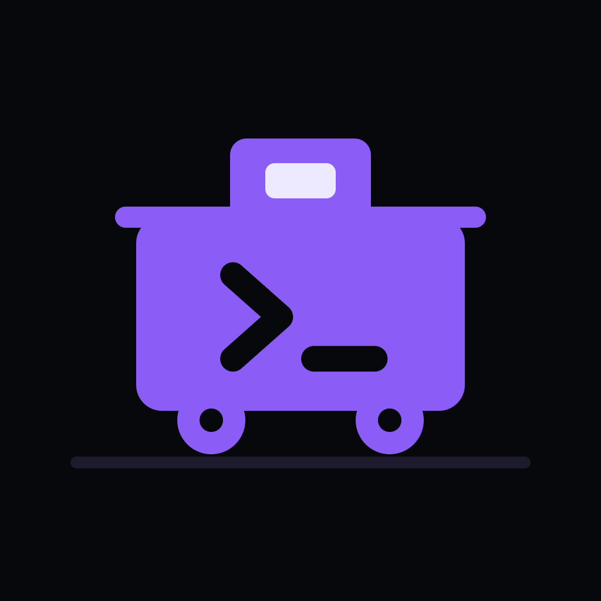

# Waycar

**A native iPhone and iPad companion app for [herdr](https://herdr.dev), tmux and herdr-core: an agent console over SSH.**

*A waycar is the crew car at the end of a train: the crew rode along for the
whole run and kept watch over every car from its cupola. Your agents do the
hauling; Waycar is where you ride along.*

[](https://github.com/waycar/waycar-app/actions/workflows/ci.yml)
[](LICENSE)
[](https://www.swift.org)
[](https://developer.apple.com/ios/)

[App Store](https://apps.apple.com/app/id6815881853) · [waycar.dev](https://waycar.dev) · [Help](https://waycar.dev/help)

</div>

---

Waycar is an **agent console**: a native dashboard of every coding agent running on your machines, sorted by who needs you. Open an Agent to read and steer its live terminal, draft with the full iOS keyboard in a native Composer, and Send the complete message once — all over plain SSH.

## Screenshots

### iPhone

| Agent Console | Agent terminal | New Agent |
| --- | --- | --- |
| 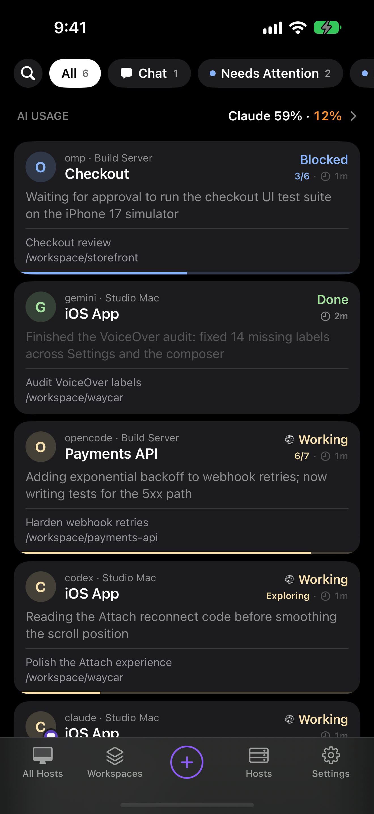 | 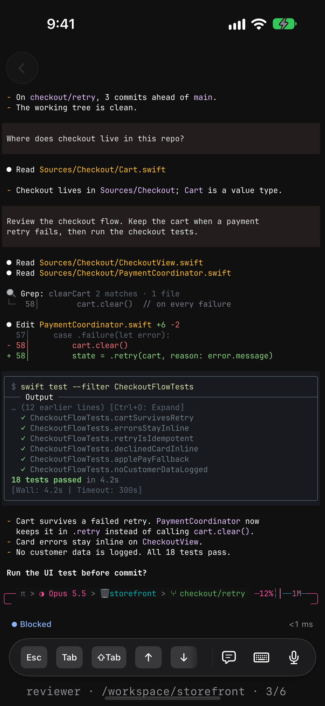 | 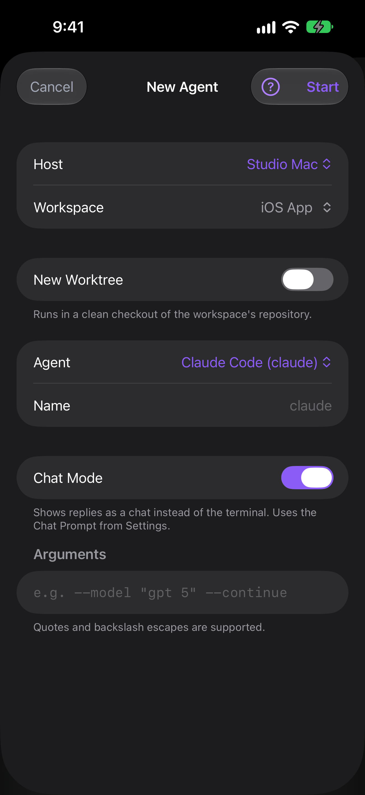 |

| Hosts | Settings | AI Usage |
| --- | --- | --- |
| 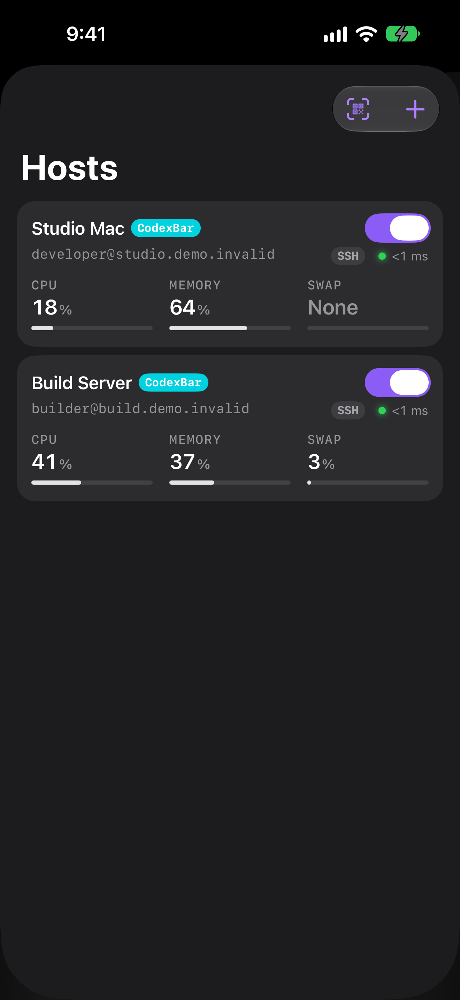 | 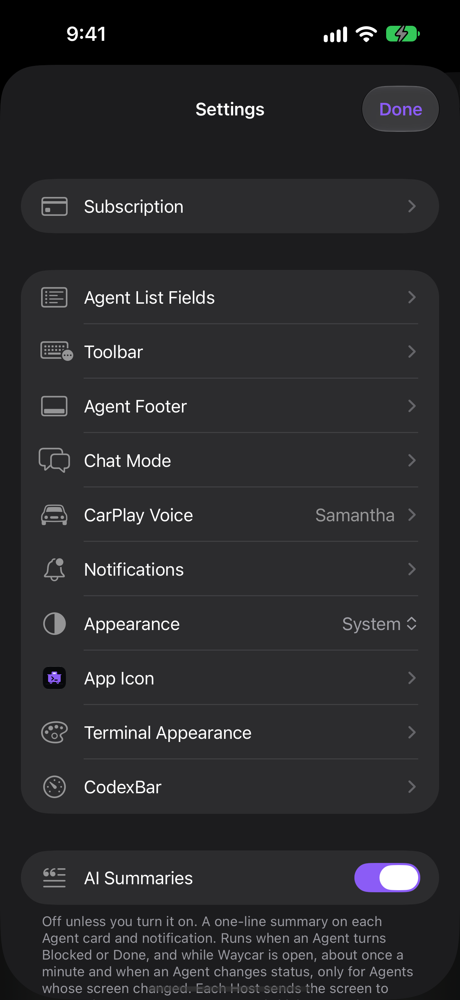 | 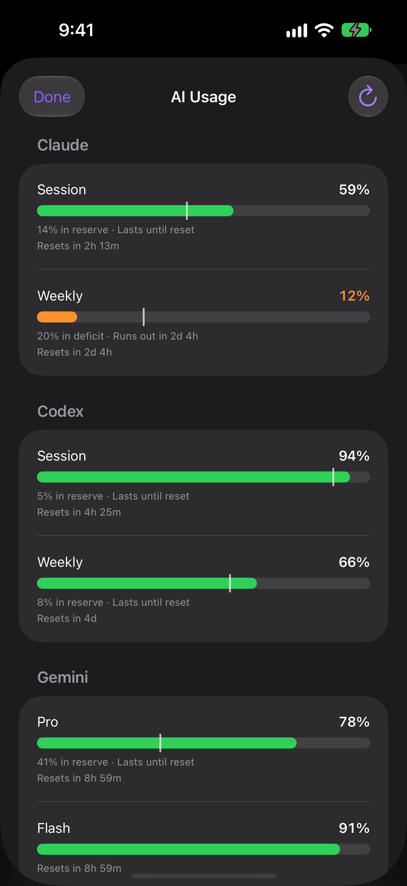 |

| Chat Mode | Dictate to Agent |
| --- | --- |
| 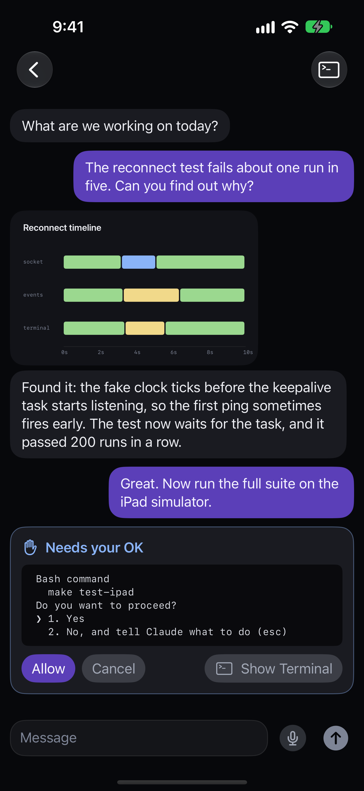 | 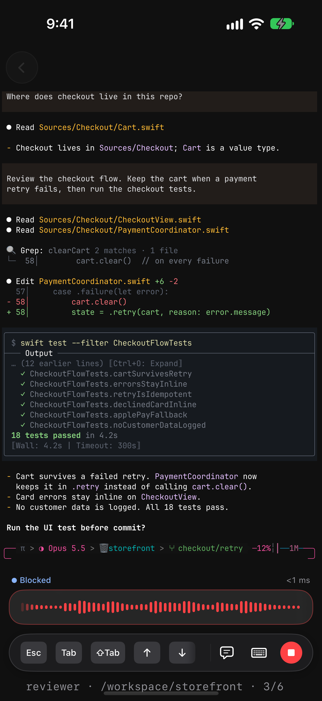 |

### iPad

| Agent Console | Agent terminal |
| --- | --- |
| 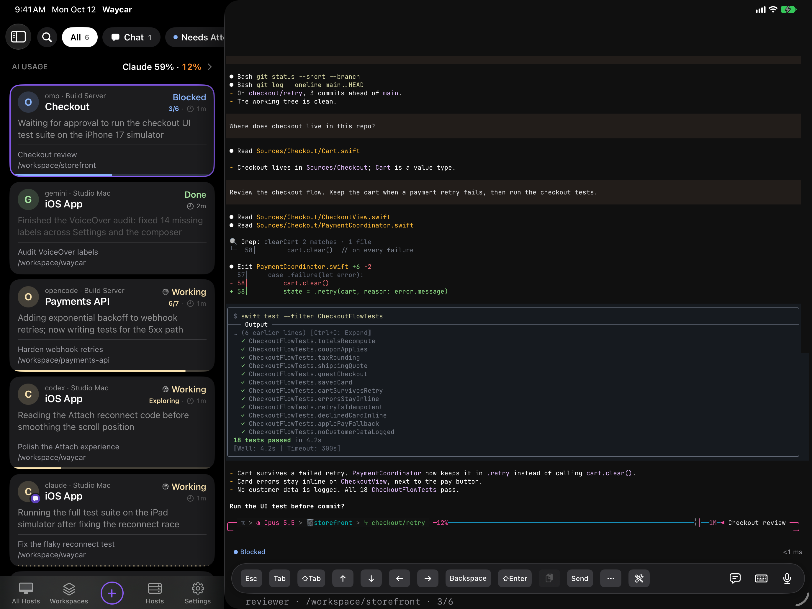 | 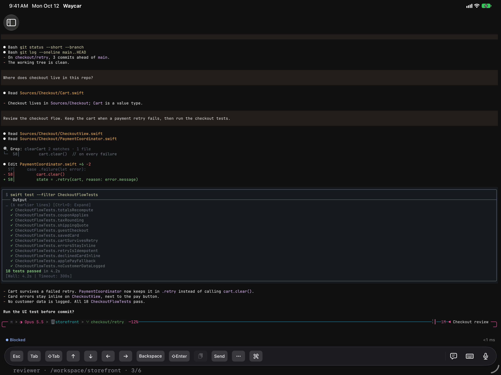 |

| New Agent | Hosts |
| --- | --- |
| 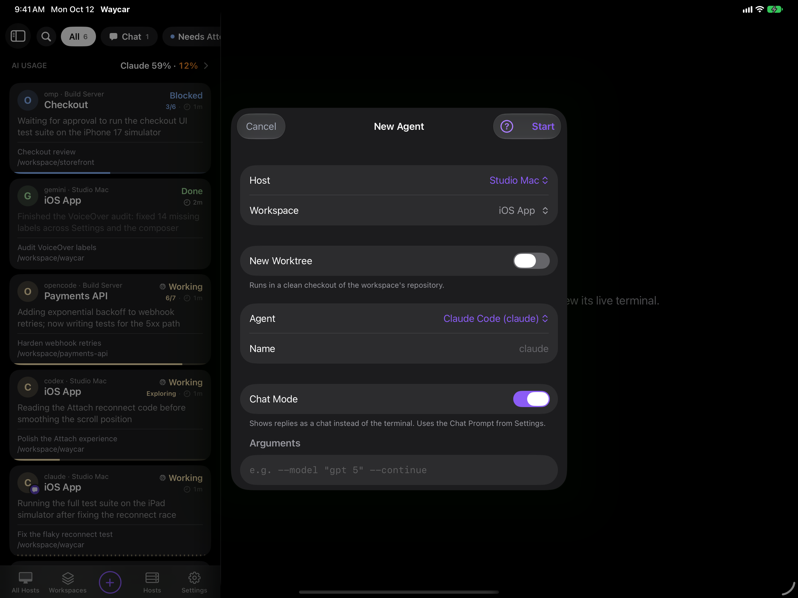 | 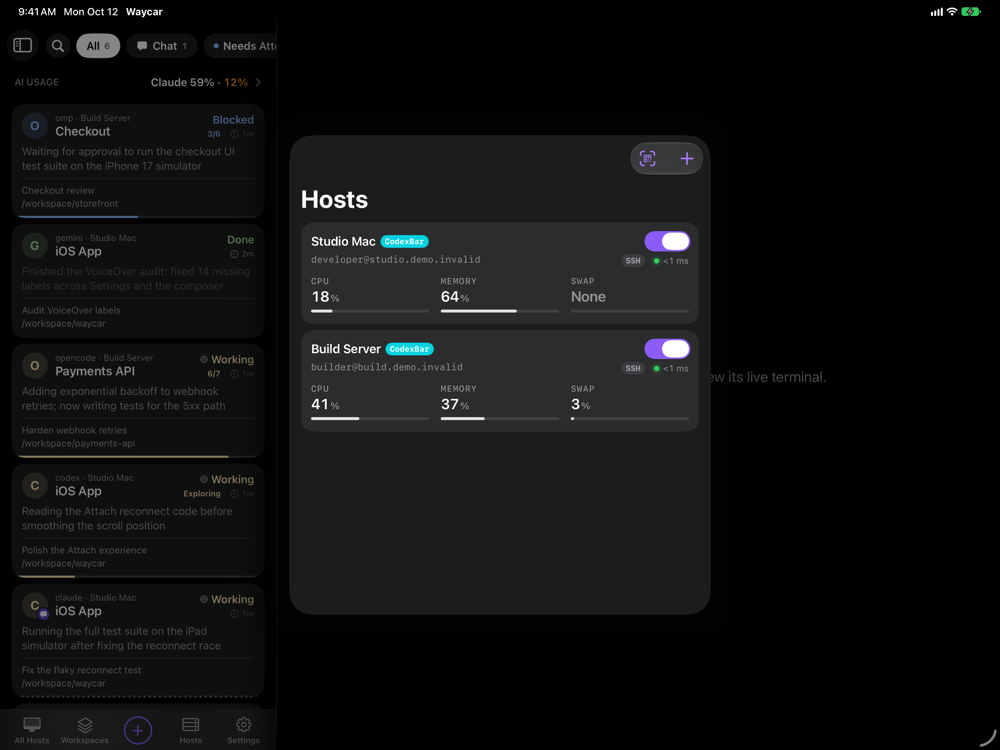 |

Screenshots are generated with `make screenshots` from the app's simulator demo fixture.

## Features

- **Console** — every Agent on every machine in one status-sorted list
  (Blocked first), filterable by Host, updated live.
- **Attach** — the Agent's real terminal rendered by libghostty: native
  scrollback, momentum touch scrolling that also drives full-screen TUIs,
  long-press selection, takeover of a stale terminal owner, and quietly
  collected web links to open later.
- **Composer** — draft locally with the full iOS keyboard (autocorrect, IME,
  dictation) or tap the microphone to dictate with the on-device speech model
  (iOS 26+), then Send once; the tools keyboard adds Agent control keys,
  Agent Skills, reusable Snippets, and terminal appearance.
- **Chat Mode** — an Agent's replies as chat bubbles read from its own
  transcript, with approvals as cards.
- **Terminal** — open a plain shell in the Agent's directory, with Text and
  Keys modes and one reused tab per Workspace.
- **Images and files** — pick up to 10 photos or files (up to 64 MiB each); they
  upload to the Host over SFTP and Send appends their Host paths after your text.
- **QR pairing** — scan a Pairing Code to add a machine; keys are generated
  on device, private keys never leave the Keychain, and the code pins the
  host key fingerprint.
- **iCloud Sync** — Hosts, passwords, SSH keys, trusted fingerprints, and
  preferences follow you to your other devices through end-to-end encrypted
  iCloud Keychain.
- **Notifications + Live Activities** — end-to-end encrypted pushes when an
  Agent goes Blocked or Done, and a Lock Screen / Dynamic Island banner
  tracking Agents in real time; the relay can never read the content
  ([PRIVACY.md](PRIVACY.md)).
- **Apple Watch** — glance at your Agents, read what one last said, approve
  safe Blocked commands, and send a voice message transcribed on your iPhone.
- **Worktrees** — start an Agent on a clean checkout of the workspace's repo.
- **Jump Host and mosh** — reach unroutable machines through an SSH jump, and
  keep terminals alive across network changes with mosh.

## How it connects

Waycar speaks herdr's JSON API over SSH: each request opens a
direct-streamlocal channel onto `herdr.sock`, one long-lived channel carries
the event stream, and interactive terminals run `herdr agent attach` on an
SSH PTY. The only prerequisites are SSH access and a running herdr. The SSH
server must allow stream-local forwarding (the OpenSSH default).

Waycar also works with tmux 3.2 or later (control mode on an SSH exec
channel) and with herdr-core 0.1.10 or later (`herdr-core connect`). There is
no Waycar server: your phone talks to your machines directly. Unroutable
machines can sit behind an SSH Jump Host:
[step by step](docs/guides/vps-jump-host-setup.md) and
[architecture and security boundaries](docs/guides/vps-jump-host.md).

## Adding a machine

On the machine running herdr, herdr-core or tmux (herdr >= 0.7.5,
herdr-core >= 0.1.10, tmux >= 3.2, no Node needed, an OpenSSH server on;
macOS: **System Settings > General > Sharing > Remote Login**):

```bash
curl -fsSL https://waycar.dev/install.sh | sh
```

Answer yes when it offers the Pairing Code QR and scan it: the code carries
the addresses, the host key fingerprint, and SSH key enrollment. The same
[plugin](plugin/README.md) delivers the encrypted notifications once you
enable them for the Host in the app.

## Are you an agent?

Asked to put Waycar on someone's own iPhone from their own Mac? Follow
[docs/agents/build-to-your-iphone.md](docs/agents/build-to-your-iphone.md):
exact steps for Xcode and its tools, pairing the phone, signing with their own
Apple Account (a free one works) and the one command that builds and installs
it, plus what doesn't work in such a build and how to fix the usual errors.
People can follow it too.

## Build from source

You need a Mac with Xcode 27 (iOS 27 SDK; the app deploys to iOS 18 and
later) and [XcodeGen](https://github.com/yonaskolb/XcodeGen)
(`brew install xcodegen`).

```bash
make generate   # regenerate Waycar.xcodeproj from project.yml
make sim        # build Debug and run it on the iPhone simulator
make test-app   # run the app test suite on the simulator
make help       # every target
```

The plugin builds with `cargo` in `plugin/` (`cargo test --locked`), the
relay and the site with Node 24 (`npm test` in `relay/`, `npm ci && npm test`
in `apps/web/`). To install on your own iPhone, signed with your own Apple
Account: `make install TEAM=<your Team ID>`, step by step in
[docs/agents/build-to-your-iphone.md](docs/agents/build-to-your-iphone.md).

## Repository layout

| Path | What |
| --- | --- |
| `Sources/`, `Tests/`, `project.yml`, `Waycar.xcodeproj` | the iOS, iPadOS and watchOS app and its tests (SwiftUI, Swift 6) |
| `Packages/WaycarSSH` | SSH over libssh2 and OpenSSL, with pinned, checked-in XCFrameworks |
| `Packages/GhosttyTerminal` | vendored libghostty-spm terminal rendering |
| `Packages/SwiftMosh` | vendored swift-mosh client, also published on its own as [waycar/swift-mosh](https://github.com/waycar/swift-mosh) |
| `plugin/` | the Host Tools: a static Rust binary for pairing, Status Hooks and notifications, installed by `install.sh` |
| `relay/` | the stateless Push Relay, a dependency-free Cloudflare Worker |
| `apps/web/` | the site at [waycar.dev](https://waycar.dev), including the in-app Help pages |
| `docs/adr/`, `docs/design/`, `docs/research/` | decisions, designs and the research behind them |
| `docs/agents/`, `docs/guides/` | how the agents work here (the engineering and Mac workflows, the issue tracker), the release guide and the setup guides |
| `scripts/` | build, test, codegen and release tooling; the simulator queue (`sim-slot.py`) is also published on its own as [waycar/simslot](https://github.com/waycar/simslot) |
| `scripts/harness-lab/`, `scripts/testboxes/` | a throwaway Linux Host that runs 17 agent harnesses against a fake model server, and Linux test boxes for five distributions' tmux |

`CONTEXT.md` defines the vocabulary, `AGENTS.md` is the working guide for
people and coding agents, and `docs/adr/` explains the decisions that look
strange from outside — the transport design in particular. Waycar is built
by one developer with a team of AI coding agents, and their instructions
are in the repository too: `AGENTS.md` and `docs/agents/`.

## Contributing

Issues and pull requests are welcome: see [CONTRIBUTING.md](CONTRIBUTING.md).
Please report security problems privately ([SECURITY.md](SECURITY.md)), and
follow the [Code of Conduct](CODE_OF_CONDUCT.md).

## Built on Heeler

Waycar started from [Heeler](https://github.com/ZingerLittleBee/Heeler),
ZingerLittleBee's open-source herdr client for iPhone (Apache 2.0). It forked
Heeler at commit
[`46dabe12`](https://github.com/ZingerLittleBee/Heeler/commit/46dabe124ed5c853497779164ac2036a9a187cbc)
on 2026-09-20, then went its own way. Heeler's 1,418 commits (July 18 to
September 20, 2026) and their authors live in Heeler's repository: this
repository's history starts from a single commit, so they don't show in its
git log.

At the fork Heeler already had the SwiftUI agent console for herdr, live
terminals through libghostty-spm, the Composer, QR pairing, encrypted
notifications with Live Activities, the SSH package on libssh2 and OpenSSL
(then `HeelerSSH`), a Node plugin for the Host and the Push Relay. Much of it
is still here: about a quarter of the app's Swift and a third of its tests,
77% of `Packages/WaycarSSH`, 86% of `relay/`, and three scripts
(`scripts/run-with-timeout.py`, `scripts/fixtures/weak-network-proxy.py`,
most of `scripts/generate-wire-types.py`). The Rust Host Tools in `plugin/`
are a port of Heeler's Node plugin. No Heeler commit has been merged since the
fork. Thank you to ZingerLittleBee and Heeler's contributors; see
[NOTICE](NOTICE), and [docs/heeler-derived-files.md](docs/heeler-derived-files.md)
for every file that came from Heeler.

## License

Waycar is licensed under the [Apache License 2.0](LICENSE). It is built on
[Heeler](https://github.com/ZingerLittleBee/Heeler) by ZingerLittleBee
(Apache 2.0); see [NOTICE](NOTICE) and [Built on Heeler](#built-on-heeler).
Third-party components carry their own licenses, listed in the app under
Settings › About › Acknowledgements. Waycar is not affiliated with the herdr
project. The license covers the code, not the Waycar name or logo: see
[TRADEMARKS](TRADEMARKS.md).
