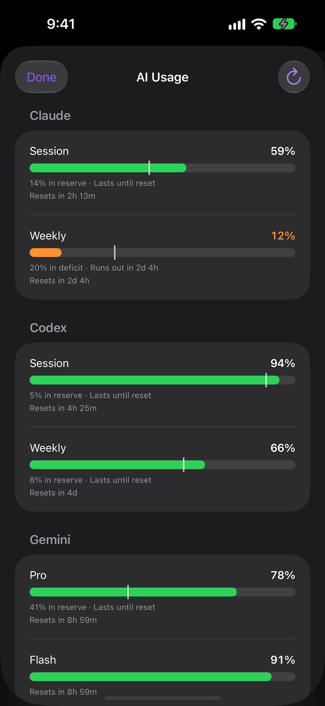

AI Usage shows how much of each AI provider's session and weekly limits you have left, so you know which account runs dry before your agent does. Waycar reads it from [CodexBar](https://github.com/steipete/CodexBar) on your Host, over SSH, and shows it in an **AI USAGE** row at the top of the Console.

## Set it up

1. Install CodexBar on your Host.
2. Connect to the Host in Waycar. It looks for CodexBar on its own, including Linux Homebrew installs.

Hosts where CodexBar was found get a **CodexBar** badge in the Hosts list. The AI USAGE row then appears atop the Console's agent list and scrolls away with it.

## Read the AI USAGE row

The row shows the provider with the least left, session first and weekly second, such as "Claude 64% · 12%". A number turns a warning color only when it runs low.

Tap the row to see every provider with its session and weekly gauges, pace, and when each resets. Tap a provider that couldn't refresh to try again, or tap **All details** for the full sheet. Pull down in the sheet to refresh.

Multiple Codex accounts appear separately in the expanded row and **All details**, each with its account label and its own limits. Account labels sit below the provider name. CodexBar versions that cannot enumerate accounts show their usual selected account.

## What is pace?

Under each gauge, CodexBar estimates whether the window lasts until it resets: "14% in reserve · Lasts until reset" when you use it slower than it runs, or "20% in deficit · Runs out in 2d 4h" when you're on track to run out first.

## Change how it's shown

Open **Settings › CodexBar**:

- **Provider**: **Most Urgent**, or a provider you choose.
- **Window**: **Session + Weekly**, **Session**, **Weekly**, or **Automatic**, plus **Show Reset Time**.
- **Show Usage As**: **Remaining** or **Used**. **Reset Times**: **Countdown** or **Clock Time**.

Under **Usage Details**:

- **Show Pace** (on by default) adds the pace line under each gauge.
- **Hide Account Labels** (off by default) hides the account name below each provider in the expanded AI USAGE row and sheet, including from VoiceOver.
- **Refresh When Opened** (off by default) asks a connected Host for fresh numbers when you expand AI Usage or open its details, unless it answered in the last 30 seconds.

When **Window** is anything but **Session + Weekly**, the row marks its number S (session) or W (weekly). A provider you chose that's missing from the latest report falls back to **Most Urgent**. Colors always reflect what is left, even when you show usage as **Used**. These options stay on each device.

## Choose which Hosts it reads from

Open a Host's page from the Hosts sheet. In the **AI Usage** section:

- **Show AI usage** turns it on or off for that Host.
- **Refresh** sets how often it checks: 1, 2, 5, or 15 minutes.
- **CodexBar Path** points at CodexBar when auto-detection misses it. Leave it blank to auto-detect.

AI Usage is on for one Host by default. Another Host where CodexBar is found starts with it off, since each extra Host asks the same AI accounts again and can cause rate-limit errors. Each Console window reads from the Host it's scoped to, or else the first connected Host with AI Usage on.

## Troubleshooting

- **"CodexBar not found"** on the Host's page: install CodexBar on the Host, or fill in **CodexBar Path**, then tap **Check Again**.
- **"Claude can't be read over SSH"**: over SSH, CodexBar can't open your Mac's keychain. Tap **Fix it for me…**, then **Open Agent**. Waycar opens the New Agent sheet, titled **Fix AI Usage**, for that Host with the fix instructions attached. The Host is locked; you can change the agent, its name and the folder. Only agents that can read the instructions are offered, without **Default Shell** or **Chat Mode**. Tap **Start**, and the agent explains the change and asks before touching your Mac. It sets up a small `codexbar serve` helper, and a Terminal window opens on the Mac to load it. After that, AI Usage reads the helper first.
- **"Claude timed out"** on a Mac with that helper: the helper stops waiting for Claude too soon. Tap **Fix it for me…**, then **Open Agent**, and start the agent the same way. It updates the helper to wait longer, and a Terminal window opens on the Mac to reload it.
- **The row reads "No data"** while its Host reconnects, and stays in place.
- **Usage refreshes less often after errors.** Waycar backs off to 15 minutes while reads fail.
