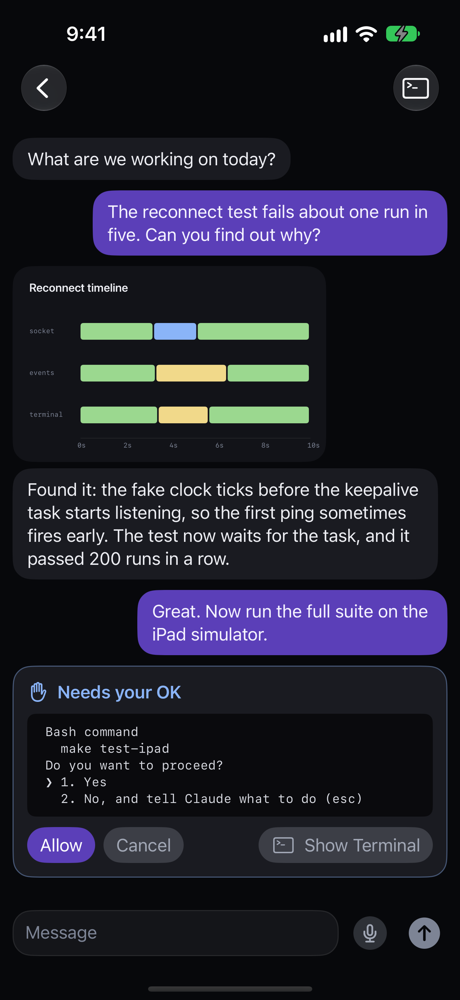

Chat Mode opens an agent as a simple chat instead of a terminal. You see your messages, the agent's final reply to each one, and a status line that says what it is doing. It works with Claude Code, Codex, omp, pi, opencode, GitHub Copilot CLI, Qwen Code, Gemini CLI, Grok Build, Antigravity, Hermes Agent, Kilo Code, Cline and Muse. See what each one supports in [Supported agents](/help/supported-agents#what-works-with-each-agent).

On a herdr-core Host, Chat Mode works for an agent that reports through the Host Tools hooks and has a Chat Marker. The push with the final reply isn't there yet. See [Waycar with herdr-core](/help/herdr-core).



## Start a chat

1. Run the install command on the Host first, so it has the latest Waycar plugin:
   ```sh
   curl -fsSL https://waycar.dev/install.sh | sh
   ```
2. Open [New Agent](/help/new-agent), pick one of the agents above, and turn on **Chat Mode**.
3. Tap **Start**. A greeting opens the chat, and you type your first message. Waycar writes the greeting on your device; it is never sent to the agent.

To start a chat from the Home Screen in one step, see [New Chat from the Home Screen](/help/new-chat).

### opencode and Kilo Code need the install command

opencode and Kilo Code get the Chat Prompt only through a small Waycar extension that the install command adds when the agent is already installed. So install the agent first, then run the Waycar install command. If you installed it after Waycar, or ran the install command with `--no-hooks`, run the install command again without it. Otherwise replies don't follow the Chat Prompt.

### Antigravity on herdr

Waycar finds an Antigravity chat through the session herdr's integration reports. On herdr, run this on the Host once:

```sh
herdr integration install antigravity-cli
```

### Cline chats have no Chat Prompt

Cline can only replace its own system prompt, not add to it, so Cline chats start without the Chat Prompt and replies may run longer.

## Talk to the agent

Type in the **Message** field and tap **Send**. With a hardware keyboard, Return sends and Shift+Return starts a new line. On iPhone without one, Return starts a new line. The microphone lets you [dictate](/help/dictation) instead.

When the agent needs your OK, a **Needs your OK** card shows the prompt from the agent's screen. It reads "Reading the prompt…" while Waycar reads the screen, and **Allow** and **Cancel** stay off until it has. If it shows "Couldn't read the prompt", tap **Retry**. **Allow** sends Return to the agent and **Cancel** sends Esc. For anything else, tap **Show Terminal** to see the agent's real terminal.

With no connection to the Host, **Allow** and **Cancel** wait instead of failing: the card reads "Allow queued. Sends when the Host is back." Waycar sends it once the Host is back, only if the agent still shows the same prompt; otherwise nothing is sent and you get a notification. Tap **Withdraw** to drop it. A queued answer is kept for 10 minutes and is lost if Waycar quits.

If a turn ends without any final text, the reply reads **No reply**.

## Images, videos and files

Images the agent opens during a turn show above its reply, and so do images and videos the reply names, whether a file on the Host or an https link. Tap one to view it full screen. A file the agent attaches opens as text unless it is an image, a PDF, or a video or audio file. Grok Build and Hermes Agent chats show text only.

Videos, files the agent attaches, and anything from an https link don't load until you tap them ("Tap to load from …"). Loading web media shows your phone's IP address to that site.

The chat has no attach control. To send a photo or file, tap **Show Terminal**, add it in the [Composer](/help/send-files) there, and come back. The Composer's tray is shared with the chat.

## Replies in your notifications

When the agent finishes, the notification and the in-app banner show its reply itself, or the error when a turn fails without one. For now this works on herdr Hosts, not tmux.

## Chat Mode settings

In **Settings › Chat Mode**:

- **Chat Prompt**: the prompt Chat Mode agents get at launch so their replies read like texts. Edit it, or tap **Reset to Default**. It can be up to 8,000 characters. Line breaks are sent as spaces. Running chats keep the prompt they started with.
- **Model**: the model each agent starts with. Leave it blank for the agent's own default. A model in New Agent's **Arguments** wins. opencode and Kilo Code models are written `provider/model`. omp starts with no model when it doesn't know the one set here.
- **Quick thinking**: on by default. It asks for less reasoning so replies come back faster. Turn it off for harder questions. It doesn't apply to opencode, Kilo Code, Gemini CLI or Qwen Code.
- **New Chat**: the Host, Workspace and Agent for [New Chat](/help/new-chat).

## herdr and tmux

Chat Mode works on both. On tmux, **Allow** and **Cancel**, and Antigravity chats, need the Waycar hooks the install command adds. Replies in notifications are herdr only for now.

## Good to know

- A chat badge marks Chat Mode agents and closed chats in the Console, and the **Chat** filter lists only them.
- A chat started on one device opens as a chat on your others.
- If herdr restarts, the chat stays a chat, but the agent comes back without the Chat Prompt, so replies may run longer until you start it again in Chat Mode.

Something not working? See [Chat Mode won't start or send](/help/chat-mode-troubleshooting).
