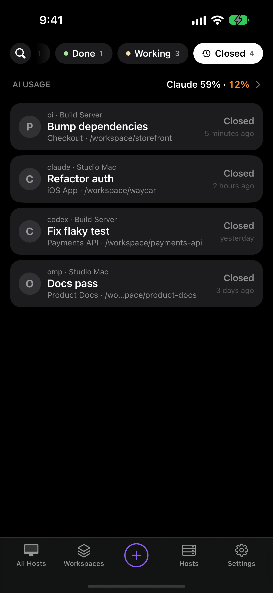

When an agent exits back to its shell, or its pane or tab closes, the Console keeps it as a Closed Session for 30 days. Tap one to pick it back up in a new tab, in the same session when the agent saved its place.

A Codex server thread also becomes a Closed Session when nobody has it open and it unloads, about a minute after going idle. Resume reopens its chat and, on a Host with a terminal runtime, its terminal too. See [Waycar with Codex](/help/codex).

An OpenCode 2 session you archive shows here too, with the other sessions its server keeps archived. Resume unarchives it and reopens its chat, and its terminal on a Host with a terminal runtime. See [Waycar with OpenCode](/help/opencode).

## Find a closed agent

Tap the **Closed** chip after the Status pills. The list shows only Closed Sessions, newest first, under the Host and Workspace you picked in the bottom bar. Tap **Closed** again to go back to **All**.

Closed Sessions stay out of every other pill, but search always finds them. They show after the live agents.

## Resume a session

1. Tap **Closed**.
2. Tap the session, or touch and hold it and tap **Resume**.

Waycar opens a new tab in the agent's Workspace and runs the agent's own resume for that exact session. If the Workspace is gone, it makes a new Workspace at the agent's folder. You land in the terminal.

- Claude Code, Codex, omp, pi, opencode and most other agents pick up the same chat.
- If the agent didn't report its session, Waycar falls back to the agent's own choice: Claude Code, Codex, omp, pi and Devin CLI open their resume picker; GitHub Copilot CLI, Qwen Code, Grok Build, Hermes Agent, Kilo Code, Antigravity, Gemini CLI, Kiro CLI and Muse reopen their latest session. Others, including opencode, Cline and Cursor Agent, start fresh.
- On herdr, most agents report their session only when herdr's integration for them is installed (`herdr integration install <agent>`). Claude Code, pi, GitHub Copilot CLI, Qwen Code and Grok Build don't need it when Waycar started them, because Waycar gives each one a session id of its own. Gemini CLI, Cline and Kiro CLI have no integration, and Codex and Muse report no session to herdr. See [Supported agents](/help/supported-agents#what-works-with-each-agent).

The Host has to be connected. A session whose Host isn't connected is dimmed.

## Opened the wrong one?

Back out without typing anything while the resumed agent is idle. It quietly closes again and goes back on the Closed list.

## Forget a session

Swipe the session and tap **Forget**, or touch and hold it and tap **Forget**. With iCloud Sync on, it's forgotten on all your devices.

## What counts as closed?

- An agent that exits back to its shell, or whose pane or tab closes.
- A session running again, resumed on any of your devices or restored by herdr, stays out of the Closed list until it closes again.
- Plain shells are never kept.

## herdr, tmux and herdr-core

Closed Sessions work on all three. On tmux, Resume picks up the exact session when the Waycar hooks are on. On herdr, it does when herdr's integration for the agent reports its session, or when Waycar started Claude Code, pi, GitHub Copilot CLI, Qwen Code or Grok Build. On herdr-core, Resume starts a new terminal of the same agent in the same folder, and the agent picks what to resume.

## Good to know

- Closed Sessions sync through [iCloud Sync](/help/icloud-sync), so an agent that ends shows up as closed on your iPhone and iPad.
- If a resume fails, Waycar keeps the row and shows **Could Not Resume Session** with the reason.
