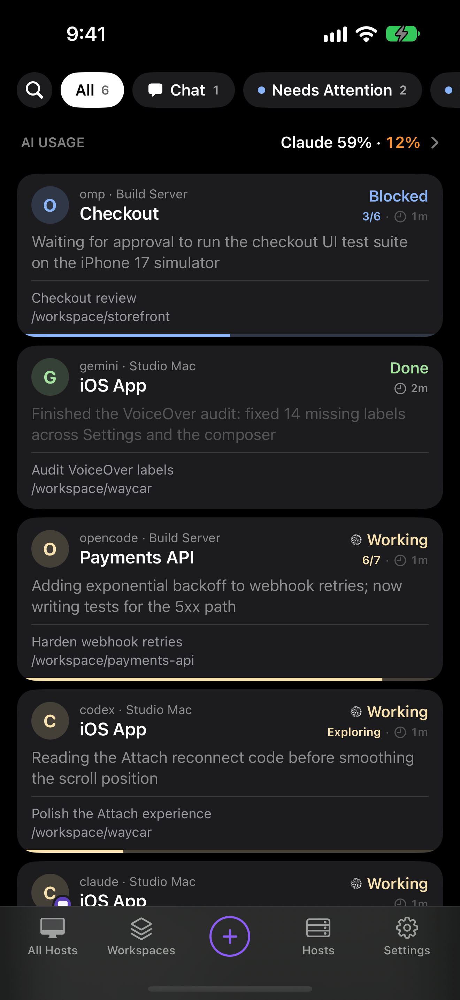

The Console is Waycar's main screen. It shows every agent and plain shell on all your Hosts as a list of cards, sorted so that agents waiting on you sit at the top. Tap a card to open that agent's live terminal.

## What's on the screen?

From top to bottom:

- **Search and Status pills.** Search finds agents by folder or title. The pills (**All**, **Chat**, **Needs Attention**, **Blocked**, **Done**, **Working**) and the **Closed** chip narrow the list. See [Filter, search, and pin](/help/filter-search-pin).
- **AI Usage row.** When a Host has CodexBar, an **AI USAGE** row sits on top of the list and scrolls away with it. See [AI Usage with CodexBar](/help/ai-usage).
- **Agent cards.** Each card shows the agent's kind, its status badge, and up to three rows of fields you can change per Host. See [Agent card fields](/help/agent-card-fields).
- **Bottom bar.** A Host menu, a Workspace menu, the **New Agent** button, **Hosts**, and **Settings**.

## In what order are agents listed?

Agents from every Host and Workspace are grouped by status: Blocked, Done, Working, Idle, then the rest (Unknown and plain shells). Pinned agents always come first. Inside each status group, agents are ordered by Host, newest change first. See [Agent status](/help/agent-status).

## Narrow the list to one Host or Workspace

1. Tap the Host menu in the bottom bar and pick a Host, or **All Hosts**.
2. Tap the Workspace menu and pick a Workspace, or **All Workspaces**.

The menus change which agents you see, never their order.

## What can I do with a card?

- Tap it to open the agent's terminal.
- Swipe it to close the agent's tab, with a few seconds to undo.
- Touch and hold it for **Select**, **Pin**, **Mark as Unread**, **Move to Workspace…**, **Rename Tab…**, and **Close**. See [Rename, close, and mark agents](/help/manage-agents).

## What are the messages above my agents?

When a Host is connecting, reconnecting, waiting for you to trust its host key, or can't connect, the Console shows a row for it above the agent cards. Tap a row with › to open that Host's page and fix it. See [What connection messages mean](/help/connection-messages).

## Why is the list empty?

| You see | Why | What to tap |
| --- | --- | --- |
| **No Agents Need Attention**, **No Chat Mode Agents**, **No Closed Sessions**, or **No Blocked Agents** (or Done, Working) | The Status pill you picked matches nothing. | **Show All** |
| **No Agents on** your Host | The Host menu is set to a Host with no agents. | **Show All Hosts** |
| **No Agents** "Agents detected on your Hosts appear here." | Your Hosts are connected but run no agents or shells. | Start one with **New Agent**. |
| **No Agents** "Your Hosts are disabled. Turn one on in Hosts." | Every Host is turned off. | **Hosts** |
| **No Results** | Your search matches nothing. | **Clear Search** |

## Open Settings

- Tap **Settings** in the bottom bar.
- Before you add a Host, tap the gear beside **Add Your First Host**.
- With a keyboard, press ⌘, or choose **Settings…** from the menu.

Tap **Done** to close it. See [Settings at a glance](/help/settings).

## Good to know

- Opening Waycar shows the agents each Host had last time at once. The live list replaces them as soon as the Host answers.
- On iPad the Console becomes a sidebar next to the open agent's terminal. See [Waycar on iPad](/help/ipad).
- With no Host yet, the Console shows the setup steps instead of a list. See [Install Waycar on your Host](/help/install).
