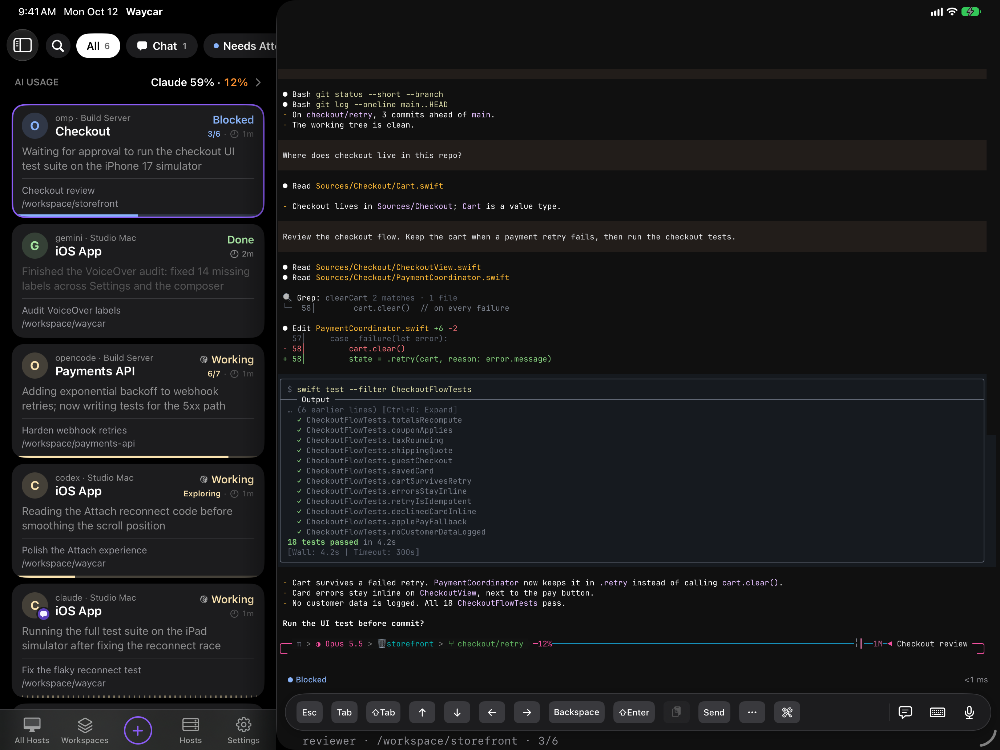

Waycar runs on iPad as well as iPhone. The Console puts your agent list in a sidebar beside the open agent's terminal, so you can watch one agent and keep an eye on the rest.

## The sidebar

In landscape, the agent list sits beside the terminal. In portrait, the list starts hidden, pushes the agent partly off screen when you show it, and closes when you open an agent. Tap the sidebar button in the top-left corner to hide or show it, or press **⌘⌃S**. The open agent is marked by its card's ring. With no agent open, tap **Show Agents**.

You can also swipe:

- **Open the list**: drag right from the left edge of the agent's terminal. The agent slides aside under your finger.
- **Close the list**: swipe in from the screen's right edge, or drag the agent left.
- **In portrait**: tap the part of the agent still showing beside the list to close it.

### Narrow windows

In a narrow Stage Manager window, the sidebar goes away and the Console shows one screen at a time, like on iPhone: the agent list, then the agent you open. Widen the window to get the sidebar back. See [Multiple windows and Stage Manager](/help/multiple-windows).

Hosts, Settings, New Agent, Skills, Snippets and similar screens open as form sheets over the Console.

## Use a hardware keyboard

While an agent's terminal has the keyboard:

- Arrow keys go to the terminal instead of moving through the agent list.
- Return and ⌘Return submit.
- Shift+Return inserts a new line.

Leave the terminal and the arrow keys move through the list again. For every shortcut, see [Keyboard shortcuts](/help/keyboard-shortcuts).

## Drag text and images into the Composer

Drag text or images from another app into the [Composer](/help/composer). **Send** stays disabled, with a "Waiting for image…" hint, until dropped images finish.

## Trackpad and mouse

Two-finger trackpad and mouse-wheel scrolling scroll the agent's terminal. Clicking a link with a trackpad or mouse opens it, like a tap.

## Good to know

- Your iPhone and iPad each keep their own Toolbar layout and Custom Keys.
- Open more than one Waycar window with Stage Manager. See [Multiple windows and Stage Manager](/help/multiple-windows).
- Hosts sync to your iPad through [iCloud Sync](/help/icloud-sync).
