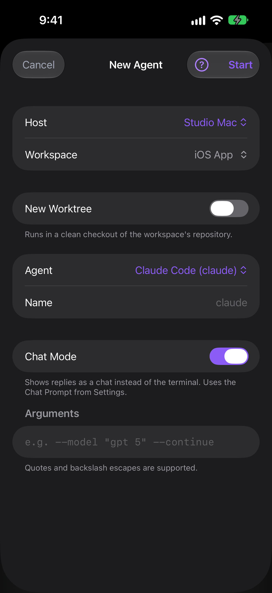

The New Agent sheet starts a coding agent, or a plain shell, on one of your Hosts. Pick the Host, where it should run, and which agent, then tap **Start**. Waycar opens the new agent's terminal as soon as it is running.

On a herdr-core Host the sheet asks for the agent and a folder only: no Workspace name, worktree, **Default Shell** or **Chat Mode**. See [Waycar with herdr-core](/help/herdr-core).

For the **Codex** runtime, pick a folder, name and first message. Its **Chat Mode** toggle uses the Chat Prompt, Codex model and Quick thinking from Settings; the thread always opens as a chat. You can start a stopped server here too. See [Waycar with Codex](/help/codex).

For the **OpenCode** runtime (OpenCode 2), pick a folder, name and first message. Its **Chat Mode** toggle uses the Chat Prompt and OpenCode model from Settings; the session always opens as a chat. You can start a stopped server here too. See [Waycar with OpenCode](/help/opencode).

## Open the New Agent sheet

- In the Console, tap the round **+** button in the bottom bar.
- On iPad with a keyboard, press ⌘N.
- From an agent you have open, choose **New Agent** in its More menu. The new agent starts in a new tab next to the one you opened it from, in the same folder.
- From a help page, tap **Ask an Agent**. The sheet opens titled **Ask an Agent**, with the page attached as **Help:** and its title. You can change the Host, Workspace, **New Worktree**, agent and name. Every installed agent is offered, without **Default Shell** or **Chat Mode**, and the launch isn't remembered. Nothing starts until you tap **Start**; the agent reads the page, then asks what you want to do. An agent that can't take a first message when it starts, such as GitHub Copilot CLI, gets the page as a queued message in its Composer, sent as soon as it's ready for input.

## Start an agent

1. Pick a **Host**. Waycar looks for the agent tools installed on it and shows "Detecting installed Agents…" while it checks.
2. Pick a **Workspace**: an existing one, or **New Workspace** to start a fresh Workspace in a folder on the Host. See [Start in a new folder](#start-in-a-new-folder).
3. Pick the **Agent**. Leave **Name** empty to use the default name. As you type a Name, Waycar turns spaces and symbols into `-` and makes it lowercase. A Default Shell's name is left as you type it.
4. Type a **First Message** if you like. Tap **Add Image or File**, or paste an image into the message, to send images and files with it. Waycar sends it once the agent is ready for input.
5. Add **Arguments** if the agent needs any. Quotes and backslash escapes are supported.
6. Tap **Start**.

To give the agent its own git checkout instead, turn on **New Worktree**. See [Start on a new worktree](/help/worktrees). To open it as a chat instead of a terminal, turn on **Chat Mode**. See [Chat Mode](/help/chat-mode).

The sheet remembers the Host and the Agent you picked last, the last Workspace you used on each Host, and whether **Chat Mode** was on. A sheet opened from **Ask an Agent** or AI Usage's **Fix it for me…** doesn't change these.

## Start in a new folder

1. In **Workspace**, choose **New Workspace**.
2. The folder is your home folder until you change it. Tap **Change Directory…** to open **Browse Directories**.
3. Tap folders to go down, or the parent-folder button to go up. Type in **Filter folders** to narrow a long list.
4. Tap **Select** to use the folder you're in.
5. Type a **Name** for the Workspace, or leave it empty to use the folder's name.

On a Host with both herdr and tmux, a **Start In** switch picks herdr or tmux for this Workspace. It starts at the Host's default and isn't remembered. On tmux, the new Workspace is a new tmux session.

If a folder has no subfolders, the browser says **No Subfolders** and you can still select it. If the list can't load, you see **Couldn't Load Folders**; tap **Try Again**.

## Name rules

Agent names are 1 to 32 characters: lowercase letters, digits, `-` or `_`, starting with a lowercase letter. When a name doesn't fit, the rule shows under the field. A name copied from a worktree **Branch** also drops leading characters that aren't letters, so `97-fix-login` becomes `fix-login`. For **Default Shell**, **Name** is the shell's tab label and any text is accepted.

On herdr, Waycar adds a suffix if another agent or tab on the Host already uses the name.

## Start a plain shell

Choose **Default Shell** in the Agent picker. It opens a new tab running the Host's default shell, with no AI agent. The tab lives inside herdr or tmux, so it isn't a raw SSH login shell, and it needs herdr or tmux 3.2 or later on the Host. See [Install tmux or herdr on your Host](/help/install-tmux-or-herdr). In an existing Workspace it opens where that Workspace's focused pane is. Default Shell and New Terminal panes carry `WAYCAR_SHELL=1` in their environment, so a shell startup file that launches an agent on its own can skip that step.

## Start while the Host is offline

When the Host isn't connected, a line under the sheet's title says the agent starts when the Host connects. The Agent picker offers the agents Waycar found the last time it reached the Host, and says when that was. Choosing a folder needs a connection, so **New Workspace** starts in your home folder.

Tap **Start** and the sheet closes. Nothing is sent yet: the launch is kept on your device, and its card at the top of the Console reads **Waiting**. Tap the card to open it and queue more messages, including images and files, in the Composer. The next time Waycar is open and the Host connects, the agent starts on its own. Your messages go out in order once it's ready, first message first. To drop the launch, swipe the card or touch and hold it, then tap **Delete**.

If Waycar closes or loses the answer while the agent is starting, the launch stays **Waiting**. When the Host reconnects, Waycar checks whether that start made an agent and uses it, or starts it if needed. No duplicate agent, nothing to confirm. Your queued messages stay with the launch and follow once it's ready.

Other failures still say why on the card: tap **Retry** or **Delete**.

## Watch the launch

After you tap **Start**, a status line under the sheet's title shows what the launch is doing, such as "Creating the workspace" or "Opening the agent". A slow step shows how many seconds it has taken. If the launch fails, the reason shows there. Tap **Start** to try again.

If you send a message while the agent is still starting, Waycar types it into the agent's terminal without pressing Enter. Check it, then press Enter from the [Toolbar](/help/toolbar) to send it. A message with more than one line, or an agent waiting on a question such as Claude Code's folder-trust prompt, makes the send fail instead: answer the question in the terminal and send again.

## Good to know

- If no agent is found on the Host, the sheet preselects **Default Shell** and notes that no agent CLI was found, so **Start** opens a plain terminal. Install a supported agent tool on the Host and tap **Detect Again** to use one instead. A sheet opened from **Ask an Agent** or **Fix it for me…** offers no **Default Shell**, so it shows **No Agents Found** until an agent is installed.
- See [Supported agents](/help/supported-agents) for the list Waycar can start.
