# Waycar on Apple Watch (V0)

All screens at a glance: 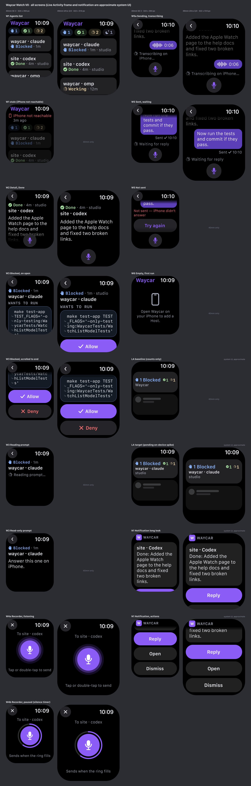

Status: Accepted; building in #193
Date: 2026-10-12

Revision 2026-10-13 (#202, Mike's first device test): the watch never truncates text. No ellipsis, no line limits, no "More": every title, status line, notice, bubble, and the Latest text wraps in full and the Digital Crown scrolls. W2 Latest is the Agent's whole last reply whenever the phone can read its transcript. The PNG mockups predate this rule and still show capped titles, dropped status segments, and a short Latest; where they differ, this text wins.

Scope: Mike's story: *glance at my Agents from the wrist, read what one just said without sound, and talk back to it.* The watch app works like Waycar in CarPlay: the same list, sort, and status words, fed by the same sources CarPlay reads. It shows that text silently and never speaks. A paired iPhone is required. The watch never opens SSH; every read and action goes through the iPhone app over WatchConnectivity. The iPhone's existing per-Host Live Activity (ADR 0014) gets a custom `.small` view for the watch. `[INFERENCE]` marks anything not checked against a primary source, the repo, or a device; `[UNVERIFIED]` marks platform claims with no Apple source.

Supersedes the earlier draft `docs/design/apple-watch.md` (branch `apple-watch`, commit `fdeb2dd1`). Where the two differ, Mike picks which one wins:

| Topic | Earlier draft | V0 |
|---|---|---|
| Live Activity | Existing mirror, zero new code | Counts-only baseline now; custom `.small` only after spike 2 (§9) |
| Dictation | Default: accept Apple's engine + PRIVACY.md note | Waycar recorder: audio goes to the iPhone, transcribed on-device by `SpeechAnalyzer`. Apple's engine only in the pre-iOS 26 fallback |
| Far from the iPhone | Read-only forever | Same; actions disabled while unreachable |
| Allow / Deny from a notification | Yes, with the guard | No: the notification text is the Agent Summary, not the lossless command |
| Command text on the watch | Shown | Shown |
| Read-back after dictation | Yes | No: sends right after stop, no live text; the words appear only as the sent bubble (accepted risk, §6.4) |

Sources: [HIG](https://developer.apple.com/design/human-interface-guidelines/) pages cited inline; repo docs `docs/design/carplay.md`, `docs/design/live-activity-glance.md`, ADR 0003, 0008, 0014, 0025, 0027, 0028; `DESIGN.md`; `CONTEXT.md`.

## 1. Scope

In V0:
- W1 Agents list, W2/W3 Agent detail (Done, Blocked), W4 Waycar voice recorder, W5a transcribing, W5 sent state, W6 empty state.
- Smart Stack / watch face Live Activity `.small` view (LA).
- Done and Blocked Agent Notifications on the watch with Reply / Open / Review actions (N1).
- Allow / Deny on Blocked prompts with CarPlay's rules and guard.

Not in V0:
- Standalone SSH from the watch. No Host connection, no keys on the watch.
- Terminal view, Direct Input, Attach, Composer (one path touches the draft: text sent to a Blocked Agent is kept as a Composer draft on the iPhone, §6).
- Launch, New Agent, Attach existing session, Host setup, Pairing.
- Complications, Snippets, file staging.
- Shells, Closed Sessions, and Disabled Hosts (excluded from the list, as in CarPlay).
- Speaking anything aloud.

## 2. Platform facts that shape the design

| Fact | Consequence | Source |
|---|---|---|
| watchOS 27 supports SE 3, Series 9 to 12, Ultra 2 to 4 | Smallest = SE 3 40mm 162×197 pt; largest = Ultra 3/4 49mm 211×257 pt | [apple.com/os/watchos](https://www.apple.com/os/watchos/), [HIG Layout archive](https://web.archive.org/web/2025120100000id_/https://developer.apple.com/tutorials/data/design/human-interface-guidelines/layout.json), [SE 3 specs](https://www.apple.com/apple-watch-se-3/specs/), [Ultra 4 specs](https://support.apple.com/en-us/148758) |
| Default Dynamic Type: Large on 40/41/42mm, xLarge on 44/45/49mm; min text 12 pt; system font SF Compact | Two type columns in the spec book. 46mm default not stated; treated as xLarge `[INFERENCE]` | [HIG Typography](https://developer.apple.com/design/human-interface-guidelines/typography) |
| Hit targets at least 44×44 pt | Rows 52/58, buttons 44/48, system back button | [HIG Buttons](https://developer.apple.com/design/human-interface-guidelines/buttons) |
| Prefer full-width buttons for primary actions; at most two text buttons in a row | Allow / Deny stacked full width | [HIG Layout](https://developer.apple.com/design/human-interface-guidelines/layout) |
| Toolbars sit in top corners or bottom; glass styling since watchOS 26 | Back + mic are toolbar items, not custom chrome | [HIG Toolbars](https://developer.apple.com/design/human-interface-guidelines/toolbars), [WWDC25 334](https://developer.apple.com/videos/play/wwdc2025/334/) |
| Digital Crown is the primary navigation input; apps can't respond to Crown presses | Crown scrolls; no custom Crown handling (§5.5) | [HIG Digital Crown](https://developer.apple.com/design/human-interface-guidelines/digital-crown) |
| No speech API on watchOS (`SFSpeechRecognizer`, `SpeechAnalyzer` not available) | Waycar records on the watch and transcribes on the iPhone | [SFSpeechRecognizer](https://developer.apple.com/documentation/speech/sfspeechrecognizer), [SpeechAnalyzer](https://developer.apple.com/documentation/speech/speechanalyzer) |
| `SpeechAnalyzer` (iOS 26+) transcribes a file: `start(inputAudioFile:finishAfterFile:)`, `analyzeSequence(from:)` | iPhone transcribes the received file; below iOS 26, fall back to system input | [start(inputAudioFile:)](https://developer.apple.com/documentation/speech/speechanalyzer/start(inputaudiofile:finishafterfile:)), [analyzeSequence(from:)](https://developer.apple.com/documentation/speech/speechanalyzer/analyzesequence(from:)) |
| `AVAudioRecorder` (watchOS 4) has level metering (`isMeteringEnabled`, `averagePower(forChannel:)`); `AVAudioEngine.inputNode` is on watchOS 4 | Level rings + silence detection on the watch | [AVAudioRecorder](https://developer.apple.com/documentation/avfaudio/avaudiorecorder), [averagePower](https://developer.apple.com/documentation/avfaudio/avaudiorecorder/averagepower(forchannel:)), [inputNode](https://developer.apple.com/documentation/avfaudio/avaudioengine/inputnode) |
| `.handGestureShortcut(.primaryAction)` is watchOS 11+; double tap works on Series 9+, Ultra 2+, and SE 3 (every watchOS 27 model); users can turn it off | Double tap stops and sends | [handGestureShortcut](https://developer.apple.com/documentation/swiftui/view/handgestureshortcut(_:isenabled:)), [Apple Support 108413](https://support.apple.com/en-us/108413) |
| System text input shows the live transcript; no option to hide it in `TextFieldLink` or `presentTextInputController` `[UNVERIFIED: absence, no API found]`. Keyboard on every supported model except SE 3 | System input is the pre-iOS 26 fallback only | [Enter text on Apple Watch](https://support.apple.com/guide/watch/enter-text-apdaf7837856/watchos), [TextFieldLink](https://developer.apple.com/documentation/swiftui/textfieldlink) |
| `.textInputSuggestions` is macOS 15 only | No suggestion rows | [textInputSuggestions](https://developer.apple.com/documentation/swiftui/view/textinputsuggestions(_:)) |
| System dictation may be server-processed unless the device says on-device | Fallback only; disclosed (§7.3) | [Apple Dictation privacy](https://www.apple.com/legal/privacy/data/en/ask-siri-dictation/) |
| `sendMessageData` wakes the iOS app like `sendMessage`; size limit undocumented (a `payloadTooLarge` error exists; ~65 KB folklore `[UNVERIFIED]`). `transferFile` is async, may be throttled, says nothing about waking the iOS app, and does not run in Simulator | Audio delivery path settled by spike 4 (§9) | [sendMessageData](https://developer.apple.com/documentation/watchconnectivity/wcsession/sendmessagedata(_:replyhandler:errorhandler:)), [transferFile](https://developer.apple.com/documentation/watchconnectivity/wcsession/transferfile(_:metadata:)), [payloadTooLarge](https://developer.apple.com/documentation/watchconnectivity/wcerror/code/payloadtoolarge) |
| Watch `sendMessage` wakes the iOS app in background; iOS cannot wake the watch app; reply handlers must return quickly | Watch starts every action; phone acks at once, then reports the result | [sendMessage](https://developer.apple.com/documentation/watchconnectivity/wcsession/sendmessage(_:replyhandler:errorhandler:)), [Transferring data](https://developer.apple.com/documentation/watchconnectivity/transferring-data-with-watch-connectivity) |
| `isReachable` needs iPhone in range and watch app foreground | "iPhone not reachable" state; actions disabled | [isReachable](https://developer.apple.com/documentation/watchconnectivity/wcsession/isreachable) |
| `updateApplicationContext` is latest-wins and works while unreachable; `transferUserInfo` is queued FIFO | Watch State via context; send results via user info | same |
| iOS background time after a WC wake is undocumented | Biggest build risk (§9) | [UNVERIFIED]; [DTS forum 685525](https://developer.apple.com/forums/thread/685525) |
| Live Activities appear on the watch face and at the top of the Smart Stack; the Smart Stack opens by itself only on an alerting update | F1 starts from the face | [View Live Activities](https://support.apple.com/guide/watch/view-live-activities-bz1vx4mwqbw9/watchos), [Launching your app](https://developer.apple.com/documentation/activitykit/launching-your-app-from-a-live-activity) |
| Smart Stack Live Activity: 40mm 152×69.5 pt, 49mm 191×81.5 pt. Ultra 3/4 and 42/46mm not listed | LA canvases; 49mm value assumed `[UNVERIFIED]` | [HIG Live Activities, watchOS](https://developer.apple.com/design/human-interface-guidelines/live-activities#watchOS-dimensions) |
| `.small` is the custom layout for both watch and CarPlay; CarPlay deactivates interactive elements and may scale to 240×78, 240×100, 170×78 pt; no environment value tells them apart | One `.small` view, no buttons, no Agent text | [Creating custom views](https://developer.apple.com/documentation/activitykit/creating-custom-views-for-live-activities), [ActivityFamily](https://developer.apple.com/documentation/widgetkit/activityfamily) |
| The `.small` view lives only in the iPhone widget extension; how it reaches the watch is unpublished | Rendering on iPhone `[INFERENCE, strong]`; ADR 0014 assumes raw content-state mirroring (counts only) | [WWDC24 10068](https://developer.apple.com/videos/play/wwdc2024/10068/), [ActivityFamily.small](https://developer.apple.com/documentation/widgetkit/activityfamily/small) |
| Stale signals: `context.isStale`, `isActivityUpdateReduced` (iOS 18) | LA stale variant | [isStale](https://developer.apple.com/documentation/widgetkit/activityviewcontext/isstale), [isActivityUpdateReduced](https://developer.apple.com/documentation/swiftui/environmentvalues/isactivityupdatereduced) |
| ActivityKit is iOS only; the watch cannot start a Live Activity | Activity lifecycle stays on iPhone (ADR 0014) | [ActivityKit](https://developer.apple.com/documentation/activitykit) |
| Watch app opts in to LA taps via "Supports Launch for Live Activity Attribute Types"; tap delivers `NSUserActivityTypeLiveActivity`; `widgetURL` delivery to the watch app `[UNVERIFIED]` | LA tap opens W1 | [Launching your app](https://developer.apple.com/documentation/activitykit/launching-your-app-from-a-live-activity), [NSUserActivityTypeLiveActivity](https://developer.apple.com/documentation/widgetkit/nsuseractivitytypeliveactivity) |
| An unlocked iPhone gets notifications instead of the watch | Watch notifications only arrive while the phone is locked or asleep | [Apple Support 108369](https://support.apple.com/en-us/108369) |
| Long look: sash, up to four custom actions, Dismiss at bottom | N1 layout | [HIG Notifications](https://developer.apple.com/design/human-interface-guidelines/notifications) |
| Background actions run on the notification's target device (iPhone); `.foreground` actions run where tapped | Reply, Open, and Review are `.foreground`: they open the watch app | [Adding actions on watchOS](https://developer.apple.com/documentation/watchos-apps/adding-actions-to-notifications-on-watchos), [UNTextInputNotificationAction](https://developer.apple.com/documentation/usernotifications/untextinputnotificationaction) |
| No watchOS API opens the iPhone app; Handoff is passive (`.userActivity`, watchOS 7) | No "Open on iPhone" button; detail screens advertise Handoff `[INFERENCE]` | [userActivity](https://developer.apple.com/documentation/swiftui/view/useractivity(_:isactive:_:)) |
| `.privacySensitive()` available on watchOS 8 | Redact Agent text in Always On | [privacySensitive](https://developer.apple.com/documentation/swiftui/view/privacysensitive(_:)) |
| ChatGPT and Claude ship no Apple Watch app (2026-10-12) | No first-party pattern; borrow the generic chat-on-watch pattern (read, mic, answer) | [ChatGPT](https://apps.apple.com/us/app/chatgpt/id6448311069), [Claude](https://apps.apple.com/us/app/claude-by-anthropic/id6473753684) |

## 3. Spec book

Spec sheets (W3 drawn at full scroll length): 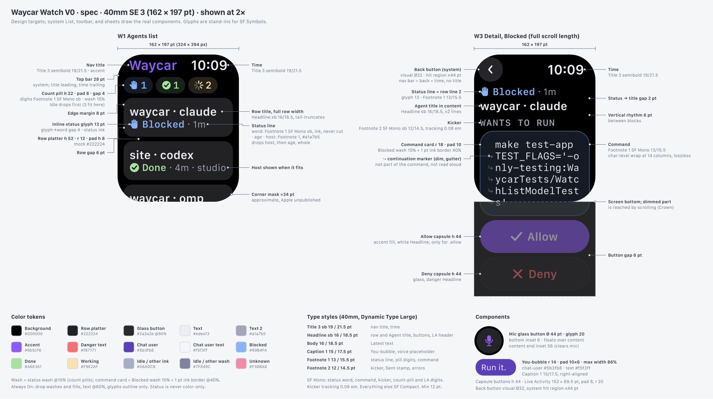 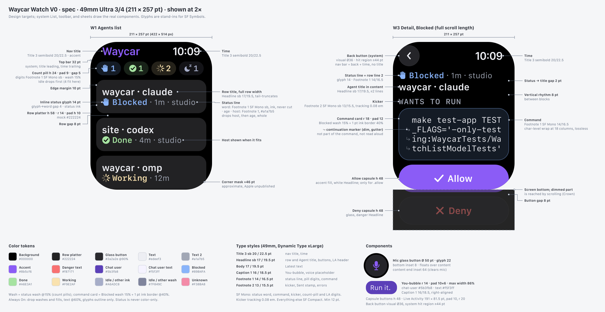

Mockup scroll states: W1, W2, W3, and N1 show the top of the scroll; `w3-detail-blocked-end-*`, `n1-notification-actions-*`, and W5 show the end. System surfaces (W4, LA, N1) carry a "system UI, approximate" caption below the screen. Images are PNGs in `apple-watch-v0/png/`; the SVG sources sit next to them in `apple-watch-v0/`. Both come from `make_mockups.py` + `mockup_kit.py` + `mockup_screens.py`: edit there and rerun `python3 docs/design/apple-watch-v0/make_mockups.py` (PNG export needs `rsvg-convert` and macOS's built-in SF fonts); never hand-edit an SVG or PNG.

Values below are design targets. System `List`, toolbar, and sheets draw the real controls.

### 3.1 Canvases

| | Small = 40mm SE 3 | Large = 49mm Ultra 3/4 |
|---|---|---|
| Points | 162×197 | 211×257 |
| Pixels @2x | 324×394 | 422×514 |
| Dynamic Type default | Large | xLarge |
| Display corner mask (approx., Apple unpublished) | 34 pt | 46 pt |
| Smart Stack LA | 152×69.5 | 191×81.5 |
| In-between sizes (not mocked) | 41mm 176×215, 42mm 187×223 → Large | 44mm 184×224, 45mm 198×242, 46mm 208×248, Ultra 2 49mm 205×251 → xLarge |

### 3.2 Type (pt / leading)

| Role | Style | Small | Large |
|---|---|---|---|
| Nav title, time | Title 3 semibold | 19 / 21.5 | 20 / 22.5 |
| Row title, button label | Headline (semibold) | 16 / 18.5 | 17 / 19.5 |
| Latest text (reply or summary) | Body, wraps in full | 16 / 18.5 | 17 / 19.5 |
| You-bubble text | Caption 1 | 15 / 17.5 | 16 / 18.5 |
| Status line, count pill text, command text | Footnote 1 | 13 / 15.5 | 14 / 16.5 |
| Meta line, kicker, banner, footer | Footnote 2 | 12 / 14.5 | 13 / 15.5 |

SF Mono for the status word, command text, kicker (brand `label`, tracking 0.08 em), count-pill digits, and LA digits (brand `caption`). Everything else is SF Compact. Minimum 12 pt.

The LA is drawn by the iPhone widget extension, so it uses iOS SwiftUI styles: line 1 `.headline`, line 2 `.footnote` semibold, line 3 `.caption` medium, digits `.monospacedDigit()`. Rendered sizes on the watch are `[UNVERIFIED]`.

### 3.3 Spacing and components

| Token | Small | Large |
|---|---|---|
| Edge margin | 8 | 10 |
| System top bar height | 28 | 32 |
| Back button (system; visual Ø, hit region ≥44) | 32 | 36 |
| Row height / radius / gap | 52 / 12 / 6 | 58 / 14 / 8 |
| Row inner padding (h) | 8 | 10 |
| Inline status glyph (row line 2, detail status line) | 13 | 14 |
| Glyph to status word gap | 4 | 4 |
| Status line to title gap | 2 | 2 |
| Count pill height / h-pad / gap | 22 / 8 / 4 | 24 / 9 / 5 |
| Bottom content inset (last line clears mic) | 56 | 64 |
| Card radius (brand `card`) | 18 | 18 |
| Card inner padding | 10 | 12 |
| Capsule button height (Allow, Deny, Try again) | 44 | 48 |
| Mic glass button Ø / glyph / bottom inset | 44 / 20 / 6 | 50 / 22 / 8 |
| Recorder mic disc Ø (W4); silence ring fills over 3.5 s | 64 | 76 |
| You-bubble radius / padding / max width | 14 / 10×6 / 86% | 14 / 10×6 / 86% |
| Vertical rhythm between blocks | 6 | 8 |
| LA card radius (mock) / padding | 20 / 8 | 20 / 10 |

### 3.4 Color

The watch app is always dark on true black. This is a stated exception to DESIGN.md's "never pure black": OLED, and the watchOS system background. Status colors come from `AgentStatusPalette.swift` (Mocha), the same values the Live Activity uses.

| Hex | Token | Role |
|---|---|---|
| `#000000` | system background | Screen background |
| `#222224` | system platter (mock) | Row platter |
| `#2a2a2e` @ 90% | glass (mock) | Glass buttons |
| `#edeef3` | brand `text` | Primary text |
| `#a1a7b5` | brand `text-2` | Secondary text |
| `#8b5cf6` | brand `violet` (`accent`) | Interactive tint, nav title, Allow fill, mic glyph |
| `#f87171` | brand `danger` | Deny text, send failure |
| `#5b3fb8` | brand `chat-user` | You-bubble fill |
| `#f5f3ff` | brand `chat-user-text` | You-bubble text |
| `#89B4FA` | `AgentStatusPalette` Blocked (herdr blue) | Blocked ink and wash |
| `#A6E3A1` | `AgentStatusPalette` Done | Done ink and wash |
| `#F9E2AF` | `AgentStatusPalette` Working | Working ink and wash |
| `#F38BA8` | `AgentStatusPalette` Unknown | Unknown (unreadable) ink and wash |
| `#A6ADC8` / `#7F849C` | `AgentStatusPalette` Idle | Idle and other: ink / wash |

Wash = wash color @ 15%. Blocked command card = Blocked wash 15% fill + 1 pt border in ink @ 40%.

### 3.5 Status vocabulary and status line

Shared `AgentActivityStatusVocabulary`, reused exactly:

| Status | Symbol | Word |
|---|---|---|
| Blocked | `hand.raised.fill` | Blocked |
| Done | `checkmark.circle.fill` | Done |
| Working | `progress.indicator` | Working |
| Idle | `moon.zzz.fill` | Idle |
| Other | `circle.fill` | capitalized raw value |

Sort follows CarPlay's `carSorted` on herdr's raw status: Blocked > Done > Working > Idle, then Host, then newest state change. (The Console sorts an unread Idle Agent as Done; the watch does not.) Shells, Closed Sessions, and Disabled Hosts are excluded.

Status line (row line 2 and detail status line): inline glyph + status word (SF Mono semibold, ink) + " · progress · age · host" (secondary). When space runs out it wraps between segments onto more lines; nothing is dropped and nothing ellipsizes ("1…" is wrong). The glyph and status word never break apart. Host appears only with more than one Host.

Age = time since the iPhone observed the status change (the bridge stamps it; the Console has no timestamp today), or the Agent Summary's age. Omitted when unknown, never guessed. The status shown is always the phone's latest report; the watch never predicts one after a send or Allow.

### 3.6 Always On

When `isLuminanceReduced` is true: drop washes and fills, text at 60%, glyphs outline only. Latest text and the command card get `.privacySensitive()` so they redact while the wrist is down; titles and status stay. Live Activity Always On uses the dark scheme ([WWDC24 10068](https://developer.apple.com/videos/play/wwdc2024/10068/)).

### 3.7 Accessibility

- Status is never color-only: symbol and word always appear together.
- All text uses Dynamic Type styles and wraps in full at any size; nothing truncates, the Digital Crown scrolls.
- VoiceOver row label: `"<title>, <Status>, <progress>, <age>, <host>"`, e.g. "waycar claude, Blocked, 3 of 6 steps done, 1 minute ago, studio". The `·` separator is not read; progress is the `AgentProgress` spoken label (", out of date" once stale), never a percent, and is left out when there is no estimate.
- Detail: the status line reads as one element ("Blocked, 1 minute ago, studio"); the command card reads verbatim without the "↪" continuation marks; Allow and Deny are buttons with hints ("Sends Enter to the prompt").
- Mic button label "Message site · codex" (the Message Agent action). W4 announces "Listening" and the stop button reads "Send".

## 4. Screens

Sample data everywhere: Hosts `studio`, `linuxhost`; Agents `waycar · claude` (Blocked, 1m, studio, frozen at 3/6), `site · codex` (Done, 4m, studio), `waycar · omp` (Working, 12m, studio, 6/7), `docs · gemini` (Working, now, studio, no estimate yet: dotted bar), `relay · pi` (Working, 3m, linuxhost, Exploring), `plugin · claude` (Idle, 1h, linuxhost). In the stale scenario every estimate is out of date (dimmed fill). Time 10:09, 10:10 after a send or Allow.

### W1 Agents list (root)

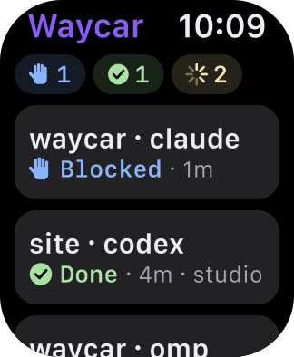 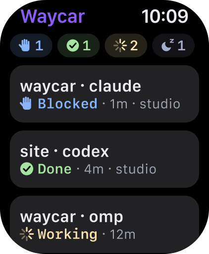

- Top bar: "Waycar" in accent (leading), time (trailing).
- Count pills row: Blocked, Done, Working, then Idle muted. Scrolls away. `ViewThatFits` drops the Idle pill first: 40mm shows 3 pills, 49mm shows 4.
- Row: no leading glyph; title (Headline, wraps in full) gets the full row width. Line 2 = status line: "✓ Done · 4m · studio"; when it doesn't fit (40mm, large text) it wraps to a second line rather than dropping the host.
- Footer: "Updated just now" (Footnote 2 secondary); it shows the age of the last Watch State ("Updated 3m ago").
- Data: rows from the surface-neutral list model shared with CarPlay (title derivation: tab label → Agent name → `workspace · Kind`, sanitized, 24-char workspace cap); symbol and word from `AgentActivityStatusVocabulary`; ink from `AgentStatusPalette`; counts per Host.
- Progress (#199): each row carries `progress: WatchProgress?` (wire version stays 1; a row without the key decodes as nil, and older watches ignore it). The phone maps `ConsoleAgent.progressDisplay(at:)`: an estimate sends plan steps `done`/`total` or the phase raw value, with `staleAfter` = progress written-at + `AgentSummary.freshness` when fresh, or `Date.distantPast` when already stale (the watch dims it from then on, no republish needed). `staleAfter` never depends on the build time, so an unchanged estimate builds an equal row and the Watch State is not resent. Pending (Working, no estimate yet, Host reports progress) sends no steps, no phase, no `staleAfter` (dotted bar); Done, Idle, Unknown, and Hosts whose plugin predates progress send nil (no bar). Blocked keeps the estimate it froze with. The watch renders it through the shared `AgentProgress` (fraction, label, spoken label); never a percent or ETA.

Stale / unreachable (Small only): 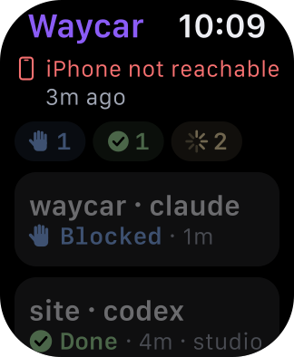

- A banner pins under the top bar, above the pills, when anything isn't fresh: "iPhone not reachable" only while the watch link is down (the age stays in the footer), "studio is still connecting", "Can't reach studio" (§6.3).
- Rows of unconfirmed Hosts dim; their actions are disabled.
- Empty → W6.

### W2 Agent detail, Done

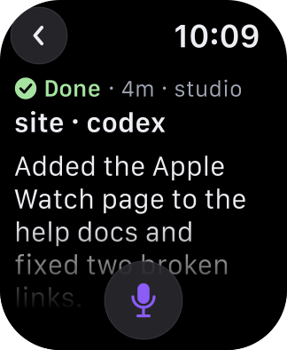 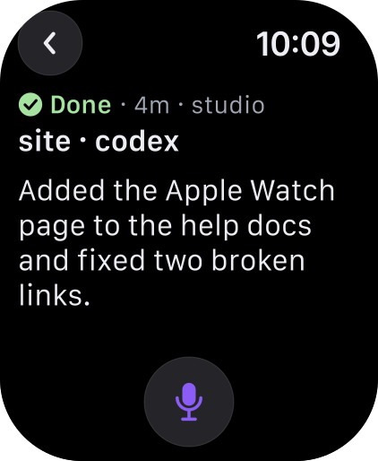

- Top bar: system back button (leading) + time (trailing). No nav title.
- Status line "✓ Done · 4m · studio" (Footnote 1), then Agent title "site · codex" (Headline, wraps in full).
- Latest text as plain Body, in full: no card, no line limit, no "More". A long reply runs below the fold and the Digital Crown scrolls it.
- Mic glass button floating bottom-center (`.bottomBar`), accent `mic.fill`, opens W4; content keeps the 56/64 pt bottom inset.
- No "Open on iPhone" button. The screen advertises Handoff with `.userActivity` for `waycar://agent/{hostID}/{paneID}` (`[UNVERIFIED]` on watch).
- Latest sources (fetched on demand, never stored on the watch, §7.3):
  - The Agent's whole last reply, whenever the phone can read its transcript through `ConsoleStore.readChatTranscript` (needs a live Host): every Chat Mode Agent, and any Agent of a kind the plugin's transcript reader understands (ADR 0025) while the Host reports its live agent session. Cleaned like other Host text (`HostText.normalizedLine` per line: newlines normalized, whole escape sequences and control, bidi and zero-width characters dropped, paragraph breaks kept).
  - Otherwise the Agent Summary in full (the plugin keeps it to about 100 characters; `AgentSummary` decoding already cuts it at 160 characters with no ellipsis, and the watch adds no cap).
  - Working with a fresh summary: the summary first (what it is doing now), then the last reply under a small "LAST REPLY" kicker.
  - A reply over the phone's 48 KB budget of JSON-encoded bytes (escaped characters count as their escape; `sendMessageData` replies have an undocumented size limit) keeps its end and opens with the plain line "Earlier text is on your iPhone." The end starts at a whole word when the cut word ends within 64 characters, otherwise at a character; no ellipsis.
  - Stale summary (over 3 min or wrong status): text dimmed plus a "Checking…" footnote line while the phone runs one `summaries refresh`.
- Working and Idle details use the same layout with the matching status line.
- A Blocked Agent reached through W2 (its status changed while open) hides the mic and shows "Review prompt", which opens W3.

### W3 Agent detail, Blocked

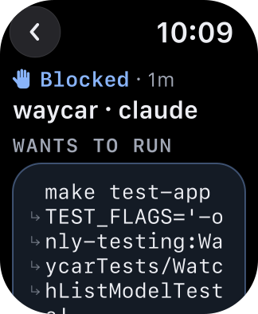 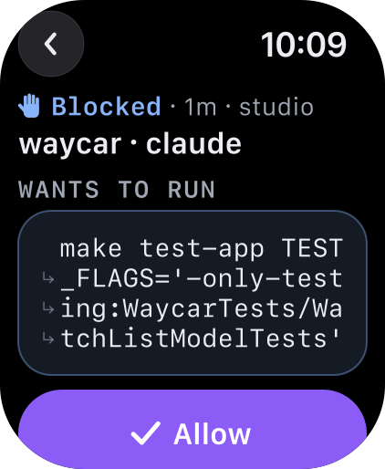

Scrolled to end: 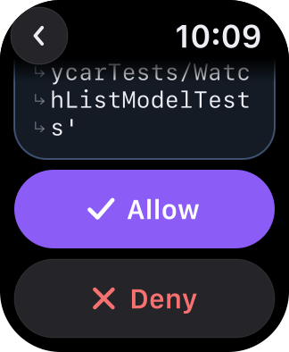 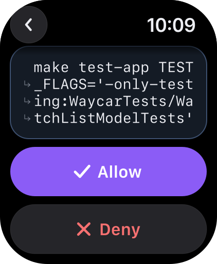

- Top bar: back + time, no nav title. Status line "✋ Blocked · 1m · studio" (wrapping to a second line where it doesn't fit), then title "waycar · claude" in full.
- Kicker "WANTS TO RUN", then command card: Blocked wash 15% + border, SF Mono Footnote 1, full text, lossless, never truncated. Wraps at character level at the column limit; continuation lines get a dim "↪" in a left gutter that is not part of the command.
- Allow (accent fill, white, `checkmark`) and Deny (glass, danger text, `xmark`), stacked full width. Allow always sits below the whole command.
- After a tap the buttons are replaced by "Allowed ✓ 10:10" or "Denied ✓ 10:10". The status line changes only when the phone reports the next state. The Allowed frame is scrolled to the end, so the status line is off-screen there.
- No mic: Waycar never types into a Blocked prompt.

Buttons follow `BlockedPromptClassifier.carApproval(for:)`, as CarPlay does (ADR 0028):

| `carApproval` | Prompt kinds | Watch shows |
|---|---|---|
| `.allow` | lossless plain-Yes permission, no risk pattern | Command + Allow + Deny |
| `.hold` | risky pattern, or not fully readable | Command (what is readable) + Deny only |
| `.readOnly` | trust, question, `[y/n]`, other | Status + title + "Answer this one on iPhone." No prompt text, nothing sent |

Reading and read-only (Small only): 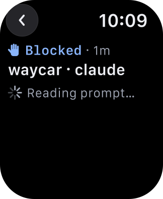 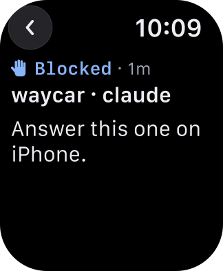

- "Reading prompt…" with no buttons while the phone wakes, connects, and reads the live screen.
- Guard rejection: "Prompt changed. Reload.", nothing sent (§6.1).
- Prompt gone (the Agent is no longer Blocked when the phone reads the screen): "No longer waiting for approval." with a Reload button, nothing sent.

### W4 Voice recorder (Waycar's own, no live text)

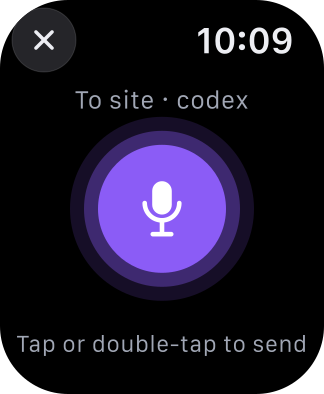 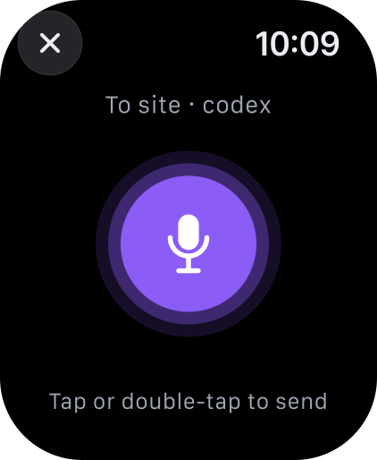

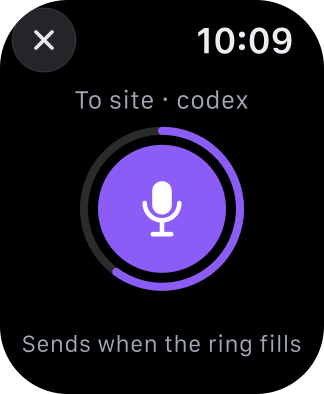 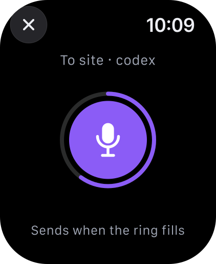

Mike finds it harder to talk while reading his own words, so the recorder shows no transcript.

- (a) Listening: ✕ glass (top-leading), time (trailing); "To site · codex" (Footnote 1, secondary); large accent mic disc centered (Ø 64 / 76) with pulsing level rings; hint "Tap or double-tap to send" (Footnote 2, secondary). No text.
- (b) Paused: same screen; a ring around the disc fills over 3.5 s of silence and resets on speech; hint "Sends when the ring fills".
- Stops on: tap the disc, double tap (`.handGestureShortcut(.primaryAction)`), or 3.5 s of silence after speech started. Stop sends immediately (§6.4).
- Cancels with nothing sent: ✕; no speech in the first 8 s; interruption (wrist down, app leaves foreground, call, Siri) with `.failure` haptic. 60 s cap stops and sends.
- Fallback when the iPhone is below iOS 26 (no `SpeechAnalyzer`): the mic opens system text input through `TextFieldLink`, which shows live text and may use Apple's servers. Stated in the app, not hidden.

### W5a Transcribing

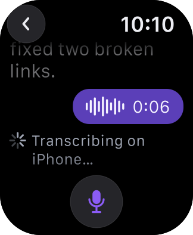 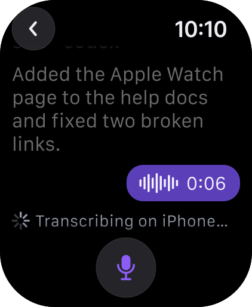

- Detail, bottom-anchored. You-bubble placeholder with a small waveform glyph and the length "0:06", no text yet.
- Under it "Transcribing on iPhone…" with a spinner. Becomes W5 when the phone returns the text and sends it.
- Empty transcript: "Couldn't make out any words. Nothing sent."

### W5 Sent / waiting

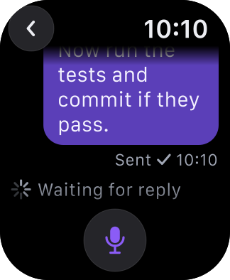 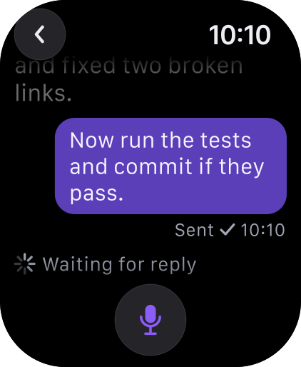

- `site · codex` after the send, auto-scrolled to the bottom, so the status line and title are off-screen. No nav title; previous Latest text dims.
- You-bubble right-aligned (`chat-user`, Caption 1) with the transcribed text, the first time the words appear. Under it "Sending…" until the delivery result, then "Sent ✓ 10:10" (§6.2).
- Pending line "Waiting for reply" (CarPlay wording). Scrolling up shows the status line from the phone's latest report (e.g. "⟳ Working · now"); it never changes on the watch's own guess.

Not sent (Small only): 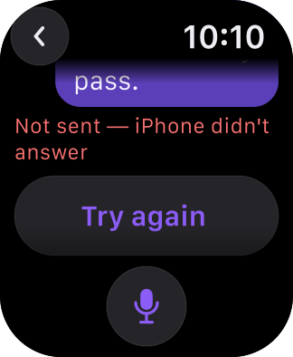

- "Not sent — iPhone didn't answer" (danger, Footnote 2) + capsule "Try again" (same message id). The mocked case is reachable and definitely not sent, so "Try again" and the mic are both enabled; both disable while unreachable.
- Unknown outcome: "Couldn't confirm it was delivered", no retry (not mocked).
- Agent Blocked at send: "Kept as draft on iPhone — answer the prompt first"; sign-in screen: "Kept as draft on iPhone — sign in on the Host first"; folder-trust dialog: "Kept as draft on iPhone — trust the folder on the Host first" (not mocked).

### W6 Empty / first run

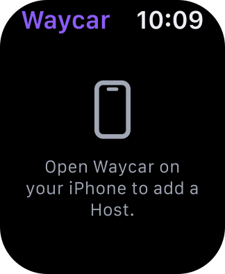

- `iphone` glyph + "Open Waycar on your iPhone to add a Host." (Footnote 1, centered). Shown when the iPhone reports no Hosts or nothing has arrived yet.

### LA Live Activity (`.small`, per Host)

Baseline, counts-only (ADR 0014's accepted floor for the watch): 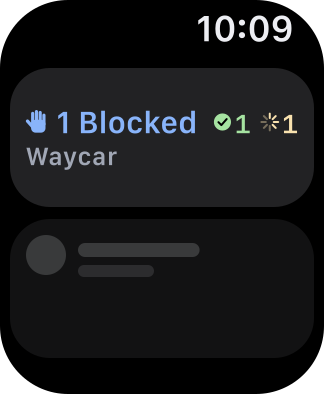

Target with rows, pending spike 2 (§9) and an ADR 0014 amendment: 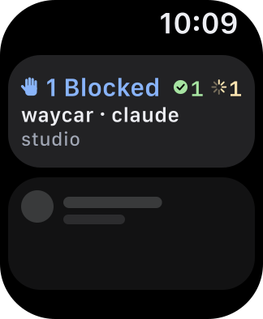 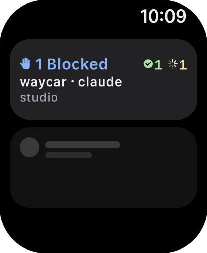

- Line 1: lead glyph + "1 Blocked" (`.headline`, ink); trailing other counts for this Host, each digit in its status ink, Idle last if room: "✓1 ⟳1" for `studio`.
- Line 2: first row whose status matches the lead, "waycar · claude" (`.footnote` semibold).
- Line 3: Host name "studio" (`.caption` medium). No age: the activity carries no timestamp.
- Counts-only baseline: header + "Waycar".
- No summary text, no buttons: the same `.small` view renders on the CarPlay Dashboard, where Waycar never shows Agent text and controls are disabled. It must hold at 152×69.5 through 240×100 pt.
- Stale (`context.isStale`, or `isActivityUpdateReduced` when the watch is out of range): counts drop to secondary ink; the system adds its own "last connected" note.
- Tap: `widgetURL(AgentActivityLink.consoleURL(hostID:))`; the watch app opens the full W1 (not Host-scoped) through `onOpenURL`, with `NSUserActivityTypeLiveActivity` as fallback.
- Data: plaintext `counts`; title and Host from the decrypted `Envelope`; ink through `AgentActivityStatusStyle` with the existing `.island` surface.

### N1 Notification long look (system, approximate)

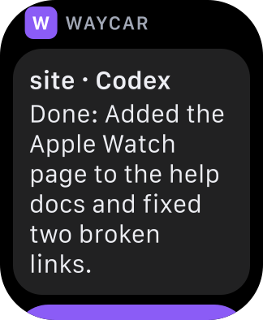 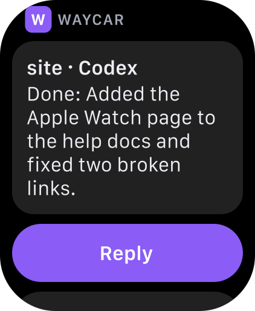

Scrolled to end: 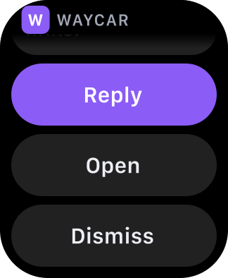 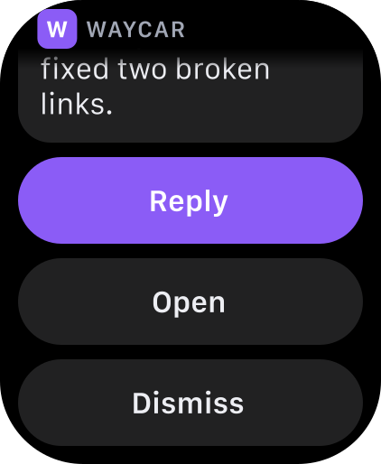

- Sash: app icon + "WAYCAR". Strings are what `AgentNotificationRenderer` already produces: Done title "site · Codex", body "Done: Added the Apple Watch page to the help docs and fixed two broken links."; Blocked title "waycar · Claude", body "Blocked: 
". No custom `WKNotificationScene` in V0.
- Done actions: "Reply" (accent, text input, background → iPhone), "Open" (`.foreground` → W2), system "Dismiss".
- Blocked actions: "Review" (`.foreground` → W3), system "Dismiss". Never Allow from a notification: the summary is not the lossless command.
- Missing Host or pane id → open W1.

## 5. Common interactions

Flow board (F1, F2, F3, F4): 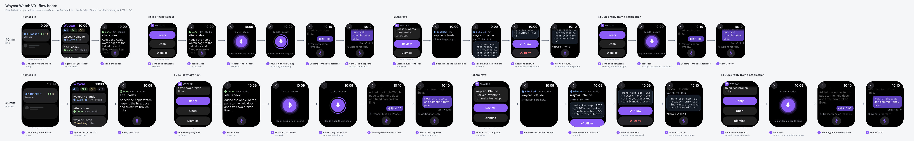

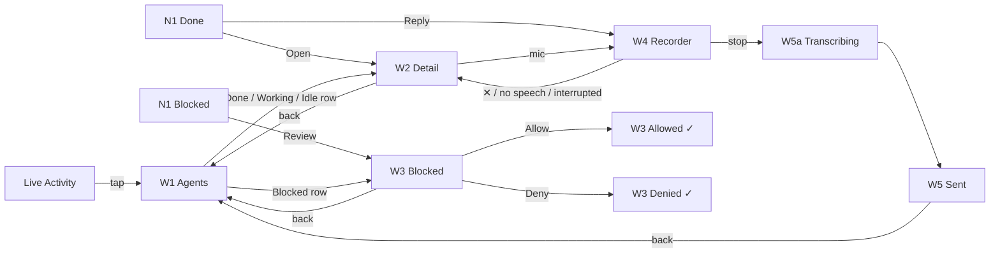

Watch notifications only arrive while the iPhone is locked or asleep ([108369](https://support.apple.com/en-us/108369)). With the phone unlocked in hand, F2 to F4 start on the phone instead.

### 5.1 F1 Check in

1. Raise wrist. Watch: the Live Activity sits at the top of the face (or turn the Crown to the Smart Stack card): "✋ 1 Blocked  ✓1 ⟳1". iPhone: nothing new; the card shows what was last rendered.
2. Tap it. Watch: W1 from the last Watch State, footer shows age. iPhone: woken by a `refresh` message, reconnects as needed, publishes fresh Watch State.
3. Tap `site · codex`. Watch: W2 asks for Latest. iPhone: returns the last reply in full, or the summary; runs one `summaries refresh` if stale.
4. Back (swipe or back button). Watch: W1.

### 5.2 F2 Tell it what's next

1. Done haptic (phone locked). Watch: N1 short look, long look on wrist hold. iPhone: received the Done push (ADR 0008).
2. Tap Open. Watch: W2 for `site · codex` via the plaintext ids in `userInfo`.
3. Read Latest, tap mic. Watch: W4a listening, `.start` haptic. Speak "Now run the tests and commit if they pass."
4. Pause. Watch: W4b ring fills over 3.5 s (or tap / double tap), `.stop` haptic, then W5a "Transcribing on iPhone…". iPhone: wakes, acks the audio with the message id, transcribes with `SpeechAnalyzer`, deletes the audio, runs `TerminalTextSafety`, sends through the action service inside a background task.
5. Watch: W5 bubble with the text, "Sending…" then "Sent ✓ 10:10", `.success` haptic, "Waiting for reply". iPhone: delivery result by `transferUserInfo`.
6. Later, Done haptic again; F2 repeats.

### 5.3 F3 Approve

1. Blocked haptic. Watch: N1 with "Review". iPhone: Blocked push.
2. Tap Review. Watch: W3 "Reading prompt…". iPhone: classifier reads the live screen, keeps the full prompt text under a prompt id, returns command + `carApproval` + id.
3. Crown to the end of the command, tap Allow. Watch: buttons disabled. iPhone: re-reads the screen, compares it to the kept prompt text, sends Enter only on an exact match.
4. Watch: `.success` haptic, "Allowed ✓ 10:10"; status line updates when the phone reports Working. On mismatch: "Prompt changed. Reload.", nothing sent.

### 5.4 F4 Quick reply from a notification

1. Done long look, scroll to the actions, tap Reply (`.foreground`). Watch: the Waycar app opens W4a for `site · codex`.
2. Speak, then stop (pause, tap, or double tap). Watch: W5a, then W5. iPhone: same path as F2 steps 4 and 5.
3. Voice replies show their state on the watch (W5, §6.2); if the watch app closes first, the outcome waits for it there.
4. Below iOS 26 on the iPhone, Reply is a typed `UNTextInputNotificationAction` that runs on the iPhone and requires authentication. It sends only to an Agent named in the decrypted notification. When the text isn't sent, the iPhone posts a local notification (with the phone locked it lands on the watch):
   - Not sent, Host not confirmed, phone locked, or no bridge: the text becomes the Agent's Composer draft; "Not sent to site · codex" / "Kept as a draft on your iPhone."
   - Agent Blocked at send (already kept as the draft): the same notification, no second draft.
   - Unknown outcome, including a send still running past the deadline: no draft, so it is never sent twice; "site · codex" / "Couldn't confirm it was delivered."
   - No Console row for the Agent (no draft possible), no Agent the decrypted notification names, or no text left after cleanup: "Reply not sent" / "Open Waycar and send it again."

### 5.5 Digital Crown

- The Crown scrolls W1, W2, W3, and the N1 long look. It is how you reach Allow below a long command.
- No custom Crown handling. No vertical paging between Agent details in V0: back to W1 for the next Agent.

## 6. Behavior and safety rules

- Voice replies follow §6.4. Below iOS 26 on the iPhone, the system input screen shows the transcript and Done sends it; no extra confirm.
- One in-flight message per Agent. Never auto-retried; "Try again" is an explicit tap.
- Prompting a Working Agent is allowed (the Agent TUI queues it).
- Never type into a Blocked prompt: no mic on W3; text sent to an Agent that is Blocked at send goes to the iPhone Composer draft (existing `keepAsDraft`).
- Lossless check: a permission command containing invisible or format characters (Unicode format category, such as zero-width and bidi controls) is not lossless, so it gets Deny only, on the watch and in CarPlay.
- Haptics: Blocked/Done arriving while the app is open → `.notification`; recording starts → `.start`; recording stops → `.stop`; Allow and Sent → `.success`; failure or discard → `.failure`.
- Read silently. No audio output.

### 6.1 Blocked prompts (CarPlay parity, ADR 0028)

- Allow only when `carApproval(for:) == .allow`. `.hold` → Deny only. `.readOnly` → nothing sent.
- Guard: the phone keeps the full prompt text it sent to the watch, keyed by prompt id. Before Enter or Esc it re-reads the screen through `BlockedPromptAnswerer` and requires exact equality with that kept text. Mismatch → "Prompt changed. Reload.", nothing sent. Prompt gone → "No longer waiting for approval." with Reload.
- Never Allow from a notification.

### 6.2 Message protocol

- Every watch message carries a message id. The phone dedupes by id.
- Phase 1: the `sendMessage` reply handler returns "received" immediately, before any SSH work. The watch waits at most 20 s for it (`WatchRequester.deadline`): WatchConnectivity may call neither the reply nor the error handler of a message the phone never answers (#206). No "received" by then means not acknowledged ("iPhone didn't answer"; Try again is safe), and the queued recording is cancelled. A late ack may mean the phone did send it; a retry is still safe because the phone dedupes by message id while it stays running, and the later outcome replaces the not-sent state.
- Phase 2: the result (sent, not sent, unknown, kept as draft) arrives keyed by id through `transferUserInfo`, so it survives the watch app going to background.
- "Try again" only after a not-sent (`RequestNotSentError`) or a missing phase-1 ack (not acknowledged; Try again is safe), reusing the same id. An unknown outcome never offers a retry.
- Voice messages: phase 1 acks receipt of the audio. Phase 2 reports empty transcript, sent, not sent, unknown, or kept as draft; the transcribed text rides along so W5 can show it.
- "Try again" for voice: if the audio never reached the phone, the watch still holds it and resends it; if the text was transcribed but definitely not sent, the phone keeps that text in memory under the message id and resends it. Either copy is deleted once the outcome is final. A recording waits up to 5 minutes on the phone for its voice message; a voice message arriving after its recording expired is reported not sent at once, and Try again transfers the recording again.
- Every watch request (refresh, Latest, Blocked prompt, answer, message) has one 20 s deadline budget, and each runs on its own: one the phone never answers ends as "Waycar on iPhone didn't answer — open it" and never holds up another. The budget is spent only while the request is on the link with the watch app active and the iPhone reachable; a resend gets only what is left, and a request is sent at most twice. "iPhone not reachable" comes at once only while the app is active and the iPhone has stayed unreachable for the whole 300 ms debounce window, never before activation has reported reachability. A link error saying unreachable while WatchConnectivity still says reachable is not kept: when the window ends, live reachability decides, and the app becoming active reads it afresh. The phone answers its slowest reads within about 14 s (6 s Host wait plus 8 s read), leaving room for a cold launch and the wake. A timed-out or failed Allow or Deny marks the prompt spent: the watch reads it again (under a fresh prompt id) before offering the buttons, and a different answer under an id already answered gets "prompt changed", never the first answer's result.
- Requests across wrist-down: when the watch app leaves the foreground or reachability drops, a request in flight pauses: its deadline stops, and a reply arriving meanwhile still counts (an Allow that went through reads as sent). If the link is back within 300 ms (the few-millisecond flaps around activation), it carries on with the rest of its deadline and nothing is sent again. Otherwise it is lost along with its reply and shows no failure; once the app is active and the iPhone has stayed reachable for 300 ms it is sent once more: refresh, Latest and Blocked prompt are asked again, a text or voice message still waiting for its "received" is resent under the same message id, and an answer under the same prompt id, so the phone dedupes it (an answer gets the first answer's real outcome, or "prompt changed"); the recording is kept until acknowledged.
- The phone answers every request exactly once. When its background time runs out first, each request still waiting is answered "Waycar on iPhone ran out of time — open it" before the app is let go; a reply after the app freezes would never arrive.
- Both apps log the link to `os_log` (subsystem `com.otreva.waycar` on the phone, `com.otreva.waycar.watchkitapp` on the watch, category `watch`): session activation and reachability, each request and reply by type, id and elapsed time, holds and background time, transcript reads, and recordings. Never Agent text.

### 6.3 Staleness and per-Host state

- The phone reports each Host as confirmed, connecting, or unreachable, plus when it last confirmed.
- W1 banner when anything isn't fresh; rows of unconfirmed Hosts dim and their actions are disabled.
- Rows survive a Host reconnecting. For an enabled Host that is not confirmed (connecting, awaiting its snapshot, or suspended with the Console), the phone keeps the rows it last published, with their last-known statuses, and reports the Host connecting. A cold-launched phone starts from the Watch State the system kept from its last publish, and the watch keeps its own rows for a Host a state does not confirm and lists nothing for, so a Blocked row never buzzes again. Rows go only when a confirmed snapshot no longer lists them, or the Host is removed or disabled. While the Console is suspended in the background the phone publishes nothing; a watch request then gets the state with every Host connecting and its rows kept.
- All actions are disabled while the iPhone is unreachable.

Error and state copy:

| Copy | When |
|---|---|
| "iPhone not reachable" | Watch link down; the footer shows the age of the last Watch State |
| "Waycar on iPhone didn't answer — open it" | Reachable but no reply within 20 s (app force-quit, suspended or wedged) |
| "Waycar on iPhone ran out of time — open it" | The phone's background time ran out before it finished the request |
| "studio is still connecting" | Host connecting |
| "Can't reach studio" | Host unreachable |
| "Reading prompt…" | W3 waiting for the phone's screen read |
| "Answer this one on iPhone." | W3 `.readOnly` |
| "Prompt changed. Reload." | Guard mismatch |
| "No longer waiting for approval." + Reload | W3, the prompt is gone |
| "Review prompt" | W2 for a Blocked Agent, in place of the mic |
| "Sending…" / "Sent ✓ 10:10" / "Waiting for reply" | W5 phases |
| "Not sent — iPhone didn't answer" | Definite not-sent |
| "Couldn't confirm it was delivered" | Unknown outcome |
| "Kept as draft on iPhone — answer the prompt first" | Agent Blocked at send |
| "Kept as draft on iPhone — sign in on the Host first" | Send refused by the harness's sign-in screen |
| "Kept as draft on iPhone — trust the folder on the Host first" | Send refused by the harness's folder-trust dialog |
| "Allowed ✓ 10:10" / "Denied ✓ 10:10" | After the phone confirms |
| "Checking…" | Stale summary refreshing |
| "LAST REPLY" | W2 kicker over a Working Agent's last reply, under its summary |
| "Earlier text is on your iPhone." | First line of a reply over the 48 KB budget |
| "Not sent to site · codex" / "Kept as a draft on your iPhone." (iPhone local notification) | Typed notification Reply (below iOS 26) not sent or Agent Blocked; text kept as the Composer draft |
| "site · codex" / "Couldn't confirm it was delivered." (iPhone local notification) | Typed notification Reply outcome unknown; no draft |
| "Reply not sent" / "Open Waycar and send it again." (iPhone local notification) | Typed notification Reply not sent and no draft kept: no Console row, no Agent the decrypted notification names, or no text after cleanup |
| Watch update notice | iPhone and watch app versions don't match |
| "Transcribing on iPhone…" | W5a |
| "Couldn't make out any words. Nothing sent." | Empty transcript |

### 6.4 Voice recorder (Mike's call, Revision 4)

- No live text while speaking. Stop sends immediately, like CarPlay; no review step.
- Accepted risk: a misheard word reaches the Agent. The only mitigation is that the sent text shows in W5.
- Stop: tap, double tap, or 3.5 s of silence after speech started. 60 s cap stops and sends.
- Nothing sent: ✕, no speech in the first 8 s, interruption (wrist down, app leaves foreground, call, Siri), or an empty transcript.
- Audio files are deleted on both devices right after transcription, never stored. Voice never goes to Apple's servers, except in the pre-iOS 26 system-input fallback.

## 7. Architecture sketch (for a later build)

### 7.1 Changes

| Area | Change |
|---|---|
| Target | New watchOS app target `WaycarWatch` in `project.yml`, embedded in `Waycar`; regenerate the project. No watch target exists today |
| Shared core | `Sources/WaycarWatchCore/`: Codable `WatchState` (per-Host state, counts, rows: title, status, age), `WatchMessage` (id + `refresh`, `readLatest`, `readPrompt`, `sendVoice(agentID, audio)`, `send(agentID, text)` for the fallback, `allow/deny(agentID, promptID)`), `WatchResult`. Compiled into both targets via `project.yml` sources, the way `WaycarWidgets` shares `AgentStatusPalette.swift` and `WaycarActivityCore` |
| Phone bridge | `WatchBridge` (`WCSessionDelegate`) owned by `WaycarAppModel`: observes `ConsoleStore`, stamps status-change times, publishes `WatchState` with `updateApplicationContext`; handles messages per §6.2 |
| Action service | Extract a surface-neutral action service from `AgentVoiceService` (`send(_:to:)`, `allow`, `deny`, `keepAsDraft`), owned by the app model. Optional reply suffix (today `send` always appends the CarPlay suffix); a "shown in full" check replaces the "spoken in full" check (`spokenQuestions`). CarPlay and watch both call it. Today the only instance lives in `CarPlayTemplateCoordinator` |
| Headless start | `WaycarAppModel.start()` runs only from a window (`ContentView.swift`) or the CarPlay scene (`CarPlaySceneDelegate.swift`). Add a headless start for a WC wake or a background notification action; new `AppActivitySource.watch` held for the background task; allow summary refresh in that state (foreground-only today, `WaycarAppModel.swift`). A locked phone has no readable list cache (ADR 0028), so it connects fresh |
| List model | Generalize `CarPlayListModel` into a surface-neutral list model (sort, title derivation, exclusions, row cap as a parameter). Do not copy |
| Live Activity | `.supplementalActivityFamilies([.small])` in `Sources/WaycarWidgets/AgentLiveActivityWidget.swift`; branch on `activityFamily == .small`; reuse `AgentActivitySurface.island` (already Mocha on dark); `widgetURL(AgentActivityLink.consoleURL(hostID:))`; stale via `context.isStale` / `isActivityUpdateReduced` |
| Watch Info.plist | "Supports Launch for Live Activity Attribute Types" listing `AgentActivityAttributes`; `NSMicrophoneUsageDescription`; `onOpenURL` + `onContinueUserActivity(NSUserActivityTypeLiveActivity)` |
| Watch recorder | `AVAudioRecorder` with metering, or `AVAudioEngine` input tap, driving the level rings and silence detection (3.5 s after speech, 8 s no-speech cancel, 60 s cap); compressed mono file; discard on scene phase leaving `.active` or an audio session interruption |
| Audio delivery | Message id + audio. Small files by `sendMessageData` (wakes the iPhone); otherwise `transferFile` plus a `sendMessage` wake carrying the id. Spike 4 decides |
| iPhone transcription | Add a file entry point to the dictation seam (`DictationEngines.live`, ADR 0003): today `DictationEngine` only drives the microphone, so this is new code on the same `SpeechAnalyzer` / `SpeechTranscriber` setup, via `start(inputAudioFile:finishAfterFile:)`. Then `TerminalTextSafety`, then the action service `send`. Delete the file on both sides. `DictationEngines.live` is nil below iOS 26, so Watch State tells the watch to use system input |
| Notification categories | `UNNotificationCategory` `agent.done` (Reply `.foreground` → W4; Open `.foreground`) and `agent.blocked` (Review `.foreground`), registered by the iPhone app only; the watch registers none. Below iOS 26 Reply is a `UNTextInputNotificationAction` (background → iPhone, `.authenticationRequired`). `WaycarNotificationService` sets `categoryIdentifier` and writes plaintext `hostID` + `paneID` into `userInfo` (Host ID is a random UUID). Whether the forwarded watch copy keeps them is `[UNVERIFIED]` |
| Notification routing | Watch: a `UNUserNotificationCenter` delegate routes Reply → W4, Open → W2, Review → W3, missing ids → W1. iPhone: `AgentNotificationCenterDelegate.didReceive` routes fallback Reply text → action service `send` only for an Agent named in the decrypted notification; any outcome other than sent posts a local notification and, unless the outcome is unknown, keeps the text as the Composer draft (§5.4); Open / Review chosen on the iPhone → the existing deep link |
| Foreground presentation | No change: `willPresent` already shows banner, list, and sound whenever no phone window is on screen (`AgentNotificationCenterDelegate.swift:62-117`) |
| Brand | Move the status palette into `design/tokens.json`; `scripts/generate-brand-tokens.py` emits a dark-only watch Swift file (`UIColor(dynamicProvider:)` is not on watchOS). No hard-coded hex |
| Tests | `WatchListModelTests` (sort on raw status, exclusions, titles and status lines in full, host only with >1 Host, age omitted when unknown), `WatchRecorderTests` (silence timer resets on speech, 8 s cancel, 60 s cap, interruption discards), `WatchMessageCodecTests` (round-trip, unknown status), `WatchBridgeTests` (routing, phase-1 ack before work, dedupe by id, one in-flight per Agent, unreachable, guard mismatch, `.readOnly` refusal, empty transcript sends nothing, audio deleted) |
| Screenshots | Fixture `WatchState` with the §4 sample data, rendered at 40mm and 49mm [INFERENCE: watch UI test capture not yet tried] |

### 7.2 Live Activity rendering

The `.small` view exists only in the iPhone widget extension, so it is almost certainly rendered there and sent to the watch [INFERENCE, strong; mechanism UNVERIFIED]. If so, envelope decrypt through the shared Keychain group happens on the iPhone and the watch could show rows without the Notification Key. ADR 0014 assumes the opposite (raw content-state mirrored, counts only) and calls counts-only an accepted floor. Baseline stays counts-only until spike 2 passes; rows then need an ADR 0014 amendment.

### 7.3 Privacy

- Application context carries titles, status, ages, counts, progress estimates (steps or phase only), and per-Host state only.
- Latest text, Chat replies, and Blocked commands are fetched on demand, held in memory, never stored on the watch.
- Voice goes from the watch to the iPhone only and is transcribed on-device; audio is deleted on both devices after transcription. Exception: below iOS 26 the system input fallback may send audio to Apple. New watch ADR plus a PRIVACY.md section saying so; PRIVACY.md today says dictation audio "is never saved or sent anywhere". ADR 0003 is Superseded, so it gets no amendment.

### 7.4 tmux

- tmux Agents without Status Hooks show as Unknown (red ink).
- Screen reads (W3) and transcript reads (W2 Chat Mode) work on both Backends.
- tmux's `stateChangeSeq` is a wall-clock time, so tmux rows could show a real age without the bridge stamp.

## 8. Vocabulary

Avoid "snapshot" as a domain term (CONTEXT.md avoid-lists); this doc says Watch State. The mic action is Message Agent, not "reply button". CONTEXT.md has these entries:
- **Watch App**: the watchOS companion. Shows Agents, Latest, and Blocked prompts silently; every read and action goes through the paired iPhone.
- **Watch State**: what the iPhone publishes to the watch: per-Host state and Agent rows (title, status, age). No Agent text.
- **Watch Message**: one watch-to-iPhone request with a message id, acked at once, result reported later.
- **Latest**: the text W2 shows in full: the Agent's last reply when the phone can read its transcript, else the Agent Summary; a Working Agent's fresh summary comes first with the reply under it.
- **Watch Voice Message**: speech recorded on the watch with no live text, transcribed on the iPhone, and sent as one message on stop.
- **Spoken Reply Suffix**: not appended to watch prompts (Q2, ADR 0029).

## 9. Risks and spikes before building

**Build blocker, before any spike: headless start.** Today `WaycarAppModel.start()` runs only from a window (`ContentView.swift`) or the CarPlay scene (`CarPlaySceneDelegate.swift`). A WatchConnectivity wake or a background notification action creates neither, so the iPhone never connects to a Host: F2 to F4 cannot work at all, and F1's refresh and Latest fetch fail whenever no window is open. The headless start, `AppActivitySource.watch`, and background summary refresh in §7.1 are a prerequisite for the watch app, not a tuning item.

1. **iOS background time after a WC wake vs SSH.** Apple documents no window. Repo facts: 20 s background grace (`AppActivityCoordinator.defaultGracePeriod`), Kept Connection up to 10 min, 10 to 16 s field return times (ADR 0027). Spike both a warm wake (Kept Connection alive) and a cold wake (locked phone, fresh connect), plus force-quit: measure wake → ack → prompt delivered.
2. **LA rendering and envelope decrypt.** Confirm on device whether `.small` shows decrypted rows on the watch, including before first unlock. Decides the LA baseline and the ADR 0014 amendment.
3. **Notification routing.** Confirm the forwarded watch copy keeps the `userInfo` ids, that `.foreground` Reply opens W4 for the right Agent, and that the failure notification reaches the watch.
4. **Audio delivery and wake.** `sendMessageData` vs `transferFile` + wake message for 5 to 60 s of audio, with the phone locked and the app warm or cold.
5. **Latency, stop to Sent.** Target ≤3 s on a warm phone `[INFERENCE]`: transfer + `SpeechAnalyzer` model load + transcription + send. Measure cold too.
6. **Silence threshold.** Tune the 3.5 s detector in wind, traffic, and a noisy room; check false stops and the 8 s cancel.
7. **Double tap.** Confirm `.primaryAction` reaches the stop button while recording, and the hint when double tap is turned off.
8. **`.small` on the CarPlay Dashboard.** Adding `.small` replaces the compact fallback in CarPlay too. Check against CPG (no Agent text beyond title, no controls) at 240×78, 240×100, 170×78 pt.
9. **LA size and type on watch.** HIG lists 191×81.5 for 49mm without naming Ultra 3/4, and no 42/46mm size; iOS text style sizes on the watch are unknown. Verify in Xcode previews.
10. **Launch payloads.** Whether `widgetURL` reaches the watch app on LA tap, and whether `.userActivity` Handoff from the watch surfaces on the iPhone.

## 10. Open questions for Mike

1. Resolved (Revision 4): the Waycar recorder, transcribed on-device on the iPhone, no live text, send on stop. System input only below iOS 26.
2. Resolved: no Spoken Reply Suffix; watch prompts go out as typed or spoken (ADR 0029).
3. Allow scope. Default is CarPlay parity (`.allow` only). Should the watch also allow `.hold` risky commands, since it shows the whole command?
4. Quick-reply chips on W2 ("Continue", "Run the tests") that send without review?

## 11. Later (post-V0)

- Complication (counts on the watch face).
- Standalone watch SSH over Wi-Fi or cellular.
- Per-Agent Live Activities.
- Vertical paging between Agent details.
- Double Tap to Allow (needs a safety review; Double Tap runs the first nondestructive action today).
