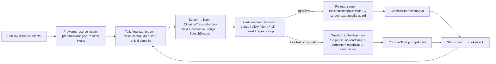

# Waycar in CarPlay

Note (2026-10-29): the `plugin/src/*.js:line` pointers below name plugin 1.x's Node files and are history. From plugin 2.0.0 the same code is in `plugin/rust` (ADR 0031): `agent-summary.js` is `summary/agent.rs`, `agent-hooks.js` is `hooks/`.

Status: Implemented (ADR 0028). Branch `Apple-Carplay` ships §6 steps 1–10, including the activity coordinator, list model and refresh throttling, and the voice loop with `CarSpeaker` and voice selection. Items marked *v2* are not yet implemented.
Date: 2026-10-06
Scope: Mike's story: *while driving, see my latest Agents and what each is doing, and dictate to an Agent to unblock it.* This doc merges four exploration reports (platform and policy, product, app architecture, voice pipeline). `[INFERENCE]` marks anything not verified against a primary source, the repo, or a device.

Sources:
- **CPG**: [CarPlay Developer Guide, June 2026](https://developer.apple.com/download/files/CarPlay-Developer-Guide.pdf). Page numbers are the printed ones, checked against the PDF (printed = PDF index − 1).
- **ARG**: [App Review Guidelines](https://developer.apple.com/app-store/review/guidelines/).
- [WWDC26 212 "Rev up your CarPlay app"](https://developer.apple.com/videos/play/wwdc2026/212/).
- [HIG CarPlay](https://developer.apple.com/design/human-interface-guidelines/carplay) and [HIG Live Activities](https://developer.apple.com/design/human-interface-guidelines/live-activities).

## 1. Summary

- **Track A (no CarPlay entitlement, ship first):**
  - The existing Live Activity on the CarPlay Dashboard. It already appears through the Dynamic Island compact fallback; a `.small` layout is optional polish.
  - Time Sensitive Blocked Agent Notifications that Siri can announce.
  - Siri App Intents for status, Allow/Deny, and "tell <Agent>…".
- **Track B (the full story):** a CarPlay **voice-based conversational** app (`com.apple.developer.carplay-voice-based-conversation`, iOS 26.4+). The screen shows an Agent list with status words; launch is list-first, and voice starts on a tap (auto-start is an opt-in setting). The driver can ask an Agent anything in plain speech; Waycar sends the question when the driver pauses and speaks the Agent's reply, hands-free, until Back. Summaries are spoken, never shown. Approvals and instructions are dictated.
- **Shared prerequisite for both tracks:** locked-phone and lifecycle fixes. Today a CarPlay-only or locked launch never dials, never starts the Console, and silences pushes while "active" (§6).

## 2. Platform options

- **A1, the Live Activity on the CarPlay Dashboard** (no CarPlay entitlement): the existing ADR 0014 activity. Without the small activity family CarPlay shows the Dynamic Island's compact leading and trailing views (CPG p.10), so `.supplementalActivityFamilies([.small])` buys a custom layout, not visibility. Glance only: interactive elements are off in CarPlay, and a tap can't open Waycar there (CPG p.9).
- **A2, Time Sensitive Blocked Agent Notifications** (the Time Sensitive capability; Done stays normal): Siri announces them on AirPods when the phone is locked and Driving Focus allows Time Sensitive notifications. In general CarPlay doesn't read notifications aloud (CPG p.27).
- **A3, Siri App Intents and App Shortcuts:** `What needs me`, `Allow/Deny`, `Tell <Agent> …`. Spoken status and answers through Siri's speech recognition, no list on screen.
- **A4, a Live Activity update with an `alert`** on newly Blocked activity, so it surfaces as a notification in CarPlay: needs an ADR 0014 amendment (Q10).
- **B, a CarPlay voice-based conversational app** (`com.apple.developer.carplay-voice-based-conversation`, iOS 26.4+, CPG p.13): the Agent list with status words, spoken summaries, open questions to an Agent with its reply spoken, voice Allow/Deny and dictated instructions, on-device speech recognition. Its rules shape the rest of this design: voice is the primary modality, the audio session is active only while voice is, and queries get no text or imagery in response (CPG p.7); recording only with the voice control template (CPG p.29); template depth 3 (CPG p.14).

CarPlay can't be shown or hidden for certain people (CPG p.12): once Track B ships, every user sees its icon.

## 3. UX scenarios

Bold lines are spoken by Waycar; 🎤 is the driver. Track B = CarPlay app. Track A = Live Activity + Time Sensitive announce + Siri.

| Scenario | Track B (CarPlay app) | Track A (no entitlement) |
|---|---|---|
| **S1. Blocked → Allow** (headline) | The Dashboard activity flips to "✋ 1 Blocked". Open Waycar: `linuxhost · Claude / Blocked · now` sits on top. Tap it and Waycar speaks the question first, **"linuxhost Claude wants to run: npm run migrate. Allow or deny?"**, then offers **[Allow] [Deny]**. 🎤 "Allow" → guarded Enter (§5) → **"Allowed."** Then either **"Claude is working."** on the status push, or after ~5 s **"Sent. No change yet."** It never claims the Agent acted (`CONTEXT.md:219-223`) | AirPods announce the Blocked push (if Driving Focus allows Time Sensitive). 🎤 "Siri, tell Waycar to allow it" → the intent resolves the most recently Blocked Agent → `requestConfirmation` **"Allow linuxhost Claude to run npm run migrate?"** → "Yes" → **"Allowed."** Through car speakers alone there is no announce; the Dashboard activity is the cue |
| **S2. Done → next instruction** | Tap `waycar · Codex / Done · 4m`: **"waycar Codex finished: added retry to the upload client; all tests pass. What next?"** (Chat Mode Agents: the Agent's own reply, capped at ~2 sentences, then **"Want the rest?"**). 🎤 "Open a PR against main." → sent on the pause as one `agent.prompt` (**"Sending…"** on screen, no read-back) → the reply is spoken, then Waycar listens again (§5 Conversation). A question that can't go out lands in that Agent's Composer draft (mirrors `CONTEXT.md:242-244`) | 🎤 "Siri, tell Waycar Codex…" → Siri asks for the text (`requestValueDialog`) → `requestConfirmation` readback → "Yes" → **"Sent."** |
| **S3. Glance** | Without interaction: an attention-sorted list with a "2 need you" section header. On "Talk to Waycar" (or at launch only if the opt-in "Start automatically in CarPlay" is on), once each Host's snapshot is verified (max 3 s, then **"studio is still connecting"**): **"Two need you. linuxhost Claude is blocked: needs approval to run the migration. waycar Codex finished: added retry. Three working, one idle."** An unreachable Host gets one spoken line, never per-Agent statuses | Dashboard: `✋ 1 Blocked · ✓1 · ⟳3`. 🎤 "Siri, ask Waycar what needs me" → the same sentence as `IntentDialog` |
| **S4. Hear what an Agent is doing; ask it anything** | Tap a Working row: **"waycar Claude is adding backoff to webhook retries. Updated 2 minutes ago."** If the summary is stale (older than 3 min, or written for another status): **"Checking…"**, then `summaries refresh` (~1.5 s one-shot, `plugin/src/agent-summary.js:72-75`), falling back to the old summary with its age. "Next", "Repeat" and "Stop" are accepted in the listening window after each item (no barge-in). 🎤 "What did you change in the upload client?" → sent on the pause → the Agent's reply is spoken when it lands (§5 Conversation) | 🎤 "Siri, what's waycar Claude doing?" → summary + age |
| **S5. Deny with correction** | 🎤 "No, use pnpm instead of npm." → Esc (guarded) → wait ≤ 8 s for a non-Blocked status → **"Tell Claude: 'use pnpm instead of npm'. Send?"** → Send → one `agent.prompt`. On timeout: **"Denied. I couldn't send the correction; it's in the draft."** Never types into the Blocked prompt (§5 rule 5) `[INFERENCE: Esc-then-prompt matches Claude's "No, and tell Claude…" outcome; verify per Backend × kind]` | Two intents: Deny, then Tell. Siri can't chain them in one utterance `[INFERENCE]` |
| **S6. Mis-dictation and risk safety** | (a) Misheard free text: a question to an Agent goes out on the pause, unconfirmed (Q7); a correction after Deny is still read back, and "No" keeps a draft. (b) The prompt matches a risk pattern (`rm -rf`, `push --force`, `reset --hard`, `drop`/`truncate`, `deploy`/`prod`, `sudo`, `curl … \| sh`, secret paths), or can't be read out losslessly: **"This one looks risky: force-push to main. I'll hold it until you're stopped."** / **"This one is too long to read out. I'll hold it until you're stopped."** Only **[Deny] [Hold]**; no voice Allow. (c) Unclassifiable prompt, trust dialog, plan approval, cursor not on plain "Yes", or "always allow" option: no Allow (§5). (d) Multi-choice question: **"It's asking a multiple-choice question. I'll leave it for later."** (v2) | Same classifier and holds; the intent answers **"I'll leave that one for later."** and sends nothing |

Out of scope in the car: Launch (new Agent; v2 at most, metered per ADR 0023), Attach, file and image staging, Snippets, Host setup, Pairing. CPG p.4 #4 excludes "unrelated settings, maintenance features".

## 4. CarPlay screen design (Track B)

**Template tree (depth ≤ 3, CPG p.14):**
1. Root `CPListTemplate`. A top row "Talk to Waycar" plus the Agent sections.
2. On launch, show the list with "Talk to Waycar" as the first row, matching ChatGPT's default. Speaking the briefing on launch is an opt-in iPhone setting, "Start automatically in CarPlay", off by default (CarPlay reopens the last-used app at every reconnect). Waycar activates no audio session until the driver taps Talk or an Agent row (CPG p.29: "Don't simply activate your audio session at the time your app launches"; p.7 #2).
3. Selecting a row presents the voice control template for that Agent: two action buttons (CPG p.26) plus nav-bar buttons.
4. No third level in v1. Choices inside a voice turn use the voice control template's two action buttons and its nav-bar buttons (CPG p.26): CarPlay presents one modal at a time, so an action sheet would dismiss the voice control template and end recording (CPG p.29). Any pushed third level must be a list or information template, shown outside a voice turn.

**Conflict: what is the root template?**
- The voice report wants the voice control template as root, with an "Agents" nav button.
- The product and architecture reports want a list root that is voice-first at launch.
- **Recommendation: list root; voice on tap, auto-start opt-in.** It matches the shipped precedents (ChatGPT, Claude: list plus a voice entry; ChatGPT's auto-start is opt-in, per [OpenAI](https://help.openai.com/en/articles/20001153-using-chatgpt-in-carplay)). It also keeps recording tied to the voice control template being on screen (CPG p.29). The iOS 27 voice-control overlay over the list is a v2 option.

**Row fields:**

| Element | Value | Evidence |
|---|---|---|
| Title | The phone Agent card's headline `workspace · tab` (`Data · Partners DO/TO`): the tab label when the phone shows one (`ConsoleAgent.showsTabLabel`; on tmux the window name, skipped when it is the automatic-rename artifact), else the Agent name, else the push identity `linuxhost · Claude` (`AgentNotificationIdentity.title(workspace:kind:)`). Said once when the name equals the Workspace (`apple-carplay`). `CarPlayListModel` sanitizes both parts: strip control and box-drawing characters, collapse whitespace, cap at 24 chars; a Workspace label containing `/` or `` ` `` is dropped, a name keeps `/`. A part that fails falls back to the next source. Unit-tested with adversarial labels (herdr accepts any label, `AGENTS.md:91-92`). Spoken identity reads the same title | Two Agents in one Workspace read apart, as on the phone |
| Detail | `Blocked · 2m`. Working and Blocked add the Agent Progress label (#189) between status and age: `Working · 3/7 · 6m`, `Working · verifying · 12m` (phase in lowercase), `Blocked · 2/4 · 4m`; pending or no estimate keeps `Working · 2m`. *v2:* adds `· studio` (the Host) only when more than one Host is connected. Status word first and never truncated; age = time in this status | `docs/design/live-activity-glance.md:22` |
| Image | Shared status symbol + palette ink: `hand.raised.fill`, `checkmark.circle.fill`, `progress.indicator`, `moon.zzz.fill`. Sized from `CPListItem.maximumImageSize`. With a progress estimate a segmented ring in the status colour is drawn around a shrunken glyph in the same bitmap: one segment per plan step (a continuous arc past 12), or 4 segments filled to the phase; a stale estimate's ring draws at 0.4 alpha; pending or none keeps the plain glyph. The ring is decorative; the detail carries the label | `live-activity-glance.md:28`. Status is never carried by color alone |
| Host trouble | *v2:* one row per unreachable Host: `studio · Reconnecting…` / `Can't reach`. No instructions | `CONTEXT.md:583-588`; CPG p.4 #2 |

**Sort.** Blocked → Done (Unread Mark counts as Done) → Working → Idle.
- **Conflict: where do Pins go?**
  - Console: Pins first, then bucket, then Host (name, id), then newest activity, with a `sortAs` snapshot so an opened Agent doesn't move (`Sources/Waycar/Console/ConsoleAgent.swift:399-433`; `CONTEXT.md:136`). The architecture report proposed reusing `consoleSorted` unchanged.
  - The product report proposes **Pins first *within* each status bucket**, because urgency beats preference in a car.
  - The code fact is undisputed; the choice is product judgment. Default (Q12): car = bucket, then Pin rank, then newest status change. `stateChangeSeq` is per-Host (herdr counter, tmux nanoseconds), so recency is only comparable within one Host and Backend; the prototype's `CarPlayListModel` therefore keeps the Console's Host → Backend grouping inside a bucket until rows carry a comparable status timestamp.

**Sections and cap.**
- Sections: "Needs you" (Blocked + Done), "Working". *v2:* a final "N idle" row that expands in place, with Unknown status folded into it.
- Cap: `min(CPListTemplate.maximumItemCount, 12)` rows, including (in v2) the idle and Host-trouble rows. CPG p.18: "you always need to be prepared to handle the case where only 12 list items are shown." Overflow is spoken on request ("+N more").
- Excluded: Shells (`CONTEXT.md:340-342`; voice-to-shell would be remote command execution), Closed Sessions, Disabled Hosts.

**Refresh.**
- Driven by the live events stream while the CarPlay scene is up. Blocked flips are applied immediately.
- Other changes are coalesced to at most one refresh every 5 s; a 60 s ticker updates ages. The 10 s cap in CPG p.5 #4 binds driving-task apps only.

**Shown vs spoken vs never:**

| Content | On screen | Spoken |
|---|---|---|
| Agent identity, status word, age, Host name | Yes | Yes |
| Counts ("2 need you") | Section header | Yes |
| Agent Summary, Chat Mode reply | **Never** | Yes, as the primary line |
| Exact Blocked command (classified from the screen) | **Never** | Yes, losslessly. If it can't be spoken in full (truncated, multi-line, any path shortened), it's held, not offered for Allow (§5 rule 6) |
| Dictated transcript / readback | **Never** (voice-state title stays generic: "Listening", "Sending…", a correction's "Send?") | Yes |
| Raw terminal text, paths, cwd, titles containing code | **Never** | Never raw; commands only after normalization |

Rule: **no message content on the car screen** (CPG p.4 #6, p.7 #3). Rows carry identity and a status word; summaries are spoken, never shown.

## 5. Voice pipeline and safety (Track B; Track A reuses the guards)

**Conversation.**
- Any utterance outside the grammar, spoken while an Agent is in context, becomes a question to that Agent. It goes out as soon as the driver pauses (1.5 s of silence, `Timing.endOfSpeech`): no read-back and no Send, Mike's call for a hands-free loop (Apple doesn't require a confirmation). The screen shows **"Sending…"**, then **"Waiting for reply"**; one `agent.prompt` carries the spoken-reply suffix. The audio session stays up while the Agent works, and the reply is spoken when it lands (the new assistant message capped at 2 sentences; without a transcript, the refreshed Agent Summary once it finishes).
- **Back-and-forth** (`AgentVoiceConversation`): once the reply has finished speaking, Waycar listens again on the same Agent; the listening state is titled **"Ask <Agent>"**. Each follow-up goes out the same way, and one question is in flight per Agent. A listen that hears nothing is no end: Waycar listens again until nothing was said for 2 minutes (`Timing.conversationIdle`). The loop ends on CarPlay's close (Back; the conversation states carry no buttons), the scene leaving the car's screen, a spoken exit as the whole utterance (**"stop"**, **"done"**, **"cancel"**, **"no thanks"**, **"that's all"**, **"thanks"** and a few more; `AgentVoiceService.isConversationExit`), or those 2 minutes of silence. Those all end silently and release the session. A question becomes the Agent's draft only when it couldn't go out (the turn closed before the prompt, the Agent turned Blocked). A driver's end closes the template at once, silence after the 1.2 s dwell (`CarPlayTemplateCoordinator.screen(for:)`). A failed send and a reply that leaves nothing to ask (Blocked, the Agent gone, no reply in 120 s) speak their line and end the turn. Half-duplex throughout: a listen starts only after the line before it finished, and the microphone opens 300 ms later (`Timing.speechSettle`) so it doesn't catch the car's tail of the reply.
- The briefing doesn't ask "Which Agent?"; it closes after speaking, with one "still connecting" / "can't reach" line per unverified Host. A Blocked Agent can't take a question (rule 5): **"Claude is waiting on approval. Allow or deny first?"**
- Waycar adds no LLM of its own: the Agent is the conversational partner.

**Audio.**
- One `.playAndRecord` session, mode `.default`, mixing disabled (WWDC26). It is activated only for a voice turn the driver started and stays active for the whole turn, a conversation's waits for replies included, then is deactivated with `.notifyOthersOnDeactivation` (CPG p.7 #2, p.29). Releasing it while a reply was awaited left the reply to re-activate the session alone; when iOS refused, the reply was silently dropped. Waycar never starts a session on its own (no launch briefing unless opted in, no spoken interjections).
- Interruptions (`AVAudioSession.interruptionNotification`): a notification, call or Siri pauses the line playing where it is (`AVSpeechSynthesizer.pauseSpeaking(at: .word)`; the Natural voice pauses its player node and keeps its queued buffers). When the interruption ends, the turn re-activates its session and the line plays on (`continueSpeaking`). A pause iOS makes with no interruption posted (`didPause`) is held and resumed the same way. A line not resumed within 8 s, one its engine can't hold, one iOS cancels (`didCancel`), and a resumed line that makes no playback progress within 3 s (queued audio iOS flushed) are cut and spoken again from the start of the sentence they stopped in.
- The car profile (`DictationAudioProfile.car`) sets no `.allowBluetoothHFP` and not `.voiceChat` (which applies `.allowBluetoothHFP` implicitly, [Apple: voiceChat](https://developer.apple.com/documentation/avfaudio/avaudiosession/mode-swift.struct/voicechat)), so the session doesn't ask for the Bluetooth hands-free (HFP) route, whose 8–16 kHz telephony band is what makes speech sound like a phone call. Under CarPlay the route is the `CarAudio` port. `[INFERENCE]` A plain-Bluetooth car (no CarPlay) would get no HFP route either. `[INFERENCE]` Whether a head unit carries a `.playAndRecord` session at a reduced rate is not documented; `CarSpeaker` logs the route's ports and sample rate on activation (`carplay` category) so a drive can settle it.
- Never publish Now Playing info.
- `AVAudioSession.promptStyle` is honoured only outside mode `.default` (it speaks for voice-prompt modes); the car session's `.default` mode reports `.none`, which once made every reply silent.
- `[INFERENCE]` The head unit decides whether FM radio pauses or ducks.

**Half-duplex.**
- Never listen while speaking. An earcon after TTS ends marks "listening".
- No barge-in: `[INFERENCE]` most head units don't cancel app output from the car mic.

**ASR.**
- SpeechAnalyzer stays on device (ADR 0003).
- Prefer `DictationTranscriber` with the [`farField`](https://developer.apple.com/documentation/speech/dictationtranscriber/contenthint/farfield) hint.
- Add [`contextualStrings`](https://developer.apple.com/documentation/speech/analysiscontext/contextualstrings) (≤100: Agent, Host and kind names, command words) and [`SpeechDetector`](https://developer.apple.com/documentation/speech/speechdetector) endpointing.
- Prefetch the model on the phone; a first-time download in the car is a risk.

**TTS.**
- `CarSpeaker` owns the turn's session and picks a `CarSpeechEngine` per line: the Natural voice when it is on and loaded (`NaturalVoice.engine()`, warmed when the CarPlay scene connects), else `SystemSpeechEngine` (`AVSpeechSynthesizer`). A line that fails without being stopped (a refused activation, an interruption, an engine error) is retried once on a freshly activated session, then spoken by `SystemSpeechEngine`. Every failure is logged in the `carplay` category with the engine, the reason and the route. A line that still can't be heard doesn't end a conversation: Waycar listens again.
- **Voice.** Siri's voices aren't available to apps. `AVSpeechSynthesisVoice(language:)` returns the compact default voice, which is what made the car sound robotic. The car speaks with the best installed voice instead (`CarVoiceSelection`): same language only, never novelty or Personal voices; Premium over Enhanced over compact, then the user's exact region (`AVSpeechSynthesisVoice.currentLanguageCode()`), then iOS's default. The fixed lines are English, so a non-English user gets an `en-US` voice. Settings › CarPlay Voice shows the voice in use and lets the user pick among the installed ones; better voices download in iOS Settings › Accessibility › Read & Speak › Voices.
- **Natural voice (beta).** A catalog of on-device English models through FluidAudio 0.17.7 (no espeak or other GPL code; `NaturalVoiceCatalog.swift`, `NaturalVoiceBackends.swift`, `NeuralSpeechEngine.swift`), ranked by naturalness, then fit for the car: (1) Kokoro-82M ANE-v3 (Apache-2.0, about 230 MB; about 410 MB on disk once compiled; top open model under 1B parameters on public leaderboards; default `af_heart`), (2) Kyutai Pocket TTS (`pocket-tts-coreml` v2.1 English on the ANE, about 530 MB; weights CC-BY-4.0, attribution in Notices; fastest first audio, streams long replies, most presets; `cosette` and `jean` omitted as non-commercial), (3) Paradee-8M Lite (Apache-2.0, about 13 MB plus Kokoro's shared text model; CPU-only, so the safest with the phone locked, lowest battery; `af_heart` only). Off by default; Settings › CarPlay Voice › Natural Voice (Beta) downloads, selects, switches and deletes each model independently (delete keeps files another installed model needs); the voice is stored per model. Excluded: Supertonic-3 (OpenRAIL-M use restrictions would have to flow into our EULA; upstream archived), Chatterbox Nano and NeuTTS-2E (GPU-only, cannot speak while backgrounded, large), Piper and KittenTTS (GPL espeak), large LLM TTS (too slow on iPhone 15). Never bundled, and downloaded only from Settings: each catalog model's files, including the English text front end Kokoro and Paradee share (G2P model, vocabulary, lexicon), are fetched at a pinned Hugging Face revision (Kokoro: `kokoro-82m-coreml` ANE-v3 `6c0750dd` over the base revision via `ModelRegistry.revisionOverrides`) and checked against Hugging Face's published SHA-256 hashes before use. Files live in `Application Support/fluidaudio` as `.completeUntilFirstUserAuthentication`, since the car speaks with the phone locked (`NaturalVoiceModelStore.swift`). A line is split into sentences; sentence N+1 synthesizes while N plays on the engine's own `AVAudioEngine` over the turn's active session, torn down after every line so the microphone is free. A custom lexicon fixes herdr, Codex, npm, API, CLI, GitHub and OMP. Any load or synthesis error turns it off until relaunch (logged once), and `SystemSpeechEngine` speaks instead. Risks: FluidAudio flags iOS 27 Kokoro inference as able to crash in Core ML after about an hour (FluidAudio #889), iOS 27 needs the `continued-processing.inference` entitlement for the Neural Engine in the background, and Kokoro ANE-v3 runs some stages on the GPU (FluidAudio rejects other compute units), which iOS may deny with the phone locked, so Kokoro can fall back to the system voice where Pocket TTS (ANE/CPU) and Paradee (CPU) keep speaking; to verify on a locked device. FluidAudio runs offline outside a Settings download, so nothing is fetched in the car; the model is released on CarPlay disconnect, memory warning or toggle-off; a download that fails keeps its verified files to resume, and Settings shows and deletes them.
- **Speaking Speed.** Settings › CarPlay Voice › Speaking Speed (`CarVoiceSpeed`, key `carplay-voice-speed`; 0.75×, 0.9×, 1×, 1.1×, 1.25×, 1.5×, default 1×; a stored value snaps to the nearest step) applies to both voices, read per line. `SystemSpeechEngine` sets `AVSpeechUtterance.rate` to `AVSpeechUtteranceDefaultSpeechRate` × the multiplier, clamped to the synthesizer's range. The Natural voice inserts an `AVAudioUnitTimePitch` (rate = multiplier, pitch kept) between its player node and the mixer when the speed isn't 1×; buffers are unchanged, so `spokenOffset` and resume are unaffected. **Play Sample** (`CarVoiceSample`) speaks one sentence on the phone in the voice and speed the car would use. It is the one load of the Natural model outside CarPlay: when no `CPTemplateApplicationScene` is connected, the model is unloaded as soon as the sample ends or is stopped, so the model lifetime above still holds. Stop acts at once, even mid-load; an audio interruption or an external pause stops it. It is disabled while a CarPlay voice turn is on (`CarVoiceActivity` has an Agent, a line speaking or a listen running), and it deactivates the audio session only if it activated it and no turn took it over.
- Normalize speech: strip ANSI and box-drawing characters, spell out shell symbols in commands, including approval read-backs. Status and summary speech may shorten paths to their last two components; an approval question never shortens or truncates (rule 6). Risk patterns run on the full, unnormalized command.

**Per-kind unblock map** (v1 voice approvals: claude and codex only, where screen rules and fixtures exist; `Sources/Waycar/Transport/Tmux/TmuxScreenDetector.swift:84-97` and its tests):

| Kind / dialog | Voice Allow | Voice Deny | Free text | Never by voice |
|---|---|---|---|---|
| claude permission ("Do you want to proceed? ❯ 1. Yes…") | `["enter"]` after the guard, only when the selected row is option 1 labelled exactly "Yes" | `["esc"]` | Deny, wait ≤ 8 s for non-Blocked, then prompt; else draft | Option 2 "Yes, and don't ask again"; plan approval (ExitPlanMode, `plugin/src/agent-hooks.js:45`; its default escalates to auto-accept edits) |
| claude AskUserQuestion / MCP input | v2: an option by number `[INFERENCE: digit selects]` | `["esc"]` | — | — |
| codex approval ("Would you like to run…") | `["enter"]` after the guard, only when the selected row is option 1 labelled exactly "Yes, proceed" | `["esc"]` | Deny, wait ≤ 8 s for non-Blocked, then prompt; else draft | "Yes, and don't ask again for this command" |
| codex `[y/n]` child prompt | Unsupported in v1 (read-only: **"It's asking a yes/no question I can't answer from the car."**). Revisit with a captured fixture | — | — | Everything |
| **claude / codex folder trust** | **None.** **"…is waiting on a folder-trust question; I won't answer that from the car."** | — | — | Everything. Enter accepts trust (`AGENTS.md:90`) |
| omp, opencode, pi | Unsupported in v1 (no screen rules; omp may read Idle while working, `AGENTS.md:86`) | — | Only when Idle/Done; opencode keeps its input-box gate | Approvals |
| shell | Excluded from the car | — | — | Everything |

herdr reports `blocked` for both a permission prompt and a trust dialog, and `claudeDialogIsOpen` lumps permission, question and MCP input together (`TmuxScreenDetector.swift:75-87`). So the car classifies **from the screen** (`ConsoleStore.readVisibleScreen`, `Sources/Waycar/Console/ConsoleStore.swift:2187-2196`) into `permission(command)`, `question(options)`, `trust` or `unknown`. `permission` requires the cursor on option 1 with the exact plain label above; any option-1 label containing "and", "always", "auto", "bypass" or "don't ask", and any plan-approval dialog, classifies as `unknown`. Only `permission` gets a voice Allow in v1; `unknown` is read-only.

**Safety rules:**
1. **Trust dialogs are never answered.** The same applies while `launch_pending` / `agent_not_ready` + Blocked (mirrors `Sources/Waycar/Console/AgentComposerStore.swift:482-501`).
2. **Answer only the prompt that was read aloud.**
   - Snapshot the prompt's screen text when TTS starts. Re-read before sending keys and require equality of the same normalized last-N screen lines Chat Mode compares, including the `❯` row (`Sources/Waycar/ChatMode/ChatTranscriptStore.swift:392-412`, `blockedScreenText` `:490-501`), not the classified value: a cursor move or a second prompt with the same command must mismatch. On a mismatch, re-announce and send nothing.
   - This reuses Chat Mode's guard (`ChatTranscriptStore.swift:388-420`) and its recheck (`:424-432`).
3. **Closed vocabulary for approvals.**
   - `{allow, yes, approve}` → Enter; `{deny, no}` → Esc. "stop" and "cancel" end the voice turn and send nothing (unit test in `CarCommandGrammar`). Only when the *final* transcript is exactly one token (filler like "uh" and a trailing "please" are tolerated).
   - Anything else gets one re-ask, then nothing happens. The question itself is the read-back, which is why it must be lossless (rule 6); Allow has no second confirmation.
4. **Free text.** A question to an Agent goes out on the driver's pause with no read-back (Mike's call: a hands-free loop); a spoken exit or CarPlay's close sends nothing.
   - A correction after Deny (S5) is still read back and needs an explicit "Send"; silence (6 s) means cancel, and unsent text goes to the Composer draft.
   - There's no undo once sent: `agent.prompt` auto-submits (`AGENTS.md:82`).
5. **Never type into a Blocked prompt.**
   - Today: herdr's `agent.prompt` refuses Blocked, tmux refuses (`Sources/Waycar/Transport/Tmux/TmuxTransport+Input.swift:27-30`), and Composer inserts without Enter (`CONTEXT.md:214-216`).
   - Deny + correction = Esc, then wait at most 8 s for a status other than Blocked, re-reading the screen once (a Waycar-sent Esc makes the pane eligible for a screen read). On timeout: **"Denied. I couldn't send the correction; it's in the draft."** The text stays a Composer draft. Why bounded: on tmux, claude leaves `blocked` only via PostToolUse*/ElicitationResult/UserPromptSubmit (`plugin/src/agent-hooks.js:44-51`), Esc fires no Stop hook, and `TmuxScreenDetector.isEligible` skips hooked-`blocked` panes, so the pane can keep reporting Blocked. No ADR 0009/0024 amendment, pending verification per Backend × kind (herdr/tmux × claude/codex) (Q6).
6. **Risk and lossless hold.** Risky patterns (S6), an unclassified Enter meaning, or a command that can't be read out losslessly (truncated, more than one line, or any path shortened) get **[Deny] [Hold]** only, with **"This one is too long to read out. I'll hold it until you're stopped."** for the latter. Deny (Esc) is always available.
7. **No blind replay.** One in-flight action per Agent. Keys are never retried after a link failure that may have delivered them (`ConsoleStore.sendKeys`); tmux control lines are never retried. After such a failure: **"Couldn't confirm it was delivered. Not resending."** The one exception is an answer taken while the Host could not be reached to read the screen at all (nothing sent): it is kept as a Queued Answer (CONTEXT.md) for 10 minutes and replayed under rule 2's guard once the Host is back, so a changed prompt sends nothing.
8. **Target disambiguation.**
   - The default target is the Agent just spoken about.
   - A spoken name must resolve uniquely across Hosts; otherwise ask (ARG 2.5.11(iii) allows that "when required").
9. **Text hygiene.** Run `TerminalTextSafety` and strip newlines (`AgentComposerStore.swift:571`; `AGENTS.md:103`).
10. **Wording.** No "pick up / open your iPhone". Say **"I'll hold it until you're stopped"** or **"Can't reach studio right now. I'll keep trying."** (CPG p.4 #2).
11. **Locked-phone authority** (Q8).
    - Status reads are always allowed.
    - Siri write intents (Allow, Deny, Tell) need an opt-in setting. Optionally also require a `.carAudio` route `[INFERENCE]`.
    - Summaries are labelled as summaries. The approval question speaks the classified command, not the cheap-model summary (`agent-summary.js:77` in plugin 1.x, now `plugin/rust/summary/agent.rs`: the screen is untrusted input).

**Latency budget** (warm Host connection; `[INFERENCE]` targets except the herdr/SSH rows):

| Step | Budget | Basis |
|---|---|---|
| Tap → earcon | ≤ 400 ms | Analyzer prewarmed on scene connect |
| End of speech → final transcript | 1.6–1.8 s | 1.5 s trailing silence (`Timing.endOfSpeech`) + finalize |
| Parse + target | < 20 ms | Local grammar; no match → question to the Agent (Waycar runs no LLM) |
| Screen re-read + classify | ~150–250 ms | herdr one-shot RPC pays a ≤100 ms tick + RTT (`AGENTS.md:104`); tmux ~1 RTT |
| TTS first audio | ≤ 300 ms | `AVSpeechSynthesizer` |
| Confirm listen (a correction only) | ~1.2 s | Short closed vocabulary |
| Deliver keys / prompt | ~150–250 ms | 1 RPC or 1 control line |
| Status ack | 0.3–1.2 s | herdr push; tmux subscription 0.3–1.15 s (`AGENTS.md:117`) |
| **End of answer → delivered** | **≤ 2.5 s approval / ≤ 4 s free text** | Sum |
| Cold (suspended or locked) | +1.0–1.7 s | "Cold launch → Agent list usable" 992–1692 ms (`docs/design/connection-latency.md`, Before/after numbers) |
| Cellular + Jump Host, Kept Connection expired (>10 min, ADR 0027) | To be measured | The cold row was measured at a 100 ms RTT proxy, not cellular |
| Siri path, end to end | ~3–6 s | Siri wake + ASR + an extra turn for free text + intent launch |

## 6. Architecture

**Today, verified in code:**

| Fact | Where |
|---|---|
| The only app delegate, `PushRegistrationDelegate`, owns a lazy, window-independent `WaycarAppModel` | `Sources/Waycar/WaycarApp.swift:9-10`; `Sources/Waycar/Notifications/PushRegistrationStore.swift:166-172` |
| Every scene role gets `QuickActionSceneDelegate`; a CarPlay session would get the wrong delegate | `PushRegistrationStore.swift:225-238` (`:236`) |
| **Dial gate:** early dials need `role == .windowApplication && protectedDataAvailable`. The comment ("Without protected data the Host credentials cannot be read") is stricter than the Keychain class | `PushRegistrationStore.swift:251-258` (`:257`), call site `:213-215`; `Sources/Waycar/WaycarAppModel.swift:305-307` |
| Keychain is `AfterFirstUnlock[ThisDeviceOnly]`: readable while locked, so SSH *can* authenticate | `Sources/Waycar/Transport/SecretStore.swift:105-111` |
| `start()` runs only from a phone/iPad window's appearance; a CarPlay-only launch never starts the Console | `Sources/Waycar/ContentView.swift:174`; `WaycarAppModel.swift:319-372` |
| **scenePhase lifecycle:** SwiftUI's aggregate phase drives the activity grace period and the summary gate. `[INFERENCE]` The process stays foreground while the CarPlay scene is, but the phone window's `.background` still starts `AppActivityCoordinator`'s grace period. After 20 s Waycar tears down its own channels, so the CarPlay list freezes even though iOS never suspended the app | `WaycarApp.swift:11-12,35-40`; `WaycarAppModel.swift:374-398` (`:379`, `:389`, `:391`, `:394`); `Sources/Waycar/Support/AppActivityCoordinator.swift:6-15,71-72,111,194-213` |
| Agent Summaries refresh only while foreground | `Sources/Waycar/Console/ConsoleStore.swift:609-615`; gate struct `Sources/Waycar/Console/HostConsoleProjection.swift:1833-1836` |
| **`.complete` caches:** inventory, Backend presence and connection memory files plus their directory; chat transcripts. All unreadable while locked (CPG p.29) | `Sources/Waycar/Console/ConsoleInventoryCache.swift:250,391,401-402`; `Sources/Waycar/ChatMode/ChatTranscriptCache.swift:371,382` |
| **Empty-facts cache bug:** a locked read failure looks like "no file" (`try?` at `:270`). `read ?? ConnectionFacts()` (`:282`) is then cached in memory (`:288`), so every later dial re-resolves `$HOME`, and a later write may persist partial facts `[INFERENCE]` | `ConsoleInventoryCache.swift:264-290` |
| **`willPresent` silencing:** always `completionHandler([])` (ADR 0008:18). `[INFERENCE, high impact]` If CarPlay keeps the app "active" while the phone is locked ([sentry-cocoa#8317](https://github.com/getsentry/sentry-cocoa/issues/8317)), Lock Screen and Watch alerts are silenced for the whole drive | `Sources/Waycar/Notifications/AgentNotificationCenterDelegate.swift:52-67` (`:66`) |
| **Audio session:** `.record`/`.measurement`/`.duckOthers`; dictation tears down on the *phone* scene's background in the views, and `MicrophoneCapture.stop()` deactivates the shared session | `SpeechDictationEngine.swift:345-346,400-404`; `Sources/Waycar/Console/AgentComposerView.swift:322-326`, `Sources/Waycar/ChatMode/ChatInputBar.swift:119-123`, `Sources/Waycar/Console/AgentDirectInputChrome.swift:144-147` |
| Blocked answering exists only inside Chat Mode (Enter/Esc + guard) | `ChatTranscriptStore.swift:264-272,388-432` |
| The Live Activity declares only Lock Screen + Dynamic Island content; no `supplementalActivityFamilies` | `Sources/WaycarWidgets/AgentLiveActivityWidget.swift:11-25` |
| No `AppIntents`, `CarPlay`, `UNNotificationCategory`, `AVSpeechSynthesizer` or `interruptionLevel` anywhere in `Sources/` | repo grep |
| Generated scene manifest, no `UIBackgroundModes`, Automatic signing. The mic string promises speech "never leaves" the device | `project.yml:87-97,118,131` |

**New types:**
- **`AgentVoiceService`** (`@MainActor`; no UIKit or CarPlay imports; shared by App Intents and CarPlay):
  - `briefing(scope:)`, `answer(agentID, .allow | .deny)`, `instruct(agentID, text)`.
  - Waits for a verified inventory (`ConsoleStore.promptAgent` → `verifiedRow`, `ConsoleStore.swift:1756-1758`).
  - Maps errors to speakable text.
- **`BlockedPromptClassifier`**: Backend-neutral. Built from `TmuxScreenDetector`'s claude/codex rules; returns `permission | question | trust | unknown`.
- **`BlockedPromptAnswerer`**: the Enter/Esc + equality guard + recheck, extracted from `ChatTranscriptStore`. Chat Mode, CarPlay and Intents share one copy.
- **`CarPlaySceneDelegate`** (`CPTemplateApplicationSceneDelegate`, iOS 26.4+):
  - Calls `appModel.start()` if no window did.
  - Forwards foreground edges to the activity coordinator.
  - Reaches the model through a `@MainActor` registry set by `PushRegistrationDelegate`, following `QuickActionCenter.shared` (`Sources/Waycar/QuickActions/QuickActions.swift:26`). `[INFERENCE]` `UIApplication.shared.delegate` is SwiftUI's proxy.
- **`CarPlayTemplateCoordinator`** (+ `CarPlayInterfacing` protocol for tests): the template tree from §4, voice-state switching, throttling.
- **`CarPlayListModel`**: a pure value built from `[ConsoleAgent]`: `excludingShells`, the §4 sort, then the cap.
- **`CarVoiceSession`**: owned by the CarPlay scene, not by views. It runs a `MicrophoneCapture` car profile, `CarSpeaker` (TTS, half-duplex, `promptStyle`) and `CarCommandGrammar` (deterministic; unmatched utterances route to the open-question loop).
- **App Intents** (in-app, not an extension, because they need the live SSH graph):
  - `AgentEntity`/`AgentQuery`, `GetAgentStatusIntent` (`.alwaysAllowed`), `AnswerBlockedAgentIntent` (`AgentEntity` + `AppEnum`), `TellAgentIntent` (String via `requestValueDialog`), and an `AppShortcutsProvider`.
  - Every intent runs in the background: `static supportedModes = .background` on iOS 26+ (`openAppWhenRun` is deprecated there), with `openAppWhenRun = false` only on the iOS 18–25 path. The write intents use `requestConfirmation` and are opt-in while locked.

**Changes to existing code:**

| Where | Change |
|---|---|
| `PushRegistrationStore.swift:225-238` | Branch on role. `.carTemplateApplication` → `sceneClass = CPTemplateApplicationScene`, `delegateClass = CarPlaySceneDelegate`. Windows keep `QuickActionSceneDelegate` |
| `PushRegistrationStore.swift:251-258`, `WaycarAppModel.swift:299-315` | Let CarPlay and intent launches dial. Replace `isProtectedDataAvailable` with "Keychain readable" (try the read; treat `errSecInteractionNotAllowed` as "not yet") |
| `AppActivityCoordinator` + `WaycarAppModel.swift:374-398` | Multi-source activity (phone ∪ carPlay ∪ intent). The grace period starts only when all sources are gone; a CarPlay foreground edge cancels a running grace Task, and no `beginBackgroundTask` while CarPlay is foreground. Analytics, iCloud, StoreKit and AI Usage stay phone-only |
| `ConsoleStore.swift:609-615` | Summary foreground = phone **or** CarPlay foreground |
| `AgentNotificationCenterDelegate.swift:52-67` | Return `[]` only while a phone *window* scene is foreground-active; otherwise present `.banner`/`.list`/`.sound` |
| `ConsoleInventoryCache.swift:250,264-290,296-304,401-402` | Move connection memory + Backend presence (no secrets: `$HOME`, protocol facts) to `.completeUntilFirstUserAuthentication`; inventory, chat and Last Frame stay `.complete`. On the first unlocked launch, set that `.protectionKey` on the cache directory and the existing connection/presence files (`FileManager.setAttributes`; writes happen only when facts change), and pass it on every write. Don't cache empty facts after a protection-class read failure; unit-test it |
| `SpeechDictationEngine.swift:345-346` | Session profile parameter (phone vs car); transcriber preference; contextual strings; `SpeechDetector` |
| Phone dictation views (`AgentComposerView.swift:322-326`, `ChatInputBar.swift:119-123`, `AgentDirectInputChrome.swift:144-147`) | Keep scenePhase teardown phone-only. `CarVoiceSession` owns the `AVAudioSession` exclusively during a CarPlay turn; phone capture is refused meanwhile |
| `ChatTranscriptStore.swift:264-272,388-432` | Extract `BlockedPromptAnswerer`; Chat Mode calls it |
| `AgentLiveActivityWidget.swift:11-25` | Optional `.supplementalActivityFamilies([.small])` + small view (also used by the Watch Smart Stack) |
| `Sources/WaycarNotificationService/NotificationService.swift` + plugin | Time Sensitive on Blocked (`interruptionLevel`; capability). `[INFERENCE]` Whether the NSE sets it or the plugin sends `aps.interruption-level` is open |
| `project.yml` | Time Sensitive capability. `NSMicrophoneUsageDescription` (`:118`) for Track B: "Waycar uses the microphone when you tap Dictate or talk to Waycar in CarPlay, turning your speech into messages and answers for your Agents. Speech is transcribed on this device and never leaves it." (ARG 5.1.1(ii)). The CarPlay entitlement key and its signing (CPG p.12). Regenerate and commit `Waycar.xcodeproj` (`AGENTS.md:161`) |
| Docs | New ADR "CarPlay as a voice-based conversational surface" (category, locked-phone policy, Blocked-prompt rules); `CONTEXT.md` terms (e.g. CarPlay Briefing); `CHANGELOG.md`; `PRIVACY.md` (Siri ASR, any ADR 0014 alert); ADR 0014 amendment if A4 is taken |
| Analytics | Opt-in events: `carplay_opened`, `agent_answered`, `agent_prompted`, `agent_prompt_dropped`, `agent_summary_spoken`, `siri_intent_ran`. Kind and buckets only. Internal-only: `host_connect.trigger` gains `carplay` and `siri` (`AGENTS.md:180`) |

**Effort and sequencing:**

| Step | Piece | Effort `[INFERENCE]` | Entitlement? |
|---|---|---|---|
| 0 | Mike's decisions (§9) | S | — |
| 1 | Verify the Live Activity fallback in a car; optional `.small` layout | S | No |
| 2 | Locked-phone readiness: dial gate, start without a window, cache protection, empty-facts fix | M | No |
| 3 | Multi-source activity + summary gate + `willPresent` gate | M | No |
| 4 | `BlockedPromptClassifier` + `BlockedPromptAnswerer` + `AgentVoiceService` | M | No |
| 5 | Time Sensitive Blocked push | S | No |
| 6 | App Intents (entity, query, 3 intents, shortcuts, auth policy) + real-car Siri spike | M–L | No |
| 7 | Optional ADR 0014 Blocked alert (plugin + relay + PRIVACY) | S–M | No |
| 8 | CarPlay scene plumbing + registry + `CarPlaySceneDelegate` | S | Yes |
| 9 | `CarPlayTemplateCoordinator` + `CarPlayListModel` + throttling | M | Yes |
| 10 | Voice loop: car audio profile, far-field ASR, TTS, grammar, open-question loop, readback states | L | Yes |
| 11 | Locked-phone QA in a car; a demo Agent that reliably turns Blocked | L | Yes |

Steps 2–4 must land before any CarPlay build. Step 3's `willPresent` gate is a Track B prerequisite; Track A needs only the intent activity source and an intent-driven dial (step 2), since background intents never hit `willPresent` (`AgentNotificationCenterDelegate.swift:51`).

## 7. Testing limits

- **The iOS Simulator CarPlay display works without a provisioning profile (verified, prototype).** Xcode 26.6's Simulator.app, I/O › External Displays › CarPlay, lists Waycar once the app signs with `com.apple.developer.carplay-voice-based-conversation` (now in `Sources/Waycar/Waycar.entitlements` for every build; the prototype used a simulator-only copy); the log shows "Application declares voice entitlement." This overrides CPG p.12 for the Simulator; devices and the CarPlay Simulator Mac app need a profile carrying the capability. Under `--demo-screenshots` the CarPlay scene runs on the demo store.
- **Xcode 27.0's Device Hub has no CarPlay display for simulators (verified;** matches forums [834440](https://developer.apple.com/forums/thread/834440), [848349](https://developer.apple.com/forums/thread/848349)). Use Xcode 26.6 for CarPlay simulator runs; device testing uses the CarPlay Simulator Mac app + iPhone (CPG p.8).
- **Prototype learnings:**
  - `CPButton` handlers on a voice control template arrive off the main thread (CarPlay's XPC queue); hop to the main actor.
  - List images render out of process: dynamic colours and symbol tints come out black. Pre-render bitmaps resolved against `carTraitCollection`.
  - `CPVoiceControlTemplate` action buttons show icons only; titles don't render.
  - Knob focus lands on the first action button, so Blocked puts Deny first.
- **The iOS Simulator can't test Siri, locked-phone behaviour or car audio** (Apple doc above). The CarPlay Simulator drives a real iPhone, so locking that phone should be testable there `[INFERENCE]`; Siri-in-CarPlay and head-unit audio focus still need a car.
- **Device installs** follow `make install` with a local What's New (`AGENTS.md:158`). Simulator work goes through `scripts/sim-slot.py` (`AGENTS.md:28-41`).
- **Hardware:** a wireless head unit lets Xcode stay attached by cable (CPG p.8).
- **Unit-testable without CarPlay:**
  - `CarPlayListModel`, the coordinator against a fake `CarPlayInterfacing`, `AgentVoiceService` against fake Transports (both Backends), `BlockedPromptClassifier` (existing fixtures in `Tests/WaycarTests/TmuxScreenDetectorTests.swift`).
  - The multi-source coordinator (injectable `BackgroundExecutionGranting`), `willPresent` gating, cache fallbacks, and intents' `perform()`.
- **Not verified on a device:** the compact-fallback rendering in a car, Time Sensitive announce with Driving Focus on, App Intents with a locked phone in CarPlay, process state while locked with CarPlay in front, mic routing to `.carAudio`, and Esc → non-Blocked timing per Backend × kind.

## 8. Ranked risks

1. **No CarPlay profile yet.** Track B can't even be prototyped without one (CPG p.12). *Mitigation:* Track A ships without it.
2. **Not conversational enough.** A closed-grammar voice remote doesn't respond to questions or requests (CPG p.7 #1). *Mitigation:* the open question-to-Agent loop (§5 Conversation).
3. **Unsafe approval by voice.** Misheard words, a changed prompt, a moved cursor, a hallucinated summary, a truncated readback, Enter meaning something unexpected, or a trust dialog. A real-world harm. *Mitigation:* §5 rules 1–7. Allow only for classified claude/codex permissions with the cursor on plain "Yes" and a lossless readback; "stop" never sends keys.
4. **The primary function fails while locked.** Dial gate, no `start()`, self-inflicted grace-period teardown, `.complete` caches. That's a user failure (CPG p.29; HIG: must function when the iPhone is inaccessible). *Mitigation:* steps 2–3 first.
5. **Agent Notifications silenced during the drive** (`willPresent` → `[]` while CarPlay keeps the app active) `[INFERENCE]`. It regresses the shipped feature exactly when it matters. *Mitigation:* step 3.
6. **The driver never hears about a Blocked Agent.** No CarPlay notifications for this category (CPG p.27); car speakers never announce Waycar pushes, and AirPods announce depends on Driving Focus. *Mitigation:* the Dashboard Live Activity, the optional A4 alert, and an on-screen section header ("1 needs you") in the open CarPlay list. Waycar speaks about a newly Blocked Agent only inside a voice turn the driver already started; it never starts an audio session on its own.
8. **On-screen text drift.** Summaries, raw Workspace labels or titles with code creeping into rows (CPG p.4 #6). *Mitigation:* §4 table and title sanitizing as test-enforced rules in `CarPlayListModel`.
9. **App Intents unproven in CarPlay with a locked phone.** Siri may demand an unlock or stall the background SSH dial `[INFERENCE]`. *Mitigation:* a real-car spike before committing step 6.
10. **QA can't exercise the flow** without a demo Agent that reliably turns Blocked. *Mitigation:* step 11.
11. **Speech quality for code terms** and car-mic noise. *Mitigation:* contextual strings, far-field, readback, a short grammar, drafts on failure. The Siri path has no vocabulary control.
12. **Reachability and staleness.** Off-LAN Hosts need a Jump Host or VPN; the Kept Connection lasts ≤ 10 min, so a long drive with another app in front redials over cellular (ADR 0027). *Mitigation:* spoken statuses wait for a verified snapshot (max 3 s); an unreachable Host gets one row and one spoken line; pushes + Live Activity cover the gap; show an "updating" state.
13. **Audio citizenship.** Stopping the radio, fighting Siri or calls. *Mitigation:* WWDC26 session config, no session at launch (auto-start opt-in), per-turn activation, `promptStyle`, half-duplex.
14. **Privacy.** Passengers hear names, paths and summaries. The Siri path breaks ADR 0003's on-device promise and needs a `PRIVACY.md` disclosure; the mic string must be updated for Track B (`project.yml:118`). *Mitigation:* Q9, Q14, §6 `project.yml` row.
15. **Public by default** (CPG p.12): the quality bar is every user, not Mike.
16. **iOS floor.** The app targets iOS 18; the category needs 26.4 and SpeechAnalyzer needs 26. What CarPlay shows on 18–26.3 with the entitlement present is unknown `[INFERENCE]`.
17. **Template walls.** Depth 3, ≥12 rows guaranteed, 2 buttons, one modal at a time. Feature creep (Launch, settings) will hit them.

## 9. Open questions for Mike

Each question has the experts' default in **bold**.

1. **Voice-only output:** the car screen shows identity + status word only; summaries and replies are spoken, never shown. → **Yes.**
2. **When Track B ships.** → **Only once it passes QA.**
3. **Ship order.** → **Track A first:** fallback check / `.small` → locked-phone + lifecycle fixes → Time Sensitive → App Intents. Track B next.
4. **Voice Allow scope.** → **claude and codex permission prompts only, cursor on plain "Yes" / "Yes, proceed"; risky or not-losslessly-readable commands held; never "always allow" or plan approval; trust dialogs never; codex `[y/n]` and multi-choice in v2; omp/opencode/pi read-only.**
5. **What the approval question speaks.** → **The exact classified command, in full; if it can't be read losslessly, hold. Summaries only for status.**
6. **Instruction to a Blocked Agent.** Esc → wait for non-Blocked → prompt, or type + Enter into the prompt (needs ADR 0009/0024 amendments and a tmux refusal change)? → **Esc-then-prompt with a bounded 8 s wait and a draft fallback; no ADR change, pending a per Backend × kind check.**
7. **Free-text confirmation.** → **Decided (Mike): a question to an Agent goes out when the driver pauses, no read-back or Send, so the conversation is hands-free; a correction after Deny keeps the read-back + explicit "Send".**
8. **Mutations while the iPhone is locked.** Architecture: opt-in for everything. Product: the car is the owner's context. → **CarPlay app: on while CarPlay is connected (its primary function must work locked, CPG p.29). Siri write intents: opt-in setting, off by default. Status: always.**
9. **Siri ASR for Track A** breaks ADR 0003's "never leaves the phone" and the mic string. → **Accept for Track A with a `PRIVACY.md` disclosure; Track B stays on-device.**
10. **ADR 0014 amendment:** an `alert` on newly Blocked activity updates, so it surfaces "as a notification" in CarPlay. → **Defer to v2; decide after a real-car check of the fallback (costs APNs budget and one more relay-visible signal).**
11. **Time Sensitive Blocked pushes.** → **On by default for Blocked; Done stays normal.**
12. **Pins in the car list.** → **First within each status bucket, not above everything.**
13. **List scope.** → **All non-Shell Agents across Hosts, attention-sorted, capped at 12, idle collapsed into one row.**
14. **Privacy with passengers.** → **Speak names and summaries automatically; add a "Private briefing" setting (counts only, details on tap).**
15. **Root and launch.** → **List root with "Talk to Waycar" first; no audio at launch. "Start automatically in CarPlay" (speak the briefing on launch) is an opt-in setting, off by default.**
16. **Test hardware:** your car's CarPlay (wired or wireless)? AirPods while driving? → **Use the CarPlay Simulator + your iPhone, then your car. Buy a wireless aftermarket head unit if the car is wired-only.**
17. **Host reachability off-LAN** (Jump Host / VPN)? → **Assume it exists; this design adds no reachability work, only behaviour: one "Can't reach" row and one spoken line per unreachable Host, statuses spoken only after a verified snapshot. Measure cellular + Jump Host latency.**
18. **Pricing.** → **CarPlay and Siri are free (ADR 0023: answering existing Agents is never metered). A v2 voice Launch counts as a Launch.**
19. **Launch from the car.** → **Not in the MVP.**
20. **Shells in the car.** → **Never.**
21. **iOS floor.** → **Car features need 26.4+ (SpeechAnalyzer 26+); the app stays iOS 18+. Don't offer the CarPlay scene below 26.4.**
22. **Lock Screen Allow/Deny action on the Blocked push** (a phone feature, not driving). → **Separate issue; not part of this design.**
23. **Open questions to Agents in the car** (any non-command utterance → readback → `agent.prompt` → spoken reply). → **Yes, in v1; it's the conversational core of Track B.**
