# State machines

A lifecycle that is spread across flags, optionals, Task handles, timestamps
and counters lets the app reach combinations no one designed: a spinner with
nothing running, a "Sent" after a failure, a stale completion overwriting a
newer one. Waycar makes such lifecycles **explicit**: one value type holds the
state and owns every legal transition, the code around it only feeds it events
and performs what it asks for.

This page is the convention, the [Index](#index) of every machine that follows
it, and the [Catalogue](#catalogue) of every lifecycle found in the 2026-11
inventory, converted or not, with the reason. `scripts/check-state-machines.py`
keeps the Index honest (see [The check](#the-check)).

## Convention

### When a lifecycle gets a machine

A lifecycle gets a machine when its state lives in more than one field, or its
transitions are spread over several methods, and some combinations of those
fields are not legal. A single boolean, a pure parser behind one `feed`
function, or a synchronous two-step view flow does not need one; the Catalogue
says so with `leave` or `explicit`.

### Shape

```swift
/// What the lifecycle is, in one sentence, and the rules a reader needs.
struct ComposerDrainMachine: StateMachine {
    enum State: Equatable, Sendable {
        case idle
        /// Data that exists only in a state is carried by that state.
        case draining(attempt: UInt64, wakePending: Bool)
        case backingOff(timer: UInt64, failures: Int)
        case cancelled
    }

    enum Event: Equatable, Sendable {
        case wake
        case attemptFinished(UInt64, Outcome)
        case backoffElapsed(UInt64)
        case cancel
    }

    enum Effect: Equatable, Sendable {
        case startAttempt(UInt64)
        case armBackoff(UInt64, after: Duration)
        case cancelBackoff
    }

    private(set) var state: State = .idle
    private var lastToken: UInt64 = 0

    mutating func handle(_ event: Event) -> [Effect] {
        switch (state, event) {
        // One case per legal transition; everything else is an explicit no-op.
        }
    }
}
```

- `StateMachine` (`Sources/Waycar/Support/StateMachine.swift`) is the whole
  framework: `State`, `Event`, `Effect` and one pure
  `mutating func handle(_:) -> [Effect]`. Pure means no I/O, no clock reads,
  no Task creation, no logging. The compiler warns when a caller drops the
  effects.
- Name it `<Lifecycle>Machine`, after what it tracks, not after its owner.
  Keep it in its owner's file while it is small, in its own file next to the
  owner once it is not.
- The state enum says what the user or a reader would call each state
  ("waiting for its pane", "backing off"). Per-state data rides on the case,
  so a timer token or a deadline exists only in the states that need it.
- `switch (state, event)` with one case per legal transition. Write the
  ignored combinations out (`case (.idle, _): return []`) instead of a
  `default:`, so a new state or event makes the compiler ask what it does.
- Derived values (`pendingTarget`, `isInFlight`) are computed properties on
  the machine, never stored beside it.

### The owner performs effects

```swift
private var drain = ComposerDrainMachine()
private var attempts: [UInt64: Task<Void, Never>] = [:]

private func send(_ event: ComposerDrainMachine.Event) {
    for effect in drain.handle(event) {
        switch effect {
        case .startAttempt(let token):
            attempts[token] = Task { [weak self] in
                let outcome = await self?.deliverNext()
                self?.send(.attemptFinished(token, outcome ?? .cancelled))
            }
        // …
        }
    }
}
```

- The owner (a `@MainActor` store, an actor) keeps everything that is not a
  value: Tasks, continuations, channels, file handles. It keys them by the
  token the effect carries.
- `handle` returns before the owner performs anything, so an effect that
  re-enters the owner (a `didSet` that sends another event) sees the new
  state.
- Observation: a machine stored in an `@Observable` class is observed like
  any other stored property; views read derived values through the owner.

### Tokens across `await`

Anything that finishes later (a request, a timer, a probe) gets a token the
machine mints (`lastToken += 1`) and puts in the effect. The completion event
carries the token back, and the machine ignores a token that is not the one its
current state holds. This is the generation, epoch and attempt-UUID guard that
used to sit in the owner after each `await`, moved into the one place that can
be tested without a Host. A token is never reused while the machine lives.

### Time

The machine never reads a clock. A deadline is either an effect
(`armTimer(token, after:)`, the owner sleeps and sends `timerElapsed(token)`)
or an event that carries `now` (`tick(now:)`), whichever the old code did. A
test then drives time by sending events.

### Persistence

A machine whose state outlives the process (a Queued Launch) makes `State`
`Codable`. Decoding an older on-disk shape happens at the persistence
boundary, into the new state, never inside `handle`.

### Load-bearing guards

The AGENTS.md "Load-bearing" facts name guards that took live debugging to
find: `WaycarSSHTransport.scheduleLaunchSettle`,
`AgentComposerStore.promptWaitingOutLaunch`,
`EventsSession.subscriptionsAreSeeded` and `dropSnapshotSubscriptions`,
`MoshClientSession.abandon()`, the input gates, T24's no-replay rule, and the
rule that nothing starts a runtime without the user's tap. A conversion turns
each into a state or a transition and keeps its behaviour exactly; it never
drops one.

### Converting a lifecycle

One machine per commit, behaviour preserved:

1. **Owner tests first.** Tests through the owner's existing API that pin the
   behaviour the conversion must keep. They pass on the old code; commit them
   with the conversion or before it.
2. **A bug found on the way** gets its own commit first: a test that fails on
   the old code, then the fix, with a CHANGELOG "Fixed" line when users see
   it. The conversion then preserves the fixed behaviour.
3. **The conversion**: the machine, the owner rewritten to feed it, the
   owner tests unchanged and green.
4. **Transition tests**: `Tests/WaycarTests/<Machine>Tests.swift`, one test
   per legal transition plus the stale-token and ignored cases.
   `Tests/WaycarTests/Support/StateMachineTesting.swift` has `handle([events])`
   and `after([events])` for setup. Anything asynchronous in an owner test
   waits with the shared `waitUntil`.
5. **The Index entry** below, in the same commit.

A new state the UI can name ("Waiting for connection") is a UI change: it
goes to Mike as a screenshot first, and a conversion never adds one on its own.

### Packages and the plugin

`Packages/WaycarSSH` and `Packages/SwiftMosh` cannot see the app, so each
declares the same protocol under the same name (internal in WaycarSSH,
`package` in SwiftMosh, whose modules share one declaration); the check finds
their machines the same way. `Packages/SwiftMosh` is vendored: a conversion
there is a Waycar patch listed in its `PROVENANCE.md`. The Host Tools in
`plugin/rust` declare a `StateMachine` trait with the same shape; a change
there ships in a plugin release (AGENTS.md, plugin version rule).

### Index entry format

```markdown
### NotificationRouteMachine

- **File:** `Sources/Waycar/Notifications/AgentNotificationRouter.swift`
- **Owner:** what performs its effects.
- **States:** … **Events:** … **Effects:** …
- **Tests:** the transition and owner suites.
- **Catalogue:** the row it came from.

(a mermaid `stateDiagram-v2`)
```

The heading is the type name; `File:` is the file that declares it.

### The check

`scripts/check-state-machines.py` (`make check-state-machines`; `make
test-app` runs it first, and `.github/workflows/state-machines.yml` on every
push and pull request that touches code or this page) fails when:

- a type conforms to `StateMachine` (Swift) or `impl StateMachine for` (Rust)
  and has no Index entry;
- an Index entry's type is gone, moved without its `File:`, or no longer
  conforms;
- a Catalogue row names a file that does not exist, or says `converted` for a
  type the Index lacks.

It needs only Python 3, so it runs on the agent host as well as the Mac.

## Index

Machines that conform to `StateMachine`, grouped by the Catalogue's areas.
Add a new entry at the end of its area's group.

**Composer and queued messages**

### SnippetCatalogMachine

- **File:** `Sources/Waycar/Snippets/SnippetCatalogMachine.swift`
- **Owner:** `SnippetStore` reads catalogue bytes and persists edits.
- **States:** `available(items)`, `unreadable` (no editable rows).
- **Events:** `reloaded`, `add`, `update`, `remove`, `move`.
- **Effects:** `persist(items)`, `refuse(error)`; unreadable bytes are never overwritten.
- **Tests:** `SnippetCatalogMachineTests`, `SnippetStoreTests`, `SnippetTests`,
  `SnippetsKeyboardPaneTests`. Synchronous: no stale asynchronous tokens.
- **Catalogue:** SEND-13.

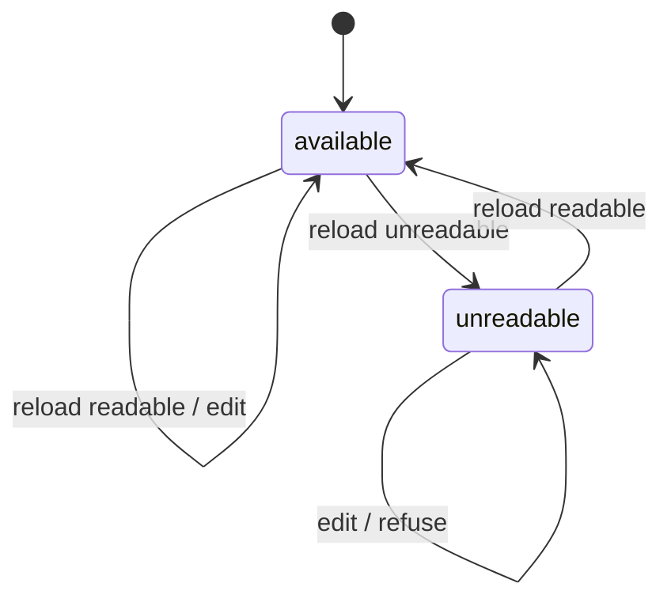

### ComposerStagingMachine

- **File:** `Sources/Waycar/Attachments/ComposerStagingMachine.swift`
- **Owner:** `ComposerStagingStore` runs attempt-token-keyed preparation/upload
  Tasks, deletes prepared files and publishes stable operation ids. The first
  upload continues the preparation's Task, rekeyed under its fresh upload token.
- **States:** `idle`, `preparing(operation, attempt, medium)`,
  `uploading(operation, attempt, source, progress)`,
  `cancelling(operation, attempt, work, disposition)`,
  `leaving(token, presentation, retainedSource, cancelledOperation)`,
  `failed(operation, failure, retainedSource, background)`.
- **Events:** `begin`, task results `prepared`/`progress`/`succeeded`/`failed`
  carrying attempt tokens, `cancel`/`retry`/`dismiss` carrying operation ids,
  `background`, `leave`, `left`.
- **Effects:** `prepare`, `upload`, `discard`, `cancelTask`, `finishTask`, `publish`.
  Every preparation and upload (including Retry) mints a fresh attempt token;
  operation ids and leave barriers share that never-reused counter. Retry keeps
  its public operation id; leave invalidates results before awaiting teardown.
- **Tests:** `ComposerStagingMachineTests`, `ComposerStagingStoreTests`,
  `ComposerTrayTests` (owner suites unchanged).
- **Catalogue:** SEND-06.

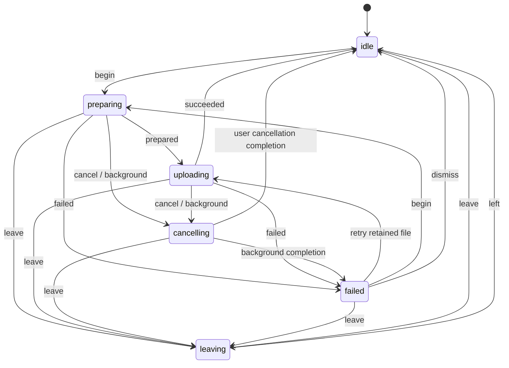

### ComposerTrayItemMachine

- **File:** `Sources/Waycar/Attachments/ComposerTrayItemMachine.swift`
- **Owner:** `ComposerTray` drives its bound staging worker and disposes local copies.
- **States:** `queued(source)`, `staging(source, operation)`,
  `failed(source, message, retryable, operation?)`, `ready(path)`, `removed`.
- **Events:** `started`, `completed`, `failed`, `retryRetained`, `retrySource`,
  `bindingChanged`, `remove`, `take`.
- **Effects:** `discardSource`, `cancel`, `dismiss`. Staging worker ids guard
  completions; binding identity is still checked by the tray.
- **Tests:** `ComposerTrayItemMachineTests`, `ComposerTrayTests`, `QueuedMessageTests`.
- **Catalogue:** SEND-07.

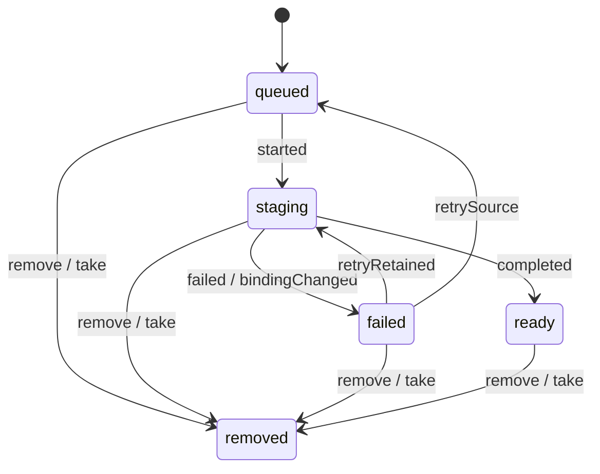

### ComposerDrainMachine

- **File:** `Sources/Waycar/Console/ComposerDrainMachine.swift`
- **Owner:** `AgentComposerStore` selects queue records, delivers them and runs
  token-keyed drain/retry Tasks, behind the existing foreground/launch gates.
- **States:** `idle`, `draining(token, failures, wake, retry?)`, `backingOff`,
  `waitingForLaunch`, `waitingForAgent`, `cancelled`. A concurrent direct Send's
  unsent result may arm a retry while the drain is still running.
- **Events:** `wake`, `iterationStarted`, `attemptFinished`, `ended`, `unsent`,
  `timerElapsed`, `cancel`.
- **Effects:** `start`, `continueDrain`, `finish`, `cancelDrain`, `armRetry`,
  `cancelRetry`. Agent wakes never reset link backoff; reconnect wakes do.
- **Tests:** `ComposerDrainMachineTests`, `QueuedMessageTests`,
  `AgentComposerStoreTests`, `QueuedLaunchTests` (owner suites unchanged).
- **Catalogue:** SEND-02.

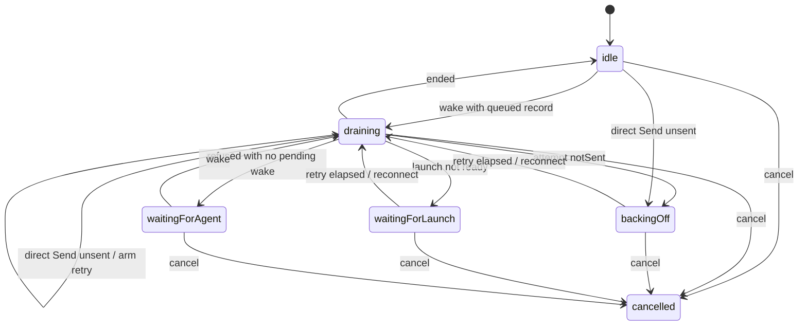

### ComposerPromptAdmissionMachine

- **File:** `Sources/Waycar/Console/ComposerPromptAdmissionMachine.swift`
- **Owner:** `AgentComposerStore.promptWaitingOutLaunch` performs prompt attempts
  and retry waits, returning response/timer tokens to its local reducer.
- **States:** `idle`, `attempting(token, deadline)`, `waitingForRegistration`,
  `waitingForInput`, `accepted`, `refused(reason)`, `cancelled`.
- **Events:** `begin(now, budget)`, `response(token, response, now, blocked)`,
  `retryElapsed(token, blocked, stillAddressed)`, `cancelled(token)`.
- **Effects:** `attempt(token)`, `wait(token, delay)`. Input gates extend the
  deadline; queued `agent_not_found` never waits. Blocked and identity checks
  precede every retry, and no input-hold error falls back to Attach typing.
- **Tests:** `ComposerPromptAdmissionMachineTests`, `AgentComposerStoreTests`,
  `QueuedMessageTests` (owner suites unchanged).
- **Catalogue:** SEND-03.

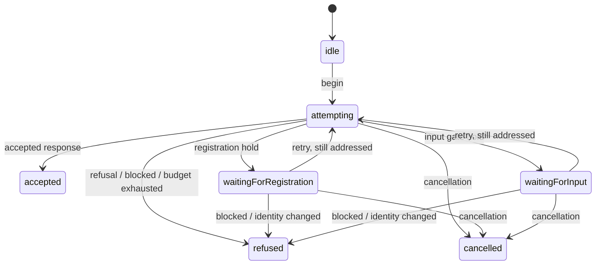

**Notifications, Live Activities, push, preferences, sync**

### NotificationRouteMachine

- **File:** `Sources/Waycar/Notifications/AgentNotificationRouter.swift`
- **Owner:** `AgentNotificationRouter` (main actor): sets the Console's
  navigation path and runs the grace timer.
- **States:** `idle` (no tap waiting); `waiting(target, grace:)` (a tap whose
  pane the Console does not know yet).
- **Events:** `tapped(target?, paneIsKnown:)`, `agentsChanged(ids)`,
  `navigated` (the path moved to an Agent), `graceElapsed(token)`.
- **Effects:** `showConsole`, `showAgent(id)`, `armGrace(token)`,
  `cancelGrace`.
- **Tests:** `NotificationRouteMachineTests`, `AgentNotificationRouterTests`.
- **Catalogue:** NOTIF-10.

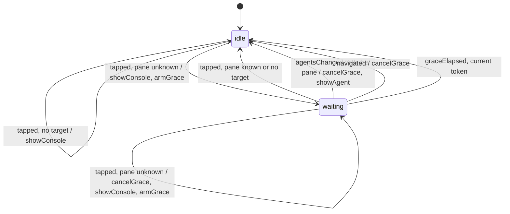

### PushRegistrationMachine

- **File:** `Sources/Waycar/Notifications/PushRegistrationMachine.swift`
- **Owner:** `PushRegistrationStore` queries iOS authorization, requests permission,
  and registers with APNs; callbacks feed token arrival and registration failure.
- **States:** `ready(status)`, `checking(token, status)`,
  `requestingPermission(token, status)`; status retains the launch's token even
  while denied, but only `registered` exposes it.
- **Events:** `refresh`, `enable`, `authorizationFinished`, `permissionFinished`,
  `deviceTokenArrived`, `registrationFailed`.
- **Effects:** `checkAuthorization(token)`, `requestPermission(token)`, `register`.
- **Tests:** `PushRegistrationMachineTests`, `PushRegistrationStoreTests`.
- **Catalogue:** NOTIF-03. PUSH-01 retained-token privacy is unchanged; query and
  permission answers share a monotonically increasing token.

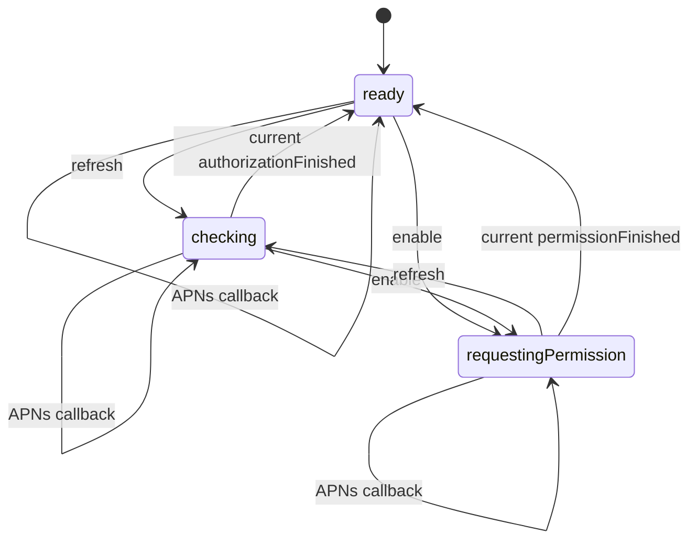

### NotificationPreferencesMachine

- **File:** `Sources/Waycar/Notifications/NotificationPreferencesMachine.swift`
- **Owner:** `NotificationPreferencesStore` reads registration files and performs
  registration ceremonies, including the reread after a partial write failure.
- **States:** per Host `unread`, `loading(token)`, `unavailable(message)`,
  `idle(settings)`, `updating(token, settings)`,
  `recoveringAfterPartialWrite(token, settings, message)`, `failed(message, settings)`.
- **Events:** `hostsChanged`, `load`, `loaded`, `loadFailed`, `write`, `written`,
  `writeFailed`, `recovered`, `recoveryFailed`.
- **Effects:** `read(token)`, `write(token)`, `reregister(settings)`, `reread(token)`,
  `writeCompleted(summaryChoice)`.
- **Tests:** `NotificationPreferencesMachineTests`, `NotificationPreferencesStoreTests`.
- **Catalogue:** NOTIF-04. The per-Host operation UUID checks become monotonic
  operation-token guards, including recovery and Host removal/readdition.

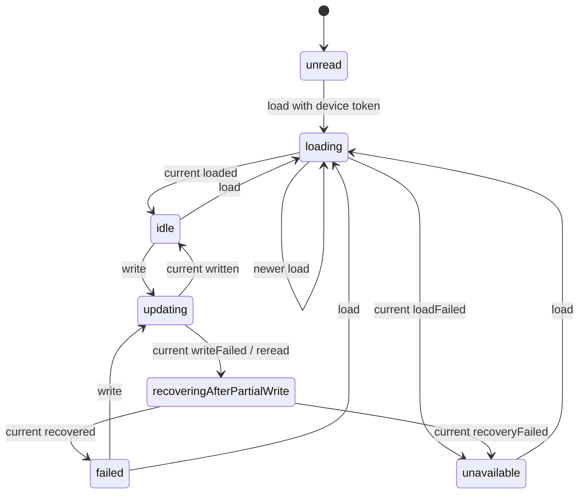

### SummaryChoiceReplicationMachine

- **File:** `Sources/Waycar/Notifications/SummaryChoiceReplicationMachine.swift`
- **Owner:** `NotificationPreferencesStore` owns token-keyed write Tasks and
  waits for each batch before feeding its completion and the latest choice.
- **States:** per Host `unconfirmed`, `confirmed(choice)`,
  `writing(token, choice, confirmed)`, `retryPending(choice, confirmed)`;
  token-keyed batches retain their starting choice and whether they joined work.
- **Events:** `catalogChanged`, `apply`, `writeFinished`, `batchFinished`,
  `registrationConfirmed`.
- **Effects:** `write(host, token, choice)`, `waitForWrites(batch, writes)`, `reapply`.
- **Tests:** `SummaryChoiceReplicationMachineTests`, `NotificationPreferencesStoreTests`.
- **Catalogue:** NOTIF-05. Preserves registration exclusion, joining an older
  write, changed-choice replay, and existing catalog semantics (catalog changes
  prune confirmations but do not cancel or abandon an in-flight write).

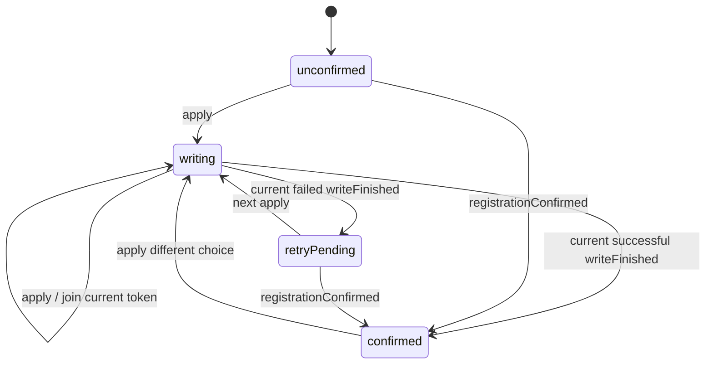

### AgentListFieldsEditingMachine

- **File:** `Sources/Waycar/Settings/AgentListFieldsEditingMachine.swift`
- **Owner:** `AgentListFieldsEditor` validates layouts, persists a Save, and
  invalidates plugin sync requests when a session ends or a Host is edited.
- **States:** `viewing(message)`, `editing(drafts, message)`.
- **Events:** `begin`, `cancel`, `edited`, `syncDraft`, `save`, `saved`, `messageChanged`.
- **Effects:** `invalidateAllSyncs`, `invalidateSync(host)`, `persist(changes)`.
- **Tests:** `AgentListFieldsEditingMachineTests`, `AgentListFieldsEditorTests`.
- **Catalogue:** NOTIF-17 (draft editing; plugin sync is a separate lifecycle).

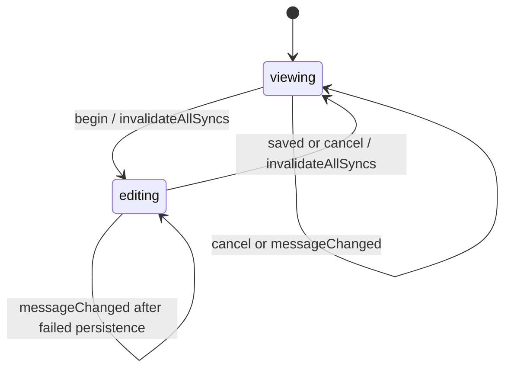

### AgentListFieldsSyncMachine

- **File:** `Sources/Waycar/Settings/AgentListFieldsSyncMachine.swift`
- **Owner:** `AgentListFieldsEditor` fetches plugin snapshots and applies
  replacements either to a draft or directly to the saved layout.
- **States:** per Host absent, `syncing(token, saveImmediately)`,
  `applying(token, message)`, `filled(message)`, `failed(message)`.
- **Events:** `start`, `received`, `applied`, `applyFailed`, `invalidate`, `invalidateAll`.
- **Effects:** `fetch(token)`, `applyLayout(host, token, layout, saveImmediately)`,
  `clearError`, `reportError(message)`.
- **Tests:** `AgentListFieldsSyncMachineTests`, `AgentListFieldsEditorTests`.
- **Catalogue:** NOTIF-17 (plugin sync). SETTINGS-01's independent per-Host
  request UUID checks become independent token-bearing states; edits and session
  boundaries invalidate the same requests as before.

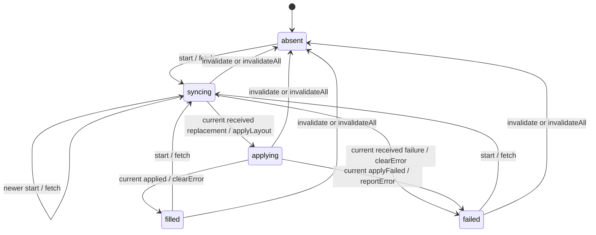

### NotificationBannerPresentationMachine

- **File:** `Sources/Waycar/Notifications/NotificationBannerPresentationMachine.swift`
- **Owner:** `AgentNotificationBannerStore` performs token-keyed dismissal Tasks;
  the existing per-Agent pipeline supplies banners and summary rewrites.
- **States:** `hidden`, `showing(banner, timer)`.
- **Events:** `show`, `dismiss`, `dismissalElapsed`.
- **Effects:** `armDismissal(token)`, `cancelDismissal(token)`.
- **Tests:** `NotificationBannerPresentationMachineTests`, `AgentNotificationBannerStoreTests`.
- **Catalogue:** NOTIF-09 (shown banner; per-Agent pipeline is `AgentNotificationPipelineMachine`).

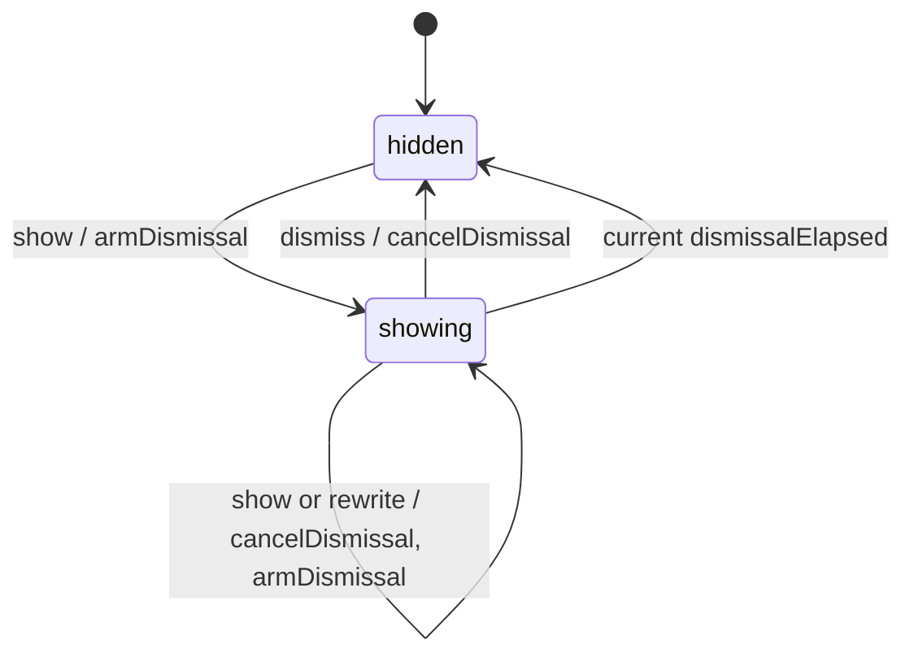

### ICloudPassMachine

- **File:** `Sources/Waycar/Sync/ICloudPassMachine.swift`
- **Owner:** `ICloudSyncCoordinator` runs the serial pass Task and publishes metadata/retries only for an accepted token. Poll/debounce Tasks supply request events; switch-off custody stays synchronous.
- **States:** `disabled`, `idle`, `syncing(token, rerun)`, `draining(token, enabled, rerun)`.
- **Events:** `enable`, `disable`, `request`, `began`, `result`, `failed`, `finished`. Requests preceding `began` join that pass; requests during it coalesce into the next.
- **Effects:** `run`, `publish`, `reportError`, `retryConnections`.
- **Tests:** `ICloudPassMachineTests`, `ICloudSyncCoordinatorTests` in `ICloudSyncTests.swift` (including B-36).
- **Catalogue:** NOTIF-13.

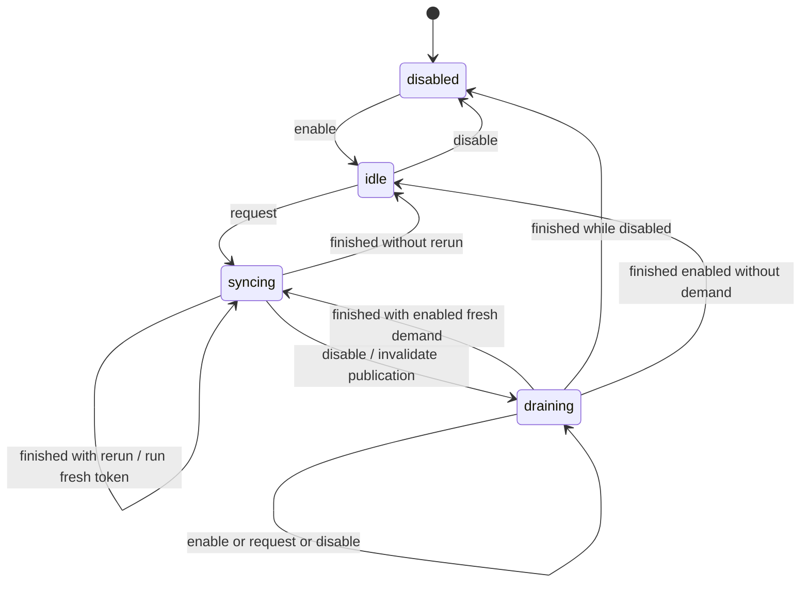

### NotificationAskMachine

- **File:** `Sources/Waycar/Notifications/NotificationAskMachine.swift`
- **Owner:** `NotificationAsk` persists the answer, requests iOS permission and starts enrollment.
- **States:** `unanswered(scene)`, `awaitingPermission(token)`, `accepted`, `declined`.
- **Events:** `present`, `release`, `unavailable`, `decline`, `turnOn`, `permissionFinished`.
- **Effects:** `initializeEnrollment`, `clearEnrollment`, `requestPermission`, `persist`, `saveEnrollment`, `processEnrollment`.
- **Tests:** `NotificationAskMachineTests`, unchanged `NotificationAskTests`.
- **Catalogue:** NOTIF-07 (ask; enrollment separate).

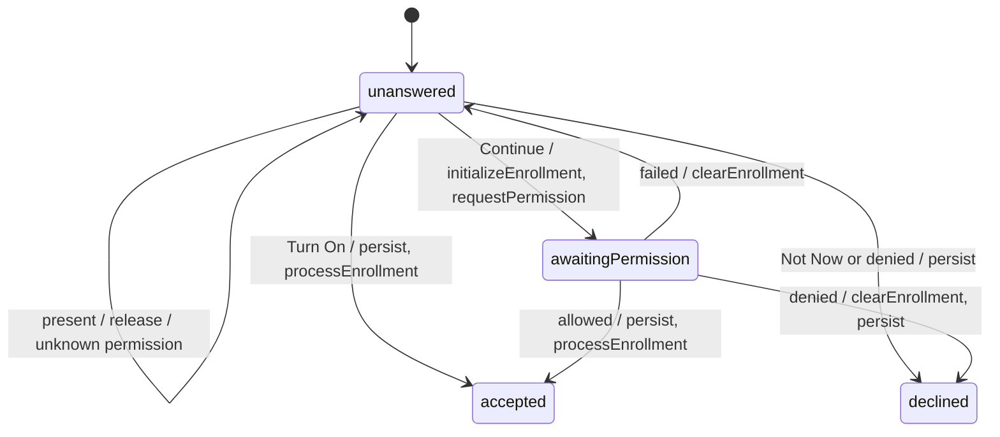

### NotificationEnrollmentMachine

- **File:** `Sources/Waycar/Notifications/NotificationEnrollmentMachine.swift`
- **Owner:** `NotificationAsk` registers Hosts, enables their Live Activities and persists pending/seen IDs.
- **States:** per Host `waiting`, `registering(token)`, `complete`; unseen Hosts have no entry.
- **Events:** `initialize`, `clear`, `discover`, `consider`, `registered`.
- **Effects:** `register`, `enableLiveActivity`, `save`.
- **Tests:** `NotificationEnrollmentMachineTests`, unchanged `NotificationAskTests` (permission, new Hosts, failed writes and re-entrant enrollment).
- **Catalogue:** NOTIF-07 (enrollment).

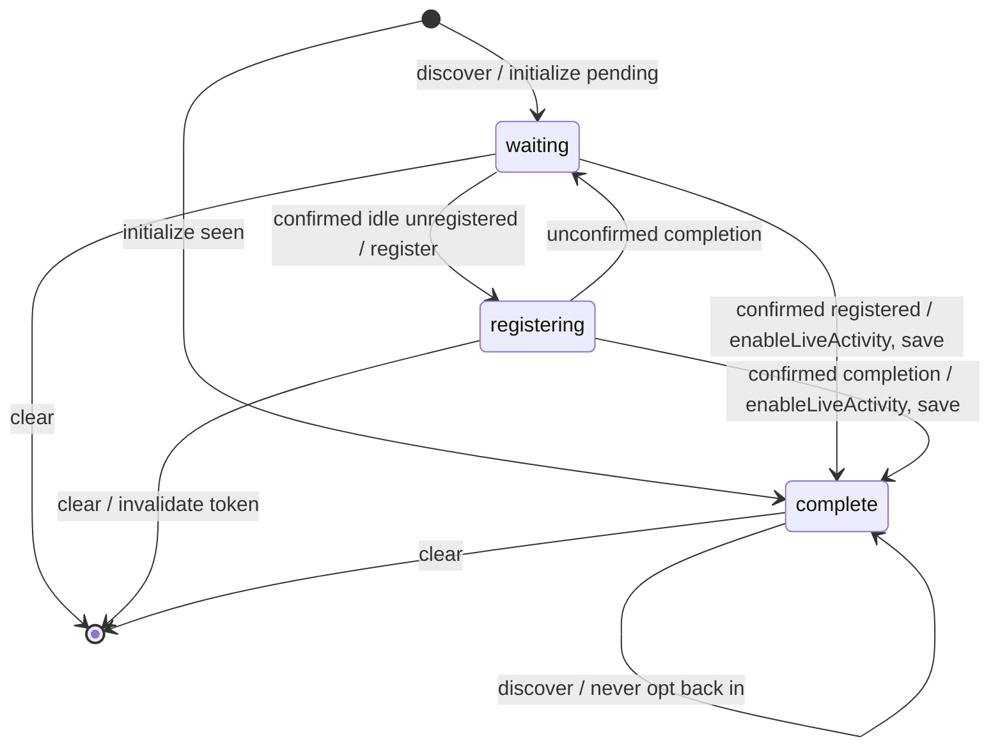

### LiveActivityRegistrationMachine

- **File:** `Sources/Waycar/LiveActivities/LiveActivityRegistrationMachine.swift`
- **Owner:** `HostLiveActivityCoordinator` performs token-keyed registration Tasks through the existing shared ceremony.
- **States:** per Host `idle`, `writing(token, job, pending)`, `retryPending(pending)` plus requested start intent and the last written update token.
- **Events:** `enqueue`, `activityToken`, `clearToken`, `requestStart`, `finished`, `retry`.
- **Effects:** `write(token, job)`; activity work precedes start work and LA-01 prevents preferences superseding failed token intent.
- **Tests:** `LiveActivityRegistrationMachineTests`, unchanged `HostLiveActivityCoordinatorTests` (failed token/preferences, token rotation, reconnect, alias and conditional clears).
- **Catalogue:** NOTIF-02.

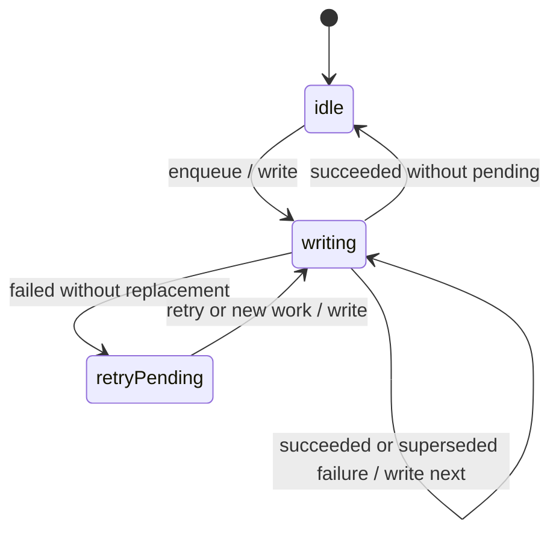

### AgentNotificationPipelineMachine

- **File:** `Sources/Waycar/Notifications/AgentNotificationPipelineMachine.swift`
- **Owner:** `AgentNotificationBannerStore` runs token-keyed hold/replay Tasks, samples presentation-time gates and sends show effects to `NotificationBannerPresentationMachine`.
- **States:** per Agent `unseen(summary)`, `baseline`, `holding(token)`, `deferred(candidate, announced)`, `announced`; replay `idle`/`waiting(token)`.
- **Events:** `observed`, `removed`, `push`, `holdElapsed`, `replayElapsed`.
- **Effects:** `armHold`, `cancelHold`, `show`, `armReplay`.
- **Tests:** `AgentNotificationPipelineMachineTests`, unchanged `AgentNotificationBannerStoreTests` (flaps, summary timing, sound deduplication, CarPlay gates and disappearing Agents).
- **Catalogue:** NOTIF-09 (per-Agent pipeline).

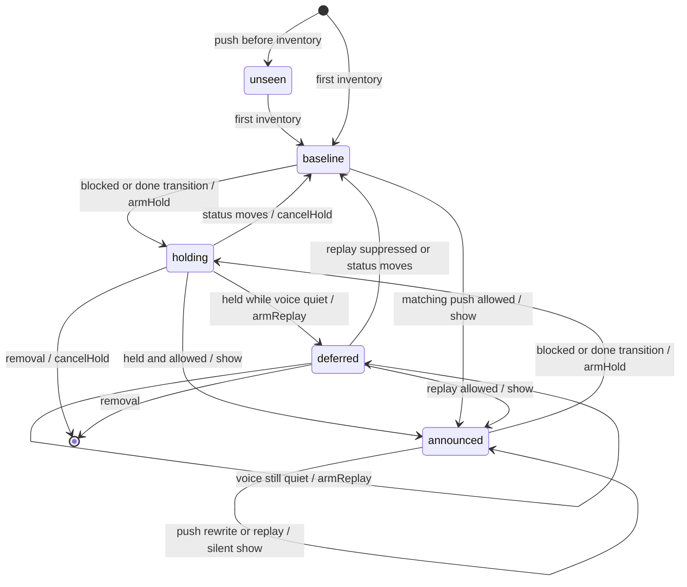

### LiveActivityLifecycleMachine

- **File:** `Sources/Waycar/LiveActivities/LiveActivityLifecycleMachine.swift`
- **Owner:** `HostLiveActivityCoordinator` samples inventory/desire/connection policy, seals content, performs ActivityKit requests and updates, and runs identity-keyed state/token watchers and token-keyed settle Tasks.
- **States:** global stopped/started; per computer `idle`, `active(live)`, `awaitingSnapshot(live)`, `dismissed(applied)`, `startFailed(applied)`, with orthogonal settle `idle`/`waiting(token)`. Retired identities and the newest inventory projection live in the machine.
- **Events:** `start`, `schedule`, `cancelSettle`, `settleElapsed`, `begin`, `applied`, `startFailed`, `forgetFailure`, `hold`, `releaseHold`, `drop`, `end`, `expire`, `activityState`, `retire`, `inventory`.
- **Effects:** `armSettle`, `cancelSettle`, `apply`, `watch`, `cancelWatch`, `endActivity`, `clearToken`, `schedule`.
- **Tests:** `LiveActivityLifecycleMachineTests`, unchanged `HostLiveActivityCoordinatorTests` (LA-02 dismissal, expiry/replacement, adoption, retired IDs, snapshot holds, failed starts and alias takeover).
- **Catalogue:** NOTIF-01.

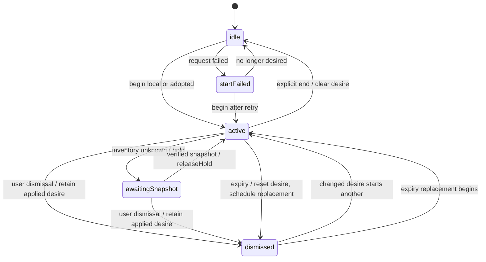

**Voice, CarPlay, dictation**

### DictationSendMachine

- **File:** `Sources/Waycar/Dictation/DictationSendMachine.swift`
- **Owner:** `DictationSender`: starts/cancels the store, awaits finish, and
  sends or drafts the consumed text. Its target carries the session token.
- **States:** `idle`, `recording(token)`, `interrupted(token, text)`,
  `stopping(token, text)`, `discarded`.
- **Events:** `start`, `committed(token, text)`, `stop`, `finished(token)`,
  `keepInterrupted`, `cancel`.
- **Effects:** `start(token)`, `finish(token)`, `take(text)`, `cancel`.
- **Tests:** `DictationSendMachineTests`, `DictationSenderTests`.
- **Catalogue:** VOICE-02. Cancellation blocks buffered consumption (B-06);
  stopping owns the words until its matching finish, never an idle observer.

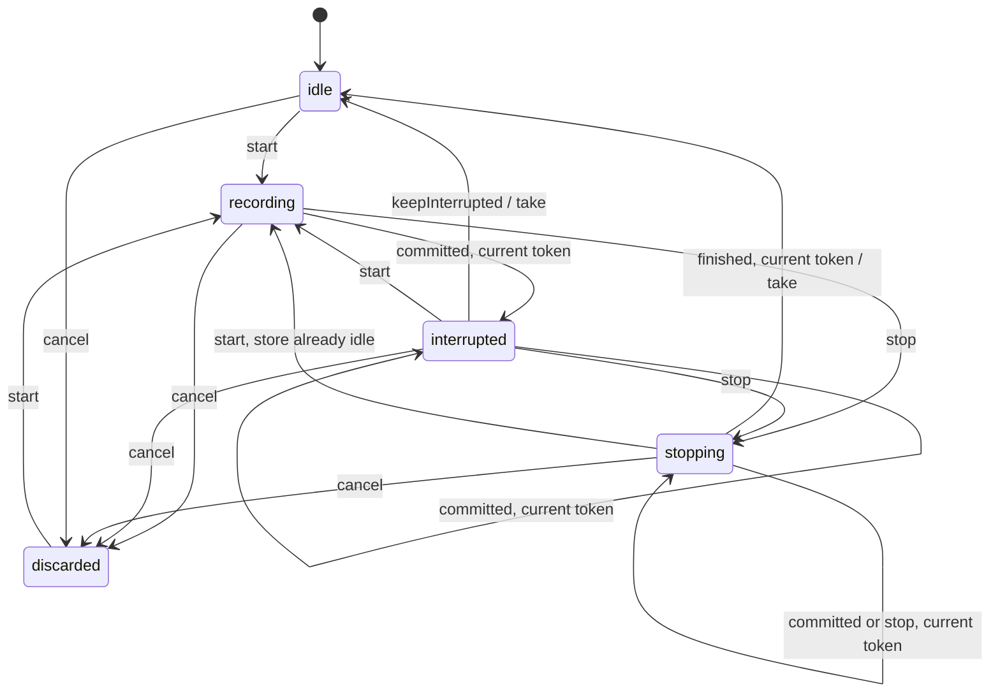

### BlockedAnswerQueueMachine

- **File:** `Sources/Waycar/Voice/BlockedAnswerQueueMachine.swift`
- **Owner:** `BlockedAnswerQueue`: creates entry UUIDs, owns expiry Tasks keyed
  by those UUIDs, and calls the existing finish reporter.
- **States:** a map of Agents to `queued(entry)` or `sending(entry)`; absence
  is settled. A sending entry has no live expiry.
- **Events:** `enqueue(entry)`, `withdraw(agent)`, `claim(entry)`,
  `finish(entry, outcome)`.
- **Effects:** `armExpiry(entry)`, `cancelExpiry(id)`, `claimed(id)`,
  `report(entry, outcome)`.
- **Tests:** `BlockedAnswerQueueMachineTests`, `BlockedAnswerQueueTests`.
- **Catalogue:** VOICE-01. Entry UUID checks fence superseded callbacks;
  `.expired` is ignored after a successful dispatch claim.

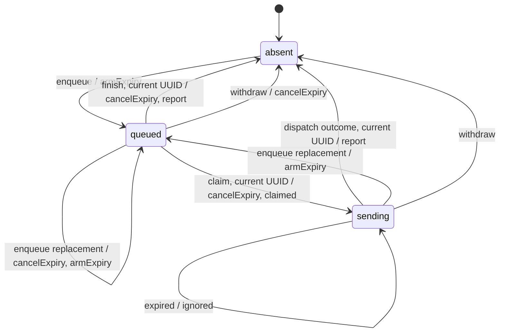

### DictationPhaseMachine

- **File:** `Sources/Waycar/Dictation/DictationPhaseMachine.swift`
- **Owner:** `DictationStore`: owns session targets, transcript segments and
  engine Tasks by machine token. Presentation keys notify independently,
  with text insertion before idle notification.
- **States:** `idle(failure)`, `starting(capture)`, `downloading(capture, fraction)`,
  `listening(capture)`, `finishing(capture)`, `cancelling(capture, showing)`.
- **Events:** `start`, `engine(token, event)`, `stop`, `cancel`,
  `ended(token, failure)`, `dismissFailure`.
- **Effects:** `start(token)`, `finish(token)`, `cancel(token)`,
  `transcript(token, text, isFinal)`, `end(token)`.
- **Tests:** `DictationPhaseMachineTests`, `DictationStoreTests`,
  `DictationSenderTests`, `AgentVoiceServiceTests`.
- **Catalogue:** VOICE-08. Every stream event and end is session-scoped;
  finishing ignores queued progress/levels/listening, never final words.

```mermaid
stateDiagram-v2
    [*] --> idle
    idle --> starting: start
    starting --> downloading: model progress
    starting --> listening: microphone opened
    downloading --> listening: microphone opened
    listening --> finishing: stop / finish, flatten level
    starting --> cancelling: stop or cancel
    downloading --> cancelling: stop or cancel
    listening --> cancelling: cancel
    finishing --> cancelling: cancel
    cancelling --> cancelling: buffered engine events, finishing suppression kept
    starting --> idle: ended, current token
    downloading --> idle: ended, current token
    listening --> idle: ended, current token
    finishing --> idle: ended, current token
    cancelling --> idle: ended, current token
```

### BlockedPromptAnswerMachine

- **File:** `Sources/Waycar/Voice/BlockedPromptAnswerMachine.swift`
- **Owner:** `BlockedPromptAnswerer`: reads screens, executes the `willSend`
  claim, sends keys, waits for unblock, and prompts or drafts a correction.
  One shared execution gates car actions; generic answers/replays retain
  their existing independent executions.
- **States:** `idle`, `verifying(token, request)`, `claiming(token, request)`,
  `dispatching(token, request)`, `waitingUnblocked(token, text)`,
  `promptingCorrection(token, text)`, `drafting(token, text)`, `settling(token, result)`.
- **Events:** `begin`, `read`, `claimed`, `keysSent`, `unblocked`, `prompted`,
  `drafted`, `completed`; every completion carries its execution token.
- **Effects:** `read`, `claim`, `sendKeys`, `queue`, `waitUnblocked`, `prompt`,
  `draft`, `complete`, `busy`.
- **Tests:** `BlockedPromptAnswerMachineTests`, `BlockedPromptAnswererTests`,
  `BlockedAnswerQueueTests`, `AgentVoiceServiceTests`.
- **Catalogue:** VOICE-18. Exact screen equality and saved classifier equality
  precede `willSend`; no transition retries keys or an uncertain prompt.

```mermaid
stateDiagram-v2
    [*] --> idle
    idle --> verifying: begin / read
    verifying --> claiming: screen and classifier match / claim
    verifying --> settling: unwanted, cancelled, changed or unreachable
    claiming --> dispatching: claimed / sendKeys
    claiming --> settling: claim rejected
    dispatching --> settling: answer result or failed Deny
    dispatching --> waitingUnblocked: correction Deny succeeded
    waitingUnblocked --> promptingCorrection: unblocked / prompt
    waitingUnblocked --> drafting: timeout / draft
    promptingCorrection --> drafting: refused unsent / draft
    promptingCorrection --> settling: sent or uncertain failure
    drafting --> settling: drafted
    settling --> idle: completed, current token
```

### SpeechSessionMachine

- **File:** `Sources/Waycar/Dictation/SpeechSessionMachine.swift`
- **Owner:** `SpeechDictationEngine`: performs microphone/analyzer effects
  on the captured Session. The Session is never restarted; its local token
  fences awaited checkpoints. External requests still match `DictationSessionID`,
  and claim/resource release still checks `self.session === session`.
- **States:** `preparing(token, stage)`, `capturing(token)`, `finalizing(token)`,
  `cancelling(token, disposition)`, `releasing(token, disposition)`,
  `released(token, disposition)`.
- **Events:** `checkpoint(token, stage, taskCancelled)`, `microphoneOpened(token)`,
  `finish`, `finalized(token, succeeded)`, `cancel`, `teardown`, `tornDown(token)`.
- **Effects:** `continueStartup`, `releaseClaim`, `stopCapture`, `discardInput`,
  `finalize(token)`, `cancelAnalyzer`, `releaseResources`.
- **Tests:** `SpeechSessionMachineTests`; `DictationStoreTests` and
  `AgentVoiceServiceTests` cover the scripted engine boundary. The production
  Speech/AVFoundation stack remains device-only, not simulator-verified.
- **Catalogue:** VOICE-09. All six startup cancellation checkpoints retained;
  finalization/cancellation disposition survives teardown. Shared audio
  ownership (VOICE-04) is unchanged and remains deferred.

```mermaid
stateDiagram-v2
    [*] --> preparing
    preparing --> preparing: matching checkpoint, task not cancelled
    preparing --> capturing: microphoneOpened, current token
    preparing --> cancelling: finish or cancel / releaseClaim
    capturing --> finalizing: finish / stopCapture, finalize
    capturing --> cancelling: cancel / releaseClaim
    finalizing --> cancelling: cancel, preserve finalizing disposition
    preparing --> releasing: teardown
    capturing --> releasing: teardown
    finalizing --> releasing: teardown, no analyzer cancellation
    cancelling --> releasing: teardown, preserve disposition
    releasing --> releasing: cancel, preserve finalizing disposition
    releasing --> released: tornDown, current token / releaseResources
    released --> releasing: repeated teardown, idempotent resources
```

### CarSpeakerLineMachine

- **File:** `Sources/Waycar/Voice/CarSpeakerLineMachine.swift`
- **Owner:** `CarSpeaker`: plays engines in the caller's task, watches holds
  and audible progress, and waits out interruptions. Audio-session ownership
  remains separate (VOICE-04).
- **States:** `idle`, `playing(line)`, `held(line, watch)`,
  `watchingResume(line, watch, progress)`, `retrying(line)`, `systemFallback(line)`.
- **Events:** `start`, `stop`, `completed(line, outcome)`, `retryReady`,
  `hold`, `resume`, `holdExpired`, `progress`.
- **Effects:** `play`, `waitForInterruption`, `finished`, `release`,
  `stopEngine`, `watchHold`, `watchProgress`.
- **Tests:** `CarSpeakerLineMachineTests`, `AgentVoiceServiceTests`.
- **Catalogue:** VOICE-03. The `stops == line` ownership epoch is retained;
  hold and progress timers additionally carry never-reused watch tokens.

```mermaid
stateDiagram-v2
    [*] --> idle
    idle --> playing: start
    playing --> held: pause
    held --> watchingResume: resume succeeds
    held --> playing: resume fails or hold expires
    watchingResume --> watchingResume: progress
    watchingResume --> playing: stalled
    playing --> retrying: primary failed
    retrying --> playing: interruption ended
    playing --> systemFallback: retry failed on natural voice
    systemFallback --> held: pause
    playing --> idle: completed or stop
    held --> idle: completed or stop
    watchingResume --> idle: completed or stop
    systemFallback --> idle: completed or stop
    retrying --> idle: cancelled or stop
```

### VoiceConversationMachine

- **File:** `Sources/Waycar/Voice/VoiceConversationMachine.swift`
- **Owner:** `AgentVoiceConversation`: token-keyed task performs speech,
  listening, sending, reply waits and announcements.
- **States:** `ready`, `introducing`, `listening(followUp, quietSince)`,
  `sending`, `waiting`, `replying`, `announcing`, `finishing`, `ended`.
  Introduction is named internally without a new presentation phase.
- **Events:** `start`, `introduced`, `listened`, `sent`, `replied`, `spoken`,
  `announced`, `close`; completions carry step tokens.
- **Effects:** `introduce`, `phase`, `listen`, `send`, `reply`, `speak`,
  `announce`, `endAudio`, `stopAudio`, `cancelTask`, `clearTask`.
- **Tests:** `VoiceConversationMachineTests`, `AgentVoiceServiceTests`.
- **Catalogue:** VOICE-05. Terminal and post-await cancellation guards,
  quiet deadlines, and auto-send behavior are preserved.

```mermaid
stateDiagram-v2
    [*] --> ready
    ready --> introducing: start
    introducing --> listening: introduced
    listening --> listening: silence before deadline
    listening --> sending: heard question
    sending --> waiting: delivered
    waiting --> replying: answer
    replying --> announcing: spoken
    announcing --> listening: announced / follow-up
    listening --> finishing: failure or idle deadline
    sending --> finishing: failure
    waiting --> finishing: final reply
    finishing --> ended: spoken and announced
    ready --> ended: close
    introducing --> ended: close
    listening --> ended: close or spoken exit
    sending --> ended: close
    waiting --> ended: close
    replying --> ended: close
    announcing --> ended: close
    finishing --> ended: close
```

### VoiceListenMachine

- **File:** `Sources/Waycar/Voice/VoiceListenMachine.swift`
- **Owner:** `AgentVoiceService.listen`: the consumer and watchdog share
  one main-actor machine; their session-local token never crosses listens.
- **States:** `starting`, `listeningQuiet`, `listeningSpeech`,
  `finalizing(reason)`, `ended(result)`; capture state owns transcript segments
  and the existing pure `Endpointer`.
- **Events:** `engine(token, event, now)`, `tick(token, now)`,
  `streamEnded(token, failure)`.
- **Effects:** `cancelConsumer(token)` (startup timeout only), `finishEngine(token)`.
  Caller cancellation still immediately cancels the consumer; stream completion
  settles its result, as before.
- **Tests:** `VoiceListenMachineTests`, `AgentVoiceServiceTests`.
- **Catalogue:** VOICE-10. Startup cancellation remains distinct from normal
  finish, which continues accepting final transcript segments.

```mermaid
stateDiagram-v2
    [*] --> starting
    starting --> listeningQuiet: microphone opened
    starting --> listeningSpeech: microphone opened after early words
    starting --> finalizing: startup timeout / cancel and finish
    listeningQuiet --> listeningSpeech: changed words
    listeningQuiet --> finalizing: no speech or maximum / finish
    listeningSpeech --> listeningSpeech: changed words
    listeningSpeech --> finalizing: trailing silence or maximum / finish
    finalizing --> finalizing: final words
    starting --> ended: stream ended
    listeningQuiet --> ended: stream ended
    listeningSpeech --> ended: stream ended
    finalizing --> ended: stream ended
```

### HeardApprovalMachine

- **File:** `Sources/Waycar/Voice/HeardApprovalMachine.swift`
- **Owner:** `AgentVoiceService`: per-Agent machines scope suspended speech
  completions and synchronously authorize one guarded Allow.
- **States:** `unheard`, `speaking(question, token)`, `heard(question)`, `consumed`.
- **Events:** `announce(question)`, `completed(token, spoken)`, `allow(question)`.
- **Effects:** `speak(token)`, `authorize(snapshot)`.
- **Tests:** `HeardApprovalMachineTests`, `AgentVoiceServiceTests`.
- **Catalogue:** VOICE-22. Full-question equality and consumption before any
  await are preserved; superseded speech cannot authorize an old question.

```mermaid
stateDiagram-v2
    [*] --> unheard
    unheard --> speaking: announce
    speaking --> speaking: replacement announcement
    speaking --> heard: current speech completed in full
    speaking --> unheard: current speech failed
    heard --> consumed: matching eligible Allow / authorize
    heard --> speaking: announce
    consumed --> speaking: announce
```

### CarPlayTurnMachine

- **File:** `Sources/Waycar/CarPlay/CarPlayTurnMachine.swift`
- **Owner:** `CarPlayTemplateCoordinator` retains CarPlay objects, conversation
  and step Tasks, renders the existing screens, and performs draft effects.
- **States:** `none`, `briefing`, `conversation`, `checking`, `rechecking`,
  `awaitingAnswer`, `confirmingCorrection`, `acting`, `finishing`.
- **Events:** `open`, `replaceStep`, `checkpoint`, `announce`, `spoken`,
  `correction`, `answer`, `sendCorrection`, `draft`, `hold`, `finish`, `close`,
  `disappeared`.
- **Effects:** `proceed`, `answer`, `correct`, `draft`, `held`, `closed`.
- **Tests:** `CarPlayTurnMachineTests`; `AgentVoiceServiceTests` pins conversation
  screen mapping and confirmed/failed/queued/drafted answer presentation. Actual
  CarPlay template delivery remains device-only; the pure machine is its seam.
- **Catalogue:** VOICE-06. Object identity still gates disappearance. Template
  tokens survive step replacement; step tokens and Task cancellation fence every
  await. Only an unclaimed correction is salvaged. An unclaimed prompt retains
  its existing Deny during the final dwell; an acted/held turn cannot act again.
  B-07's typed dispatch outcome continues to gate Done; no new UI state or copy.

```mermaid
stateDiagram-v2
    [*] --> none
    none --> briefing: open briefing
    none --> conversation: open conversation
    none --> checking: open blocked
    checking --> awaitingAnswer: question spoken
    checking --> acting: Deny during initial speech
    awaitingAnswer --> confirmingCorrection: correction heard
    awaitingAnswer --> acting: answer
    confirmingCorrection --> acting: send or Deny / consume words
    confirmingCorrection --> finishing: cancel / draft
    acting --> rechecking: changed prompt
    rechecking --> awaitingAnswer: replacement question spoken
    awaitingAnswer --> finishing: hold
    acting --> finishing: settled
    briefing --> finishing: last line
    confirmingCorrection --> none: close / draft
    finishing --> none: close
    conversation --> none: close
```

### NaturalVoiceModelMachine

- **File:** `Sources/Waycar/Voice/NaturalVoiceModelMachine.swift`
- **Owner:** `NaturalVoiceModelStore` reads disk, runs downloads/deletes, controls
  the process-wide network switch, and retains Tasks keyed by operation/read token.
- **States:** `ready`, `checking(token)`, `downloading(operation)`,
  `preparing(operation)`, `cancelling(operation, fetched)`, `deleting(operation)`;
  the last disk/progress projection remains visible until a fresh snapshot arrives.
- **Events:** `refresh`, `snapshot`, `download`, `delete`, `cancel`, `progress`,
  `fetched`, `completed`.
- **Effects:** `readSnapshot`, `download`, `delete`, `cancel`, `clearWork`.
- **Tests:** `NaturalVoiceModelMachineTests`, `NaturalVoiceModelStoreTests`
  (injected disk reads), `NaturalVoiceTests` (existing file/install helpers).
  Live FluidAudio installation and device compilation remain device-dependent.
- **Catalogue:** VOICE-12. Cancellation retains the serialized work slot and
  network exclusion through cleanup; fetching stops progress even while cancelling.
  Snapshot tokens reject old reads without dropping newer refresh demand.

```mermaid
stateDiagram-v2
    [*] --> ready
    ready --> checking: refresh
    checking --> checking: newer refresh / readSnapshot
    checking --> ready: matching snapshot
    ready --> downloading: download
    checking --> downloading: download, invalidate read
    downloading --> preparing: fetched
    downloading --> cancelling: cancel or delete same model
    preparing --> cancelling: cancel or delete same model
    ready --> deleting: delete
    checking --> deleting: delete, invalidate read
    deleting --> cancelling: cancel or delete same model
    cancelling --> cancelling: progress or fetched, matching token
    downloading --> checking: completed / clearWork, readSnapshot
    preparing --> checking: completed / clearWork, readSnapshot
    deleting --> checking: completed / clearWork, readSnapshot
    cancelling --> checking: cleanup completed / clearWork, readSnapshot
```

### NeuralPlaybackMachine

- **File:** `Sources/Waycar/Voice/NeuralPlaybackMachine.swift`
- **Owner:** `NeuralSpeechEngine` synthesizes and schedules audio, pauses/restarts
  AVFoundation resources, and owns synthesis Tasks and continuations by line epoch.
- **States:** `idle(progress)`, `synthesizing(line)`, `playing(line)`,
  `paused(line, synthesis)`, `draining(line)`, `ended(line, spoken)`.
- **Events:** `resetProgress`, `start`, `sentence`, `scheduled`, `played`,
  `synthesized`, `failed`, `pause`, `resume`, `configurationChanged`, `stop`,
  `stopLine`, `released`.
- **Effects:** `synthesize`, `complete`, `releaseResources`, `ensurePlaying`,
  `pauseAudio`, `resumeAudio`, `configurationStopped`.
- **Tests:** `NeuralPlaybackMachineTests`, `NeuralSpeechEngineTests` (empty-stream
  synthesis, cancellation and replacement without audio/model files),
  `NaturalVoiceTests` (existing sentence boundaries), `AgentVoiceServiceTests`
  (speaker retry/progress contract). Audible playback remains device-only.
- **Catalogue:** VOICE-14. Existing speak/stop epochs fence chunks, completion,
  cancellation, configuration change and deferred cleanup. The machine emits
  completion once; the owner removes its continuation before resuming it. Paused
  chunks queue without playing; a held configuration change does not end the line.

```mermaid
stateDiagram-v2
    [*] --> idle
    idle --> synthesizing: start, current epoch
    synthesizing --> playing: first nonempty buffer
    playing --> playing: schedule or played before synthesis ends
    playing --> paused: pause
    playing --> draining: synthesis ended with pending buffers
    paused --> paused: schedule or synthesis ended
    paused --> playing: resume, synthesis ongoing
    paused --> draining: resume, synthesis finished
    draining --> paused: pause
    draining --> ended: last buffer played / complete true
    synthesizing --> ended: synthesis ended without buffers / complete false
    playing --> ended: all played and synthesis ended / complete true
    paused --> ended: last callback after synthesis ended / complete true
    playing --> idle: stop or configuration change / complete false, release
    synthesizing --> idle: stop / complete false, release
    paused --> idle: stop / complete false, release
    draining --> idle: stop / complete false, release
    ended --> idle: stop / release
```

**Apple Watch**

### WatchApprovalMachine

- **File:** `Sources/WaycarWatchCore/WatchApprovalMachine.swift`
- **Owner:** WatchStore performs prompt reads, answers and haptics.
- **States:** resting(read, answer), reading(token, episode, answer, stamp policy, reload wanted), answering(prompt, token, choice).
- **Events:** load, readFinished, answer, answerFinished, blockedEpisode.
- **Effects:** read, answer, success, failure.
- **Tests:** WatchApprovalMachineTests; WatchBridgeTests covers the peer's approval contract. WatchStore is watch-target-only; its effect adapter is watch-build checked.
- **Catalogue:** WATCH-01.

```mermaid
stateDiagram-v2
    [*] --> resting
    resting --> reading: load, stamp expired or not answered
    reading --> resting: readFinished, matching token and episode
    reading --> resting: readFinished, earlier episode, no load waiting (discard)
    reading --> reading: readFinished, earlier episode, a load waiting / read current episode
    reading --> reading: load (single flight; remembered)
    resting --> answering: answer, allowed and not already answered
    answering --> resting: answerFinished, matching token and prompt id
    answering --> reading: spent answer / reread
    reading --> reading: blockedEpisode / hide old read
    answering --> resting: blockedEpisode
    resting --> resting: blockedEpisode
```

### WatchActivityLeaseMachine

- **File:** `Sources/Waycar/Watch/WatchActivityLeaseMachine.swift`
- **Owner:** `WatchBridge` begins/ends background time and sends open replies.
- **States:** `released`, `held(generation, owners, reachable)`.
- **Events:** `acquire`, `release`, `reachability`, `expired(generation)`.
- **Effects:** `begin`, `startPublishing`, `expireReplies`, `release` (in that order on expiry).
- **Tests:** `WatchActivityLeaseMachineTests`, `WatchBridgeTests`.
- **Catalogue:** WATCH-15. Reply handlers stay owner resources; expired generations and old owners do nothing.

```mermaid
stateDiagram-v2
    [*] --> released
    released --> held: acquire / begin
    released --> held: reachable / begin, startPublishing
    held --> held: acquire, release, reachability
    held --> released: last owner leaves / release
    held --> released: current expiration / expireReplies, release
```

### WatchMessageLedgerMachine

- **File:** `Sources/Waycar/Watch/WatchMessageLedgerMachine.swift`
- **Owner:** `WatchBridge` acknowledges, sends/transcribes and delivers outcomes.
- **States:** per id: absent, `processing(token, agentID)`, `retryable(transcript)`, `finished(event)`; insertion order bounds settled memory.
- **Events:** `receive`, `begin`, `finished(token, delivery, transcript)`.
- **Effects:** `acknowledge`, `process(token, transcript)`, `deliver`.
- **Tests:** `WatchMessageLedgerMachineTests`, `WatchBridgeTests`.
- **Catalogue:** WATCH-12. Unknown is final; only definite non-delivery retries. Stale completions cannot settle a newer attempt. Trimming stops at the oldest processing id.

```mermaid
stateDiagram-v2
    [*] --> absent
    absent --> processing: begin / process
    processing --> processing: receive / acknowledge
    processing --> retryable: notSent / deliver
    processing --> finished: other outcome / deliver
    retryable --> processing: begin / process with transcript
    finished --> finished: receive / acknowledge, deliver
    finished --> absent: evict
    retryable --> absent: evict
```

### WatchApprovalLedgerMachine

- **File:** `Sources/Waycar/Watch/WatchApprovalLedgerMachine.swift`
- **Owner:** `WatchBridge` keeps answer Tasks by token, waits for Hosts and performs guarded answers.
- **States:** per prompt: absent/spent, `available(snapshot)`, `answering(token, prompt, choice)`, `answered(token, choice, reply)`; separate bounded prompt/answer orders.
- **Events:** `read`, `answer`, `hostFailed(token)`, `completed(token, reply, keep)`.
- **Effects:** `start`, `join(sameChoice)`, `reply`, `unlockRequired`, `forgetTask`.
- **Tests:** `WatchApprovalLedgerMachineTests`, `WatchBridgeTests`.
- **Catalogue:** WATCH-14. First answer wins; an opposite choice waits but returns changed. A newer read replaces availability, not in-flight work; Host failure restores only without a newer available read. Completion tokens protect retries and eviction.

```mermaid
stateDiagram-v2
    [*] --> available: read
    available --> answering: answer / start
    available --> spent: replacement or eviction
    answering --> answering: repeat / join
    answering --> available: Host failure without newer read
    answering --> spent: Host failure with newer read, failed answer, eviction
    answering --> answered: confirmed outcome
    answered --> answered: repeat / join
    answered --> spent: eviction
```

### WatchRecordingRendezvousMachine

- **File:** `Sources/Waycar/Watch/WatchRecordingRendezvousMachine.swift`
- **Owner:** `WatchBridge` owns timer Tasks/activity holds by rendezvous token, deletes files, and transcribes paired recordings.
- **States:** per id: absent, `fileWaiting(url, arrived, expiry)`, `messageWaiting(agentID, messageToken, wait)`, `expired`. Pairing consumes the entry; the message ledger then rejects duplicates.
- **Events:** `message`, `file(arrived, acceptUnclaimed)`, `waitExpired(token)`, `fileExpired(token)`, `sweep(cutoff)`.
- **Effects:** `waitForFile`, `armExpiry`, `cancelTimer`, `delete`, `transcribe(waitingToken?)`, `missing(waitingToken?)`.
- **Tests:** `WatchRecordingRendezvousMachineTests`, `WatchBridgeTests`.
- **Catalogue:** WATCH-13. Both arrival orders transfer the hold exactly once; expiry cancels timers, bounded tombstones fail a late envelope promptly, and a new file enables retry. Old wait/expiry tokens are ignored.

```mermaid
stateDiagram-v2
    [*] --> absent
    absent --> fileWaiting: file / armExpiry
    absent --> messageWaiting: message / waitForFile
    fileWaiting --> fileWaiting: replacement / cancelTimer, delete, armExpiry
    fileWaiting --> absent: message / cancelTimer, transcribe
    messageWaiting --> absent: file / cancelTimer, transcribe with hold
    messageWaiting --> absent: waitExpired / cancelTimer, missing, release hold
    fileWaiting --> expired: fileExpired or sweep / cancelTimer, delete
    expired --> absent: message / missing
    expired --> fileWaiting: file / armExpiry
    expired --> absent: evict
```

### WatchLatestMachine

- **File:** `Sources/WaycarWatchCore/WatchLatestMachine.swift`
- **Owner:** WatchStore performs Latest reads and delayed rechecks; AgentDetailView reads its checking projection.
- **States:** resting(read), reading(token, previous, recheck, pendingTimer), scheduled(latest, timer).
- **Events:** load, finished, recheckElapsed. **Effects:** read, scheduleRecheck.
- **Tests:** WatchLatestMachineTests; WatchRequesterTests covers the read transport. Watch-only owner needs integrator watch build.
- **Catalogue:** WATCH-04. Single flight, retained text and one follow-up; superseded timers/completions do nothing. A reload keeps a scheduled follow-up's timer: dropped if it elapses mid-read, kept through a failed reload.

```mermaid
stateDiagram-v2
    [*] --> resting
    resting --> reading: load
    reading --> scheduled: stale initial result
    scheduled --> reading: load or matching recheck timer
    reading --> scheduled: reload failed, follow-up timer still pending
    reading --> resting: result or failure
```

### WatchRecorderPresentationMachine

- **File:** `Sources/WaycarWatchCore/WatchRecorderPresentationMachine.swift`
- **Owner:** RecorderView starts audio, announces reasons, sends the file once and navigates.
- **States:** preparing, recording, handled, showingReason(reason, timer), dismissed.
- **Events:** begin, listening, finished, cancelled, cancel, reasonElapsed, disappear.
- **Effects:** start, announce, send, dismiss, armReason.
- **Tests:** WatchRecorderPresentationMachineTests; watch-only adapter requires integrator watch build.
- **Catalogue:** WATCH-09. One presentation handles its outcome once; permission reasons persist until cancel.

```mermaid
stateDiagram-v2
    [*] --> preparing
    preparing --> recording: ready / start
    preparing --> dismissed: unavailable
    preparing --> showingReason: busy
    recording --> handled: finished / send and dismiss
    recording --> showingReason: cancelled with reason
    recording --> dismissed: cancelled without reason
    showingReason --> dismissed: current timer, cancel or disappear
```

### WatchSnapshotMachine

- **File:** `Sources/WaycarWatchCore/WatchSnapshotMachine.swift`
- **Owner:** WatchStore projects state/update notice and performs accepted-snapshot haptics, approval invalidation and routing.
- **States:** awaitingFirstState, current(snapshot), incompatible(peerVersion, previous).
- **Events:** snapshot, versionMismatch. **Effects:** accepted(previous, next).
- **Tests:** WatchSnapshotMachineTests; WatchStateBuilderTests and WatchWireTests cover wire snapshots and retained rows; watch-only adapter requires watch build.
- **Catalogue:** WATCH-05. Timestamp ordering and unconfirmed-Host row retention stay at the acceptance boundary; link state is orthogonal.

```mermaid
stateDiagram-v2
    [*] --> awaitingFirstState
    awaitingFirstState --> current: snapshot
    awaitingFirstState --> incompatible: mismatch
    current --> incompatible: mismatch
    incompatible --> current: snapshot
    current --> current: nonolder snapshot
```

### WatchLinkMachine

- **File:** `Sources/WaycarWatchCore/WatchLinkMachine.swift`
- **Owner:** WatchRequester owns debounce Tasks and pauses/resumes/loses requests in order.
- **States:** scene/reported-reachability inputs with mutually exclusive waiting (suspended/unknown), ready, down, settling(token, doubt) verdict.
- **Events:** evaluate, active, reachable, linkError, elapsed(liveReachable).
- **Effects:** cancelDebounce, armDebounce, pause, resume, transmitWaiting, losePaused, failWaiting.
- **Tests:** WatchLinkMachineTests; unchanged WatchRequesterTests in WatchMessengerTests.swift cover flaps, wrist down, unknown reachability, live reread and doubt.
- **Catalogue:** WATCH-02. Tokens replace both debounce cancellation/snapshot guards; a flap resumes budgets immediately, genuine loss waits for settling, and down requires known reachability.

```mermaid
stateDiagram-v2
    [*] --> waiting
    waiting --> settling: active and known or unknown link
    ready --> settling: reachability, inactive or doubt / pause
    settling --> ready: flap with paused requests / resume
    settling --> ready: current timer and live/reported up
    settling --> down: current timer, active and known down
    settling --> waiting: inactive or unknown
    down --> settling: reachable or active change
```

### WatchRequestMachine

- **File:** `Sources/WaycarWatchCore/WatchRequestMachine.swift`
- **Owner:** WatchRequester keeps per-request continuations, link Tasks and timer Tasks; it removes request identity before resuming the continuation.
- **States:** waiting(sends, budget), transmitting(sends, budget, sentAt, timer), paused(sends, budget), finished.
- **Events:** transmit, pause, resume, lose, reply, error(attempt), deadline(token), unreachable.
- **Effects:** send, arm, stopTimer, cancelWork, forgetWork, complete, doubtLink.
- **Tests:** WatchRequestMachineTests; unchanged WatchRequesterTests in WatchMessengerTests.swift pin shared deadline budgets, max sends, paused/earlier success, cancellation-insensitive links and stale replies.
- **Catalogue:** WATCH-03. Success from any send wins while open; errors need current sends, timers need current generation, and only ready-link elapsed time spends budget.

```mermaid
stateDiagram-v2
    [*] --> waiting
    waiting --> transmitting: transmit within sends and budget
    transmitting --> paused: readiness lost / stop deadline
    paused --> transmitting: flap / arm remaining budget
    transmitting --> waiting: loss or unreachable error
    paused --> waiting: loss or current error
    waiting --> finished: sends/budget exhausted or down
    transmitting --> finished: reply, error, deadline
    paused --> finished: reply
    waiting --> finished: earlier reply
```

### WatchMessengerMachine

- **File:** `Sources/WaycarWatchCore/WatchMessengerMachine.swift`
- **Owner:** WatchMessenger performs transfers/ack requests, outbox mutations, timer Tasks and file deletion. External transfer UUIDs map to machine attempt tokens.
- **States:** queued, awaitingAck, awaitingOutcome(timer), uncertain, retryable (each retaining recording/attempt as appropriate), settled.
- **Events:** deliver, acknowledged, ackFailed, transferFailed, phase, seed, restartTimer, timerElapsed, settle.
- **Effects:** deliver, acknowledged, ackFailed, transferFailed, timedOut, armTimer, stopTimer, forgetAttempt, cancelTransfer, deleteRecording.
- **Tests:** WatchMessengerMachineTests; unchanged WatchMessengerTests cover acknowledgement races, retained recordings, retry IDs, stale transfer failures and once-only phase reports.
- **Catalogue:** WATCH-11. Outbox retains authority over late definitive outcomes and wrong-Agent filtering; this machine guards all asynchronous effects and retains audio after uncertainty/non-delivery.

```mermaid
stateDiagram-v2
    [*] --> queued
    queued --> awaitingAck: deliver
    awaitingAck --> awaitingOutcome: acknowledged / outbox phase
    awaitingAck --> retryable: acknowledgement failure
    awaitingOutcome --> uncertain: current timeout
    uncertain --> retryable: late not-sent
    retryable --> queued: retry
    awaitingAck --> settled: definitive outcome
    awaitingOutcome --> settled: definitive outcome
    uncertain --> settled: definitive outcome
    retryable --> settled: definitive outcome or replacement
```

### WatchRecorderMachine

- **File:** `Sources/WaycarWatchCore/WatchRecorderMachine.swift`
- **Owner:** WatchRecorder awaits permission and owns audio/session objects, detector, interruption observer and tokened meter Task. It mirrors only phase changes for observation; RecorderView consumes the phase.
- **States:** idle, requestingPermission(token), starting(token), recording(token, progress), finished(file, duration), cancelled(reason).
- **Events:** start, permission, began, failed, sample, stop, cancel, interrupt, demo.
- **Effects:** requestPermission, begin, meter, stop, teardown(delete), stopObservingInterruptions, haptic.
- **Tests:** WatchRecorderMachineTests; SilenceDetectorTests pin sample decisions. Audio/watch-only adapter requires integrator watch build (no simulator audio claim).
- **Catalogue:** WATCH-08. Permission/capture generations replace the old attempt counter; cancel invalidates pending starts, stop retains the file, and interruptions never send.

```mermaid
stateDiagram-v2
    [*] --> idle
    idle --> requestingPermission: start
    requestingPermission --> starting: current grant
    requestingPermission --> cancelled: denial, cancel or interruption
    starting --> recording: began
    starting --> cancelled: failed or interruption
    recording --> recording: sample
    recording --> finished: stop / retain file
    recording --> cancelled: no speech, cancel, interruption
    finished --> requestingPermission: start
    cancelled --> requestingPermission: start
```

**App shell and the rest**

### SkillsCatalogueMachine

- **File:** `Sources/Waycar/Skills/SkillsCatalogueMachine.swift`
- **Owner:** `SkillsPaneStore` awaits the injected catalogue fetch and feeds its tokened outcome back.
- **States:** `idle(previous)`, `loading(previous, token)`, `loaded(skills)`, `failed(previous, message)`.
- **Events:** `loadIfNeeded`, `refresh`, `finished(token, outcome)`.
- **Effects:** `fetch(token, forceRefresh)`.
- **Tests:** `SkillsCatalogueMachineTests`, `SkillsPaneStoreTests`, `SkillsPanePresentationTests`.
- **Catalogue:** MISC-08. Loading owns the slot before suspension; cancellation returns to idle without discarding the old list.

```mermaid
stateDiagram-v2
    [*] --> idle
    idle --> loading: loadIfNeeded or refresh
    loaded --> loading: refresh
    failed --> loading: refresh
    loading --> loaded: current success
    loading --> failed: current failure
    loading --> idle: current cancellation
```

### AppActivityMachine

- **File:** `Sources/Waycar/Support/AppActivityMachine.swift`
- **Owner:** `AppActivityCoordinator` runs token-keyed grace Tasks, holds UIKit grants and yields the ordered activity stream.
- **States:** `foreground(sources)`, `grace(startedAt, grant)`, `suspending(startedAt, grant)`, `suspended(startedAt)`.
- **Events:** `becameActive(source, now)`, `enteredBackground(source, now)`, `grantRefused(token)`, `grantExpired(token)`, `graceElapsed(token)`, `teardownFinished`.
- **Effects:** `beginGrace(token)`, `cancelGrace(token)`, `releaseGrant(token)`, `activated(absence, crossedGrace, at)`, `suspended`.
- **Tests:** `AppActivityMachineTests`, `AppActivityCoordinatorTests`, `AppModelActivityDriverTests`.
- **Catalogue:** MISC-01. Keeps activationCount, the injected monotonic absence boundary, grant ownership and teardown's background-time budget. Expiration releases the grant before publishing suspension.

```mermaid
stateDiagram-v2
    [*] --> foreground
    foreground --> grace: last source leaves
    grace --> foreground: source returns
    grace --> suspending: current graceElapsed
    grace --> suspended: current grantExpired or grantRefused
    suspending --> suspended: teardownFinished or current grantExpired
    suspending --> foreground: source returns
    suspended --> foreground: source returns
```

### LaunchSheetMachine

- **File:** `Sources/Waycar/WhatsNew/WhatsNewStore.swift`
- **Owner:** each `ContentView` feeds app-wide notes availability and its own sheet appearance/dismissal callbacks; `WhatsNewStore` retains separate local-id/build acknowledgements.
- **States:** `notesPending`, `notesShowing`, `notesDismissing`, `readyForConsent`.
- **Events:** `notesChanged(pending)`, `appeared(notesPending)`, `dismissed(notesPending)`.
- **Effects:** none; the window derives the consent and Notification Ask gates from state.
- **Tests:** `LaunchSheetMachineTests`, `WhatsNewStoreTests`, `AppModelAnalyticsConsentTests`.
- **Catalogue:** MISC-04. Acknowledgement can clear pending notes while the sheet still dismisses. Consent's scene claim remains owned by `AnalyticsConsentPrompt`.

```mermaid
stateDiagram-v2
    [*] --> readyForConsent
    readyForConsent --> notesPending: notesChanged, pending
    notesPending --> notesShowing: appeared with notes
    notesShowing --> notesDismissing: notes acknowledged
    readyForConsent --> notesDismissing: late appearance after acknowledgement
    notesPending --> readyForConsent: acknowledged before appearance
    notesDismissing --> readyForConsent: dismissed, no pending notes
    notesShowing --> readyForConsent: dismissed, no pending notes
    notesShowing --> notesPending: dismissed, still pending
```

### CodexBarDetectionMachine

- **File:** `Sources/Waycar/AIUsage/CodexBarDetectionMachine.swift`
- **Owner:** `AIUsageStore` runs token-keyed probes/retry Tasks, applies the existing first-enabled-Host preference and reschedules polling.
- **States:** `unknown(previous, failures)`, `probing(previous, generation, token, failures)`, `found(path, generation)`, `missing(generation)`, `retryWaiting(previous, generation, token, failures)`, `invalidPath(generation, failures)`.
- **Events:** `probe(generation, requestID, customPath)`, `finished(token, outcome)`, `retryElapsed(token)`, `reset`.
- **Effects:** `locate`, `cancelRetry`, `armRetry`, `retireRetry`, `didFind`, `reschedulePolling`, `connectionsChanged`.
- **Tests:** `CodexBarDetectionMachineTests`, `AIUsageStoreTests`, `CodexBarCommandTests`, `AIUsagePollScheduleTests`.
- **Catalogue:** MISC-06. Retains request UUID ownership across forgotten/re-added Hosts, connection generations, known paths during rechecks and exponential retry delay. UUID entropy arrives in the probe event; the pure machine mints its sequence.

```mermaid
stateDiagram-v2
    [*] --> unknown
    unknown --> probing: probe, valid path
    probing --> found: current success with path
    probing --> missing: current success without path
    probing --> retryWaiting: current failure
    retryWaiting --> unknown: current retryElapsed
    found --> probing: next connection or Check Again
    missing --> probing: next connection or Check Again
    retryWaiting --> probing: next connection
    unknown --> invalidPath: probe, invalid custom path
    invalidPath --> unknown: reset
    retryWaiting --> unknown: reset, cancel retry
```

### AIUsagePollingMachine

- **File:** `Sources/Waycar/AIUsage/AIUsagePollingMachine.swift`
- **Owner:** `AIUsageStore` supplies live sources, due delays, clock values and Host eligibility; it performs token-keyed waits/fetches and joins the current fetch for manual refresh.
- **States:** `paused`, `waiting(due, timer)`, `fetching(host, token)`; per-Host reports and server follow-up history remain independent of the scheduler.
- **Events:** `schedule(due?)`, `pollElapsed(token)`, `fetch(host, path, scheduled, requestID)`, `finished(token, outcome, at, hostIsEnabled)`, `forget(host)`.
- **Effects:** `armPoll`, `cancelPoll`, `retirePoll`, `checkSchedule`, `fetch`, `cancelFetch`, `retireFetch`, `redetect`, `reschedule`.
- **Tests:** `AIUsagePollingMachineTests`, `AIUsageStoreTests`, `AIUsagePollScheduleTests`, `AIUsageReportDecodingTests`.
- **Catalogue:** MISC-07. Keeps UUID ownership, one accepted fetch, stale/forgotten-Host rejection, interruption handling, per-Host failure timing and one server follow-up per scheduled poll.

```mermaid
stateDiagram-v2
    [*] --> paused
    paused --> waiting: schedule with due source
    waiting --> waiting: schedule replaces timer
    waiting --> paused: current pollElapsed or schedule with no source
    paused --> fetching: fetch
    waiting --> fetching: fetch, cancel timer
    fetching --> paused: current finished, reschedule or redetect
    fetching --> paused: forget current Host, cancel fetch
```

### TerminalPreviewGalleryMachine

- **File:** `Sources/Waycar/Console/TerminalPreviewGalleryMachine.swift`
- **Owner:** `TerminalPreviewGalleryModel` runs token-keyed reads/dwells, reports page changes and removes local copies.
- **States:** `open(pages, selection, dwell, reads)`, `closed(pages, current)`; selection is `initial` or `shown`.
- **Events:** `show`, `dwellElapsed(token)`, `readFinished(index, token, page)`, `close`.
- **Effects:** `read`, `cancelRead`, `armDwell`, `cancelDwell`, `pageChanged`, `removeCopy`, `removeAllCopies`.
- **Tests:** `TerminalPreviewGalleryMachineTests`, `TerminalPreviewGalleryTests`.
- **Catalogue:** MISC-11. Keeps first-page immediacy, dwell ownership, image-only adjacent read-ahead, at most two reads, farthest-copy eviction and cancellation cleanup. Closed retains only the old presentation; stale completions cannot own a page or retain a copy.

```mermaid
stateDiagram-v2
    [*] --> open
    open --> open: first show / read immediately
    open --> open: later show / preserve adjacent reads, arm dwell
    open --> open: current dwellElapsed / read selected page
    open --> open: current readFinished / evict, schedule read-ahead
    open --> closed: close / cancel work, remove copies
    closed --> closed: late readFinished / remove stale copy
```

### MarkdownLinkedFileMachine

- **File:** `Sources/Waycar/Console/MarkdownLinkedFileMachine.swift`
- **Owner:** `MarkdownLinkedFileInteraction`, used by `MarkdownFilePreviewSheet`, runs token-keyed resolution/read Tasks, opens confirmed web links and pushes Markdown pages.
- **States:** parallel regions: resolution `idle` / `resolving(token, target, directory)`; confirmation `idle` / `confirming(consent)` / `ending(directory)`; read `idle` / `loading(token, name)`. Refusal, failure and Quick Look presentations remain independent.
- **Events:** `resolve`, `resolved(token)`, `dismissConfirmation`, `confirmationEnded`, `confirmed`, `readFinished(token, outcome)`, `cancelRead`, `disappear`, presentation changes.
- **Effects:** `resolve`, `cancelResolution`, `load`, `cancelRead`, `openWeb`, `push`.
- **Tests:** `MarkdownLinkedFileMachineTests`, `MarkdownLinkedFileInteractionTests` (added before conversion), `MarkdownPreviewSheetTapTests`.
- **Catalogue:** MISC-20. Keeps explicit consent, the alert's nil-before-Open directory handover, post-await cancellation checks and popped-page pruning. A new resolution never cancels a consented read or dismisses an existing alert/preview; stale tokens cannot present or push a result.

```mermaid
stateDiagram-v2
    state resolution {
        [*] --> idle
        idle --> resolving: resolve
        resolving --> resolving: resolve / cancel old token
        resolving --> idle: current resolved / present consent
        resolving --> idle: disappear / cancel
    }
    state confirmation {
        [*] --> none
        none --> confirming: current resolved
        confirming --> confirming: current resolved / replace consent
        confirming --> ending: alert writes nil
        ending --> none: confirmationEnded
        ending --> confirming: current resolved
    }
    state read {
        [*] --> notReading
        notReading --> loading: confirmed file / load
        loading --> loading: confirmed file / cancel old token, load
        loading --> notReading: current readFinished / push or present outcome
        loading --> notReading: cancelRead or disappear
    }
```

**New Agent and Queued Launch**

### QueuedLaunchDrainMachine

- **File:** `Sources/Waycar/Console/QueuedLaunchDrainMachine.swift`
- **Owner:** `ConsoleStore` supplies a generation only for a foreground Host
  with live snapshots, owns token-keyed drain Tasks, and performs cancellation
  and completion re-drains. The restored-Host set remains one-time disk-read
  bookkeeping, not permission to launch.
- **States:** `ready`, `attempted(generation)`,
  `draining(token, lastAttemptedGeneration?)`.
- **Events:** `wake(generation?)`, `invalidate`, `finished(token)`, `cancel`.
- **Effects:** `start(token)`, `finish(token)`, `cancel(token)`, `redrain`.
  Enqueue, Retry, foreground and lost-network resets preserve an active token;
  an old completion cannot clear a replacement drain.
- **Tests:** `QueuedLaunchDrainMachineTests`, `QueuedLaunchTests` (oldest-first
  serialization, persist-before-dispatch, reconnect during an outstanding
  replay, late enqueue on the same connection, and Host re-targeting).
- **Catalogue:** LAUNCH-07.

```mermaid
stateDiagram-v2
    [*] --> ready
    ready --> draining: verified foreground generation / start(token)
    draining --> draining: invalidate or ineligible / clear allowance only
    draining --> attempted: matching completion with allowance / finish, redrain
    draining --> ready: matching completion without allowance / finish, redrain
    attempted --> draining: different generation / start(token)
    attempted --> ready: invalidate or ineligible
    draining --> ready: cancel / cancel(token)
```

### WorktreeLaunchMachine

- **File:** `Sources/Waycar/Transport/WorktreeLaunchMachine.swift`
- **Owner:** `WorktreeLaunchAttempt` serializes synchronous evidence events
  with its existing Mutex; transports still perform exact-branch reconciliation
  and cleanup. No asynchronous completion or new Host operation is introduced.
- **States:** `ready(ownership)`, `agentMayRun(ownership, at)`,
  `shellTabMayExist(ownership)`, `agentAndShellMayExist(ownership, at)`.
  Ownership is `untouched`, `createUnconfirmed`, `known(worktree)` (before a
  dispatch callback) or `created(worktree)`.
- **Events:** `createDispatched`, `worktreeRecorded`, `agentStartDispatched(at)`,
  `shellTabDispatched`. **Effects:** none (evidence only).
  Ownership and repeated dispatch records never erase possible Agent starts;
  an adopted typed branch never becomes owned just because it receives input.
- **Tests:** `WorktreeLaunchMachineTests`, `WorktreeLaunchAttemptTests`,
  `WorktreeLaunchReconciliationTests`, existing transport worktree suites.
- **Catalogue:** LAUNCH-09.

```mermaid
stateDiagram-v2
    [*] --> ready
    ready --> ready: create dispatched or exact worktree recorded
    ready --> agentMayRun: agent start dispatched(at)
    ready --> shellTabMayExist: shell tab dispatched
    agentMayRun --> agentMayRun: later agent dispatch / retain latest time
    agentMayRun --> agentAndShellMayExist: shell tab dispatched
    shellTabMayExist --> agentAndShellMayExist: agent start dispatched(at)
    agentAndShellMayExist --> agentAndShellMayExist: later dispatch / retain both
```

### LaunchPreparationMachine

- **File:** `Sources/Waycar/Console/LaunchPreparationMachine.swift`
- **Owner:** `StartAgentStore.submit` and `queueLaunch` resolve home, prepare
  attachments, and construct the draft from its Host-bound target.
- **States:** `editing`, `assembling(token, host)`, `resolvingHome`,
  `preparing(token, target)`, `prepared(token, draft)`.
- **Events:** `begin`, `resolvingHome`, `homeResolved(applies)`, `preparing`,
  `prepared`, `finish`. **Effects:** `assemble(token)`, `useDraft(draft)`.
- **Tests:** `LaunchPreparationMachineTests`, `StartAgentStoreTests`
  (gated attachment preparation on live and offline launches), unchanged
  `StartAgentChatModeTests` (kind changes during home lookup), `QueuedLaunchTests`.
- **Catalogue:** LAUNCH-01; fixes B-13 by snapshotting Workspace and backend
  with the dispatch, before attachment preparation suspends. The kind is
  still chosen after home lookup; other late form values retain their timing.

```mermaid
stateDiagram-v2
    [*] --> editing
    editing --> assembling: begin / assemble token
    assembling --> resolvingHome: name-only New Workspace
    resolvingHome --> assembling: applicable home answer
    resolvingHome --> editing: obsolete home answer
    assembling --> preparing: bind Host and target
    preparing --> prepared: matching prepared draft / useDraft
    assembling --> editing: finish
    resolvingHome --> editing: finish
    preparing --> editing: finish
    prepared --> editing: finish
```

### LaunchSubmissionMachine

- **File:** `Sources/Waycar/Console/LaunchSubmissionMachine.swift`
- **Owner:** `StartAgentStore` performs launch/queue I/O, joins its ordered
  progress consumer, retains the synchronous joining-Agent latch, and supplies
  existing banner titles and timestamps.
- **States:** `editing`, `preparing`, `launching(token)`, `failed`, `started`,
  `queued`, each with the retained presentation report.
- **Events:** `submissionBegan`, `preparing`, `launchBegan`, `keepsLaunch`,
  `editing`, `resetFailure`, `failed`, `launchFailed`, `step`, `operationFailed`,
  `started`, `queued`. **Effects:** `launch(token)`.
- **Tests:** `LaunchSubmissionMachineTests`, unchanged `StartAgentStoreTests`
  (visibility, progress ordering/failure/deduplication and joined-Agent metadata),
  `StartAgentChatModeTests`, `QueuedLaunchTests`.
- **Catalogue:** LAUNCH-03. Preserves notSent versus uncertain queueing and
  presentation metadata retention; no launch-gate wait moves into this sheet.

```mermaid
stateDiagram-v2
    [*] --> editing
    editing --> preparing: submit / home or attachment preparation
    preparing --> launching: draft ready / launch token
    launching --> launching: current progress / deduplicate and finish prior step
    launching --> failed: failed outcome
    preparing --> failed: preparation or persistence failed
    launching --> started: visibility wait finished
    launching --> queued: notSent or uncertain / persist same draft
    preparing --> queued: offline / persist draft
    failed --> editing: Host changed / clear failed progress
    failed --> preparing: retry
    preparing --> editing: form no longer applicable
```

### AgentDiscoveryMachine

- **File:** `Sources/Waycar/Console/AgentDiscoveryMachine.swift`
- **Owner:** `StartAgentStore` performs discovery, checks the selected Host,
  and applies Last Used, preset, quick-chat and explicit-Shell selection rules.
- **States:** `idle`, `detecting(attempt)`, `refreshing(attempt, cache)`,
  `detached(attempt, hadCache)`, `live(kinds)`, `cached(cache)`, `failed(message)`.
- **Events:** `reset`, `begin`, `loaded`, `cancelled`, `failed`.
  **Effects:** `clearSelection`, `applyKinds(preservesLoadedPick)`, `detect(attempt)`.
- **Tests:** `AgentDiscoveryMachineTests`, `StartAgentStoreTests` (cache,
  cancellation, overlapping reads, Host changes and B-14), `StartAgentQuickChatTests`.
- **Catalogue:** LAUNCH-04. A Host switch clears presentation but, as before,
  switching back without a newer read may accept its answer. Stale attempts
  cannot replace a newer read. Cached cancellation/failure stays Loaded.

```mermaid
stateDiagram-v2
    [*] --> idle
    idle --> detecting: begin without cache
    idle --> refreshing: begin with cache / apply cached kinds
    detecting --> live: current answer / select kinds
    refreshing --> live: current answer / preserve offered pick
    refreshing --> cached: failure or cancellation
    detecting --> failed: current failure
    detecting --> idle: cancellation
    detecting --> detached: Host changed / clear presentation
    refreshing --> detached: Host changed / clear presentation
    detached --> live: answer after switching back, no newer read
    live --> detecting: refresh without cache
    live --> refreshing: refresh with cache
    cached --> refreshing: retry
```

### ServerChatLaunchMachine

- **File:** `Sources/Waycar/Console/ServerChatLaunchMachine.swift`
- **Owner:** `ConsoleStore.startServerChatAgent` starts/reconciles the native
  session, chooses the lead visible terminal runtime, opens its resume pane,
  and writes the link marker. Shared by Codex and OpenCode.
- **States:** `idle`, `starting`, `choosingTerminal`, `openingTerminal`,
  `recordingMarker`, `ready(session, terminalDisposition)`, `failed`,
  `uncertain(session?)`, `cancelled(session?)`.
- **Events:** `begin`, `sessionStarted`, `terminalChosen`, `terminalOpened`,
  `markerRecorded`, `failed`. **Effects:** `startSession`, `chooseTerminal`,
  `openTerminal`, `recordMarker`, `showTerminalFailure`; async stages get tokens.
- **Tests:** `ServerChatLaunchMachineTests`, `CodexLaunchTests` (both server
  backends: definitive and uncertain terminal failure, independent Launch Tags,
  canonical folder), unchanged `OpenCodeFlowsTests` (existing/archived terminals).
- **Catalogue:** CODEX-13. Native reconcile/create/name remains transport-owned.
  Cancellation and uncertain terminal dispatch still throw; only a definitive
  terminal failure is Chat-only success with the existing quiet notice.

```mermaid
stateDiagram-v2
    [*] --> idle
    idle --> starting: begin / startSession
    starting --> choosingTerminal: native session returned
    choosingTerminal --> ready: terminal already linked or no terminal runtime
    choosingTerminal --> openingTerminal: choose lead runtime
    openingTerminal --> recordingMarker: pane returned / recordMarker
    recordingMarker --> ready: marker recorded
    openingTerminal --> ready: definitive terminal failure / show notice
    starting --> failed: native refusal
    starting --> uncertain: lost native answer
    openingTerminal --> uncertain: lost terminal answer
    recordingMarker --> uncertain: lost link
    starting --> cancelled: cancellation
    openingTerminal --> cancelled: cancellation
    recordingMarker --> cancelled: cancellation
```

### LaunchRetryIdentityMachine

- **File:** `Sources/Waycar/Console/LaunchRetryIdentityMachine.swift`
- **Owner:** `StartAgentStore` asks it for a blank Branch field's branch and
  mints when told to; a started launch (Agent or shell) and a kept Queued
  Launch end the retry.
- **States:** `fresh`, `retrying(branch, inputs)`; the inputs are the Host,
  source Workspace and base the branch was minted for.
- **Events:** `branchNeeded(inputs)`, `minted(branch, inputs)`,
  `launchStarted`, `launchKept`. **Effects:** `reuse(branch)`, `mint`.
  Form Retry keeps only the branch: each try still mints its own Launch Tag
  and session. Durable replay is outside it: a kept draft carries its
  branch, Tag, name and session, and `prepareLaunchDraft` never remints a
  pinned field, however often it runs.
- **Tests:** `LaunchRetryIdentityMachineTests`, `StartAgentStoreTests`
  (same-input retries, changed inputs, a success or a kept launch dropping
  the branch, a kept draft's identity from a fresh store), `QueuedLaunchTests`.
- **Catalogue:** LAUNCH-02.

```mermaid
stateDiagram-v2
    [*] --> fresh
    fresh --> fresh: branchNeeded / mint
    fresh --> retrying: minted(branch, inputs)
    retrying --> retrying: branchNeeded, same inputs / reuse(branch)
    retrying --> retrying: branchNeeded, other inputs / mint, then minted
    retrying --> fresh: launchStarted or launchKept
```

### QueuedLaunchMachine

- **File:** `Sources/Waycar/Console/QueuedLaunchMachine.swift`
- **Owner:** `ConsoleStore` feeds each `QueuedLaunch` record through
  `QueuedLaunch.handle(_:)` (restore, migration, Retry, replay, the start
  report and the answer) and performs the effects; Delete reads `isStarting`.
  `ConsoleStore.handOverPendingMessages` is the handover step: synchronous,
  repeatable over the message records, removing the launch once nothing is
  left on its pending pane.
- **States:** `waiting`, `starting`, `failed(message)`, legacy `uncertain`,
  each carrying its `Recovery`: the started Agent (pane, joined) whose
  handover is outstanding, and may-have-started. The state is the record's
  own fields (`QueuedLaunch.lifecycle`), so the on-disk format is unchanged:
  a record maps to its state and back exactly, nil versus false included.
- **Events:** `restored`, `messagesNotKept`, `retry`, `dispatching`,
  `agentStarted(pane, joined)`, `started(pane, joined)`, `handoverFailed`,
  `notSent`, `answerLost`, `refused(message)`.
- **Effects:** `save`, `holdRecipient(pane)`, `handOver(pane)`, `drain`.
  Starting reaches disk before dispatch (a failed save sends nothing), and
  the reported Agent before any post-start await, so a persisted Starting
  can already carry it: restore makes it waiting with may-have-started and
  finishes the handover with no network, and a replay of a launch with a
  started Agent hands over instead of starting. A handover that cannot
  finish leaves the moved prefix on the real pane, held (for Send Anyway
  when joined), and the rest pending: at restore the launch keeps waiting,
  during a replay it fails ("couldn't keep" for a recorded Agent, "started,
  but couldn't be moved" for the answer), and Retry or the next connection
  finishes it once. Delete removes both halves and releases the pane.
- **Tests:** `QueuedLaunchMachineTests`, `QueuedLaunchTests` (records the
  app wrote round-trip unchanged, legacy uncertain restore, Retry, recorded
  starts restored with and without an interrupted handover, a live handover
  that cannot finish, Delete after a partial handover, partial joined
  handover held for Send Anyway, Starting persisted before dispatch).
- **Catalogue:** LAUNCH-06, LAUNCH-08.

```mermaid
stateDiagram-v2
    [*] --> waiting: kept on the device
    uncertain --> waiting: restored / may have started
    starting --> waiting: restored / may have started
    waiting --> starting: dispatching / save first
    starting --> starting: agentStarted / save, hold pane
    starting --> [*]: started / save, handOver, removed
    starting --> failed: started, handover failed
    starting --> waiting: notSent, or answerLost / may have started
    starting --> failed: refused
    waiting --> [*]: recorded Agent / handOver, removed
    waiting --> failed: messages not kept
    failed --> waiting: retry / drain
    waiting --> [*]: delete
    failed --> [*]: delete
```

**Hosts, install, runtime start, pairing**

### PairingCeremonyMachine

- **File:** `Sources/Waycar/Pairing/PairingCeremonyMachine.swift`
- **Owner:** `PairingScanStore` decodes scans, loads the Device Key, awaits the
  connector, adds the verified Host and pins its fingerprint before publishing it.
- **States:** `scanning(failure?)`, `ready(scan)`, `attempting(token, scan, step?)`,
  `saving(token, scan, step?)`, `failed(scan, failure)`, `paired(scan, host)`.
  A scan retains its arrival method and either the scanned credential or the
  already-enrolled Device Key; failure retryability remains presentation-only.
- **Events:** `parsed`, `parseFailed`, `pair(now:)`, token-bearing `step`,
  `ceremonyFailed`, `failed`, `cancelled`, `verified`, `saved`, and `rescan`.
- **Effects:** `connect(token, code)`, `save(token, result)`.
- **Tests:** `PairingCeremonyMachineTests`, `PairingScanLifecycleTests`, existing
  `PairingScanStoreTests` and unchanged mandatory `PairingCeremonyE2ETests`.
- **Catalogue:** HOST-11. Keeps exact TTL admission, bootstrap stripping only
  after failed verification, generation-filtered progress, cancellation without
  failure, and verified-before-persistence/fingerprint-before-publication order.

```mermaid
stateDiagram-v2
    [*] --> scanning
    scanning --> scanning: parseFailed / rescan
    scanning --> ready: parsed
    ready --> attempting: pair within TTL / connect
    ready --> failed: pair at or past expiry
    attempting --> attempting: current step
    attempting --> failed: current ceremonyFailed or local failure
    attempting --> ready: current cancelled
    attempting --> saving: current verified / save
    saving --> saving: current step
    saving --> failed: current save failure
    saving --> paired: current saved
    failed --> attempting: pair within TTL / connect with retry credential
    failed --> failed: pair at or past expiry
    ready --> scanning: rescan
    failed --> scanning: rescan
    paired --> scanning: rescan
```

### PairingCameraAccessMachine

- **File:** `Sources/Waycar/Pairing/PairingCameraAccessMachine.swift`
- **Owner:** `PairingCameraAccessStore` in `PairingScanView.swift` reads camera
  authorization on appearance and scene activation, and awaits system permission.
- **States:** `undetermined`, `requesting(token)`, `authorized`, `denied`.
- **Events:** `authorization(access)`, `permissionReturned(token, granted:)`.
- **Effects:** `requestPermission(token)`; an undetermined recheck does not
  duplicate the outstanding prompt. A definitive snapshot supersedes its answer.
- **Tests:** `PairingCameraAccessMachineTests`, `PairingCameraAccessStoreTests`.
- **Catalogue:** HOST-12; B-16. Foreground rechecks Settings grants and revocations;
  the existing scanner, denied copy, paste and manual fallbacks are unchanged.

```mermaid
stateDiagram-v2
    [*] --> undetermined
    undetermined --> requesting: authorization undetermined / requestPermission
    undetermined --> authorized: authorization authorized
    undetermined --> denied: authorization denied
    requesting --> requesting: authorization undetermined
    requesting --> authorized: current permission granted / authorization authorized
    requesting --> denied: current permission denied / authorization denied
    denied --> authorized: authorization authorized
    authorized --> denied: authorization denied
    denied --> requesting: authorization undetermined / requestPermission
    authorized --> requesting: authorization undetermined / requestPermission
```

### RuntimeStartMachine

- **File:** `Sources/Waycar/Console/RuntimeStartMachine.swift`
- **Owner:** `ConsoleStore.startRuntime` performs the user's start, optional
  server detection, reconnect and verification; no other event admits a start.
- **States:** `idle`, `starting(token, host)`, `detecting(token, host)`,
  `verifying(token)`, `failed(message)`; one machine per Host/runtime.
- **Events:** `userStart`, `started`, `detected`, `verified`, `clearError`.
- **Effects:** `start`, `detect`, `record`, `verify(retry)`, `finish`.
  Duplicate taps finish false; Host record equality rejects obsolete outcomes;
  the claim lasts through verification even when verification fails.
- **Tests:** `RuntimeStartMachineTests`, `RuntimeStartCharacterizationTests`,
  `ConsoleRuntimeStartTests`, `HostServerRuntimeSectionTests` (B-31).
- **Catalogue:** HOST-09, CODEX-11.

```mermaid
stateDiagram-v2
    [*] --> idle
    idle --> starting: userStart
    failed --> starting: userStart
    starting --> detecting: server started
    starting --> verifying: terminal started / reconnect
    detecting --> verifying: detected / record presence
    starting --> failed: start refused, same Host
    detecting --> failed: detection refused, same Host
    starting --> idle: Host record changed
    detecting --> idle: Host record changed
    verifying --> idle: verification settled
    failed --> idle: scope connected or Host removed
```

### BackendDetectionMachine

- **File:** `Sources/Waycar/Console/BackendDetectionMachine.swift`
- **Owner:** `ConsoleStore` runs token-keyed detection Tasks, cheap server
  probes, cache writes, reconciliation and secondary projection resumes.
- **States:** `idle(facts)`, `waiting(facts, request)`,
  `detecting(facts, token, pending?)`. Facts retain presence/time, per-backend
  failure episodes, per-server connection generations and deferred scopes.
- **Events:** `seed`, `request`, `deferDetection`, `finished`, `recorded`,
  `cancelDetection`, `hostChanged`, `suspend`, `missing`, `scopeDeferred`,
  `scopeEnded`, `settled`, `primaryVerified`.
- **Effects:** `detect`, `cancel`, `release`, `apply`, `resume`.
  Cache and secondary scheduling share one machine because the same connection
  settlement gates both; a pending request during a flight is preserved.
  Six-hour freshness, legacy probe distinctions, missing-backend bypass and
  external-result supersession remain unchanged. Removed Hosts retain an empty
  machine so late completions cannot reuse tokens after removal/re-addition.
- **Tests:** `BackendDetectionMachineTests`,
  `BackendDetectionCharacterizationTests`, `ConsoleStoreConnectFlowTests`,
  `ConsoleDualBackendTests`.
- **Catalogue:** HOST-10, CONSOLE-02, CODEX-12.

```mermaid
stateDiagram-v2
    [*] --> idle
    idle --> waiting: stale request or stopped server probe
    waiting --> detecting: connection settled / detect
    idle --> detecting: new missing-backend episode
    detecting --> detecting: request / retain pending work
    detecting --> idle: current answer / apply presence
    detecting --> waiting: failed or cancelled, pending work
    detecting --> idle: failed or cancelled, no pending work
    detecting --> idle: external result / cancel and apply
    waiting --> idle: suspend or Host changed
    detecting --> idle: Host changed / cancel
```

### BackendInstallRunMachine

- **File:** `Sources/Waycar/Hosts/BackendInstallRunMachine.swift`
- **Owner:** `BackendInstallCenter` runs the installer, drains its ordered
  output, detects backends and performs the consent-authorized runtime start.
  A machine per Host derives both `runs` and `outcomes`; hiding a sheet cannot
  cancel the app-owned Task.
- **States:** `idle`, `installing(token, run)`, `detecting(token, run, installer)`,
  `startingRuntime(token, run, outcome)`, `finished(outcome)`.
- **Events:** `start`, `output`, `installerEnded`, `detected`, `runtimeEnded`,
  `dismiss`. **Effects:** `install`, `detect`, `startRuntime`, `report`.
- **Tests:** `BackendInstallRunMachineTests`, `BackendInstallLifecycleTests`,
  `BackendInstallCenterTests` (existing owner suite unchanged).
- **Catalogue:** HOST-05.

```mermaid
stateDiagram-v2
    [*] --> idle
    idle --> installing: confirmed install
    finished --> installing: confirmed retry / new token
    installing --> installing: matching output / retain latest 40 lines
    installing --> finished: failed or interrupted install
    installing --> detecting: clean installer exit
    detecting --> finished: failed detection / missing tool / found tmux
    detecting --> startingRuntime: found herdr or core
    startingRuntime --> finished: start ended, even if refused
    finished --> idle: dismiss outcome
```

### BackendInstallProbeMachine

- **File:** `Sources/Waycar/Hosts/BackendInstallProbeMachine.swift`
- **Owner:** `BackendInstallPanelStore` reads preflight and detection, announces
  existing notes and hands found backends to the Console. It starts nothing.
- **States:** `idle(preflight, note)`, `checking(token, preflight, note)`,
  `settling(token, preflight, note)`; preflight is `unread`, `reading(token)`,
  `ready(facts)` or `failed(message)`. Reads can overlap; only the newest
  preflight token may publish its answer (B-18). Check Again stays single-flight
  until its follow-up read and Console hand-off finish.
- **Events:** `load`, `preflightReady`, `preflightFailed`, `checkAgain`,
  `detected`, `detectionFailed`, `checkEnded`.
- **Effects:** `read`, `detect`, `found`, `record`, `announce`.
- **Tests:** `BackendInstallProbeMachineTests`, `BackendInstallPanelProbeTests`,
  `BackendInstallLifecycleTests`, `BackendInstallPanelStoreTests` (existing
  owner suite unchanged).
- **Catalogue:** HOST-07.

```mermaid
stateDiagram-v2
    [*] --> idle
    idle --> idle: load / read with fresh token
    idle --> checking: Check Again / detect
    checking --> settling: found / Console hand-off
    checking --> settling: still missing / record, announce, fresh preflight
    checking --> settling: detection failed / announce
    settling --> idle: owner finished all effects
    idle --> idle: current preflight completion
    checking --> checking: load or current preflight completion
    settling --> settling: load or current preflight completion
```

### WaycarPluginUpdateMachine

- **File:** `Sources/Waycar/Hosts/WaycarPluginUpdateMachine.swift`
- **Owner:** `WaycarPluginUpdateStore` acquires/releases the synchronous
  Host-keyed `WaycarPluginUpdateActivity` lock, runs token-keyed Tasks,
  verifies success or a kept old install, and reports success to the Console.
  The lock remains keyed only by Host, as before; the matching run alone
  emits release. Existing requirement classifiers remain offers, not gates.
- **States:** `confirm`, `acquiring(token)`, `installing(token, latestLine)`,
  `verifying(token, latestLine, result)`, `finishing(token, phase)`,
  `finished(phase)`. Verification retains the existing running UI; finishing
  holds the lock through callback reentrancy. Unreadable success remains success.
- **Events:** `start`, `acquired`, `credentialsFailed`, `output`,
  `installerEnded`, `verified`, `released`.
- **Effects:** `acquire`, `install`, `verify`, `notify`, `release`.
- **Tests:** `WaycarPluginUpdateMachineTests`, `BackendInstallLifecycleTests`,
  `WaycarPluginUpdateStoreTests`, `WaycarPluginNoticeTests` (existing owner
  suites unchanged).
- **Catalogue:** HOST-08.

```mermaid
stateDiagram-v2
    [*] --> confirm
    confirm --> acquiring: user consent
    finished --> acquiring: retry / new token
    acquiring --> finished: another run owns Host
    acquiring --> installing: acquired
    installing --> installing: current output
    installing --> verifying: installer ended / fresh detection
    installing --> finishing: credentials failed
    verifying --> finishing: verified / notify only on success
    finishing --> finished: matching run released Host
```

### HostChecksMachine

- **File:** `Sources/Waycar/Hosts/HostChecksMachine.swift`
- **Owner:** `HostOnboardingStore` performs detection and backend preflight,
  checking the run token after each await and closing retired transports.
- **States:** `idle`, `detecting`, `checking`, `invalidated`, `finished`;
  each carries its facts, with a single coalesced rerun on an active run.
- **Events:** `request`, `detected`, `factsChanged`, `ended`, `enabled`.
- **Effects:** `run(token)`; no effect starts a Host service. Disabling does
  not revive an old run when the Host is enabled again.
- **Tests:** `HostChecksMachineTests`, `HostOnboardingStoreTests`,
  `HostOnboardingLifecycleTests` (Swift execution pending integration).
- **Catalogue:** HOST-01.

```mermaid
stateDiagram-v2
    [*] --> idle
    idle --> detecting: request while enabled
    detecting --> checking: detected with current token
    detecting --> finished: failed / ended
    checking --> finished: ended
    detecting --> detecting: ended with queued rerun
    checking --> detecting: ended with queued rerun
    detecting --> invalidated: disabled
    checking --> invalidated: disabled
    invalidated --> finished: ended
    invalidated --> detecting: ended with enabled explicit rerun
    finished --> detecting: request while enabled
```

### StatusHooksInstallMachine

- **File:** `Sources/Waycar/Hosts/StatusHooksInstallMachine.swift`
- **Owner:** `HostOnboardingStore` dials privately, installs and closes the
  connection, then publishes the fresh hooks report.
- **States:** `idle(error?)`, `connecting(token)`, `installing(token)`,
  `invalidated(token)` (busy until the owner unwinds).
- **Events:** `install`, `connected`, `completed`, `failed`, `ended`,
  `checksStarted`, `disabled`.
- **Effects:** `connect`, `install`, `publish`; disabling rejects subsequent
  remote steps and late publication, even after re-enabling.
- **Tests:** `StatusHooksInstallMachineTests`, `HostOnboardingStoreTests`,
  `HostOnboardingLifecycleTests` (Swift execution pending integration).
- **Catalogue:** HOST-03; bug B-15.

```mermaid
stateDiagram-v2
    [*] --> idle
    idle --> connecting: install
    connecting --> installing: connected with current token
    connecting --> idle: failed
    installing --> idle: completed / failed
    connecting --> invalidated: disabled
    installing --> invalidated: disabled
    invalidated --> idle: ended
```

### HostMoshTestMachine

- **File:** `Sources/Waycar/Hosts/HostMoshTestMachine.swift`
- **Owner:** `HostOnboardingStore` connects, runs the real handshake proof
  only for the current tap and closes the private transport.
- **States:** `idle`, `connecting`, `probing`, `finished(result)`, `invalidated`.
- **Events:** `test`, `connected`, `completed`, `ended`, `disabled`.
- **Effects:** `connect(token)`, `probe(token)`. Invalidated work cannot probe
  or publish; the existing interruption copy appears when it unwinds.
  This display result never changes `MoshAvailabilityStore`'s Host/network cache.
- **Tests:** `HostMoshTestMachineTests`, `HostOnboardingLifecycleTests`,
  `HostOnboardingStoreTests` (Swift execution pending integration).
- **Catalogue:** HOST-04; bug B-15.

```mermaid
stateDiagram-v2
    [*] --> idle
    idle --> connecting: test
    connecting --> probing: connected with current token
    connecting --> finished: failed / ended
    probing --> finished: completed / ended
    connecting --> invalidated: disabled
    probing --> invalidated: disabled
    invalidated --> finished: ended / interrupted
    finished --> connecting: test
```

### HostFormMoshTestMachine

- **File:** `Sources/Waycar/Hosts/HostFormMoshTestMachine.swift`
- **Owner:** `HostFormMoshTestStore`, owned by `HostFormView`, performs the
  draft's detection, connection and real proof, declining unknown keys.
- **States:** `idle`, `detecting(token, target)`, `connecting`, `probing`,
  `finished(target, result)`; the display name is not part of SSH identity.
- **Events:** `test`, `draftChanged`, `detected`, `connected`, `completed`, `ended`.
- **Effects:** `detect`, `connect`, `probe`; each carries a fresh token.
  An edited connection target drops the result and retires in-flight work;
  its returned transport still closes. No new UI copy or cache behavior.
- **Tests:** `HostFormMoshTestMachineTests`, `HostFormMoshTestStoreTests`
  (Swift execution pending integration).
- **Catalogue:** HOST-14; bug B-17.

```mermaid
stateDiagram-v2
    [*] --> idle
    idle --> detecting: test
    detecting --> connecting: detected with current token
    connecting --> probing: connected with current token
    detecting --> finished: validation / connection failure
    connecting --> finished: failed
    probing --> finished: completed
    detecting --> idle: changed target
    connecting --> idle: changed target
    probing --> idle: changed target
    finished --> idle: changed target
    finished --> detecting: test
```

### HostKeyTrustMachine

- **File:** `Sources/Waycar/Hosts/HostKeyTrustMachine.swift`
- **Owner:** `HostOnboardingStore` holds the one first-connect continuation
  under its token, writes a confirmed pin and reruns the checks.
- **States:** two independent parts: the question (`none`,
  `asking(token, candidate)`) and the replacement (`none`, `offered(known,
  presented)`), plus the tokens of confirmed pin writes in flight.
- **Events:** `asked(candidate, hostEnabled)`, `answered(trusted)`,
  `checksStarted`, `mismatched`, `replacementConfirmed(hostEnabled,
  checksRunning)`, `pinWritten(token)`.
- **Effects:** `wait(token)`, `decline`, `resolve(token, trusted)`,
  `writePin(token, presented)`, `runChecks`. A changed key is written only
  after the user's confirmation, on an enabled Host with no checks running;
  a mismatch alone never touches the pin. The write is not a checks epoch:
  checks may run and re-offer the mismatch meanwhile, and the landed write
  clears the offer and reruns them (coalesced into a running run). A second
  question while one is up is declined, so a rerun during a mosh test's
  Jump Host question fails rather than replace it. Cancellation and a
  disabled Host answer whatever question is up with false, as before.
- **Tests:** `HostKeyTrustMachineTests`, `HostOnboardingLifecycleTests`
  (refused while running or off, a run outlasting the write, disabling
  during it, mosh tests leave the offer alone, a question overlapping the
  write), `HostOnboardingStoreTests`.
- **Catalogue:** HOST-02.

```mermaid
stateDiagram-v2
    state Question {
        [*] --> none
        none --> asking: asked while enabled / wait(token)
        none --> none: asked while disabled / decline
        asking --> asking: second asked / decline
        asking --> none: answered / resolve(token)
    }
    state Replacement {
        [*] --> noOffer
        noOffer --> offered: mismatched
        offered --> offered: mismatched
        offered --> noOffer: checksStarted
        offered --> offered: confirmed, enabled, not running / writePin(token)
        offered --> noOffer: pinWritten(token) / runChecks
        noOffer --> noOffer: pinWritten(token) / runChecks
    }
```

**Chat**

### ChatApprovalMachine

- **File:** `Sources/Waycar/ChatMode/ChatApprovalMachine.swift`
- **Owner:** `ChatTranscriptStore` reads screens/requests, checks terminal
  guards, sends answers and runs token-keyed recheck Tasks. Its existing
  shared read coalescer remains with deferred CHAT-03.
- **States:** `terminal(screen, answer, recheck)`, `structured(requests, answer)`;
  screen answers are ready/checking/answered/invalidated; structured answers
  are ready/sending/refreshing/invalidated. Unreadable request lists retain cards.
- **Events:** reset/start/status/clear, stop, retry, screen/request read,
  answer, answer result, recheck elapsed, request refresh finished.
- **Effects:** check exact screen, send native request answer, arm/cancel
  recheck, refresh screen, refresh after request. Tokens reject answers from
  a previous status or appearance. Structured answers never queue or replay;
  success and resolved-elsewhere both remove the card. Their claim lasts
  through the transcript refresh. Stop retains presentation until restart.
- **Tests:** `ChatApprovalMachineTests`, `ChatTranscriptLifecycleTests`,
  `ChatTranscriptStoreTests`, `CodexConsoleChatTests`, `OpenCodeConsoleChatTests`.
- **Catalogue:** CHAT-01, CODEX-14.

```mermaid
stateDiagram-v2
    [*] --> terminalReady
    [*] --> structuredReady
    terminalReady --> checking: answer visible prompt
    checking --> answered: sent / arm recheck
    checking --> terminalReady: changed prompt / undelivered
    answered --> answered: same prompt / recheck
    answered --> terminalReady: different prompt / status changed
    checking --> invalidated: stop
    answered --> invalidated: stop
    invalidated --> terminalReady: start / status changed / different prompt
    structuredReady --> sending: answer listed request, live and Blocked
    sending --> refreshing: success / resolved elsewhere / failed
    refreshing --> structuredReady: transcript refreshed
    sending --> invalidated: stop
    refreshing --> invalidated: stop
    invalidated --> structuredReady: start / status changed
    sending --> structuredReady: status changed
    refreshing --> structuredReady: status changed
```

### ChatPollingMachine

- **File:** `Sources/Waycar/ChatMode/ChatPollingMachine.swift`
- **Owner:** `ChatTranscriptStore` runs token-keyed poll Tasks; each tick
  awaits its transcript read before sleeping again.
- **States:** `stopped(follow)`, `quiescent`, `polling(token, follow)`; local
  follow is none or waiting(deadline, knownAssistantIDs), retained on stop.
- **Events:** configure started/status/open-turn demand, local send,
  messages changed, tick with time, stop.
- **Effects:** start/cancel poll, poll(screen plus optional transcript).
  Blocked alone reads only the screen; working/open-turn/local follow reads
  the transcript. Only a new assistant id ends follow; expiration is checked
  at a current tick, never by a stale loop. Read errors keep open-turn data.
- **Tests:** `ChatPollingMachineTests`, `ChatTranscriptLifecycleTests`,
  `ChatTranscriptStoreTests`. Message inspection keeps the original early
  exit and short-circuit scan; no per-read assistant-id set is built.
- **Catalogue:** CHAT-04.

```mermaid
stateDiagram-v2
    [*] --> stopped
    stopped --> quiescent: start without demand
    stopped --> polling: start with demand
    quiescent --> polling: working / Blocked / open turn / local send
    polling --> polling: tick / replace local follow
    polling --> polling: new assistant reply / clear follow
    polling --> quiescent: no remaining demand
    polling --> stopped: stop / invalidate poll token, retain follow
    quiescent --> stopped: stop
```

### TranscriptPrefetchMachine

- **File:** `Sources/Waycar/ChatMode/TranscriptPrefetchMachine.swift`
- **Owner:** `ChatTranscriptPrefetcher` ranks readable finished Agents and runs
  token-keyed fetch/wake Tasks; the machine owns attempts and Host cooldowns.
- **States:** `idle`, `running(token)`, `waiting(token, until)`.
- **Events:** `update`, `attempted`, `unreadable`, `ended`, `woke`, `cancel`.
- **Effects:** `run`, `sleep`, `cancel`, `update`. Cancellation retains attempt
  history but rejects late reader failures before they can pause a Host (B-19).
  The owner retains lazy saved-copy lookups and the original serial pass loop.
- **Tests:** `TranscriptPrefetchMachineTests`, `ChatLifecycleCharacterizationTests`,
  `ChatTranscriptPrefetcherCancellationTests`, `ChatTranscriptPrefetcherTests`.
- **Catalogue:** CHAT-02.

```mermaid
stateDiagram-v2
    [*] --> idle
    idle --> running: active update / due Agent
    idle --> waiting: active update / cooldown
    running --> running: attempt / current reader failure
    running --> waiting: pass ends / arm wake
    waiting --> idle: current wake / update
    waiting --> running: update / due Agent
    waiting --> waiting: update / replace wake
    running --> idle: cancel or inactive
    waiting --> idle: cancel or inactive
```

### ChatMarkerAuthorityMachine

- **File:** `Sources/Waycar/ChatMode/ChatMarkerAuthorityMachine.swift`
- **Owner:** `ChatModeStore` keeps one machine per Host/pane, batches revisions
  and repairs, and maps the existing version-1 persistence shape at the boundary.
- **States:** `absent`, `local(marker, recordedAt)`, `confirmed(marker)`,
  `retired(launchedAt)`.
- **Events:** `record`, `reported`, `retire`, `session`, `follow`.
- **Effects:** `changed(revision)`, `rewrite`, `delete`. Synchronous: no await
  tokens; launch timestamps retain wire-millisecond retirement identity.
- **Tests:** `ChatMarkerAuthorityMachineTests`, `ChatLifecycleCharacterizationTests`,
  `ChatModeStoreTests`, `TmuxChatMarkerRecycleTests`.
- **Catalogue:** CHAT-06.

```mermaid
stateDiagram-v2
    [*] --> absent
    absent --> local: record
    absent --> confirmed: Host reports marker
    local --> local: follow or session / grace rewrite
    confirmed --> local: record or follow or session
    local --> confirmed: Host supersedes local copy
    local --> absent: grace expired / Host lacks marker
    confirmed --> absent: Host lacks marker
    local --> retired: retire
    confirmed --> retired: retire
    retired --> retired: Host lists retired launch / delete
    retired --> absent: Host lacks marker
    retired --> confirmed: Host lists later launch
    retired --> local: record
```

### QuestionCardDeliveryMachine

- **File:** `Sources/Waycar/ChatMode/QuestionCardDeliveryMachine.swift`
- **Owner:** `QuestionCardDeliveryStore`, owned by `ChatQuestionCardView`, runs
  token-keyed submissions through the existing Composer result adapter.
- **States:** `absent`, `unanswered(question)`, `submitting(question, token, option)`,
  `queued(question, option)`, `sent(question, option)`.
- **Events:** `show`, `pick`, `finished`.
- **Effects:** `submit`. Exact question identity invalidates late completions;
  only confirmed delivery selects a Sent option. Queueing retains duplicate
  suppression without claiming delivery, and failure restores unanswered (B-20).
- **Tests:** `QuestionCardDeliveryMachineTests`, `QuestionCardDeliveryStoreTests`;
  the View-local Set/Void callback had no existing delivery-test seam.
- **Catalogue:** CHAT-13.

```mermaid
stateDiagram-v2
    [*] --> absent
    absent --> unanswered: show question
    unanswered --> submitting: supported option pick
    submitting --> sent: delivery confirmed
    submitting --> queued: kept on device
    submitting --> unanswered: failed or ignored
    sent --> unanswered: different question
    queued --> unanswered: different question
    submitting --> unanswered: different question
    unanswered --> absent: question removed
    submitting --> absent: question removed
    queued --> absent: question removed
    sent --> absent: question removed
```

### TranscriptCacheMachine

- **File:** `Sources/Waycar/ChatMode/TranscriptCacheMachine.swift`
- **Owner:** `ChatTranscriptCache` keeps the machine under its `Mutex`,
  reads an unknown key's file through `queue.sync` outside the lock, and
  performs writes and removals on its serial queue after the lock is
  released, in the order the machine asks. The envelope (format 3) and its
  encoding are untouched.
- **States:** per key: no entry (never asked), or an entry with an
  optional held list (`messages, identity, savedAt, writeQueued`) and a
  missing mark; both at once only after a read raced a removal, and the
  held list answers first.
- **Events:** `diskRead`, `saved`, `confirmed`, `writeDue`, `removed`,
  `removedPane`, `removedHost`, `retained`, `pruned`.
- **Effects:** `scheduleWrite`, `write`, `moved`, `deleteFile`, `deletePane`,
  `deleteHost`, `deleteHosts(except:)`. A held list beats a disk read that
  lands later; a save while a write is queued only replaces what it writes;
  another identity's save replaces, never merges. Kept: a read landing after
  a removal still holds what it found beside the mark, and `retainOnly` and
  `prune` forget held lists but keep missing marks, so after both the key
  still reads as missing.
- **Tests:** `TranscriptCacheMachineTests`,
  `ChatTranscriptCacheLifecycleTests` (golden envelope round trip, missing
  knowledge and which removals forget it, identity and confirmation,
  coalesced saves); the raced-read-then-`retainOnly` sequence is pinned at
  the machine (`theMissingMarkOutlivesTheRacedList`), since the cache has no
  seam to hold a disk read open, `ChatTranscriptCacheTests`,
  `ChatTranscriptCacheStampTests`, `ChatLifecycleCharacterizationTests`.
- **Catalogue:** CHAT-07.

```mermaid
stateDiagram-v2
    [*] --> unknown
    unknown --> missing: diskRead, no file
    unknown --> held: diskRead found / clean
    unknown --> held: saved / scheduleWrite
    missing --> held: saved / scheduleWrite
    missing --> held: diskRead found (read raced a removal), mark kept
    held --> held: saved, changed / scheduleWrite unless queued
    held --> held: confirmed past 60 s / moved, scheduleWrite unless queued
    held --> held: writeDue / write
    held --> missing: removed / deleteFile
    held --> unknown: pruned or retained elsewhere, no missing mark
    held --> missing: pruned or retained elsewhere, mark kept
    held --> unknown: removedPane, removedHost
    missing --> unknown: removedPane, removedHost
```

### TranscriptAcquisitionMachine

- **File:** `Sources/Waycar/ChatMode/TranscriptAcquisitionMachine.swift`
- **Owner:** `ChatTranscriptStore` keeps the current transcript, screen and
  retry Tasks, runs each pass's read, sets `availability` and shows or
  merges the messages a found read brought. `refresh()` and the polls await
  the transcript pass's Task, as before.
- **States:** started; per reader (`transcript`, `screen`) a pass `idle` or
  `running(token, again)`; the cursor (`needsFullRead`, `transcriptPath`);
  the retry `none` or `waiting(token)` with its attempt; the plugin recheck
  budget.
- **Events:** `start`, `stop`, `requested(reader)`, `passBegan`, `passEnded`,
  `screenDiscarded`, `readFailed(pluginGap)`, `answered(found | notFound |
  unsupported | readerError)`, `retryElapsed`, `pluginUpdated`.
- **Effects:** `startPass`, `cancelPass`, `runAgain`, `passFinished`,
  `armRetry`, `cancelRetry`, `scheduleRead`, `show`, `merge`. A request
  during a pass runs it once more; one before the pass began is absorbed
  into it. Stop and a discarded screen read retire the token. Reads stay in
  full until a full read lands; a moved transcript reads in full once more
  and replaces the list. Retries arm only while started; a found read and a
  start reset the attempt; the plugin budget survives a found read and only
  a start resets it. A refresh while stopped reads but never retries. The
  Codex X25 fallback stays in `CodexTransport`; a refused read is retried
  like any failure.
- **Tests:** `TranscriptAcquisitionMachineTests`,
  `ChatTranscriptAcquisitionTests`, `ChatTranscriptLifecycleTests`,
  `ChatTranscriptStoreTests`, `WaycarPluginNoticeTests`.
- **Catalogue:** CHAT-03; the shared coalescer of CHAT-01 and CODEX-14.

```mermaid
stateDiagram-v2
    state Pass {
        [*] --> idle
        idle --> running: requested / startPass(token)
        running --> running: requested / again
        running --> running: passEnded, again / runAgain
        running --> idle: passEnded / passFinished
        running --> idle: stop or screenDiscarded / cancelPass
    }
    state Retry {
        [*] --> none
        none --> waiting: not found, error or failure while started / armRetry
        waiting --> waiting: another failure / cancelRetry, armRetry next delay
        waiting --> none: retryElapsed / scheduleRead
        waiting --> none: found, unsupported, plugin gap past budget, stop / cancelRetry
    }
```

**Console**

### AgentSummaryReadMachine

- **File:** `Sources/Waycar/Console/AgentSummaryReadMachine.swift`
- **Owner:** `HostConsoleProjection` performs token-keyed store reads and folds
  accepted summaries/capability into its existing rows.
- **States:** `idle`, `reading(token, epoch, availability)`,
  `readingAgain(token, epoch, availability)`, `unavailable`, `ended`.
- **Events:** `request`, `finished`, `connectionChanged`, `pluginMissing`, `end`.
- **Effects:** `read(token)`, `apply(summaries)`, `requestFollowUp`,
  `pluginMissing`, `cancel(token)`.
- **Tests:** `AgentSummaryReadMachineTests`,
  `HostConsoleProjectionLifecycleTests`, existing `ConsoleStoreTests`.
- **Catalogue:** CONSOLE-04. HCP-1 keeps the coalesced follow-up when an old
  connection's read finishes; only its matching epoch can publish capability
  or summaries. Refresh-action capability feeds this same read authority;
  follow-ups sample the gate/epoch after publication, which can re-enter the owner.

```mermaid
stateDiagram-v2
    [*] --> idle
    idle --> reading: enabled request
    reading --> readingAgain: request
    readingAgain --> reading: finished / start one follow-up
    reading --> idle: finished
    reading --> unavailable: current read found no plugin
    readingAgain --> unavailable: current read found no plugin
    unavailable --> idle: connection changed
    reading --> reading: connection changed / keep old read, reset capability
    readingAgain --> readingAgain: connection changed / keep follow-up
    idle --> unavailable: refresh found no plugin
    reading --> ended: end / cancel token
    readingAgain --> ended: end / cancel token
    idle --> ended: end
    unavailable --> ended: end
```

### AgentSummaryRefreshMachine

- **File:** `Sources/Waycar/Console/AgentSummaryRefreshMachine.swift`
- **Owner:** `HostConsoleProjection` keeps the wait's Task, the token-keyed
  refresh Task (trigger, settle, then joining whatever read
  `AgentSummaryReadMachine` owns), the periodic clock's stamp and the covered
  panes, and samples the gate, connection and due time into each event.
- **States:** `idle`, `waiting(periodic | debounce)`,
  `refreshing(token, restartsClock)`, `ended`; failures, the missing refresh
  action and the queued follow-up are fields learnt on this connection.
- **Events:** `schedule`, `statusChanged`, `waitEnded`, `finished`,
  `proceed`, `paused`, `connectionChanged`, `pluginMissing`, `end`.
- **Effects:** `arm`, `cancelWait`, `startRefresh`, `cancelRefresh`,
  `reportPluginMissing`, `restartClock`, `cover`, `updateRows`, `proceed`.
  A paused or reconnected refresh is cancelled but keeps its slot until its
  Task reports `cancelled`, which moves no clock and covers no pane; the
  follow-up is decided only after the finished refresh's rows are published
  (`proceed`), as before. Waits carry no token: a superseded wait whose sleep
  already ended still starts the refresh (kept, unchanged).
- **Tests:** `AgentSummaryRefreshMachineTests`,
  `HostConsoleProjectionLifecycleTests` (cancelled mid-trigger and while
  joining reads across a reconnect, paused in the settle, one follow-up),
  `ConsoleStoreTests` summary cadence cases.
- **Catalogue:** CONSOLE-05.

```mermaid
stateDiagram-v2
    [*] --> idle
    idle --> waiting: schedule / arm periodic
    idle --> waiting: status change / arm debounce
    waiting --> waiting: status change / re-arm debounce
    waiting --> refreshing: wait ended / start(token)
    waiting --> idle: paused, connection changed, plugin missing / cancel wait
    refreshing --> refreshing: status change / queue follow-up
    refreshing --> refreshing: paused, connection changed / cancel, keep slot
    refreshing --> idle: finished(token) / clock, cover, rows, proceed
    idle --> refreshing: proceed with follow-up / start(token)
    idle --> waiting: proceed without one / arm periodic
    idle --> ended: end
    waiting --> ended: end / cancel wait
    refreshing --> ended: end / cancel refresh
```

### SnapshotAuthorityMachine

- **File:** `Sources/Waycar/Console/SnapshotAuthorityMachine.swift`
- **Owner:** `HostConsoleProjection` keeps the resync Task (which
  `refreshSidebarMetadata` joins) and the retry Task, runs each resync
  (snapshot, then apply, the subscription update, summaries and Shell
  Activity), and keeps the data fences: request generations, status and pane
  revisions and local edits. The subscribe-before-snapshot order and the
  seeded subscriptions stay `EventsSession`'s.
- **States:** authority `awaiting` or `verified`; resync `idle` or
  `running(token, followUp)`; the epoch, an armed retry, and ended.
- **Events:** `requested`, `resyncEnded(token)`, `landed(epoch)`,
  `refused(epoch)`, `verified`, `retryRequested`, `retryElapsed`,
  `connectionChanged`, `end`.
- **Effects:** `run(token)`, `release`, `cancelRun`, `apply`, `reportFailure`,
  `armRetry`, `cancelRetry`, `releaseRetry`. A connection change bumps the
  epoch and drops the follow-up but leaves the resync in flight running: its
  answer is refused, and the new connection's request becomes its
  follow-up. The retry is asked for after the failure is published. Ended
  rows keep their authority. The retry's wait carries no token: one whose
  sleep ended after it was cancelled still releases the armed retry and
  requests a resync (kept, unchanged).
- **Tests:** `SnapshotAuthorityMachineTests`,
  `HostConsoleProjectionLifecycleTests` (cached rows until the subscribed
  snapshot, an ended projection, signals coalescing during a snapshot, a
  reconnect fencing one), `HostConsoleProjectionConnectFlowTests`,
  `ConsoleStoreTests`, `ConsoleLastKnownInventoryTests`.
- **Catalogue:** CONSOLE-03.

```mermaid
stateDiagram-v2
    state Authority {
        [*] --> awaiting
        awaiting --> verified: current epoch's answer applied
        verified --> awaiting: connection changed / epoch + 1
    }
    state Resync {
        [*] --> idle
        idle --> running: requested while connected / run(token)
        running --> running: requested / follow-up
        running --> running: connection changed / drop follow-up
        running --> idle: resyncEnded / release
        running --> running: resyncEnded with follow-up / release, run(token)
    }
    state Retry {
        [*] --> unarmed
        unarmed --> armed: failure published, connected
        armed --> unarmed: elapsed connected / release, request
        armed --> unarmed: answer landed, connection changed, end / cancel
    }
```

### WorktreeRemovalMachine

- **File:** `Sources/Waycar/Console/WorktreeRemovalMachine.swift`
- **Owner:** `HostConsoleProjection` proves the exact linked checkout at the
  transport write boundary, records receipts and releases finished operations.
- **States:** `preparing`, `authorized(affected)`,
  `dispatched(affected, snapshotGeneration)`,
  `unconfirmed(affected, snapshotGeneration)`, `removed(receipt)`, `refused`.
- **Events:** `authorize`, `dispatched`, `unconfirmed`, `succeeded`, `refused`,
  `snapshot`; immutable request UUID/equality owns asynchronous callbacks.
- **Effects:** `record(receipt, snapshotGeneration)`, `finish`, `reject(error)`.
- **Tests:** `WorktreeRemovalMachineTests`,
  `HostWorktreeRemovalCharacterizationTests`, existing `ConsoleStoreTests`
  worktree-removal cases and `WorktreeRemovalTests`.
- **Catalogue:** CONSOLE-17. Re-authorization after dispatch keeps the original
  proof and affected IDs. Only a strictly later-requested snapshot resolves
  uncertainty; recreated checkout receipt pruning stays at the inventory owner.

```mermaid
stateDiagram-v2
    [*] --> preparing
    preparing --> authorized: exact current linked-checkout proof
    authorized --> authorized: repeat pre-dispatch proof
    authorized --> dispatched: full request written
    dispatched --> dispatched: retry authorize / keep proof
    dispatched --> unconfirmed: ambiguous outcome
    dispatched --> removed: successful reply / record
    unconfirmed --> removed: later snapshot absent / record
    unconfirmed --> refused: later snapshot still present
    preparing --> refused: definite rejection
    authorized --> refused: definite rejection
    dispatched --> refused: definite rejection
```

### InventoryVerificationMachine

- **File:** `Sources/Waycar/Console/InventoryVerificationMachine.swift`
- **Owner:** `ConsoleStore` retains each UUID-keyed continuation and timeout,
  evaluates projection/network failures, and removes the waiter before resuming.
- **States:** `idle`, `waiting(token, patience)`, `finished`.
- **Events:** `begin`, `resolved`, `timedOut`, `cancel`.
- **Effects:** `armTimeout`, `settle`. Attach's `waitsOutFailure` admits no
  timeout; bounded waits settle once. Recovery timeout still reports the
  underlying failure. Verified-row terminal identity checks remain owner-side.
- **Tests:** `InventoryVerificationMachineTests`,
  `ConsoleLifecycleCharacterizationTests`, `ConsoleLastKnownInventoryTests`.
- **Catalogue:** CONSOLE-08.

```mermaid
stateDiagram-v2
    [*] --> idle
    idle --> waiting: begin / armTimeout unless Attach
    waiting --> finished: current resolved / settle
    waiting --> finished: current timeout, bounded patience / settle
    waiting --> finished: cancel / settle
    waiting --> waiting: stale result or timeout / ignore
    finished --> finished: duplicate completion / ignore
```

### NotificationVisibilityWriteMachine

- **File:** `Sources/Waycar/Console/NotificationVisibilityWriteMachine.swift`
- **Owner:** `ConsoleStore` runs token-keyed Tasks per Host, each awaiting its
  predecessor before reading and replacing notify.json through the current
  primary projection. No service starts, target capture or extra retries added.
- **States:** `idle(coreDefault)`, `writing(tokens, coreDefault)`; the default
  is `needed`, `pending(token)` or `settled`.
- **Events:** `enqueue`, `finished`. **Effects:** `enqueue(after:)`, `release`.
  Explicit core/tmux/Zellij changes and automatic defaults share CS-03's FIFO; a failed
  default is eligible at a later detection, not automatically replayed.
- **Tests:** `NotificationVisibilityWriteMachineTests`,
  `ConsoleLifecycleCharacterizationTests`, `ConsoleDualBackendTests`.
- **Catalogue:** CONSOLE-10. The existing queue intentionally still resolves
  the primary when its turn starts, including after catalog replacement.

```mermaid
stateDiagram-v2
    [*] --> idle
    idle --> writing: enqueue / enqueue without predecessor
    writing --> writing: enqueue / enqueue after tail
    writing --> writing: head finished, more queued / release head
    writing --> idle: last finished / release
    writing --> writing: duplicate default or stale completion / ignore
    idle --> idle: settled default requested / ignore
```

### ConsoleActivationMachine

- **File:** `Sources/Waycar/Console/ConsoleActivationMachine.swift`
- **Owner:** `ConsoleStore` keeps each lifecycle transition's Task by token
  (each awaits the one before it, its caller awaits it), runs the
  transitions (activating or suspending every projection, detection,
  revalidation), follows the monitor's path stream, and runs each path
  change's re-proving in a Task of its own, which checks `isActive` then.
- **States:** `isActive`, the tail transition's token, and each path
  follow's last reading (`awaitingBaseline` or `known(path)`).
- **Events:** `enqueued`, `began(active)`, `finished(token)`, `followed`,
  `pathRead(follow, path)`, `followEnded`.
- **Effects:** `run(token, after)`, `release`, `follow(token)`,
  `setOffline`, `lostPath`, `pathChanged(path, recovered)`. Transitions run
  in call order and set activation as they begin; a follow's baseline seeds
  the offline flag without being a change; none settles offline waiters at
  once; a path back after none is a recovery (the owner redials). Each
  follow judges readings against its own, so a reading still buffered for a
  replaced follow behaves as before.
- **Tests:** `ConsoleActivationMachineTests`, `ConsoleStoreResilienceTests`
  (baseline offline, path changes while suspended, re-proving, redial after
  none), `ConsoleLifecycleCharacterizationTests` (call order).
- **Catalogue:** CONSOLE-01.

```mermaid
stateDiagram-v2
    state Activation {
        [*] --> inactive
        inactive --> active: resume or reactivate begins
        active --> inactive: suspend begins
    }
    state Chain {
        [*] --> empty
        empty --> queued: enqueued / run(token)
        queued --> queued: enqueued / run(token, after tail)
        queued --> empty: tail finished / release
    }
    state Follow {
        [*] --> awaitingBaseline: followed
        awaitingBaseline --> known: baseline / setOffline
        known --> known: reading / setOffline, pathChanged
    }
```

### ChatMarkerReadMachine

- **File:** `Sources/Waycar/Console/ChatMarkerReadMachine.swift`
- **Owner:** `ConsoleStore` keeps one per Host in `chatModeMarkerReads`
  (with the read's Task and the markerless projection), feeds it each
  rebuild's verification facts, and runs the read: wait, read over the
  marker projection, `ChatModeStore.replaceMarkers`, repair writes and
  deletes, then the confirmation's rebuild and follow. The persisted markers
  stay `ChatModeStore`'s (`ChatMarkerAuthorityMachine`); nothing stored
  changes.
- **States:** `idle`, `waiting(token)`, `running(token)`; the verification
  count, the verification the last read began in and the confirmed one, its
  start time, and the verified, fallback and verified-backends facts are
  fields.
- **Events:** `observed`, `schedule(now, interval)`, `began(eligible, now)`,
  `landed(verification)`, `ended(token)`.
- **Effects:** `keep`, `cancel`, `start(token, wait)`, `read(verification)`,
  `confirmed`, `release`, `reschedule`. A read that spans a new verification
  (a reconnect, the markers moving to the Host's other projection) confirms
  nothing and holds back a second read, and its end reads for the new one.
  Tokens name their entry, so a Task from a removed Host never ends a newer
  entry's read. `began` and `landed` carry no token, as before: a waiting
  Task cancelled after its sleep ended still reads, and confirms by
  verification (kept, unchanged).
- **Tests:** `ChatMarkerReadMachineTests`, `ConsoleChatModeTests` (a read and
  a repair write spanning a reconnect, throttling, repairs, gaps),
  `ConsoleDualBackendTests` (fallback to tmux), `ConsoleLifecycleCharacterizationTests`.
- **Catalogue:** CONSOLE-07.

```mermaid
stateDiagram-v2
    [*] --> idle
    idle --> running: schedule, new verification or interval over / start(token)
    idle --> waiting: schedule inside the interval / start(token, wait)
    waiting --> running: began
    waiting --> running: schedule, new verification / cancel, start(token)
    running --> running: began / read; landed in its verification / confirmed
    running --> idle: ended(token) / release, reschedule if a new verification
    waiting --> idle: ended(token), ineligible / release
```

### PendingTabCloseMachine

- **File:** `Sources/Waycar/Console/PendingTabCloseMachine.swift`
- **Owner:** `ConsoleStore` publishes its Closes as `pendingTabCloses` (only
  when they change, so a no-op event re-renders nothing), holds one
  countdown Task per row, samples the listed rows' live tabs into each event,
  and runs the one `tab.close` a countdown is handed (`closeAgentTab`, which
  holds the tab's rows for the departure). Rows leaving the list are pruned
  at each rebuild, before which their departure holds are taken.
- **States:** the Closes by row (`counting` or `closing`), as the Console
  renders them; every running countdown by token, with the Agent it was
  swiped with; and the countdown whose Task the owner holds for each row.
- **Events:** `schedule`, `countdownEnded(token)`, `closed`, `closeFailed`,
  `undo`, `rowsGone`.
- **Effects:** `startCountdown(agent, token)`, `cancelCountdown`,
  `dropCountdown`, `close(tabID)`. A countdown is independent of its row's
  Close: a failure releases by row, so an older Close in flight can clear a
  row's newer Close, and that countdown still runs out with its own Agent
  and sends its `tab.close`. A row swiped again replaces its held Task
  without cancelling the older countdown, and any countdown running out
  drops the held Task (kept, unchanged).
  One tab gets one `tab.close`: a countdown ending beside a closing sibling
  on the same Host and live tab rides along, a succeeding Close stops the
  siblings still counting there, and a failed one (or `agent_not_found`)
  releases its row and its riders on that tab. A swiped Close is a
  user-requested Close: it asks for the tab's close, which on a Workspace's
  last tab may close its worktree group (`WaycarSSHTransport.closeTab`
  answers `confirmation_required` with `closeWorktreeGroup`). A rider herdr moved to
  another tab after it joined is not released by the Close it rode on (kept,
  unchanged).
- **Tests:** `PendingTabCloseMachineTests`, `ConsoleLastKnownInventoryTests`
  (one close per tab, a succeeding Close stopping a counting sibling, a
  sibling moved mid-countdown, a reswiped Close outliving an older failure,
  failures, riders, undo, departure holds),
  `ConsoleLifecycleCharacterizationTests`.
- **Catalogue:** CONSOLE-16.

```mermaid
stateDiagram-v2
    [*] --> counting: schedule / startCountdown(agent, token)
    counting --> [*]: undo, or row gone / cancelCountdown
    counting --> closing: countdownEnded(token) / close(live tab)
    counting --> closing: countdownEnded beside a closing sibling / ride along
    counting --> closing: sibling's Close succeeded / cancelCountdown
    closing --> [*]: row gone
    closing --> [*]: its Close (or the one it rode on) failed
    counting --> [*]: an older Close of its row failed / countdown runs on
```

### ConnectionMemoryMachine

- **File:** `Sources/Waycar/Console/ConnectionMemoryMachine.swift`
- **Owner:** `ConsoleInventoryCache` claims targets, reads and writes the unchanged
  connection envelope, and publishes facts under its mutex; loaded reads remain O(1).
- **States:** `invalidated`, `unloaded(claim)`, `unreadable(claim)`,
  `current(claim, rememberedTarget, facts)`.
- **Events:** `claim`, `loaded`, `remember`, `invalidate`.
- **Effects:** `persist(target, facts)`. A claim token fences retained memories;
  unreadable files retry without caching or overwriting their other facts.
- **Tests:** `ConnectionMemoryMachineTests`, `ConnectionMemoryOwnershipTests`,
  `ConsoleInventoryCacheTests` (Swift execution pending integration).
- **Catalogue:** CONSOLE-12; bug B-21.

```mermaid
stateDiagram-v2
    [*] --> invalidated
    invalidated --> unloaded: claim target
    unloaded --> unreadable: locked file
    unreadable --> current: readable retry
    unloaded --> current: loaded or missing
    current --> current: claim target / current-token remember
    current --> invalidated: remove
    unreadable --> invalidated: remove
    unloaded --> invalidated: remove
```

### SidebarSnapshotMachine

- **File:** `Sources/Waycar/Console/SidebarSnapshotMachine.swift`
- **Owner:** `HerdrSidebarSnapshotStore` runs token-keyed borrowed reads and
  publishes output dictionaries only when the visible answer changes.
- **States:** `disconnected(facts)`, `connected(connection, facts)`,
  `reading(connection, token, facts)`; facts keep display and last answer distinct.
- **Events:** `seed`, `reconcile`, `refresh`, `finished`, `invalidate`.
- **Effects:** `cancel`, `read`, `publish`, `didChange`. Disconnect keeps the layout;
  revision changes replace a read, and re-addition never reuses a token.
- **Tests:** `SidebarSnapshotMachineTests`, `ConsoleAuxiliaryOwnerTests`,
  `HerdrSidebarSnapshotStoreTests` (Swift execution pending integration).
- **Catalogue:** CONSOLE-13.

```mermaid
stateDiagram-v2
    [*] --> disconnected
    disconnected --> disconnected: seed / invalidate
    disconnected --> reading: connected projection
    reading --> reading: revision changed / refresh
    reading --> connected: matching answer
    connected --> reading: refresh / revision changed
    reading --> disconnected: disconnect keeps facts / invalidate clears facts
    connected --> disconnected: disconnect keeps facts / invalidate clears facts
```

### WorktreeDetailRemovalMachine

- **File:** `Sources/Waycar/Console/WorktreeDetailRemovalMachine.swift`
- **Owner:** `WorktreeDetailStore` builds the unchanged confirmation, returns its
  synchronous accepted request, and performs one asynchronous removal effect.
- **States:** `idle`, `confirming`, `dispatchPending(token, request)`, `removing`,
  `removed`, `failed`, `stale(feedback)`, `unconfirmed(feedback)`.
- **Events:** `prepare`, `cancelConfirmation`, `begin`, `dispatch`, `finished`,
  `dismissFeedback`. **Effects:** `confirmed(request)`, `remove(token, request)`.
- **Tests:** `WorktreeDetailRemovalMachineTests`, `ConsoleAuxiliaryOwnerTests`,
  `WorktreeDetailStoreTests` (Swift execution pending integration).
- **Catalogue:** CONSOLE-18.

```mermaid
stateDiagram-v2
    [*] --> idle
    idle --> confirming: prepare
    confirming --> idle: cancel
    confirming --> dispatchPending: begin / return exact request
    dispatchPending --> removing: matching request / consume claim
    removing --> removed: matching success
    removing --> failed: refusal
    removing --> stale: identity changed
    removing --> unconfirmed: outcome uncertain
    removing --> idle: cancellation
    failed --> idle: dismiss feedback
    stale --> stale: dismiss feedback
    unconfirmed --> unconfirmed: dismiss feedback
```

### SessionUsageFollowMachine

- **File:** `Sources/Waycar/Console/SessionUsageFollowMachine.swift`
- **Owner:** `AgentSessionUsageStore` runs each refresh's steps inline (the
  caller's task, so its cancellation still stops them), keeps the bytes,
  offset, totals and the per-selector window cache, and folds a chunk only
  when the machine says it is current.
- **States:** the followed file (`none`, `following(path)`), the current
  refresh token, the config (`unread`, `read(at)`) and the lookup slot
  (`idle`, `resolving(selector)`).
- **Events:** `refreshed(path, now)`, `configRead`, `chunkRead`, `followed`,
  `lookupNeeded`, `lookupEnded`, `cleared`.
- **Effects:** `dropTotals`, `showTokenRate`, `readConfig`, `follow`,
  `foldChunk`, `lookUpWindow`, `resolve`, `rememberWindow`. A newer refresh
  makes every older step's answer stale. Kept races: `cleared` mints no
  token, so a refresh in flight still folds its read; any lookup ending
  empties the one-selector slot, so a newer refresh's selector can be asked
  about twice.
- **Tests:** `SessionUsageFollowMachineTests`,
  `AgentSessionUsageLifecycleTests`, `AgentSessionUsageStoreTests`,
  `ConsoleAuxiliaryOwnerTests`.
- **Catalogue:** CONSOLE-23, MISC-22.

```mermaid
stateDiagram-v2
    [*] --> none
    none --> following: refreshed / dropTotals, readConfig
    following --> following: refreshed, same path / follow or readConfig
    following --> following: refreshed, other path / dropTotals, readConfig
    following --> following: current configRead / showTokenRate, follow
    following --> following: current chunkRead / foldChunk
    following --> none: current chunkRead, file gone / dropTotals, lookUpWindow
    following --> none: cleared / dropTotals, refresh stays current
    state Lookup {
        [*] --> idle
        idle --> resolving: lookupNeeded / resolve
        resolving --> resolving: lookupNeeded, other selector / resolve
        resolving --> idle: lookupEnded / rememberWindow if current
    }
```

### ClosedResumeMachine

- **File:** `Sources/Waycar/Console/ClosedResumeMachine.swift`
- **Owner:** `ClosedSessionsStore` awaits each back-out's verification and
  close, reads what a resume's record is now (gone, without or with a
  session) from its records, writes the file and forgets records. It keeps
  `pendingResumes`, `backedOutResumes` and `usedResumes` as projections,
  updating one row's entries per `project` effect (each only when its value
  changes), so reads and per-row changes cost what they did, and the file
  keeps its version-1 shape (pending record → earliest
  start in milliseconds, absent when none).
- **States:** per resumed Agent row, a resume (its token, record and
  terminal, with seen) that is `pending(beganAt)`, `backingOut(beganAt,
  forgotten)` or `used`; no entry once it ended.
- **Events:** `began`, `inputSent`, `usedElsewhere`, `backOutRequested`,
  `verified`, `backOutFailed(notVerified | other)`, `captured`,
  `verifiedSnapshot`, `listed`, `forgotten`.
- **Effects:** `project(row, listing)` (first, and only when the row's
  pending, backed-out or used listing changes; a terminal marked seen or a
  back-out marked forgotten emits none), `persist`, `verify(token)`,
  `close(token)`, `forget(record)`, `captureIsResume(record, wasPending)`,
  `dropCapture`. The token fences a
  back-out's answers (B-22): a capture, a verified snapshot or a new resume
  of the row meanwhile ends it. Only idle, done or unknown rows close;
  `pane_not_found` changes nothing. A relaunch restores no resume: the store
  resolves the file's pending stamps as used, as before.
- **Tests:** `ClosedResumeMachineTests`, `ClosedResumeLifecycleTests` (file
  shape round trip, relaunch rewrite, captures, snapshots, Forget and use
  elsewhere across the awaits), `ClosedResumeOwnershipTests`,
  `ClosedSessionResumerTests`, `ClosedSessionCaptureTests`,
  `ClosedSessionsStoreTests`.
- **Catalogue:** CONSOLE-14.

```mermaid
stateDiagram-v2
    [*] --> pending: began / persist
    pending --> pending: began again / new token
    pending --> used: input or used elsewhere, record with session / persist
    pending --> [*]: input or used elsewhere, sessionless / forget
    pending --> backingOut: backOutRequested / persist, verify(token)
    backingOut --> backingOut: verified unused / close(token)
    backingOut --> backingOut: forgotten / mark forgotten
    backingOut --> used: verified busy, or failed / persist
    backingOut --> pending: not verified, record kept / persist
    backingOut --> [*]: other terminal or Shell / persist
    backingOut --> [*]: captured / captureIsResume or dropCapture
    pending --> [*]: captured / captureIsResume, file changes
    pending --> [*]: snapshot shows another terminal, or gone once seen / persist
    used --> [*]: captured, row unlisted, snapshot, or forgotten
```

**Attach and terminal**

### TerminalRecoveryGenerationMachine

- **File:** `Sources/Waycar/Console/TerminalRecoveryGenerationMachine.swift`
- **Owner:** `TerminalRecoveryGenerationLatch` preserves its existing API;
  `AgentAttachStore` applies its decisions to the foreground recovery pipeline.
- **States:** `inactive`, `unbound(projected)`, `bound(pipeline, acquired, projected)`.
- **Events:** `begin`, `bind`, `project`, `acquire`, `clearBound`, `clear`.
- **Effects:** `decide(pending/acknowledge/replace/retain)`. Projection is monotonic,
  rebinding forgets acquisition, and a matching pair deactivates the latch.
- **Tests:** `TerminalRecoveryGenerationMachineTests`,
  `TerminalRecoveryGenerationLatchCharacterizationTests`, `AgentAttachStoreTests`
  (Swift execution pending integration).
- **Catalogue:** ATTACH-02.

```mermaid
stateDiagram-v2
    [*] --> inactive
    inactive --> unbound: begin
    unbound --> unbound: projection / pending
    unbound --> bound: bind
    bound --> bound: rebind / forget acquisition
    bound --> bound: one signal / pending
    bound --> inactive: matching pipeline has both signals / decide
    bound --> inactive: matching clearBound / clear
    unbound --> inactive: clear
```

### ViewedDoneMachine

- **File:** `Sources/Waycar/Console/ViewedDoneMachine.swift`
- **Owner:** `AgentFocusCoordinator` sleeps the unchanged dwell, dispatches the
  captured focus closure and retains a cancelled Task until it returns.
- **States:** `ineligible`, `dwelling(attempt, target)`, `sending(attempt, target)`,
  `draining(attempt, next)`, `attempted(target)`.
- **Events:** `update`, `leave`, `dwellElapsed`, `failure`, `finished`.
- **Effects:** `startAttempt`, `cancelAttempt`, `reportFailure`. A changed target
  drains its predecessor before the newest target can start; stale failures are
  silent, and an unchanged attempted target never retries.
- **Tests:** `ViewedDoneMachineTests`, `AttachLifecycleCharacterizationTests`,
  `AgentFocusCoordinatorTests` (Swift execution pending integration).
- **Catalogue:** ATTACH-04 (also MISC-21).

```mermaid
stateDiagram-v2
    [*] --> ineligible
    ineligible --> dwelling: eligible target / startAttempt
    dwelling --> sending: matching dwellElapsed
    dwelling --> attempted: matching finished
    sending --> attempted: matching finished
    dwelling --> draining: eligibility changed / cancelAttempt
    sending --> draining: target changed or leave / cancelAttempt
    draining --> draining: latest target changed / cancelAttempt
    draining --> dwelling: matching finished, next eligible / startAttempt
    draining --> ineligible: matching finished, no next target
    attempted --> dwelling: changed eligible target / startAttempt
    attempted --> ineligible: ineligible or leave
```

### AgentTerminalRetentionMachine

- **File:** `Sources/Waycar/Console/AgentTerminalRetentionMachine.swift`
- **Owner:** `AgentTerminalCache.Lifetime` owns one entry's retention value;
  the cache keeps expiry Tasks and serializes actual teardown by entry identity.
- **States:** `presented(owner)`, `retainedIdle(owner, expiry)`,
  `evicting(teardown)`, `removed`.
- **Events:** `claimPresentation`, `activate`, `release`, `expiryElapsed`, `evict`,
  `teardownFinished`. **Effects:** `cancelExpiry`, `scheduleExpiry`, `evict`, `tearDown`.
- **Tests:** `AgentTerminalRetentionMachineTests`, `AttachLifecycleCharacterizationTests`,
  `AgentTerminalCacheTests` (Swift execution pending integration).
- **Catalogue:** ATTACH-05. Lifetime identity, budget owner identity and predecessor
  teardown ordering remain in the cache; no surface/responder callback is reordered.

```mermaid
stateDiagram-v2
    [*] --> presented
    presented --> presented: activate same owner / cancelExpiry
    presented --> retainedIdle: release same owner / scheduleExpiry
    retainedIdle --> retainedIdle: claimPresentation / release replaces expiry
    retainedIdle --> presented: activate same owner / cancelExpiry
    retainedIdle --> evicting: matching expiry / evict / tearDown
    presented --> evicting: evict / tearDown
    evicting --> removed: matching teardownFinished
```

### TerminalInputOwnershipMachine

- **File:** `Sources/Waycar/Terminal/TerminalInputOwnershipMachine.swift`
- **Owner:** `TerminalInputController` keeps the writer, scroller, held-byte
  buffer and history-leave Task; it performs effects at the existing input
  and completion boundaries. Paste review remains ATTACH-10.
- **States:** `detached`, `live(generation)`, `releasingHeldInput(generation)`.
- **Events:** `beginSession`, `endSession`, `detachSession`, `input`, `historyLeft`.
- **Effects:** `deliver`, `hold`, `leaveHistory(generation)`, `releaseHeldInput`.
  The generation fences the history-leave await; terminal reports bypass the
  hold, user bytes retain FIFO order, and a replacement drops the old buffer.
  The buffer stays owner-side to avoid copying it through a state transition
  on every keystroke; its nonempty lifetime is the releasing state.
- **Tests:** `TerminalInputOwnershipMachineTests`,
  `TerminalInputOwnershipOwnerTests` (existing controller API, no new seam),
  `TerminalInputControllerTests`, `TmuxPaneHistoryTests`.
- **Catalogue:** ATTACH-09. ATTACH-11/13/14/15 remain deferred for a Mac pass;
  `TerminalKeyboardLifecycleOwnerTests` adds existing-API stage, inset-token,
  queued-reload and resize-fence safety nets without changing UIKit ordering.

```mermaid
stateDiagram-v2
    [*] --> detached
    detached --> live: begin / mint generation
    live --> live: begin / replace generation
    live --> releasingHeldInput: user input while history holds / hold, leave
    releasingHeldInput --> releasingHeldInput: user input / hold
    releasingHeldInput --> releasingHeldInput: terminal report / deliver
    releasingHeldInput --> live: matching historyLeft / release held input
    releasingHeldInput --> live: begin / replace generation, drop held bytes
    live --> detached: matching end or detach
    releasingHeldInput --> detached: matching end or detach / drop held bytes
```

### TerminalLastFrameMachine

- **File:** `Sources/Waycar/Terminal/TerminalLastFrameMachine.swift`
- **Owner:** `TerminalLastFrame` holds the weak UIKit view and snapshot resources;
  capture and the presented-IOSurface bitmap reader are unchanged.
- **States:** `empty`, `cached`, `painted(surface)`.
- **Events:** offer, paint, retired (synchronous capture result), discard.
- **Effects:** store/clear snapshot and weak painted view. The owner fences
  retirement by surface identity before capture; repeated paints do not publish
  unchanged observed ownership. No asynchronous work or stale tokens.
- **Tests:** `TerminalLastFrameMachineTests`, `TerminalLastFrameOwnerTests`,
  `TerminalLastFrameTests`, `AgentLastFrameEntryTests`.
- **Catalogue:** ATTACH-07.

```mermaid
stateDiagram-v2
    [*] --> empty
    empty --> cached: offer
    empty --> painted: paint
    cached --> painted: paint
    painted --> painted: paint / refresh weak view
    painted --> cached: retired / capture succeeded
    painted --> empty: retired / capture failed
    cached --> empty: discard
    painted --> empty: discard
```

### TerminalFilePreviewMachine

- **File:** `Sources/Waycar/Console/TerminalFilePreviewMachine.swift`
- **Owner:** `TerminalFilePreviewStore` runs the read Task and writes/removes
  private temporary copies; path resolution, limits and viewer selection stay
  at that boundary.
- **States:** `ready(contents)`, `loading(token, name, contents)`,
  `failed(message, contents)`. Contents hold at most one Markdown/Quick Look
  viewer, its linked copies and independent gallery ownership/generation;
  loading and failure intentionally retain the previous viewer.
- **Events:** request, cancel, presented/failed, dismissFailure, close viewer,
  linked/gallery copy written, remove gallery file(s).
- **Effects:** start/cancel read, remove directory. Read completions carry a
  minted token; linked reads retain the exact optional Markdown identity guard,
  and gallery reads retain the close-generation guard before writing.
- **Tests:** `TerminalFilePreviewMachineTests`, `TerminalFilePreviewOwnerTests`,
  `RemoteFilePreviewTests`. `AttachDeferredOwnerTests.swift` characterizes the
  other high-risk Attach owners pending a Mac conversion pass.
- **Catalogue:** ATTACH-19.

```mermaid
stateDiagram-v2
    [*] --> ready
    ready --> loading: request / retain viewer
    loading --> loading: request / cancel previous read
    loading --> ready: matching presentation
    loading --> ready: cancel / retain viewer
    loading --> failed: matching failure / retain viewer
    ready --> failed: refusal
    failed --> ready: dismiss failure
    failed --> loading: request
    ready --> ready: close viewer or gallery
    loading --> loading: close viewer or gallery
    failed --> failed: close viewer or gallery
```

### KeyboardInsetMachine

- **File:** `Sources/Waycar/Terminal/KeyboardInsetMachine.swift`
- **Owner:** `TerminalKeyboardInset` keeps the window, the measurement
  overrides, the coalesce, confirmation and fallback Tasks keyed by token,
  and the armed handoff's closures; its observed `height`,
  `lastPresentedHeight`, `isSoftwareKeyboardDismissed` and
  `activeResponderHandoffID` are assigned only by `publish…` effects, in
  the order the inset always assigned them.
- **States:** published heights and dismissal, capture on/off, the missed
  presentation flag, presentation `none`/`coalescing(token, height)`,
  dismissal `none`/`confirming(token)`, handoff
  `none`/`holding(id, fallback, kind, owesDismissal)`.
- **Events:** will-present and its measurement, coalesce elapsed,
  will-dismiss, did-show and the window's measurement, expect keyboard,
  confirmation elapsed, pause/resume capture, begin/end/cancel handoff,
  fallback elapsed, exit measured.
- **Effects:** measure, cancel/arm the three timers, forget the fired
  fallback, publish. Measurements are separate events, so a presentation
  is measured only while it can land and an exit measures only after its
  freeze is released; stale timer tokens do nothing.
- **Tests:** `KeyboardInsetMachineTests`, `TerminalKeyboardInsetLifecycleTests`,
  the inset tests in `TerminalAttachTests`, `TerminalKeyboardHandoffTests`,
  `TerminalKeyboardLifecycleOwnerTests`.
- **Catalogue:** ATTACH-13.

```mermaid
stateDiagram-v2
    state Presentation {
        [*] --> none
        none --> coalescing: measured frame covers the window / arm coalesce
        coalescing --> coalescing: later frame / re-arm
        coalescing --> none: matching elapsed / publish heights
        coalescing --> none: hide, pause, handoff, did-show settle
    }
    state Dismissal {
        [*] --> idle
        idle --> confirming: hide, expect keyboard, zero settle / arm
        confirming --> idle: matching elapsed at zero / publish dismissed
        confirming --> idle: presentation, handoff, positive settle
    }
    state Handoff {
        [*] --> free
        free --> holding: begin / publish id, arm fallback
        holding --> holding: hide or expiring confirmation / owe dismissal
        holding --> holding: begin / carry debt
        holding --> free: end, cancel, matching fallback / publish nil, measure, reconcile
    }
```

### GridReportMachine

- **File:** `Sources/Waycar/Terminal/GridReportMachine.swift`
- **Owner:** `TerminalSessionCallbackBridge` keeps the cross-thread
  sequence counter (read into the freeze events) and the UI closures. It
  performs each callback effect and sends the step's continuation once the
  callback returns, so a callback that re-entered the bridge has already
  been applied when the step goes on.
- **States:** phase `live`, `deferring(deferred)`, `flushing(through,
  deferred)`; reports waiting for their predecessor; last processed and
  discarded sequence; the duplicate-suppression grid; the last phase
  notified.
- **Events:** report arrived, begin/finish/cancel freeze (with the latest
  sequence), authoritative and settled grids, and the continuations
  (currentness checked, viewport delivered, size reported, forwarded, phase
  notified).
- **Effects:** check currentness, deliver the viewport, report a size,
  forward the thaw grid, notify the phase; each the last of its step.
- **Tests:** `GridReportMachineTests`, `TerminalResizeBridgeLifecycleTests`,
  `TerminalKeyboardLifecycleOwnerTests`, `TerminalWindowResizeCoalescingTests`,
  `TerminalKeyboardHandoffTests`.
- **Catalogue:** ATTACH-15.

```mermaid
stateDiagram-v2
    [*] --> live
    live --> live: report in sequence / check, deliver, report (duplicate consumed once)
    live --> deferring: begin / discard reports that left, notify
    deferring --> deferring: report or grid / hold newest
    deferring --> flushing: finish / fence latest sequence, notify
    flushing --> flushing: report before the fence / hold
    flushing --> live: fence consumed / forward held grid, notify
    deferring --> live: cancel / discard, notify
    flushing --> live: cancel / discard, notify
    flushing --> deferring: begin
```

### SurfaceKeyboardFreezeMachine

- **File:** `Sources/Waycar/Terminal/SurfaceKeyboardFreezeMachine.swift`
- **Owner:** `WaycarTerminalView` keeps the leash Task, the queued
  main-queue reload, the shared grid-report Task, the window-resize debt and
  the UIKit calls (`reloadInputViews`, layout, first responder). It feeds
  the machine before every effect, so `layoutSubviews` and a settle UIKit
  re-enters from `becomeFirstResponder` or `reloadInputViews` see the new
  state, as before.
- **States:** `live`, `frozen(cycle, endsOnFrameChange, reload
  notYet/scheduled/done, handoff)`.
- **Events:** inherit, request handoff, frame settled, queued reload fired,
  leash elapsed, finish, request keyboard, cancel.
- **Effects:** cancel the grid report, begin/cancel the bridge freeze,
  cancel/arm the leash, schedule the reload, reload input views, lay out,
  seed the authoritative grid, schedule the grid report, report the pending
  window-resize grid, report the handoff's outcome. The queued reload and
  the leash carry the cycle token; the reload is marked done before it
  runs.
- **Tests:** `SurfaceKeyboardFreezeMachineTests`,
  `TerminalSurfaceFreezeLifecycleTests`, `TerminalKeyboardHandoffTests`,
  `TerminalKeyboardLifecycleOwnerTests`, `TerminalWindowResizeCoalescingTests`.
- **Catalogue:** ATTACH-14.

```mermaid
stateDiagram-v2
    [*] --> live
    live --> frozen: inherit or request handoff / new cycle, freeze bridge, arm leash
    frozen --> frozen: inherit or request handoff / new cycle
    frozen --> frozen: first settle / queue reload (cycle)
    frozen --> frozen: matching queued reload / mark done, reload
    frozen --> live: settle after reload / thaw, report settled
    frozen --> live: matching leash / reload if not done, thaw, report timedOut
    frozen --> live: finish, or request keyboard with no handoff / thaw
    frozen --> live: cancel / thaw bridge, report cancelled
```

**Ultimate, herdr-core, Codex and OpenCode transports**

### CoreLinkMachine

- **File:** `Sources/Waycar/Transport/Core/CoreLinkMachine.swift`
- **Owner:** `CoreTransport` keeps the dial Task under its token (joined by
  every caller while it dials) and the open client; `closeLink` ends the
  events (`CoreEventsMachine.linkClosed`) and closes the client or cancels
  the dial. `ensureOpen` and `isConnected` read the state; deinit releases
  the hold unless closed.
- **States:** `idle`, `connecting(token)`, `open(token)`, `lost(failure)`,
  `distrusted` (the `.core` slot goes back to the connection, the hold
  stays), `closed`.
- **Events:** `connect`, `dialed(token)`, `dialFailed(token, failure)`,
  `clientEnded(failure)` (a caller found the client closed),
  `connectionEnded(failure)` (the pump ended), `distrust`,
  `close(releasesHold)` (false when a failed open is abandoned).
- **Effects:** `dial(token)`, `keep(token)`, `discard(token)`, `closeLink`,
  `release`. A lost link is never redialed (`EventsSession` replaces the
  transport), and the dial is only the connect line, which probes core's
  socket and exits 125 (`.coreNotRunning`): nothing here starts a core.
- **Tests:** `CoreLinkMachineTests`, `CoreTransportTests` (stopped core
  never started, lost link never redialed, close after distrust, distrust
  after close, dropped transports release once, open failures keep the
  hold).
- **Catalogue:** CORE-01.

```mermaid
stateDiagram-v2
    [*] --> idle
    idle --> connecting: connect / dial(token)
    connecting --> open: dialed(token) / keep
    connecting --> lost: dialFailed(token)
    open --> lost: connectionEnded or clientEnded
    lost --> lost: clientEnded
    idle --> distrusted: distrust / closeLink
    connecting --> distrusted: distrust / closeLink
    open --> distrusted: distrust / closeLink
    lost --> distrusted: distrust / closeLink
    distrusted --> closed: close / closeLink, release
    open --> closed: close / closeLink, release
    lost --> closed: close / closeLink, release
    connecting --> closed: close / closeLink, release
    idle --> closed: close / closeLink, release
```

### CoreEventsMachine

- **File:** `Sources/Waycar/Transport/Core/CoreEventsMachine.swift`
- **Owner:** `CoreTransport.subscribeToEvents` calls `events.subscribe` on
  `subscribe(token)` and installs the inventory and starts the pump on
  `startPump(pump)`, after its post-await `ensureOpen` checks; it keeps the
  pump Task, the consumer's continuation (which `deliver` and `emitResync`
  read) and the resync Tasks (CORE-03).
- **States:** two parts. Remote: `unsubscribed`, `subscribing(token)`,
  `subscribed(pump)`. Consumer: `none`, `opening` (a `subscribeToEvents`
  call runs), `delivering(stream)`.
- **Events:** `subscribeRequested`, `connected`, `subscribed(token)`,
  `subscribeFailed(token)`, `attach`, `openingEnded`,
  `consumerEnded(stream)`, `consumerTerminated(stream)`,
  `connectionEnded(pump, failure)`, `linkClosed`.
- **Effects:** `refuse(error)`, `subscribe(token)`, `startPump(pump)`,
  `cancelPump`, `deliver(stream)`, `finishStream(failure?)`,
  `forgetStream`, `cancelResyncs`. One `events.subscribe` per connection;
  a consumer that ends leaves the subscription and the inventory for the
  next, which needs no round trip; a stream id fences an old stream's
  `end()` and termination; credit and backpressure stay in
  `CoreRPCClient`.
- **Tests:** `CoreEventsMachineTests`, `CoreTransportTests` (a second
  consumer while one subscribes or delivers, an old stream's end, an
  abandoned consumer, a resync dying with its consumer, close during the
  first subscribe, a refused subscribe retried, resubscribing reuses the
  connection).
- **Catalogue:** CORE-02.

```mermaid
stateDiagram-v2
    state Remote {
        [*] --> unsubscribed
        unsubscribed --> subscribing: connected / subscribe(token)
        subscribing --> subscribed: subscribed(token) / startPump
        subscribing --> unsubscribed: subscribeFailed(token) or linkClosed
        subscribed --> unsubscribed: connectionEnded(pump) or linkClosed
    }
    state Consumer {
        [*] --> none
        none --> opening: subscribeRequested
        opening --> delivering: attach / deliver(stream)
        opening --> none: openingEnded after a throw
        delivering --> none: consumerEnded or consumerTerminated(stream)
        delivering --> none: connectionEnded / finishStream(failure)
        delivering --> none: linkClosed / finishStream
    }
```

### CoreDoneOverlayMachine

- **File:** `Sources/Waycar/Transport/Core/CoreDoneOverlayMachine.swift`
- **Owner:** `CoreTransport` sends `focused` from `focusAgent`, `recordMoved`
  for a notification that changed no inventory effect, and
  `inventoryChanged` after one that did (and at subscribe); a `presentDone`
  becomes a status effect, so the cached snapshot is dropped and a
  `pane.agent_status_changed` goes out. `CoreSnapshotBuilder` reads
  `presented(_:for:)`. No RPC.
- **States:** per address unseen (no entry) or `seen(turn, word)`, a
  reported Done the user opened.
- **Events:** `focused(address, terminal)`, `recordMoved(terminal)`,
  `inventoryChanged(terminals)`.
- **Effects:** `presentDone(address)`: a seen Done whose terminal finished
  another turn with the same word (B-23). Pruning on an inventory change
  emits nothing, as before: the change itself already reports the row.
- **Tests:** `CoreDoneOverlayMachineTests`, `CoreSnapshotBuilderTests`
  (rows and roll-ups), `CoreTransportTests` (focus, re-created address,
  missed snapshot, B-23).
- **Catalogue:** CORE-08.

```mermaid
stateDiagram-v2
    [*] --> unseen
    unseen --> seen: focused on a reported Done
    seen --> seen: focused on a newer Done
    seen --> unseen: recordMoved past it / presentDone
    seen --> unseen: inventoryChanged, gone, finished or moved on
    seen --> seen: inventoryChanged, still the same Done
```

### CoreLaunchGateMachine

- **File:** `Sources/Waycar/Transport/Core/CoreLaunch.swift`
- **Owner:** `CoreTransport` sends `launched` from a launch and from a
  tagged retry that finds its terminal; `checkLaunchReadiness` (inside
  `promptAgent`, after the sign-in and trust screens) reads the clock and
  the record, sends `recordRead`, reads the screen on `readScreen` and
  sends `screenRead`, and maps `hold` to `agent_not_ready`.
- **States:** per address open (no gate; every terminal Waycar did not
  launch) or `holding(kind, launchedAt)`.
- **Events:** `launched(address, kind, at)`, `recordRead(address, gate,
  record, elapsed, wait)`, `screenRead(address, gate, screen, elapsed,
  wait)`; decisions are `CoreLaunch.readiness` and `screenDecision`, so
  OSC 7501 reports and the input markers decide, never a timer.
- **Effects:** `letThrough` (the address opens), `hold`, `readScreen`.
  Kept race: several checks may run at once, and one that lets its prompt
  through opens the address whichever gate holds it by then (a tagged retry
  re-arms the same terminal), as before.
- **Tests:** `CoreLaunchGateMachineTests`, `CoreLaunchTests` (report,
  silent agent read after the wait, opened gate stays open, tagged retry
  re-arms, unlaunched terminal never held, unsubscribed transport).
- **Catalogue:** CORE-06.

```mermaid
stateDiagram-v2
    [*] --> open
    open --> holding: launched
    holding --> holding: launched again / new gate
    holding --> open: recordRead reported or finished / letThrough
    holding --> holding: recordRead inside the wait / hold
    holding --> holding: recordRead past the wait / readScreen
    holding --> open: screenRead shows input / letThrough
    holding --> holding: screenRead without input / hold
```

### CoreRPCConnectionMachine

- **File:** `Sources/Waycar/Transport/Core/CoreRPCConnectionMachine.swift`
- **Owner:** `CoreRPCClient` runs the handshake reads, the reader, writer
  and silence-check Tasks, the pending calls (CORE-05, id-keyed) and the
  notification continuation; it feeds every phase change through
  `apply(_:)` and reads `isOpen`, `callRefusal` and `eventsChannel` from
  the machine. `lastFrameAt` (a clock) stays in the client.
- **States:** `new`, `opening`, `open(subscription)` with `none`,
  `requested` (sent, no reply yet), `live(channel)`, `closed` (core sent
  CLOSE on the events channel), `failed(reason)`.
- **Events:** `openRequested`, `handshakeFinished`, `subscribeRequested`,
  `subscribeReplied(channel)`, `subscribeFailed`, `eventsClosed`,
  `failed(reason)`.
- **Effects:** `refuse(error)`, `startIO`, `startLiveness`,
  `stopLiveness`, `forgetEvents`, `endEvents(error)`, `tearDown(reason)`.
  The post-await `opening` checks of `open(marker:)` read the machine; the
  first failure wins; CREDIT is sent for every DATA frame on the `live`
  channel only. One subscription per connection: `requested`, `live` and
  `closed` refuse another.
- **Tests:** `CoreRPCConnectionMachineTests`, `CoreRPCClientTests` (open
  twice, failed open rethrows, close while opening, subscribe while one is
  pending, after CLOSE, reply without a channel, first failure wins).
- **Catalogue:** CORE-04.

```mermaid
stateDiagram-v2
    [*] --> new
    new --> opening: openRequested
    opening --> open: handshakeFinished / startIO
    state open {
        [*] --> none
        none --> requested: subscribeRequested
        requested --> live: subscribeReplied / startLiveness
        requested --> none: subscribeFailed
        live --> closed: eventsClosed / endEvents, stopLiveness
    }
    new --> failed: failed / tearDown
    opening --> failed: failed / tearDown
    open --> failed: failed / tearDown
```

### UltimateTransportMachine

- **File:** `Sources/Waycar/Transport/Ultimate/UltimateTransportMachine.swift`
- **Owner:** `UltimateTransport` keeps the per-project inventory
  (conversations, concluded lists, question counts), the pumps and the
  stream's continuation; one-shot reads, pumps' reports, `ping`, `close`
  and `transportDistrusted` go through the machine, which owns the epoch,
  `online` and the lost decision.
- **States:** lifecycle `inService`, `lost`, `distrusted`, `closed`;
  `streaming`; `epoch`; `online`; `failedAfterRetry` (this stream).
- **Events:** `snapshotRead(epoch, instance, listed)`, `pingFailed`,
  `subscribe`, `published(stream, instance)`, `questionsCounted(stream,
  instance)`, `instanceFailed(stream, instance, afterRetry, projects)`,
  `endStream(stream)`, `distrust`, `close`, `abandon`.
- **Effects:** `superseded`, `keepListing`, `dropListing`,
  `forgetConversations`, `keepPublished`, `keepQuestions`, `forgetProject`,
  `startPumps(stream)`, `retry`, `failStream(offline)`, `endStream`,
  `release`. ULT-01: subscribing and ending a stream advance the epoch, so
  a one-shot read that waited across either returns the current snapshot
  instead of overwriting pushes; a pump reports under its stream's epoch.
  One project's outage never takes another's conversations down; the
  transport is lost only when every project failed again after a retry.
- **Tests:** `UltimateTransportMachineTests`, `UltimateTransportTests`
  (one-shot read superseded, independent projects, all projects down,
  distrust keeps the hold, stream replacement, lost transport refuses,
  close during subscribe, failed ping forgets projects).
- **Catalogue:** CORE-10.

```mermaid
stateDiagram-v2
    [*] --> idle
    idle --> streaming: subscribe / startPumps(epoch + 1)
    streaming --> streaming: published, questionsCounted, instanceFailed / retry
    streaming --> idle: endStream(current) / endStream, epoch + 1
    streaming --> lost: every project failed after a retry / failStream, endStream
    idle --> distrusted: distrust / epoch + 1
    streaming --> distrusted: distrust / endStream
    lost --> distrusted: distrust
    idle --> closed: close / release
    streaming --> closed: close / endStream, release
    lost --> closed: close / release
    distrusted --> closed: close / release
```

### UltimateInstanceStreamMachine

- **File:** `Sources/Waycar/Transport/Ultimate/UltimateInstanceStreamMachine.swift`
- **Owner:** each pump Task of `UltimateTransport.subscribeToEvents`: it
  reads the SSE events, decodes and validates them and keeps the shared UI
  and board replicas (CORE-14, CORE-15), posts the board subscription,
  reports to the transport (`receive`, `instanceFailed`), sleeps the back
  off and yields readiness.
- **States:** `streaming(bootstrap)` (identified, stream id, board
  subscribed, summaries, shared UI received), `reporting`, `backingOff`,
  `stopped`; with `failures` since the last publish and whether the first
  report is still owed.
- **Events:** `streamOpened`, `streamAnnounced(id)`, `identified`,
  `listArrived`, `listed`, `sharedUIArrived`, `sharedUIApplied(snapshot)`,
  `eventDone`, `boardSubscribed`, `published`, `streamFailed`,
  `retryDecided`, `backoffElapsed`, `stop`.
- **Effects:** `refuseMissingIdentity`, `subscribeBoard(streamID)`,
  `publish(summaries)`, `signalReady`, `report(afterRetry)`,
  `backOff(delay)`. Identity on every reconnect, fresh replicas per
  attempt, the board always on conversation 1, capped back off, failures
  reset by a publish; `subscribeToEvents` waits for one report per project.
- **Tests:** `UltimateInstanceStreamMachineTests`, `UltimateTransportTests`
  (decoy rejected, board subscription, retries start over after a publish,
  conversations before identity, subscribe waits for every project once).
- **Catalogue:** CORE-11.

```mermaid
stateDiagram-v2
    [*] --> streaming
    streaming --> streaming: SSE event / subscribeBoard, publish
    streaming --> reporting: streamFailed / report(afterRetry)
    reporting --> backingOff: retryDecided(true) / backOff
    reporting --> stopped: retryDecided(false)
    backingOff --> streaming: backoffElapsed, streamOpened
    streaming --> stopped: stop
    backingOff --> stopped: stop
```

### CodexCallMachine

- **File:** `Sources/Waycar/Transport/Codex/CodexCallMachine.swift`
- **Owner:** `CodexRPCClient` mints each call's UUID id (the token), keeps
  its continuation, timer and send Task keyed by it, and resumes what the
  machine settles; the socket's write queue asks it before a frame goes out.
- **States:** `open(calls)` with each call `queued` or `committed`; `ended`.
- **Events:** `enqueued`, `writeBegan`, `answered`, `failed` (timeout,
  cancellation, cancelled write), `ended`.
- **Effects:** `write(id)` (the frame may go out), `settle(id, withdraw)`,
  `stopReader`, `finishEvents`. A committed call that times out or is
  cancelled still fails, but its send is never withdrawn: its frame may be on
  the wire, so it is never reported unsent or replayed. An answer, timeout or
  cancellation for a settled id is ignored.
- **Tests:** `CodexCallMachineTests`, `CodexRPCClientTests` (commit-point
  timeout and cancellation, queued frames that never reach the channel,
  close and transport end failing every call once).
- **Catalogue:** CODEX-07.

```mermaid
stateDiagram-v2
    [*] --> queued: enqueued
    queued --> committed: writeBegan / write
    queued --> [*]: failed / settle, withdraw send
    committed --> [*]: failed / settle, keep send
    queued --> [*]: answered / settle
    committed --> [*]: answered / settle
    queued --> ended: client ended / settle, withdraw
    committed --> ended: client ended / settle
```

### CodexConnectionMachine

- **File:** `Sources/Waycar/Transport/Codex/CodexConnectionMachine.swift`
- **Owner:** `CodexTransport` refuses requests by its `refusal`, drops events
  unless `isLive`, and performs the teardown: the reader Task, resume Tasks,
  the event subscriber, the RPC channel and the SSH hold.
- **States:** `open`, `lost`, `distrusted`, `closed` (also a failed open).
- **Events:** `connectionEnded` (reader EOF, a blocked thread that could not
  be resumed), `distrust`, `close`, `abandon`.
- **Effects:** `failEvents`, `stopReader`, `cancelResumes`, `endEvents`,
  `closeRPC`, `release`. Only Close releases, once, from any state but
  closed; an abandoned open leaves the hold with its caller; distrust after
  Close repeats its teardown and stays closed.
- **Tests:** `CodexConnectionMachineTests`, `CodexTransportTests` (distrust,
  lost, refused initialize, release once).
- **Catalogue:** CODEX-01.

```mermaid
stateDiagram-v2
    [*] --> open
    open --> lost: connectionEnded / failEvents
    open --> distrusted: distrust
    lost --> distrusted: distrust
    open --> closed: close / release
    lost --> closed: close / release
    distrusted --> closed: close / release
    open --> closed: abandon (no release)
    closed --> closed: distrust / teardown again
```

### CodexSubscriptionMachine

- **File:** `Sources/Waycar/Transport/Codex/CodexSubscriptionMachine.swift`
- **Owner:** `CodexTransport.ensureSubscribed` sends `thread/resume` in a
  Task kept by the machine's token, waits for it, and reports the answer or
  failure with that token; Close cancels the Tasks.
- **States:** per thread none (unsubscribed), `resuming(token)`, `subscribed`.
- **Events:** `needed`, `resumed(token)`, `resumeFailed(token)`, `started`
  (`thread/start`), `closed` (`thread/closed`).
- **Effects:** `resume(token)`, `wait(token)`, `forget`. Concurrent needs
  share one resume; a failure clears only the resume it belongs to, so a
  waiter that learns of an older failure late keeps the retry (B-29);
  listing never resumes (X8); a resume's answer never
  overwrites a thread already listed (the owner checks). `thread/closed`
  during a resume leaves it running, and its answer subscribes the thread
  again (kept, unchanged). Turn events count while `isTracked`.
- **Tests:** `CodexSubscriptionMachineTests`, `CodexTransportTests` (shared
  resume, retry after a failure, a turn started during a resume, blocked
  threads resumed at open, a failed blocked resume ending the connection).
- **Catalogue:** CODEX-03.

```mermaid
stateDiagram-v2
    [*] --> resuming: needed / resume(token), wait
    resuming --> resuming: needed / wait(token)
    resuming --> subscribed: resumed / forget
    resuming --> [*]: resumeFailed(current token) / forget
    resuming --> resuming: resumeFailed(older token) / ignored
    [*] --> subscribed: started
    subscribed --> [*]: closed
    resuming --> resuming: closed (answer still subscribes)
```

### CodexThreadActivityMachine

- **File:** `Sources/Waycar/Transport/Codex/CodexThreadActivityMachine.swift`
- **Owner:** each `CodexThread` carries one; `CodexTransport` feeds it
  `thread/status/changed`, `turn/started` and the Console's focus, and
  performs the effects on its turn and request maps.
- **States:** `active(status)`, `idle(status, done)`, `other(status, done)`,
  with `hasTurns` beside the phase. Agent status derives: active is Working,
  or Blocked on a waiting flag; idle is Done or Idle; other is Unknown.
- **Events:** `statusChanged`, `turnStarted`, `acknowledged`.
- **Effects:** `forgetTurn`, `dropRequests`, `publish`, `resumeBlocked`, in
  that order. Done needs an observed active → idle and survives a status in
  between (`systemError`); an unchanged status changes nothing.
- **Tests:** `CodexThreadActivityMachineTests`, `CodexTransportTests`
  (broadcast status, Done and focus; Done across `systemError`; a turn start
  giving an empty thread its session).
- **Catalogue:** CODEX-04.

```mermaid
stateDiagram-v2
    [*] --> idle
    [*] --> active
    idle --> active: active status
    other --> active: active status
    active --> idle: idle status / done
    active --> other: other status
    idle --> other: other status / keep done
    other --> idle: idle status / keep done
    idle --> idle: acknowledged / clear done
    other --> other: acknowledged / clear done
    active --> active: flags changed (Working ↔ Blocked)
```

### CodexActiveTurnMachine

- **File:** `Sources/Waycar/Transport/Codex/CodexActiveTurnMachine.swift`
- **Owner:** `CodexTransport.activeTurn` reads the newest turn when asked,
  under the token the machine hands out, and steers or interrupts the turn it
  names; the thread's activity, `thread/closed` and a proven-ended steer feed
  `ended`.
- **States:** per thread the `known` turn (or none) and each read still
  out, by its own token: `open(completed)`, `started(turn?)` or `ended`. A
  thread that knows no turn and has no read out has no entry, so closed and
  idle threads leave nothing behind (review 177084).
- **Events:** `needed(active)`, `lookedUp(token, running)`, `started(turn,
  tracked)`, `completed(turn)`, `ended`.
- **Effects:** `use(turn?)`, `lookUp(token)`. Each read answers its own
  caller with its own result, as before the conversion (review 177084): a
  turn another read cached is no broadcast. Only what a read heard while it
  was out overrides it: a tracked `turn/started` names the newer turn; the
  thread going inactive or closing, or the read's own turn completing, means
  none runs, so Stop never interrupts and Send never steers a turn that
  ended meanwhile (B-30). Only a subscribed (or resuming) thread's
  `turn/started` is known; another turn's completion keeps the known one; a
  steer refused while the newest turn still runs keeps it (no new turn is
  started).
- **Tests:** `CodexActiveTurnMachineTests`, `CodexTransportTests` (steer,
  fallback start, interrupt, unknown active turn read before steering, Stop on
  an ended turn, overlapping reads, untracked starts).
- **Catalogue:** CODEX-05.

```mermaid
stateDiagram-v2
    [*] --> none
    none --> none: needed, inactive / use(nil)
    none --> reading: needed, active / lookUp(token)
    reading --> reading: another needed / lookUp(new token)
    reading --> known: lookedUp, heard nothing, running / use(own turn)
    reading --> none: lookedUp, heard ended or own turn completed / use(nil)
    reading --> known: lookedUp, heard tracked start / use(started turn)
    none --> known: tracked started
    known --> known: needed / use(turn)
    known --> known: other turn completed
    known --> none: completed or ended
```

### CodexApprovalMachine

- **File:** `Sources/Waycar/Transport/Codex/CodexApprovalMachine.swift`
- **Owner:** `CodexTransport` reads a file change's paths before it reports
  `asked` (re-checking the connection and thread after that read), maps the
  user's answer to Codex's result and writes it once with `respond`.
- **States:** per thread its waiting requests in arrival order.
- **Events:** `asked` (a replayed id replaces itself), `answered` (after
  the write), `resolvedElsewhere` (`serverRequest/resolved`), `dropped` (not
  Blocked any more, or closed).
- **Effects:** `publish`. First answer wins: a request no longer listed is
  answered with `agent_request_resolved`; an answer whose write is cancelled
  or fails leaves the request listed and is never replayed. Two concurrent
  answers to one request are both written (kept; the cards serialize them).
- **Tests:** `CodexApprovalMachineTests`, `CodexTransportTests` (mapping and
  answers, a cancelled queued answer, unreadable file changes, resolved
  elsewhere, a replayed id, a closed thread).
- **Catalogue:** CODEX-06.

```mermaid
stateDiagram-v2
    [*] --> waiting: asked / publish
    waiting --> waiting: asked again (replay) / replace, publish
    waiting --> [*]: answered / publish
    waiting --> [*]: resolvedElsewhere / publish
    waiting --> [*]: dropped (left Blocked, closed)
    waiting --> waiting: answer write failed / kept, not replayed
```

### OpenCodeConnectionMachine

- **File:** `Sources/Waycar/Transport/OpenCode/OpenCodeConnectionMachine.swift`
- **Owner:** `OpenCodeTransport`'s pump Task requests each stream (feeding
  `connecting` where it reads the headers), feeds `relisted` after each
  `server.connected` re-read and `streamFailed` after a failure, re-reads the
  password when asked, sleeps the delay and signals the open; the actor
  refuses requests by `refusal` and performs the teardown.
- **States:** `open(stream)` with stream `opening(reread)`,
  `live(failures, reread)`, `backingOff(failures, reread)`,
  `rereading(opening, failures)`, `failed`; `lost`; `distrusted`; `closed`
  (also a failed open).
- **Events:** `relisted`, `streamFailed(error, unauthorized)`,
  `passwordRead(error?)`, `connecting`, `distrust`, `close`, `abandon`.
- **Effects:** `opened`, `reconnect`, `rereadPassword`, `wait(delay)`,
  `failOpen`, `lose`, `stopPump`, `endEvents`, `forgetPassword`, `release`.
  Every `server.connected` re-lists (O14); a re-list that fails is a stream
  failure. A 401 re-reads the password once and reconnects without a delay;
  a 401 right after it, or a request's own `opencode_unauthorized`, loses the
  transport. A complete re-list restores the retry budget. Only Close
  releases, once; Close and distrust forget the password, and a re-read
  that finishes after them is dropped (`keepsPassword`, B-41).
- **Tests:** `OpenCodeConnectionMachineTests`, `OpenCodeTransportTests`
  (reconnect and restart re-list, lost after retries, the budget reset, a
  failed re-list retried, stream 401s, a refused first stream, distrust).
- **Catalogue:** OPENCODE-01, OPENCODE-02.

```mermaid
stateDiagram-v2
    [*] --> opening
    opening --> live: relisted / opened
    opening --> rereading: first 401 / rereadPassword
    opening --> failed: other failure / failOpen
    live --> live: relisted / budget restored
    live --> rereading: first 401 / rereadPassword
    rereading --> opening: password read (opening) / reconnect
    rereading --> live: password read / reconnect
    rereading --> backingOff: read failed, retries left / wait
    live --> backingOff: failure, retries left / wait(delay)
    backingOff --> live: connecting / failures + 1
    live --> lost: retries spent or second 401 / lose
    opening --> closed: abandon
    live --> distrusted: distrust
    live --> closed: close / release
    lost --> closed: close / release
    distrusted --> closed: close / release
```

### OpenCodeActivityMachine

- **File:** `Sources/Waycar/Transport/OpenCode/OpenCodeActivityMachine.swift`
- **Owner:** `OpenCodeTransport` feeds it each re-list, every session it
  lists or forgets, the `session.execution.*` and `session.viewed` events and
  the Console's focus, posts `/view` when asked, and decides Blocked from its
  pending requests.
- **States:** per listed session `working(times)` or `resting(times)`, with
  the server's `idle` and `viewed` epoch milliseconds.
- **Events:** `relisted`, `listed`, `unlisted`, `started`, `ended(at,
  reason)`, `viewed`, `viewRequested`, `viewPosted`.
- **Effects:** `publish`, `postView(idle)`. Status derives: Blocked, then
  Working, then Done while `idle > viewed`, else Idle. An end stamps `idle`
  at the event's time where the server writes one, so a turn interrupted
  with reason `shutdown` (a rejected approval, O17) leaves no Done (B-38).
  A re-list takes the server's own times; `/view` is posted only for an unseen result, and a
  `session.viewed` that lands during the post wins.
- **Tests:** `OpenCodeActivityMachineTests`, `OpenCodeTransportTests`
  (inventory and status, events, failed and interrupted turns, the re-list's
  times, views), `OpenCodeConsoleChatTests`.
- **Catalogue:** OPENCODE-04.

```mermaid
stateDiagram-v2
    [*] --> resting: listed / relisted
    resting --> working: started / publish
    working --> resting: ended / stamp idle, publish
    working --> resting: interrupted, reason shutdown / keep times, publish
    resting --> resting: viewed or view posted / publish
    working --> working: viewed / publish
    resting --> [*]: unlisted
    working --> [*]: unlisted
```

**tmux transport**

### TmuxLinkMachine

- **File:** `Sources/Waycar/Transport/Tmux/TmuxLinkMachine.swift`
- **Owner:** `TmuxTransport` keeps the dial Task callers join, the client a
  dial kept (by generation; `controlChannel` while the link names it), the
  pump and the event stream. `establish` lists the server's sessions
  (`tmux ls`), opens a client on the anchor and sends its startup line,
  closing the client on any failure; the machine says when to refuse,
  close the replaced client, go idle, record the server's facts, keep or
  discard. `activeControl`, `isConnected`, the pump's guard, the idle and
  screen polls read the state. `runLine`'s T24 replay stays the owner's:
  only idempotent lines, only an `%exit`, only on the same server.
- **States:** link `idle`, `control(generation)` or `lost`; the
  generation; `dialing`; standing `inService`, `distrusted` or `closed`.
- **Events:** `connect`, `dialStarted`, `sessionsListed(generation,
  anchored)`, `startupAnswered(generation)`, `dialEnded`,
  `clientEnded(end)`, `distrust`, `close` (also a failed open's abandon).
- **Effects:** `dial`, `join`, `refuse(error)`, `closeClient(generation)`,
  `listSessions(generation)`, `enterIdle`, `openClient(generation)`,
  `recordServer`, `keep(generation)`, `discard(generation)`,
  `finishEvents(failure?)`, `reattach` (after `%exit`: reattach or resync
  idle, no Host Connection Status change), `endControl(closing)`. Every
  dial and every distrust moves the generation on, so a replaced client's
  events and a superseded dial count for nothing; a distrusted or closed
  transport never dials again (attach and exec work go on). Never
  `refresh-client -C`, never `attach -d`: the attach line is unchanged.
  The pump's end and `activeControl`'s check can both handle one
  `%exit` (kept, unchanged: the second dial joins or redials).
- **Tests:** `TmuxLinkMachineTests`, `TmuxTransportTests` (versions and
  the anchor, idle polling by Host role, reattach on `%exit`, idle with no
  session, a lost link failing the stream and redialed while counting as
  connected, distrust keeping attach, a dial distrusted before its startup
  answer, close during a dial, a failed startup keeping the hold, T24
  replays), `TmuxTransportE2ETests`.
- **Catalogue:** TMUX-04.

```mermaid
stateDiagram-v2
    [*] --> idle
    idle --> dialing: connect / dial
    lost --> dialing: connect / dial
    control --> dialing: connect, dialStarted / closeClient
    dialing --> idle: sessionsListed, no anchor / enterIdle
    dialing --> control: startupAnswered(current) / recordServer, keep
    dialing --> dialing: startupAnswered(superseded) / discard
    control --> lost: clientEnded closed or lost / finishEvents
    control --> lost: clientEnded exited / reattach
    control --> distrusted: distrust / endControl
    dialing --> distrusted: distrust / endControl
    distrusted --> closed: close / endControl
    control --> closed: close / endControl
    idle --> closed: close / endControl
    lost --> closed: close / endControl
```

### TmuxControlChannelMachine

- **File:** `Sources/Waycar/Transport/Tmux/TmuxControlChannelMachine.swift`
- **Owner:** `TmuxControlChannel` opens the underlying channel, runs the
  reader (parser) and the writer (one line at a time, in call order),
  keeps `start()`'s continuation and timer and each line's caller and
  timer by line id, and performs the effects: resume or fail the waiters,
  stop the writer, reader and events (`TmuxControlEventQueue`, TMUX-11),
  close the underlying channel from a fresh Task.
- **States:** phase `idle`, `opening`, `attaching`, `open` or
  `ended(end)`; the pending lines in send order (id, expected replies,
  replies so far, written, caller gone); whether `%exit` was seen, and its
  reason.
- **Events:** `start(cancelled)`, `opened`, `openFailed`,
  `startInterrupted(end, failure)` (timer, cancellation),
  `lineQueued(expectedReplies)`, `lineTaken(id)`, `reply`,
  `exitNotified(reason)`, `lineCancelled(id)`, `lineTimedOut(id)`,
  `readerStopped(error)`, `writeFailed(timedOut, detail)`, `close`.
- **Effects:** `refuse(error)`, `startIO`, `resumeStart`, `enqueue(id)`,
  `write(id)`, `complete(id, replies)`, `releaseCaller(id)`,
  `cancelTimer(id)`, `finish(end, failure, lines)`, `closeChannel`.
  Replies match first in, first out (T2); an error reply ends its line, as
  tmux sends nothing for the rest; a flags-0 block after the attach and a
  reply with nothing pending are dropped. A line cancelled while queued is
  withdrawn and never written; a written one keeps its place with no
  caller and its timer. A timeout or a failed write ends the client, since
  replies can no longer be attributed. `%exit` makes the next EOF or read
  error an orderly exit. Nothing is re-sent (ADR 0018).
- **Tests:** `TmuxControlChannelMachineTests`, `TmuxControlChannelTests`
  (start, config errors, attach errors, open failures, start timeout,
  cancellation and close while opening, chunked and interleaved replies,
  coalesced subscription events, exit and EOF, write failures, cancelled
  queued and written lines, stray replies, timeouts, close).
- **Catalogue:** TMUX-09, TMUX-10.

```mermaid
stateDiagram-v2
    state Phase {
        [*] --> idle
        idle --> opening: start
        idle --> ended: start, already cancelled
        opening --> attaching: opened / startIO
        opening --> ended: openFailed, close
        attaching --> open: attach reply / resumeStart
        attaching --> ended: attach error, timer, cancel / finish, closeChannel
        open --> ended: lineTimedOut, writeFailed, readerStopped, close / finish, closeChannel
        attaching --> ended: readerStopped, writeFailed, close
    }
    state Line {
        [*] --> queued: lineQueued / enqueue
        queued --> [*]: lineCancelled / cancelTimer, releaseCaller
        queued --> written: lineTaken / write
        written --> callerGone: lineCancelled / releaseCaller
        written --> [*]: replies or error reply / complete
        callerGone --> [*]: replies / dropped
        written --> [*]: client ended / failed
    }
```

### TmuxSubscriptionBaselineMachine

- **File:** `Sources/Waycar/Transport/Tmux/TmuxSubscriptionBaselineMachine.swift`
- **Owner:** `TmuxTransport` feeds every `%subscription-changed` push of
  the current control client (its pump drops a replaced client's events)
  with the last snapshot's panes while there is a snapshot, delivers status
  changes at once and debounces resyncs (TMUX-08). It resets the baseline
  when a new control client connects and when the server goes idle.
  `reportedStatus` and the screen watch read the latest `wc-status` value.
- **States:** per subscription name, unseeded or the last value pushed.
- **Events:** `reset`, `pushed(name, value, snapshotPanes)`.
- **Effects:** `deliver(event)` (`pane.agent_status_changed`),
  `resync(kind)`. A first status push diffs against the snapshot's hook
  values, or asks for a snapshot when there is none; a first topology push
  is only the baseline (`TmuxEvents.events`).
- **Tests:** `TmuxSubscriptionBaselineMachineTests`, `TmuxTransportTests`
  (the first push after a snapshot reports the change, without one it asks
  for one, a replaced client or an idle server diffs against the snapshot
  again, a kind without screen rules reports the latest push),
  `TmuxEventsTests`.
- **Catalogue:** TMUX-01.

```mermaid
stateDiagram-v2
    [*] --> unseeded
    unseeded --> seeded: pushed / diff against the snapshot, or resync
    seeded --> seeded: pushed / diff against the last push
    seeded --> unseeded: reset (new client, server idle)
```

### TmuxInventoryPublicationMachine

- **File:** `Sources/Waycar/Transport/Tmux/TmuxInventoryPublicationMachine.swift`
- **Owner:** `TmuxTransport.sessionSnapshot` asks for a token before its
  one control line (three lists), runs its enrichment (`ps`, checkouts)
  and answers its caller with what it listed; it publishes (records, the
  launch-gate pruning with the gates it began with, Shell Activity, the
  last snapshot; or the empty inventory when no session is left) only on
  `publish`. The foreground and checkout caches stay keyed caches.
- **States:** `empty`, `current(token)`.
- **Events:** `refreshRequested`, `listed(token)`.
- **Effects:** `list(token)`, `publish(token)`. A refresh that started
  before the one in force only answers its caller (B-24).
- **Tests:** `TmuxInventoryPublicationMachineTests`, `TmuxTransportTests`
  (overlapping refreshes answer their own listing, an older one never
  publishes over a newer one, an older snapshot keeps a new launch gate,
  no session left clears the inventory).
- **Catalogue:** TMUX-06.

```mermaid
stateDiagram-v2
    [*] --> empty
    empty --> empty: refreshRequested / list(token)
    empty --> current: listed(token) / publish
    current --> current: refreshRequested / list(token)
    current --> current: listed(newer token) / publish
    current --> current: listed(older token) / answers its caller only
```

### TmuxScreenVerdictMachine

- **File:** `Sources/Waycar/Transport/Tmux/TmuxScreenDetector.swift`
- **Owner:** `TmuxTransport.pollScreens` sends a `tick` per
  `screenWatch.tick` while the event stream is open, with the last
  snapshot's Agents of kinds with screen rules and their hook options from
  the latest `wc-status` push; reads each pane it is asked to (capture and
  title on one control line), lists the pane again and, only while the
  same kind and hook session remain, sends the classified `read`, then
  delivers each report. A snapshot overlays the verdicts in force
  (`screenOverlaid`), and `reportedStatus` reads them. A closed transport,
  a lost link (`finishEvents`) and an idle server (`enterIdle`) forget;
  a deliberate resubscribe keeps them.
- **States:** per raw pane id, what the watch holds: kind and hook session,
  hook status, sequence and since when, last read, base status, the
  screen's verdict in force, what was last reported.
- **Events:** `tick(panes, now, timing)`, `read(status, pane, now)`,
  `forget`.
- **Effects:** `readScreen(pane)` (due panes, least recently read first,
  at most `panesPerTick`), `report(status, paneID)` (only a change). A hook
  change always wins and drops the verdict; so does a replaced Agent and
  a pane no longer listed. Reads carry no token: a read applies to the
  pane as listed again after it (kept, unchanged).
- **Tests:** `TmuxScreenVerdictMachineTests`, `TmuxScreenDetectorTests`
  (scheduling, rate limits, replaced Agents, hooks winning, a pane no longer
  listed; on the transport: hooked panes skipped, verdicts surviving a
  resubscribe, a lost link dropping them, a stale working pane read, reads
  bounded per tick), `TmuxTransportTests` (a read for a replaced Agent is
  discarded).
- **Catalogue:** TMUX-05.

```mermaid
stateDiagram-v2
    [*] --> unwatched
    unwatched --> watched: tick lists the pane
    watched --> watched: tick, due / readScreen
    watched --> watched: read, verdict changed / report
    watched --> watched: hook moved / verdict dropped
    watched --> unwatched: replaced Agent / watched afresh
    watched --> unwatched: tick without the pane, forget
```

### TmuxLaunchGateMachine

- **File:** `Sources/Waycar/Transport/Tmux/TmuxLaunchGateMachine.swift`
- **Owner:** `TmuxTransport` sets a gate on every launch (`startAgent`,
  `startAgentInNewWorkspace`, a tagged retry that finds its pane), prunes
  through a snapshot that publishes (with the gates it began with) and
  drops them on close. `checkLaunchReadiness`, which `promptAgent` runs
  after the sign-in and folder-trust screens, performs the reads the
  machine asks for: the readiness fields (kind resolved over `ps` when the
  command does not tell), the marker's screen, the screen rules' dialog
  verdict; then admits or fails `agent_not_ready`.
- **States:** per raw pane id, the gate: kind, launch time, first
  detection time.
- **Events:** `launched(pane, kind, at)`, `listed(panes, gatesAtStart)`,
  `check(pane, now, timing)`, `paneRead(check, facts, now)`,
  `markerRead(check, onScreen)`, `dialogRead(check, blocked)`, `closed`.
- **Effects:** `admit`, `hold(gate)`, `readPane(check)`,
  `readMarker(check, marker)`, `readDialog(check)`. claude opens on its
  session hook, or past `claudeLaunchReadyTimeout` unless a dialog shows;
  a marker kind on a hook status or its marker on the alternate screen, or
  past `inputReadyTimeout` unread; other kinds their delay after first
  detection, and, with screen rules, not while a dialog shows; a dead pane
  opens. A check carries the gate it found and ends on it, writing or
  clearing whatever replaced it meanwhile (kept, unchanged).
- **Tests:** `TmuxLaunchGateMachineTests`, `TmuxTransportTests` (every
  kind's launch gate, the claude trust dialog past the timeout, a dialog
  holding a screen-rules kind, the sign-in check reading the detected kind,
  an older snapshot keeping a new gate, a dead pane, a pruned and a
  restored gate).
- **Catalogue:** TMUX-02.

```mermaid
stateDiagram-v2
    [*] --> ungated
    ungated --> gated: launched
    gated --> reading: check / readPane, or readDialog past claude's timeout
    gated --> ungated: check past a marker's cap / admit
    reading --> ungated: dead, hook ready, marker shown, delay out / admit
    reading --> reading: alternate screen / readMarker; delay out, screen rules / readDialog
    reading --> gated: not yet / hold, first detection kept
    reading --> gated: dialog shows / hold
    gated --> ungated: listed without its pane (began with it), closed
```

### TmuxWorktreeTargetMachine

- **File:** `Sources/Waycar/Transport/Tmux/TmuxWorktreeTargetMachine.swift`
- **Owner:** `TmuxTransport.worktreeLaunchTarget`, one value per try of
  `startAgentInNewWorktree` / `startShellTerminalInNewWorktree`. It
  performs the steps: the source Workspace's checkout from a fresh
  snapshot and `git worktree list`, the base (`WorktreeBaseResolution`),
  minting a branch and building the add's command (a ref git would refuse
  runs nothing), `git worktree add`, the re-list after a refusal, the
  reconcile polls; it reports the launch steps and records the attempt's
  evidence (`WorktreeLaunchAttempt`, `WorktreeLaunchMachine`), then opens
  or reuses the session as before.
- **States:** `unstarted`, `listing`, `resolvingBase`, `adding`,
  `relisting`, `reconciling(branch, deadline)`, `settled(target)`,
  `failed`.
- **Events:** `begin(knownWorktreePath)`, `listed(createDispatched,
  onBranch, sourceIsLinked, now)`, `addReady`, `added(path)`,
  `addRefused`, `addUnanswered(now)`, `relisted(onBranch)`,
  `polled(onBranch, now)`.
- **Effects:** `list`, `resolveBase`, `report(step)`,
  `recordCreateDispatched`, `add`, `relist`, `poll(after)`,
  `recordWorktree(path, workspaceID)`, `settle(own | adopted)`,
  `fail(createUnconfirmed | linkedWorktreeSource | addRefused)`. The add
  runs at most once per launch; a worktree is recognised only by its exact
  branch (minted: own; typed: adopted, never removed); a launch without a
  branch never reconciles. The reconcile reports
  `checkingForCreatedWorktree`, whose banner still names herdr (B-25,
  open: the copy needs new text).
- **Tests:** `TmuxWorktreeTargetMachineTests`, `TmuxWorktreesTests` (an
  add then a session, a replay adding nothing, an unanswered add found by
  its minted branch or unconfirmed without one, a refused add adopted or
  failing with git's answer, an existing branch, a typed branch reused, a
  refused session removing only a fresh worktree), `WorktreeLaunchMachineTests`.
- **Catalogue:** TMUX-13.

```mermaid
stateDiagram-v2
    [*] --> unstarted
    unstarted --> settled: begin, earlier try's worktree
    unstarted --> listing: begin / list
    listing --> reconciling: listed, add dispatched / report checking
    listing --> settled: listed, on the branch
    listing --> failed: listed, linked source
    listing --> resolvingBase: listed / resolveBase
    resolvingBase --> adding: addReady / report, recordCreateDispatched, add
    adding --> settled: added / recordWorktree
    adding --> relisting: addRefused, a branch / relist
    adding --> failed: addRefused, no branch
    adding --> reconciling: addUnanswered, a branch / report checking, poll
    adding --> failed: addUnanswered, no branch
    relisting --> settled: relisted on the branch
    relisting --> failed: relisted, not there
    reconciling --> reconciling: polled, not there, budget left / poll(after)
    reconciling --> settled: polled on the branch
    reconciling --> failed: budget out / createUnconfirmed
```

### TmuxPromptTurnMachine

- **File:** `Sources/Waycar/Transport/Tmux/TmuxPromptTurnMachine.swift`
- **Owner:** `TmuxTransport.promptAgent` asks for its pane's turn under a
  UUID it made, parks its continuation by that id while it waits, and
  releases the turn once its prompt is delivered, the delayed Enter
  included (`TmuxPromptDeliveryMachine` says who releases). A cancelled
  wait withdraws from a fresh Task, as before. `ZellijTransport`'s
  `promptAgent` owns a second instance the same way, per Zellij pane.
- **States:** per raw pane id, `holder` and the `waiting` ids in arrival
  order; no entry while no prompt holds the pane.
- **Events:** `request(id, pane)`, `withdraw(id, pane)`,
  `release(id, pane)`.
- **Effects:** `grant(id)` (resume that prompt), `cancel(id)` (fail it as
  cancelled). Only the holder's release hands the turn on; a release or
  withdrawal naming no holder or waiter changes nothing; panes never wait
  for each other.
- **Tests:** `TmuxPromptTurnMachineTests`, `TmuxTransportTests` (a second
  prompt waits for the first one's delayed Enter, a cancelled waiter sends
  nothing and is skipped, a refused prompt or a failed paste hands its turn
  on).
- **Catalogue:** TMUX-03.

```mermaid
stateDiagram-v2
    [*] --> free
    free --> held: request / grant
    held --> held: request / queue
    held --> held: withdraw waiting / cancel
    held --> held: release with waiters / grant next
    held --> free: release, none waiting
```

### TmuxPromptDeliveryMachine

- **File:** `Sources/Waycar/Transport/Tmux/TmuxPromptDeliveryMachine.swift`
- **Owner:** `TmuxTransport.promptAgent`, one value per prompt that holds
  its pane's turn. The caller runs the gates (sign-in and folder-trust
  screens, the launch gate, Blocked) and the draft's line (behind
  `copy-mode -q`), with its Enter unless `entersAfterGap`. A delayed Enter
  gets the machine by value in an unstructured Task, so the caller's
  cancellation never reaches it: it sleeps out the kind's `submitDelay`,
  reads status, screen and title on one line of the same channel, and
  sends the raw CR on a line of its own. Nothing reconnects, nothing is
  re-sent.
- **States:** `delivering` (the caller holds the turn), `awaitingEnter`
  (the delayed Enter holds it), `entering`, `ended(submitted |
  typedUnsubmitted | failed)`.
- **Events:** `typed(entersAfterGap)`, `read(EnterRead)` (the hook's
  status from that read, the status last reported, the screen rules'
  verdict, whether the draft still waits), `entered`, `failed`.
- **Effects:** `awaitEnter`, `sendEnter`, `releaseTurn` (exactly once, by
  whoever holds the turn), `refuseUnsubmitted` (`prompt_not_submitted`,
  after the release, as before).
- **Tests:** `TmuxPromptDeliveryMachineTests`, `TmuxTransportTests` (one
  line of buffer, paste and Enter; a delayed CR on its own line; it
  outlives the caller's cancellation; it is skipped when blocked, freshly
  blocked, a dialog shows or the screen rules read Blocked; a failed read
  or a lost channel sends no CR and never reconnects; an empty prompt is
  Enter alone).
- **Catalogue:** TMUX-15.

```mermaid
stateDiagram-v2
    [*] --> delivering
    delivering --> ended: typed with Enter / releaseTurn
    delivering --> awaitingEnter: typed, Enter after the gap / awaitEnter
    delivering --> ended: failed / releaseTurn
    awaitingEnter --> entering: read, draft waits, nothing Blocked / sendEnter
    awaitingEnter --> ended: read otherwise / releaseTurn, refuseUnsubmitted
    awaitingEnter --> ended: failed / releaseTurn
    entering --> ended: entered / releaseTurn
    entering --> ended: failed / releaseTurn
```

**Zellij transport**

### ZellijFeedMachine

- **File:** `Sources/Waycar/Transport/Zellij/ZellijFeedMachine.swift`
- **Owner:** `ZellijTransport` reads the watch channel and finishes streams on loss.
- **State:** starting → live → lost, or closed. Lost transports never reconnect in place.
- **Events/effects:** complete frame, failure or close; finish the stream and close the channel.
- **Tests:** `ZellijTransportTests` (first frame, status/membership events, timeout, EOF).

### ZellijAttachMachine

- **File:** `Sources/Waycar/Transport/Zellij/ZellijAttachMachine.swift`
- **Owner:** `ZellijTransport`'s attach driver performs PTY input, navigation, desk restoration and resize, over SSH and mosh.
- **States:** idle, drawing, sendingClaim, claiming, navigating, restoring, resizing, finished.
- **Events:** PTY opened, output, quiet/timeout, claim key sent, navigation/restore result, resized.
- **Effects:** arm timers, send Ctrl-g from Normal to Locked, wait for redraw plus quiet, navigate, restore desk, resize, finish exact pane or whole session; stale completion tokens are ignored.
- **Tests:** `ZellijAttachMachineTests` (pure transitions), `ZellijAttachIntegrationTests` (driver: exact pane, desk moved and restored, restore failure, timeouts), `ZellijCommandTests` (claim and navigation commands).

**SSH and mosh**

### SessionPoolMachine

- **File:** `Sources/Waycar/Transport/SessionPoolMachine.swift`
- **Owner:** `SSHSessionPool` (behind `HostSSHSessionPool`) performs every
  await the machine asks for (probe and retain a connection, check whether
  one is connected, release one, dial) and comes back with an event; it
  keeps the waiters' continuations and the dial Tasks by id. A nil key
  dials privately, outside the machine.
- **States:** per key the `live`, `kept` and hedged `replacements`
  connections (session and serial), the dial in flight (id, the serial it
  replaces, waiters in arrival order), and the abandoned dials by id.
- **Events:** `lookUp`, `liveProbed`, `replacementProbed`, `join`,
  `cancelWaiter`, `dialEnded`, `currentChecked`, `keep`, `keepRetained`,
  `releaseKept`, `retire`, `replacementChecked`, `abandonDial`.
- **Effects:** `probeLive`, `probeReplacement`, `handOut`, `wait`,
  `startDial`, `cancelDial`, `cancelWaiter`, `failWaiters`,
  `releaseUnclaimed`, `checkCurrent`, `distribute`, `retainForKeep`,
  `keepAnswered`, `release`, `releaseLater`, `checkReplacement`. Serials
  are the tokens: a probe or retain that finished after the key moved on
  changes only what still names it. A hedge dialed for a connection that is
  still live is shared only once that one is retired; the stale connection
  is never handed out again to the call that named it; a dial nobody
  waits for is cancelled and released when it lands; an abandoned dial
  keeps its waiters and yields to a newer live connection that is still
  connected. Kept race: a landed abandoned dial that finds the live
  connection dead becomes live even if the key moved on during that check,
  as before.
- **Tests:** `SessionPoolMachineTests`, `HostSSHSessionPoolTests` (shared
  dials, holds, dead connections, private keys, failed and abandoned dials,
  keeps and their races, hedges, retire).
- **Catalogue:** SSH-01.

```mermaid
stateDiagram-v2
    [*] --> empty
    empty --> dialing: join / startDial
    dialing --> dialing: join / add waiter
    dialing --> empty: last waiter cancelled / cancelDial
    dialing --> live: dialEnded / distribute
    dialing --> empty: dial failed / failWaiters
    live --> live: lookUp / probeLive, handOut
    live --> empty: probe failed
    live --> kept: keep / retainForKeep
    kept --> live: releaseKept / releaseLater
    live --> hedged: replacing dial lands / distribute
    hedged --> live: retire, hedge connected
    kept --> empty: retire / releaseLater
    hedged --> live: releaseKept / hedge dropped
```

### HostSessionLifetimeMachine

- **File:** `Sources/Waycar/Transport/HostSessionLifetimeMachine.swift`
- **Owner:** `HostSSHSession`: `retain()`, `release()` /
  `releaseReportingTeardown()` and `noteConnectionInvalidated()` (from
  `mapOperationError` and the notification-file paths) feed it; on
  `tearDown` the session closes its staging, notification and ranged-file
  SFTP channels, returns the ranged-file lease and closes the connection
  (2 s each), surfacing the connection's failure. `connected` ("nothing
  new starts") and `isConnected` read it.
- **States:** `open(holds)`, `invalidated(holds)`, `closed`.
- **Events:** `retain`, `release`, `connectionInvalidated`.
- **Effects:** `retained`, `refused`, `tearDown`. A closed session refuses a
  hold, so the pool dials afresh; the last release of an invalidated
  session closes without touching the connection, as before.
- **Tests:** `HostSessionLifetimeMachineTests`; the session itself needs a
  real connection, so its owner coverage is the real-SSH lanes
  (`WaycarSSHSessionE2ETests`, `SharedFixtureE2ETests`, the backend E2E
  suites) and the pool's `HostSSHSessionPoolTests`.
- **Catalogue:** SSH-03.

```mermaid
stateDiagram-v2
    [*] --> open
    open --> open: retain / release, holds left
    open --> invalidated: connectionInvalidated
    invalidated --> invalidated: retain / release, holds left
    open --> closed: last release / tearDown
    invalidated --> closed: last release
    closed --> closed: retain / refused
```

### RangedFileHolderMachine

- **File:** `Sources/Waycar/Transport/RangedFileHolderMachine.swift`
- **Owner:** `HostSSHSession.readFileSlice` and the session's teardown:
  the session keeps the SFTP client and its `.ordinarySession` lease, the
  open in flight (an actor-isolated Task under the machine's token, which
  re-checks the session is still open before it installs the client) and
  the idle release Task (30 s), and performs the closes.
- **States:** holder `empty`, `opening(token)`, `open(token)`; the reads
  in flight.
- **Events:** `readStarted`, `opened`, `openFailed`, `readFailed`,
  `readEnded`, `idleElapsed`, `sessionClosed`.
- **Effects:** `cancelIdleRelease`, `use`, `joinOpening`, `open(token)`,
  `close`, `armIdleRelease`. Reads arriving during an open join it; the
  only read on a channel that fails drops it, one of several leaves it to
  the others; the idle release is armed by the last read's end. The lease
  lives as long as the channel (#148). Kept race: an idle release that had
  already run out when a read started still closes the channel that read
  left, early, as before.
- **Tests:** `RangedFileHolderMachineTests`; the session itself needs a
  real connection, and no real-SSH lane reads a file slice through it, so
  the holder's owner coverage is the transition tests (reported in P3c).
- **Catalogue:** SSH-04.

```mermaid
stateDiagram-v2
    [*] --> empty
    empty --> opening: readStarted / open(token)
    opening --> opening: readStarted / joinOpening
    opening --> open: opened(token)
    opening --> empty: openFailed(token)
    open --> open: readStarted / use; readEnded, last / armIdleRelease
    open --> empty: readFailed, only read / close
    open --> empty: idleElapsed, no read / close
    open --> empty: sessionClosed / close
```

### NetworkPathSettleMachine

- **File:** `Sources/Waycar/Transport/NetworkPathSettleMachine.swift`
- **Owner:** `NetworkPathMonitor` feeds it under its lock, then outside it
  starts and cancels the source, arms and cancels the debounce Task (which
  sleeps, then sends its token back) and yields to or finishes the
  `changes()` streams; `currentKey` and the baseline a new stream is handed
  read the machine.
- **States:** `isStarted`, with the readings `awaitingBaseline`,
  `settled(key)`, `debouncing(settled, current, token)`.
- **Events:** `start`, `read(key)`, `debounceElapsed(token)`, `stop`.
- **Effects:** `startSource` (once), `reportBaseline(key)` (to the streams
  that asked for it), `armDebounce(token)`, `reportChange(key)`,
  `cancelDebounce`, `cancelSource`, `finishStreams`. Every reading takes a
  fresh token, so only the latest reading's debounce settles (B-26); a
  settle naming the path reported last is no change. Stop leaves the
  readings as they were, as before.
- **Tests:** `NetworkPathSettleMachineTests`, `NetworkPathMonitorTests`
  (bursts, blips, baselines, buffering, stop, B-26).
- **Catalogue:** SSH-02.

```mermaid
stateDiagram-v2
    [*] --> awaitingBaseline
    awaitingBaseline --> settled: read / reportBaseline
    settled --> debouncing: read / armDebounce(token)
    debouncing --> debouncing: read / armDebounce(new token)
    debouncing --> settled: debounceElapsed(current token) / reportChange if it moved
    debouncing --> debouncing: debounceElapsed(replaced token) / ignored
```

### ChannelAdmissionMachine

- **File:** `Sources/Waycar/Transport/ChannelAdmissionMachine.swift`
- **Owner:** `SSHChannelAdmission` mints request ids, keeps each request's
  continuation and deadline Task by id and performs the effects;
  `snapshot()` and the waiter count read the machine. Leases
  (`SSHChannelAdmissionLease`, released once, or by deinit) send `release`.
- **States:** the admitted counts per class and on the connection, the
  parked requests in arrival order, the pending requests and those
  cancelled while not parked.
- **Events:** `requested`, `register(class, deadline)`, `cancel`, `expire`,
  `release(class)`, `finished`.
- **Effects:** `grant`, `refuse`, `cancelWait`, `timeOut`, `armDeadline`.
  The production budgets (forwarding 8, events 1, ordinary 4, attach 5,
  ceiling 18) keep session channels under sshd's `MaxSessions`: `control`,
  `core` and `zellij` each spend an ordinary slot. An immediate grant is
  never refused by its deadline; a release goes to the first parked request
  it admits, in arrival order; a request granted before its cancellation
  arrives gives the slot back from `acquire`, as before.
- **Tests:** `ChannelAdmissionMachineTests`, `SSHChannelAdmissionTests`
  (budgets, ceiling, the long-lived classes, deadlines, cancellation, order,
  leases).
- **Catalogue:** SSH-05.

```mermaid
stateDiagram-v2
    [*] --> pending: requested
    pending --> granted: register with room / grant
    pending --> parked: register, class full / armDeadline
    pending --> refused: register after cancel / refuse
    parked --> granted: release makes room / grant
    parked --> [*]: cancel / cancelWait
    parked --> [*]: expire / timeOut
    granted --> [*]: finished (lease kept, or given back if cancelled)
    refused --> [*]: finished
```

### AttachOutputMachine

- **File:** `Sources/Waycar/Transport/AttachOutputMachine.swift`
- **Owner:** `WaycarSSHAttachOutputGate` feeds it under its lock from the
  pumps (`yield`, `finish`), the session's `beginExplicitEnd` and each read
  and its cancellation handler, and keeps the parked consumer's
  continuation and the finish's failure.
- **States:** delivery `open(buffer, waiting)`, `finishing(buffer,
  failed)`, `ended`; the claiming reader.
- **Events:** `read(reader)`, `yield(bytes)`, `finish(failed)`,
  `beginExplicitEnd`, `consumerCancelled(reader)`.
- **Effects:** `answer(bytes | end | failure | alreadyClaimed)`, `park`,
  `resumeWaiter(answer)`, `keepFailure`. A finish drains what was accepted;
  an explicit end or the claimant's cancellation discards it. The first
  reader claims the stream, another is refused without touching it, and
  only the claimant (or a reader racing the first claim) ends delivery by
  cancellation (#137, #153, #164).
- **Tests:** `AttachOutputMachineTests`, `TerminalAttachTests` (startup
  chatter, explicit end, clean drain, second consumers, cancellation,
  finishes).
- **Catalogue:** SSH-06.

```mermaid
stateDiagram-v2
    [*] --> open
    open --> open: yield / buffer or resumeWaiter
    open --> open: read / answer bytes or park
    open --> finishing: finish / resumeWaiter(end or failure) if parked
    finishing --> finishing: read / drain, then end or failure
    open --> ended: beginExplicitEnd or claimant cancelled / resumeWaiter(end)
    finishing --> ended: beginExplicitEnd or claimant cancelled
    ended --> ended: read / end; yield, finish dropped
```

### ByteTransportMachine

- **File:** `Packages/WaycarSSH/Sources/WaycarSSH/ByteTransportMachine.swift`
- **Owner:** `DirectTCPIPByteTransport` feeds it under its lock, keeps the
  forwarding pump's Task, closes the descriptors and cancels the pump.
  `close(timeout:)` waits for the pump outside the machine and cancels it
  inside its task group once the timeout wins (B-27).
  `SessionDriver.openDirectTCPIP` takes the pump descriptor and starts the
  pump; the nested session's driver takes the inner one.
- **States:** inner and pump descriptors `held(fd)` or `released`; the pump
  `unstarted` or `started`.
- **Events:** `takeInner`, `takePumpDescriptor`, `startPump`, `abort`.
- **Effects:** `hand(fd)`, `refuse` (`connectionInvalidated`),
  `closeDescriptor(fd)`, `cancelPump`. Each descriptor is handed out once;
  once the pump runs, its descriptor is the pump's (closed when it ends).
  The pump loop itself (buffers, EOF flags) stays a local loop in
  `SessionDriver.runDirectTCPIPPump`. Teardown order is unchanged:
  `SSHConnection.close` ends the target session, then this transport, then
  the Jump Host session.
- **Tests:** `ByteTransportMachineTests`, `DirectTCPIPBridgeTests`
  (descriptors handed out once, aborts, close results, B-27), the Jump
  Host gate in `WaycarSSHJumpHostGateE2ETests`.
- **Catalogue:** SSH-17.

```mermaid
stateDiagram-v2
    [*] --> unstarted
    unstarted --> unstarted: takeInner / takePumpDescriptor (once each)
    unstarted --> started: startPump
    unstarted --> unstarted: abort / close held descriptors
    started --> started: abort / close inner, cancelPump
```

### TransportSendOwnerMachine

- **File:** `Packages/WaycarSSH/Sources/WaycarSSH/TransportSendOwnerMachine.swift`
- **Owner:** `SessionDriver`: `notePacketProducingResult` feeds every
  packet-producing libssh2 result with libssh2's outbound-block report
  (read exactly where it always was) and maps the effect to the
  `TransportSendOwnerDisposition` its callers act on; `close` and
  `invalidateResources` release it; every wait and drain reads `owner`
  (`transportSendOwner`).
- **States:** `free`, `owned(call)`.
- **Events:** `wouldBlock(call, outboundPending)`, `finished(call, result,
  outboundPending)`, `sessionReleased`.
- **Effects:** `cleared`, `invalidate` (the driver then abandons the owned
  send or invalidates). Only the exact owning call's non-`EAGAIN` result
  ends ownership; cancellation and timeouts never clear it (#130).
- **Tests:** `TransportSendOwnerMachineTests`; owner coverage is the
  fixture-backed `SessionDriverE2ETests` (`cancelling a transport-send owner
  drains` / `invalidates`, `timing out a transport-send owner at loop-top
  drains` / `invalidates`, `a transport-send owner error with outbound
  pending invalidates`, `outbound backpressure does not livelock a channel
  open`), which only `make test-ci-app` runs.
- **Catalogue:** SSH-13.

```mermaid
stateDiagram-v2
    [*] --> free
    free --> owned: wouldBlock, outbound pending
    owned --> owned: another call's wouldBlock or result
    owned --> free: owner's result, nothing outbound / cleared
    owned --> owned: owner's failure, outbound pending / invalidate
    owned --> free: sessionReleased
```

### ChannelOpenSlotMachine

- **File:** `Packages/WaycarSSH/Sources/WaycarSSH/ChannelOpenSlotMachine.swift`
- **Owner:** `SessionDriver.claimChannelOpenSlot` asks `canAdmit`, takes a
  slot or parks (after its deadline and cancellation checks, releasing the
  operation mutex inside the continuation as before); the driver keeps each
  parked opener's continuation and deadline Task by waiter id and performs
  the grants and failures. `openChannel` and `openSFTP` release their slot
  when the open settles; `invalidateResources` fails every parked opener.
- **States:** opens in flight, whether the stock open (SFTP init) is among
  them, the limit (`pipelinedChannelOpenLimit`, 32), parked openers by
  priority and arrival.
- **Events:** `take`, `park(id, kind, priority)`, `release`, `withdraw(id,
  error)`, `invalidate`, `setLimit`.
- **Effects:** `grant(id)`, `fail(id, error)`. One stock open at a time, so
  an opener that releases the mutex between `open_finish` turns never lets
  a second stock open resume the first one's session-owned state; a slot
  goes to the first admissible opener, interactive first. The native open
  itself (patch 0004's start and finish, the pending-open registry, freeing
  a refused or abandoned open within its 2 s budget without costing the
  session) stays procedural in the driver: its C calls sit between mutex
  turns.
- **Tests:** `ChannelOpenSlotMachineTests`; owner coverage is the
  fixture-backed `SessionDriverSchedulingE2ETests` and
  `SessionDriverPatchedLibSSH2E2ETests` (`a serialized channel-open wait
  honors deadline and cancellation`, pipelined, refused and abandoned
  opens), which only `make test-ci-app` runs.
- **Catalogue:** SSH-12.

```mermaid
stateDiagram-v2
    [*] --> free
    free --> free: take while room
    free --> full: take reaches the limit
    full --> full: park
    full --> full: release / grant first admissible waiter
    full --> free: release, no waiter it admits
    full --> full: withdraw / fail
    full --> full: invalidate / fail every waiter
```

### DatagramEndpointMachine

- **File:** `Packages/SwiftMosh/Sources/MoshTransport/DatagramEndpointMachine.swift`
- **Owner:** `NetworkDatagramEndpoint` (actor) keeps the `NWConnection`,
  `start()`'s continuation, the waiting receives and the receive buffer;
  it opens the connection the `start` effect names, hands every callback
  its connection's token, and performs the effects. `send()` and
  `receive()` go to the held connection; `start()` is refused unless
  `stopped`, before its port checks, as before.
- **States:** `stopped`, `connecting(connection)`, `open(connection)`,
  `failed(connection)` (held until `stop()`: a start is refused, sends,
  receives and its receive callbacks still go on).
- **Events:** `start`, `reported(connection, ready|failed|cancelled|other)`,
  `startReturned(connection)`, `receiveCompleted(connection)`, `stop`.
- **Effects:** `open(connection)`, `resumeStart`, `failAll(failure)`,
  `armReceive(connection)`, `deliverReceive`, `close`. A callback or a
  start return whose token is not the held connection's does nothing
  (B-28, SwiftMosh patch 18). SwiftMosh patch 19.
- **Tests:** `DatagramEndpointMachineTests`, `TransportTests` (restart on a
  fresh connection, a second start refused until stopped, stop during a
  start, failure after ready, B-28's late cancel, receive error and
  datagram).
- **Catalogue:** MOSH-11.

```mermaid
stateDiagram-v2
    [*] --> stopped
    stopped --> connecting: start / open(token)
    connecting --> open: reported ready / resumeStart
    open --> open: startReturned / armReceive
    connecting --> failed: reported failed or cancelled / failAll
    open --> failed: reported failed or cancelled / failAll
    failed --> failed: reported failed or cancelled / failAll
    open --> open: receiveCompleted / deliverReceive, armReceive
    failed --> failed: receiveCompleted / deliverReceive, armReceive
    connecting --> stopped: stop / close
    open --> stopped: stop / close
    failed --> stopped: stop / close
    stopped --> stopped: stale token / ignored
```

### MoshContactHealthMachine

- **File:** `Packages/SwiftMosh/Sources/MoshCore/MoshContactHealthMachine.swift`
- **Owner:** `MoshClientSession` (actor) sends `started` when it starts
  running, `contact` on every authenticated server datagram, `tick` on
  each maintenance pass while running (50 ms), `ended` when its runtime
  stops or suspends; it yields published values to the connectivity
  streams and fails the session on `expire`. `connectivity` and the
  stream's first value read the state; the streams' finishing stays the
  owner's.
- **States:** `notRunning(lastContact)`, `healthy(lastContact)`,
  `stalled(lastContact)`, `expired(lastContact, connectivity)` (the
  connectivity it had stands until the runtime stops).
- **Events:** `started(now)`, `contact(now, judged)` (`judged` is whether
  the session runs: during a shutdown a datagram is contact, not
  judgment), `tick(now)`, `ended`.
- **Effects:** `publish(connectivity)`, `expire(timeoutMs)`. The timeout
  is checked before the stall. The app's thresholds (6.5 s stall, 65 s
  timeout, `MoshAttachSession`) are the config's; nothing here reads a
  clock. SwiftMosh patch 20.
- **Tests:** `MoshContactHealthMachineTests`, `WaycarNetworkPatchTests`
  (stall and recovery, idle heartbeats, not judged during a shutdown,
  suspension and resume, timeout before the stall), `CoreAndAdapterTests`
  (network timeout).
- **Catalogue:** MOSH-07.

```mermaid
stateDiagram-v2
    [*] --> notRunning
    notRunning --> healthy: started / publish connected
    healthy --> stalled: tick past stall threshold / publish stalled
    stalled --> healthy: contact while running / publish connected
    healthy --> healthy: contact
    stalled --> stalled: contact while not running
    healthy --> expired: tick past network timeout / expire
    stalled --> expired: tick past network timeout / expire
    healthy --> notRunning: ended
    stalled --> notRunning: ended
    expired --> notRunning: ended
```

### StandbyMoshMachine

- **File:** `Sources/Waycar/Transport/StandbyMosh.swift`
- **Owner:** `StandbyMoshStore` (main actor) runs each preparation's
  bootstrap under its budget in a Task keyed by the machine's token, waits
  for a target's preparation in flight before `take` and
  `claimAttachBootstrap`, and reads `standby(for:)`, `isPreparing` and
  `hasAttachBootstrap(on:)` from the state. `now` arrives in events.
- **States:** per target absent, `preparing(token)`, `ready(standby)`,
  `refreshing(standby, token)` (a renewal keeps the ready one),
  `bootstrapping(count)`, and the overlap kept from before:
  `bootstrappingBesidePreparation(count, token)` and
  `bootstrappingBesideStandby(count, standby)`, reached only when a
  preparation starts between the one an attach waited for finishing and
  that attach's claim.
- **Events:** `prepare`, `prepared(token, standby?)`, `take(now)`,
  `claimAttachBootstrap(now)`, `finishAttachBootstrap`, `discardHost`,
  `discard`.
- **Effects:** `startPreparation(token)`, `joinPreparation(token)`,
  `refusePreparation`, `cancelPreparation(token)`, `handOut(standby?)`,
  `attachBootstrapsSettled(host)`. Single use; a standby counts only
  while younger than `maxAge` (50 s); discarding keeps attach bootstraps.
- **Tests:** `StandbyMoshMachineTests`, `StandbyMoshStoreTests` (taken
  once, origin, age, never beside an attach bootstrap, budget, renewal,
  joining, take waits, stale claim, discards, settling),
  `MoshStandbySuspensionTests`, `SpeculativeMoshStandbyTests`.
- **Catalogue:** MOSH-03.

```mermaid
stateDiagram-v2
    [*] --> preparing: prepare / startPreparation
    preparing --> ready: prepared(token, standby)
    preparing --> [*]: prepared(token, nil) / discard
    ready --> refreshing: prepare / startPreparation
    refreshing --> ready: prepared(token) / new or kept standby
    refreshing --> preparing: take
    ready --> [*]: take / handOut / discard
    [*] --> bootstrapping: claimAttachBootstrap, no standby
    ready --> [*]: claimAttachBootstrap / handOut
    bootstrapping --> bootstrapping: claim / finish, count > 1
    bootstrapping --> [*]: finish last / attachBootstrapsSettled
    preparing --> bootstrappingBesidePreparation: claim in the overlap
    bootstrappingBesidePreparation --> bootstrappingBesideStandby: prepared(token, standby)
    bootstrappingBesidePreparation --> bootstrapping: prepared(token, nil) / discard
    bootstrappingBesideStandby --> bootstrapping: take / discard
    bootstrappingBesideStandby --> ready: finish last
    bootstrappingBesidePreparation --> preparing: finish last
```

### MoshEligibilityMachine

- **File:** `Sources/Waycar/Console/MoshEligibilityMachine.swift`
- **Owner:** `ConsoleStore` (`ConsoleStore+Mosh.swift`, `sendMosh`) keeps
  the probe Tasks per Host, the projections the probes run over and the
  network's memory (`MoshAvailabilityStore`, read only for a generation
  not settled yet); it starts the probe a `startProbe` names, upgrades SSH
  terminals, cancels probes, reconciles every Host, and mirrors the
  outcomes and re-probing Hosts into the tracked `moshStates` and
  `moshReprobingHosts` the capsule renders, only when they change.
- **States:** per Host four facets: known (`outcome` by generation),
  invalidated (automatic for a generation, or the user's SSH choice),
  settled (the generation probed or answered from memory), re-probing (the
  capsule re-probe's token).
- **Events:** `invalidate`, `recordOutcome`, `reprobe`,
  `reconcile(remembered, canProbe)`, `connectProbeFinished(available?,
  cancelled)`, `reprobeEnded(token, available?)`, `networkChanged(hasPath)`,
  `hostChanged(keepsTarget)`, `primaryProjectionEnded`.
- **Effects:** `startProbe(connect | reprobe(token))`,
  `upgrade(connectingOnly)`, `cancelProbe`, `cancelAllProbes`,
  `reconcileAll`. Newest generation wins and an invalidation outlasts its
  generation's probe; a discarded connect answer gives its generation back
  unless cancelled; the user's SSH choice survives networks and new
  connections until the capsule's re-probe; a re-probe cancelled by a new
  network shows testing until its task ends. Connect probes are fenced by
  generation, not token, as before (one still running when the herdr
  projection ends may record its answer).
- **Tests:** `MoshEligibilityMachineTests`, `ConsoleMoshProbeTests`,
  `MoshAvailabilityPerNetworkTests`, `MoshFastPathEdgeTests`
  (`moshTransport`, `MoshAvailabilityStore` and `MoshTransportChoice`
  unchanged).
- **Catalogue:** MOSH-02.

```mermaid
stateDiagram-v2
    state Known {
        [*] --> unknown
        unknown --> known: probe, proof or memory
        known --> known: newer generation / invalidate (unavailable)
        known --> unknown: network change, Host change
    }
    state Settled {
        [*] --> unsettled
        unsettled --> settled: reconcile probes or answers from memory / reprobe
        settled --> unsettled: discarded connect answer, not cancelled
        settled --> unsettled: network change, Host change
    }
    state Reprobing {
        [*] --> idle
        idle --> testing: reprobe / startProbe(token)
        testing --> idle: reprobeEnded(token)
        testing --> idle: Host change
    }
```

### MoshAttachMachine

- **File:** `Sources/Waycar/Transport/MoshAttachMachine.swift`
- **Owner:** `MoshSessionLifecycle` (`MoshAttachSession.swift`) keeps the
  machine with the swift-mosh session, the run, start, pump, relay and
  watchdog Tasks, the first-contact waiters and connectivity subscribers
  behind one mutex. Each step feeds the machine and does its effects'
  bookkeeping in the lock section that step always used (the session is
  published and the watchdog armed under one lock, so `end()` always finds
  them); the async effects (reporting the start, the handshake or abandon)
  go back to the step that holds what they need.
- **States:** four facets: start `starting`, `started`, `abandoned`; first
  contact pending, `answered`, `timedOut`, `ended`; ending requested; link
  (the connectivity last relayed, ended).
- **Events:** `sessionCreated`, `startSucceeded`, `startFailed`,
  `endRequested(abandoning)`, `watchdogElapsed(token)`,
  `firstContactTimedOut`, `firstHostOp`, `runReady`, `connectivity`,
  `disarmWatchdog`, `runEnded`, `linkEnded`.
- **Effects:** `armWatchdog(token)`, `skipRun`, `reportStart`,
  `shutdownStartedSession`, `cancelWatchdog`, `stopSession(abandoning)`,
  `settleFirstContact`, `timeOutFirstContact`, `failFirstContact`,
  `abandonSession`, `startRelayAndPump`, `relayConnectivity`, `endLink`.
  An explicit end uses the shutdown handshake, a first-contact timeout
  `abandon()`; a link lost after an answer is `MoshLinkLost` (the owner
  reads `hostAnswered`). Kept from before: the watchdog takes the start
  and then first contact in two steps (an answer, `end()` or the run's end
  can come between), a disarmed watchdog past its sleep still decides by
  the state, and the run's end settles first contact before it ends the
  link.
- **Tests:** `MoshAttachMachineTests`, `MoshAttachSessionTests` (silent
  server: timeout, abandon and end before first contact, unusable port,
  registry; a loopback server answering with sealed states: first contact,
  its shutdown, the watchdog disarmed, an end after an answer),
  `MoshFastPathStoreTests` (registry), `MoshServerContactTests`.
- **Catalogue:** MOSH-01.

```mermaid
stateDiagram-v2
    state Start {
        [*] --> starting
        starting --> started: startSucceeded / reportStart
        starting --> abandoned: endRequested or watchdog / reportStart abandoned
        abandoned --> abandoned: startSucceeded / shutdownStartedSession
    }
    state FirstContact {
        [*] --> pending
        pending --> answered: firstHostOp / settle, cancelWatchdog
        pending --> timedOut: firstContactTimedOut / settle, failFirstContact, abandonSession
        pending --> ended: runEnded / settle
    }
    state Link {
        [*] --> relaying
        relaying --> relaying: connectivity changed / relayConnectivity
        relaying --> linkEnded: linkEnded / endLink
    }
```

**herdr events and transport**

**Host Tools plugin**

### ExportRunMachine

- **File:** `plugin/rust/chat/session_export.rs`
- **Owner:** `run_export_command` spawns the exporter in its own process
  group, reads both pipes on threads, polls every 5 ms and SIGKILLs the group
  for each `killGroup`. The size cap stays in the pipe readers, which kill
  the group themselves.
- **States:** `running(stops)`, `draining(exit, stops)` (the exporter exited,
  its pipes are still open), `finished(exit, timedOut)`.
- **Events:** `tick(aborted, now)`, `exited(code)`, `pipesClosed`.
- **Effects:** `killGroup`: once for the signal, once for the deadline, in
  `running` and `draining` alike (B-33), and once more when the pipes close.
- **Tests:** `chat::session_export::tests::export_run_machine` (transitions),
  `chat::session_export::tests` (timeout, abort, failure detail, a hung
  wrapper's child, a left-behind child within and past the timeout).
- **Catalogue:** HT-14.

```mermaid
stateDiagram-v2
    [*] --> running
    running --> running: tick, signal or deadline first seen / killGroup
    running --> draining: exited
    draining --> draining: tick, signal or deadline first seen / killGroup
    draining --> finished: pipesClosed / killGroup
```

### SessionReleaseMachine

- **File:** `plugin/rust/hook_pane_machines.rs`
- **Owner:** `hook_session::release_pane` (tmux): reads the pane once
  (`read_pane`), builds the unset argv (`unset_pane`) and notifies through
  `HookHost`. herdr-core (`hook_status::CoreTarget::apply`) and Zellij keep
  their own read-then-write.
- **States:** `reading`, `unsetting(guarded, notify)`, `released`, `kept`,
  `failed`.
- **Events:** `read(held, status, wanted, paneIsTarget)`, `answered(out?)`.
- **Effects:** `unset(onlyFor?)` (guarded: inside `if-shell -F`, only while
  the pane records the released session or none, B-34), `notifyRelease`
  (only a pane that had a status, only once unset).
- **Tests:** `hook_pane_machines::tests` (transitions), `hook_session::tests`
  (own session, phantom SessionEnd, no id, empty session, gone pane, a
  replacing session between read and write, on the fake and a real tmux).
- **Catalogue:** HT-03.

```mermaid
stateDiagram-v2
    [*] --> reading
    reading --> kept: read, another session holds the pane
    reading --> unsetting: read / unset
    unsetting --> released: answered, nothing left / notifyRelease if it had a status
    unsetting --> kept: answered, guarded and a session left
    unsetting --> failed: tmux failed
```

### PaneStatusWriteMachine

- **File:** `plugin/rust/hook_pane_machines.rs`
- **Owner:** `hook_session::apply_to_pane` (tmux): builds the one write
  call (`write_pane`: options, then `@waycar_agent`, status and seq) and
  notifies through `HookHost`. `bin/waycar-hook` makes the same decision in
  POSIX sh for the statuses an event name decides.
- **States:** `reading`, `writing(status?, guarded, attempt)`,
  `rereading(attempt)`, `written(status?)`, `unchanged`, `superseded`,
  `failed`.
- **Events:** `read(want, status, seq, options, optionsHaveAgent,
  paneIsTarget, nowNs)`, `answered(out?)`, `reread(pane?)`.
- **Effects:** `write(options, status?)` (a conditional status is a
  compare-and-swap on the seq it read, B-35), `reread` (the swap was refused:
  decide again from the fresh status, `STATUS_WRITE_ATTEMPTS` = 3 attempts
  in all, the status alone), `notify(status)` once written. `bin/waycar-hook`
  runs the same bounded loop.
- **Tests:** `hook_pane_machines::tests` (transitions), `hook_session::tests`
  (payload statuses, conditional statuses from each state, equal status,
  gone pane, a newer Done between read and write, a refused swap whose
  condition still holds and one refused three times, on the fake, a real
  tmux and the shell hook).
- **Catalogue:** HT-04.

```mermaid
stateDiagram-v2
    [*] --> reading
    reading --> unchanged: read, no move and no options
    reading --> writing: read / write
    writing --> written: answered / notify if a status moved
    writing --> rereading: guarded seq did not land, attempts left / reread
    rereading --> writing: reread, condition still moves the pane / write (status only)
    rereading --> unchanged: reread, nothing to write
    rereading --> failed: pane gone
    writing --> superseded: guarded seq did not land on the last attempt
    writing --> failed: tmux failed
```

### ApprovalWatchMachine

- **File:** `plugin/rust/approval_watch_machine.rs`
- **Owner:** `approval_watch::watch_approval` mints the token, reads the pane
  (options plus the kind's screen rule), sleeps on the injected clock, makes
  the `if-shell -F` compare-and-set writes and notifies.
- **States:** `starting`, `claiming(firstRead)`, `waiting(wait)`,
  `writingBlocked(wait)`, `held(wait, blockedSeq)`,
  `writingWorking(wait, blockedSeq)`, `leaving(wait)`, `finished`;
  `wait` is the poke, seq and deadline of the current `PreToolUse`.
- **Events:** `started(pane?, otherHolder)`, `claimed(watch?, now)`,
  `read(pane?, now)`, `blockedWritten(seq?)`, `workingWritten(ok)`,
  `left(watch?)`.
- **Effects:** `claim(onlyIf?)`, `read(afterMs?)`, `writeStatus(status,
  previousSeq, token)`, `notify(status)`, `leave(poke)`.
- **Tests:** `approval_watch_machine::tests` (transitions),
  `approval_watch::tests` (dialog, denial, poke restarts, a hook's write
  before each write, a lost claim, a gone pane, a real tmux).
- **Catalogue:** HT-05.

```mermaid
stateDiagram-v2
    [*] --> starting
    starting --> finished: pane gone or another live watch
    starting --> claiming: started / claim
    claiming --> finished: claim lost
    claiming --> waiting: claimed, judge the first read
    waiting --> waiting: read, working, no dialog / read after POLL_MS
    waiting --> writingBlocked: read, dialog shown / writeStatus blocked
    waiting --> leaving: another status, seq or the deadline / leave
    waiting --> finished: pane gone or token lost
    writingBlocked --> held: written / notify, read after HELD_POLL_MS
    writingBlocked --> leaving: lost / leave
    held --> held: dialog still shown
    held --> writingWorking: dialog gone / writeStatus working
    held --> leaving: another write or pane gone / leave
    writingWorking --> leaving: answered / notify if written, leave
    waiting --> finished: leave asked, poke cannot sit in a format (token kept)
    writingBlocked --> finished: lost, poke cannot sit in a format (token kept)
    held --> finished: another write or gone, poke cannot sit in a format (token kept)
    writingWorking --> finished: answered, poke cannot sit in a format (token kept)
    leaving --> waiting: token kept (poked) / read
    leaving --> finished: let go
```

### EnrollmentAcceptMachine

- **File:** `plugin/rust/pair_accept.rs`
- **Owner:** `pair_accept::try_accept` (the sshd forced command) reads the
  pending record and stdin, runs `end_pairing`, and performs the
  inside-the-lock effects within `edit_authorized_keys`, the critical section
  `expire_pairing` and `end_pairing` share. The popup side of the ceremony
  (`begin_pairing`, `expire_pairing`, `end_pairing`) stays the popup's.
- **States:** `checking`, `healing(outcome)`, `reading(expiresAt)`,
  `editing(expiresAt, key)`, `committing(outcome)`, `finished(outcome)`.
- **Events:** `pending(record, now)`, `healed`, `submission(text)`,
  `locked(pendingExists, now)` (sent inside the lock), `edited`.
- **Effects:** `fail`, `endPairing`, `readSubmission`, `edit`; inside the
  lock `revokeBootstrap`, `removePending`, `addDeviceKey`,
  `recordEnrollment`.
- **Tests:** `pair_accept::tests::enrollment_accept_machine` (transitions),
  `pair_accept::tests` (enroll, single use, retry after an invalid line,
  expiry before and inside the lock, concurrent accepts, an expiry racing an
  accept, self-heal), `pairing_session::tests`.
- **Catalogue:** HT-07.

```mermaid
stateDiagram-v2
    [*] --> checking
    checking --> [*]: null record / fail
    checking --> healing: missing or expired / endPairing
    checking --> reading: live / readSubmission
    healing --> finished: healed, rejected
    reading --> finished: empty or invalid, rejected
    reading --> editing: valid key / edit
    editing --> committing: locked, used / nothing
    editing --> committing: locked, expired / revokeBootstrap, removePending
    editing --> committing: locked, live / revoke, remove, addDeviceKey, recordEnrollment
    committing --> finished: edited
```

### PairPopupMachine

- **File:** `plugin/rust/pair.rs`
- **Owner:** `pair::Popup` (the `waycar pair` terminal loop) owns the raw
  terminal, signals, the escape/TTL/poll/copied timers and the ceremony's
  session, payload and Enrollment, and runs `begin_pairing`,
  `expire_pairing`, `end_pairing` and `remove_key_line`. The keys of one
  read run as one batch: a close in it drops a ceremony, copy or revoke the
  same read started.
- **States:** `select`, `qr`, `expiring`, `expired`, `enrolled`, `revoking`,
  `revoked`, `fatal`; data: the selection, the confirmed addresses, the last
  QR layout and `closing`.
- **Events:** `key`, `closeRequested`, `startupFailed`, `ceremonyFailed`,
  `qrDrawn(layout)`, `pollDue`, `enrollmentFound`, `expiryDue`,
  `expireAnswered`, `revokeAnswered`, `resized`, `copiedNoticeElapsed`.
- **Effects:** `paint`, `close`, `startCeremony`, `copy`, `revoke`,
  `stopCeremonyTimers`, `stopPoll`, `showStartFailure`, `readEnrollment`,
  `showEnrolled`, `expire`, `showExpired`, `redrawQr`, `clearCopied`,
  `fail`.
- **Tests:** `pair::tests` (keys per phase, the non-key events, each answer
  ignored outside its phase, and the popup with a private home: start, close
  in the same read, poll, revoke, TTL expiry and restart, an Enrollment at
  the deadline, signal, copy, failed start). `handle` matches `(phase,
  event)`: keys and closing signals reach every phase, every other event
  only the phase that asks for it.
- **Catalogue:** HT-06.

```mermaid
stateDiagram-v2
    [*] --> select
    select --> fatal: startupFailed
    select --> qr: enter with an address / startCeremony
    qr --> fatal: ceremonyFailed
    qr --> enrolled: enrollmentFound
    qr --> expiring: expiryDue / stopPoll, expire
    expiring --> enrolled: expireAnswered with an Enrollment
    expiring --> expired: expireAnswered, none / showExpired
    expiring --> [*]: expireAnswered, failed / fail (exit 1)
    expired --> qr: enter / startCeremony
    enrolled --> revoking: r / revoke
    revoking --> revoked: revokeAnswered with a screen
    revoking --> [*]: revokeAnswered, no Enrollment / close
    select --> [*]: q, escape, Ctrl-C, signal / close
    qr --> [*]: close, signal / close
    expiring --> [*]: signal / close(0)
    revoking --> [*]: signal / close(0)
    expired --> [*]: any other key, signal / close
    enrolled --> [*]: any other key, signal / close
    revoked --> [*]: any key, signal / close
    fatal --> [*]: any key / close(1)
    fatal --> [*]: signal / close(0)
```

### SummaryRecordMachine

- **File:** `plugin/rust/summary/store.rs`
- **Owner:** `write_summary`, `write_progress` and `clear_progress` (through
  `run_record`) read the pane's record, write lines with `write_atomic` and
  run `rewrite_progress`'s re-read-and-compare. The record format, key
  order and the progress rules are unchanged (`agent-summary-store-v1.json`).
- **States:** `reading`, `writing`, `rewriting(changed)`,
  `finished(result)`; the call (`summary`, `progress`, `clear`) is its data.
- **Events:** `read(stored?)`, `wrote`, `rewrote(landed)`.
- **Effects:** `write(line)` (a summary or tombstone, unless a newer `ts` is
  stored), `rewriteProgress(seen, progress, progressTs)` (only while the
  stored record is still `seen`).
- **Tests:** `summary::store::tests` (`machine_*` transitions, the store
  vector, turn and phase rules, the guarded rewrite, Node interop).
- **Catalogue:** HT-11.

```mermaid
stateDiagram-v2
    [*] --> reading
    reading --> finished: newer ts stored, nothing to change, or no record
    reading --> writing: summary / write
    reading --> rewriting: progress or clear / rewriteProgress
    writing --> finished: wrote, true
    rewriting --> finished: rewrote, landed and changed
```

### ActivityEpisodeMachine

- **File:** `plugin/rust/activity_start.rs`
- **Owner:** the Live Activity hook (`activity_hook::send_updates` and
  `start_activities`, under the send lock) reads it from
  `activity/start-state.json`, plans each run's devices through
  `plan_devices`, feeds it every push's answer and saves it only when its
  serialization changed.
- **State:** the persisted `StartState`: `ended_tokens` (update tokens this
  plugin ended) and `started` (devices started, or dismissed, this episode).
  Per device that reads as eligible, updating (a live update token), started
  or dismissed this episode, or ended (its token).
- **Events:** `plan(devices, empty)`, `updateAnswered(id, token, fcm,
  ending, delivered, at)`, `startDelivered(id, at)`.
- **Effects:** `update(index)`, `startCandidate(index)` (the plan).
- **Tests:** `activity_start::tests` (plan rules, answers, file round trip),
  `activity_hook_tests` (push-to-start once per episode, dismissal, end then
  a new episode, a token registered during the grace, the start state).
- **Catalogue:** HT-08.

```mermaid
stateDiagram-v2
    [*] --> eligible
    eligible --> started: startDelivered
    eligible --> updating: plan, live update token
    updating --> started: updateAnswered, gone mid-episode (dismissed)
    updating --> ended: updateAnswered, end delivered
    ended --> eligible: plan, no device registers the token
    ended --> started: startDelivered
    started --> updating: plan, live update token
    started --> eligible: plan, inventory empty (episode ends)
```

### ActivityRunMachine

- **File:** `plugin/rust/activity_hook.rs`
- **Owner:** `run_activity` (a status run, both triggers) and
  `run_progress_update` (the plan-step tick's progress-only run) read the
  registrations and last-state, write the debounce claim, sleep on the
  injected clock, take the send lock and run `send_updates` /
  `start_activities` (each checks the claim first, so a newer run
  supersedes), and `keep_tick_alive`. The update half's dedupe and content
  stay in `send_updates`; the per-device bookkeeping is
  `ActivityEpisodeMachine`.
- **States:** `idle`, `debouncing(claim)`, `updating(claim?)`,
  `startGrace(claim, writeLast)`, `starting`, `settling`, `finished`.
- **Events:** `statusRequested(hasDevices, endedAndIneligible, claim)`,
  `progressRequested`, `debounceElapsed`, `updatesAnswered(candidates,
  delivered)?`, `graceElapsed`, `startsAnswered`, `tickChecked`.
- **Effects:** `writeClaim`, `debounce(ms)`, `sendUpdates(claim?,
  progressOnly)`, `startGrace(ms)`, `startActivities(claim, writeLast)`,
  `keepTickAlive`.
- **Tests:** `activity_hook::tests::activity_run_machine` (transitions),
  `activity_hook::tests` (overlapping runs, the send lock, a newer claim in
  the debounce and in the grace, start once per episode, progress-only
  runs).
- **Catalogue:** HT-09.

```mermaid
stateDiagram-v2
    [*] --> idle
    idle --> finished: no device, or ended and not eligible
    idle --> debouncing: statusRequested / writeClaim, debounce
    idle --> updating: progressRequested / sendUpdates
    debouncing --> updating: debounceElapsed / sendUpdates
    updating --> startGrace: a device may start / startGrace
    updating --> settling: none, or superseded / keepTickAlive
    updating --> finished: progress-only answered
    startGrace --> starting: graceElapsed / startActivities
    starting --> settling: startsAnswered / keepTickAlive
    settling --> finished: tickChecked
```

### ActivityTickMachine

- **File:** `plugin/rust/activity_tick.rs`
- **Owner:** `run_activity_tick` (the detached `waycar activity-tick`) takes
  and always releases `activity/tick.lock`, heartbeats it, sleeps on the
  injected clock, reads the config and last-state, lists the Host (herdr,
  tmux, a running core; never starts one) and prunes the plan-step map,
  reads each Working Agent's plan into the store and the map, compares and
  pushes through `run_progress_update`.
- **States:** `acquiring`, `beating(then)`, `sleeping`, `checking`,
  `listing`, `reading(index, count)`, `comparing`, `pushing`,
  `stopped(locked | disabled | ended | idle | expired)`.
- **Events:** `acquired(taken, now)`, `beat(kept)`, `slept(now)`,
  `checked(summariesOn, episodeLive)`, `listed(working)`, `planDone(index)`,
  `compared(changed)`, `pushed`.
- **Effects:** `beat`, `sleep(ms)`, `check`, `clearShownProgress`, `list`,
  `readPlan(index)`, `compare`, `push`.
- **Tests:** `activity_tick::tests::activity_tick_machine` (transitions),
  `activity_tick::tests` (the loop, unreadable plans, pocket mode, pruning
  per backend, summaries off, the deadline, lock takeover before each read
  and after the push, the detached spawn).
- **Catalogue:** HT-02.

```mermaid
stateDiagram-v2
    [*] --> acquiring
    acquiring --> stopped: lock not taken (locked)
    acquiring --> beating: taken / beat
    beating --> stopped: lock lost (locked)
    beating --> sleeping: kept, loop top / sleep
    sleeping --> stopped: deadline (expired)
    sleeping --> checking: slept / check
    checking --> stopped: summaries off / clearShownProgress (disabled)
    checking --> stopped: episode over (ended)
    checking --> listing: live / list
    listing --> stopped: nobody Working (idle)
    listing --> beating: Working Agents / beat, readPlan
    beating --> reading: kept / readPlan(i)
    reading --> beating: planDone / beat
    beating --> comparing: kept after the last read / compare
    comparing --> pushing: changed / push
    comparing --> beating: unchanged / beat, loop top
    pushing --> beating: pushed / beat, then the loop top's
```

### NotificationDeliveryMachine

- **File:** `plugin/rust/notify_delivery.rs`
- **Owner:** `notify_core::run_notification`, for every trigger's `Backend`
  (herdr, tmux, herdr-core, Zellij, Codex): reads the per-pane dedupe state and the
  registration file, makes the summary within the hold and sleeps the rest,
  re-checks through the backend, reads the Chat Mode reply, stores the
  summary, seals, claims (`claim_notification`, under the dedupe lock),
  posts, releases its own claim and prunes tokens. Push ids and payloads are
  the backends' and unchanged.
- **States:** `deciding`, `readingMarker`, `holding`, `rechecking(second)`,
  `replying`, `resummarizing`, `checkingDedupe`, `sealing`, `claiming`,
  `posting(claim)`, `finished(skipped | gone | movedOn | rearmed | stored |
  deduped | noDevices | delivered | undelivered)`.
- **Events:** `begin(lastNotified, hasDevices, summaryEnabled)`,
  `markerRead`, `held`, `rechecked(status?)`, `replied`, `resummarized`,
  `dedupeChecked`, `sealed`, `claimed(token?)`, `posted(delivered)`.
- **Effects:** `readChatMarker`, `hold(summarize)`, `recheck`,
  `clearLastNotified`, `reply(chat)`, `resummarize`, `persistSummary`,
  `checkDedupe`, `seal`, `claim`, `post`, `releaseClaim(token)`,
  `pruneTokens`.
- **Tests:** `notify_delivery::tests` (transitions), `notify_core::tests`,
  `notify_core::hc_tests`, `notify_hook` tests (dedupe, departure re-arm,
  hold, Chat Mode reply and fallback, seal failure, a failed POST releasing
  only its own claim, 410 pruning).
- **Catalogue:** HT-01.

```mermaid
stateDiagram-v2
    [*] --> deciding
    deciding --> finished: nothing to push, store or re-arm
    deciding --> readingMarker: a Done to push / readChatMarker
    deciding --> holding: hold
    readingMarker --> holding: markerRead / hold
    holding --> rechecking: held / recheck
    rechecking --> finished: gone (clearLastNotified), moved on, or on the first a departure (clearLastNotified)
    rechecking --> replying: first, held / reply
    replying --> resummarizing: Chat Mode with no reply / resummarize
    resummarizing --> rechecking: resummarized / recheck (second)
    rechecking --> checkingDedupe: second, held / persistSummary, checkDedupe
    replying --> checkingDedupe: persistSummary, checkDedupe
    replying --> finished: summary only / persistSummary
    checkingDedupe --> finished: already notified or no device
    checkingDedupe --> sealing: seal
    sealing --> claiming: sealed / claim
    claiming --> finished: claimed by another
    claiming --> posting: claimed / post
    posting --> finished: delivered / pruneTokens
    posting --> finished: undelivered / releaseClaim, pruneTokens
```

## Catalogue

Every lifecycle the 2026-11 inventory found (17 read-only surveys, one per
area), with what happens to it. IDs are this inventory's; the 2026-11-08
audit's IDs (CS-01, ES-04 and so on) appear only in notes.

- **Kind:** `implicit` (spread over fields), `partial` (an enum exists but
  transitions are scattered or mixed with effects), `explicit` (already one
  pure type).
- **V/R:** value and conversion risk, high/medium/low.
- **Verdict:** `convert` (planned, in the phase shown), `converted` → the
  Index type, `explicit` (already explicit, kept as is), `leave` (not worth a
  machine, with the reason).
- **Phase:** P0 foundation; P1a Composer and notifications; P1b voice,
  CarPlay and Watch; P1c app shell; P2a New Agent and Hosts; P2b Chat and
  Console; P2c Attach and terminal; P3a Ultimate, Core, Codex and OpenCode
  transports;
  P3b tmux; P3c SSH and mosh, packages included; P3d herdr events and
  transport; P4 plugin.

### Composer and queued messages

| ID | Machine | Where | Kind | V/R | Verdict | Phase |
|---|---|---|---|---|---|---|
| SEND-01 | Message delivery (preparing, queued, uploading, in flight, held, failed, delivered) | `Sources/Waycar/Console/AgentComposerStore.swift` | partial | H/H | convert | P1a |
| SEND-02 | Queue drain scheduling and backoff | `Sources/Waycar/Console/AgentComposerStore.swift` | implicit | H/H | converted → `ComposerDrainMachine` | P1a |
| SEND-03 | Prompt admission across a launch (`promptWaitingOutLaunch`) | `Sources/Waycar/Console/AgentComposerStore.swift` | implicit | H/H | converted → `ComposerPromptAdmissionMachine` | P1a |
| SEND-04 | Agent progress attribution after a send | `Sources/Waycar/Console/AgentComposerStore.swift` | partial | M/M | leave: guarded, no defect; folds into SEND-01 if touched | — |
| SEND-05 | Pending-launch handover of queued messages | `Sources/Waycar/Console/AgentComposerStore.swift` | implicit | H/H | convert | P1a |
| SEND-06 | Single-slot attachment staging | `Sources/Waycar/Attachments/ComposerStagingStore.swift` | partial | H/H | converted → `ComposerStagingMachine` | P1a |
| SEND-07 | Tray item lifecycle (queued, staging, failed, ready) | `Sources/Waycar/Attachments/ComposerTray.swift` | partial | H/M | converted → `ComposerTrayItemMachine`; bug B-04 | P1a |
| SEND-08 | Tray binding to a Composer | `Sources/Waycar/Attachments/ComposerTray.swift` | implicit | M/H | leave: identity checks hold; teardown-sensitive | — |
| SEND-09 | Thumbnail worker | `Sources/Waycar/Attachments/ComposerTray.swift` | implicit | L/L | leave: small serial worker | — |
| SEND-10 | Composer keyboard and focus | `Sources/Waycar/Console/AgentComposerView.swift` | partial | M/H | leave: device-only responder policy | — |
| SEND-11 | Suggestion suppression | `Sources/Waycar/Console/AgentComposerView.swift` | implicit | L/L | leave: one flag | — |
| SEND-12 | Sent-row linger | `Sources/Waycar/Console/AgentComposerView.swift` | implicit | L/L | leave: presentation timer | — |
| SEND-13 | Snippet catalogue readability | `Sources/Waycar/Snippets/SnippetStore.swift` | implicit | M/L | converted → `SnippetCatalogMachine`; bug B-05 | P1a |
| SEND-14 | Snippet editor mode | `Sources/Waycar/Snippets/SnippetsManagementView.swift` | explicit | L/L | explicit | — |
| SEND-15 | Status subscription lifetime | `Sources/Waycar/Console/AgentComposerStore.swift` | implicit | L/L | leave: one-shot open | — |

### Notifications, Live Activities, push, preferences, sync

| ID | Machine | Where | Kind | V/R | Verdict | Phase |
|---|---|---|---|---|---|---|
| NOTIF-01 | Live Activity per computer (settling, active, awaiting snapshot, dismissed, failed start) | `Sources/Waycar/LiveActivities/HostLiveActivityCoordinator.swift` | implicit | H/H | converted → `LiveActivityLifecycleMachine` | P1a |
| NOTIF-02 | Live Activity token registration pipe | `Sources/Waycar/LiveActivities/HostLiveActivityCoordinator.swift` | implicit | H/H | converted → `LiveActivityRegistrationMachine` | P1a |
| NOTIF-03 | APNs authorization and registration | `Sources/Waycar/Notifications/PushRegistrationStore.swift` | partial | H/H | converted → `PushRegistrationMachine` | P1a |
| NOTIF-04 | Per-Host notification preferences | `Sources/Waycar/Notifications/NotificationPreferencesStore.swift` | partial | H/H | converted → `NotificationPreferencesMachine` | P1a |
| NOTIF-05 | Summary-choice replication to Hosts | `Sources/Waycar/Notifications/NotificationPreferencesStore.swift` | implicit | H/H | converted → `SummaryChoiceReplicationMachine` | P1a |
| NOTIF-06 | Shared notify.json writer exclusion | `Sources/Waycar/Notifications/NotificationRegistrationCeremony.swift` | implicit | M/H | leave: centralized actor lease | — |
| NOTIF-07 | Notification Ask and enrollment | `Sources/Waycar/Notifications/NotificationAsk.swift` | implicit | H/H | converted → `NotificationAskMachine`, `NotificationEnrollmentMachine` | P1a |
| NOTIF-08 | Agent session and break clock | `Sources/Waycar/Notifications/NotificationAsk.swift` | implicit | M/L | leave: already pure and time-injected | — |
| NOTIF-09 | Foreground banner pipeline | `Sources/Waycar/Notifications/AgentNotificationBannerStore.swift` | implicit | H/M | converted → `NotificationBannerPresentationMachine`, `AgentNotificationPipelineMachine` | P1a |
| NOTIF-10 | Notification tap waiting for its pane | `Sources/Waycar/Notifications/AgentNotificationRouter.swift` | implicit | H/M | converted → `NotificationRouteMachine`; bug B-01 | P0 |
| NOTIF-11 | Scene registration and deep-link admission | `Sources/Waycar/Notifications/AgentSceneDirectory.swift` | implicit | M/M | leave: routing decision already pure | — |
| NOTIF-12 | Terminal window ownership | `Sources/Waycar/Notifications/HostTerminalOwnership.swift` | explicit | M/L | explicit | — |
| NOTIF-13 | iCloud sync pass scheduler | `Sources/Waycar/Sync/ICloudSyncCoordinator.swift` | implicit | H/H | converted → `ICloudPassMachine` | P1a |
| NOTIF-14 | Preference three-way agreement | `Sources/Waycar/Sync/PreferenceSync.swift` | implicit | M/M | leave: synchronous decision | — |
| NOTIF-15 | Synced identity publication | `Sources/Waycar/Sync/SyncedIdentityKeychain.swift` | implicit | M/H | leave: ordered Keychain custody, no async lifecycle | — |
| NOTIF-16 | Toolbar and footer layout readability | `Sources/Waycar/Settings/AgentToolbarLayoutStore.swift`, `Sources/Waycar/Settings/AgentFooterLayoutStore.swift` | implicit | M/L | leave: loaders keep it consistent | — |
| NOTIF-17 | Agent List Fields editing and per-Host sync | `Sources/Waycar/Settings/AgentListFieldsEditor.swift` | partial | H/M | converted → `AgentListFieldsEditingMachine`, `AgentListFieldsSyncMachine` | P1a |
| NOTIF-18 | Attention badge count provenance | `Sources/WaycarNotificationCore/AttentionBadgeStore.swift`, `Sources/Waycar/Notifications/AttentionBadgeCoordinator.swift` | implicit | M/H | leave: cross-process writers | — |

### Voice, CarPlay, dictation

| ID | Machine | Where | Kind | V/R | Verdict | Phase |
|---|---|---|---|---|---|---|
| VOICE-01 | Blocked answer queue | `Sources/Waycar/Voice/BlockedAnswerQueue.swift` | implicit | H/M | converted → `BlockedAnswerQueueMachine` | P1b |
| VOICE-02 | Dictation sender stop and teardown | `Sources/Waycar/Dictation/DictationSender.swift` | implicit | H/H | converted → `DictationSendMachine`; bug B-06 fixed | P1b |
| VOICE-03 | Car speaker line (playing, held, resuming, retrying) | `Sources/Waycar/Voice/CarSpeaker.swift` | implicit | H/H | converted → `CarSpeakerLineMachine` | P1b |
| VOICE-04 | Shared audio session ownership | `Sources/Waycar/Voice/CarSpeaker.swift`, `Sources/Waycar/Dictation/SpeechDictationEngine.swift`, `Sources/Waycar/Voice/CarVoiceSample.swift` | implicit | H/H | convert | P1b |
| VOICE-05 | Voice conversation phases | `Sources/Waycar/Voice/AgentVoiceConversation.swift` | partial | H/M | converted → `VoiceConversationMachine` | P1b |
| VOICE-06 | CarPlay turn presentation | `Sources/Waycar/CarPlay/CarPlayTemplateCoordinator.swift` | partial | H/H | converted → `CarPlayTurnMachine`; bug B-07 fixed | P1b |
| VOICE-07 | CarPlay list refresh | `Sources/Waycar/CarPlay/CarPlayTemplateCoordinator.swift` | implicit | M/M | leave: running checks gate callbacks | — |
| VOICE-08 | Dictation store phases | `Sources/Waycar/Dictation/DictationStore.swift` | partial | H/M | converted → `DictationPhaseMachine` | P1b |
| VOICE-09 | Speech engine session | `Sources/Waycar/Dictation/SpeechDictationEngine.swift` | implicit | H/H | converted → `SpeechSessionMachine` | P1b |
| VOICE-10 | Listen and endpointing | `Sources/Waycar/Voice/AgentVoiceService.swift` | implicit | H/M | converted → `VoiceListenMachine` | P1b |
| VOICE-11 | Reply wait | `Sources/Waycar/Voice/AgentVoiceService.swift` | implicit | M/M | leave: local loop, no shared state | — |
| VOICE-12 | Natural voice model store | `Sources/Waycar/Voice/NaturalVoiceModelStore.swift` | partial | H/H | converted → `NaturalVoiceModelMachine` | P1b |
| VOICE-13 | Natural voice cache | `Sources/Waycar/Voice/NeuralSpeechEngine.swift` | implicit | M/H | leave: guarded load cache | — |
| VOICE-14 | Neural speech playback | `Sources/Waycar/Voice/NeuralSpeechEngine.swift` | implicit | H/H | converted → `NeuralPlaybackMachine` | P1b |
| VOICE-15 | System speech playback | `Sources/Waycar/Voice/CarSpeechEngine.swift` | implicit | M/H | leave: delegate-driven, per-line synthesizer | — |
| VOICE-16 | Voice sample playback | `Sources/Waycar/Voice/CarVoiceSample.swift` | implicit | M/M | leave: generation-scoped already | — |
| VOICE-17 | Car voice activity quieting | `Sources/Waycar/Voice/CarVoiceActivity.swift` | implicit | M/M | leave: counters with fail-open expiry | — |
| VOICE-18 | Blocked prompt answerer | `Sources/Waycar/Voice/BlockedPromptAnswerer.swift` | implicit | H/H | converted → `BlockedPromptAnswerMachine` | P1b |
| VOICE-19 | Agent action dispatch | `Sources/Waycar/Voice/AgentActionService.swift` | implicit | M/M | leave: per-Agent set, synchronous success | — |
| VOICE-20 | Turn completion tracker | `Sources/Waycar/Voice/AgentActionService.swift` | explicit | L/M | explicit | — |
| VOICE-21 | Car send preflight | `Sources/Waycar/Voice/AgentVoiceService.swift` | implicit | M/M | leave: guarded since VOICE-05 (2026-11-08) | — |
| VOICE-22 | Heard approval authorization | `Sources/Waycar/Voice/AgentVoiceService.swift` | implicit | H/M | converted → `HeardApprovalMachine` | P1b |

### Apple Watch

| ID | Machine | Where | Kind | V/R | Verdict | Phase |
|---|---|---|---|---|---|---|
| WATCH-01 | Watch approval episode | `Sources/WaycarWatch/Model/WatchStore.swift` | partial | H/H | converted → `WatchApprovalMachine`; bug B-09 | P1b |
| WATCH-02 | Watch link readiness | `Sources/WaycarWatchCore/WatchRequester.swift` | implicit | H/H | converted → `WatchLinkMachine` | P1b |
| WATCH-03 | Watch request attempt and budget | `Sources/WaycarWatchCore/WatchRequester.swift` | implicit | H/H | converted → `WatchRequestMachine` | P1b |
| WATCH-04 | Latest read and recheck | `Sources/WaycarWatch/Model/WatchStore.swift` | partial | H/M | converted → `WatchLatestMachine`; bug B-08 | P1b |
| WATCH-05 | Snapshot acceptance and version notice | `Sources/WaycarWatch/Model/WatchStore.swift` | implicit | H/M | converted → `WatchSnapshotMachine` | P1b |
| WATCH-06 | Refresh single-flight | `Sources/WaycarWatch/Model/WatchStore.swift` | implicit | L/L | leave: one guarded flag | — |
| WATCH-07 | Pending navigation | `Sources/WaycarWatch/Model/WatchStore.swift` | implicit | M/M | leave: token-checked fallback | — |
| WATCH-08 | Recorder lifecycle | `Sources/WaycarWatch/Model/WatchRecorder.swift` | partial | H/H | converted → `WatchRecorderMachine` | P1b |
| WATCH-09 | Recorder presentation and outcome | `Sources/WaycarWatch/Views/RecorderView.swift` | implicit | H/M | converted → `WatchRecorderPresentationMachine`; bug B-10 | P1b |
| WATCH-10 | Watch outbox | `Sources/WaycarWatchCore/WatchOutbox.swift` | explicit | M/L | explicit | — |
| WATCH-11 | Watch messenger effects | `Sources/WaycarWatchCore/WatchMessenger.swift` | implicit | H/H | converted → `WatchMessengerMachine` | P1b |
| WATCH-12 | Phone message ledger | `Sources/Waycar/Watch/WatchBridge.swift` | partial | H/H | converted → `WatchMessageLedgerMachine` | P1b |
| WATCH-13 | Phone recording rendezvous | `Sources/Waycar/Watch/WatchBridge.swift` | implicit | H/H | converted → `WatchRecordingRendezvousMachine` | P1b |
| WATCH-14 | Phone approval ledger | `Sources/Waycar/Watch/WatchBridge.swift` | implicit | H/H | converted → `WatchApprovalLedgerMachine` | P1b |
| WATCH-15 | Phone activity lease | `Sources/Waycar/Watch/WatchBridge.swift` | implicit | H/H | converted → `WatchActivityLeaseMachine` | P1b |
| WATCH-16 | Phone state publishing | `Sources/Waycar/Watch/WatchBridge.swift` | implicit | M/M | leave: coalescing works, failure hidden by design | — |
| WATCH-17 | Phone completion gates | `Sources/Waycar/Watch/WatchBridge.swift` | implicit | L/M | leave: two tiny one-shot gates | — |
| WATCH-18 | Silence detector | `Sources/WaycarWatchCore/SilenceDetector.swift` | implicit | M/L | leave: pure, one sample function | — |
| WATCH-19 | Status stamps | `Sources/Waycar/Watch/WatchStateBuilder.swift` | explicit | L/L | explicit | — |
| WATCH-20 | Demo scenario progression | `Sources/WaycarWatch/Model/WatchDemoData.swift` | implicit | L/L | leave: DEBUG fixture | — |

### App shell and the rest

| ID | Machine | Where | Kind | V/R | Verdict | Phase |
|---|---|---|---|---|---|---|
| MISC-01 | App activity (foreground, grace, suspending, suspended) | `Sources/Waycar/Support/AppActivityCoordinator.swift` | partial | H/H | converted → `AppActivityMachine`; bug B-12 fixed | P1c |
| MISC-02 | App launch and first dial | `Sources/Waycar/WaycarAppModel.swift` | implicit | M/H | leave: once-only flags, startup-sensitive | — |
| MISC-03 | Window route restoration | `Sources/Waycar/ContentView.swift` | implicit | M/M | leave: synchronous, one appearance | — |
| MISC-04 | Launch sheet sequencing (What's New, then consent) | `Sources/Waycar/WhatsNew/WhatsNewStore.swift` | implicit | H/M | converted → `LaunchSheetMachine` | P1c |
| MISC-05 | Review request | `Sources/Waycar/Review/ReviewPromptStore.swift` | implicit | M/M | leave: policy already pure | — |
| MISC-06 | CodexBar detection | `Sources/Waycar/AIUsage/AIUsageStore.swift` | partial | H/H | converted → `CodexBarDetectionMachine` | P1c |
| MISC-07 | AI Usage polling | `Sources/Waycar/AIUsage/AIUsageStore.swift` | implicit | H/H | converted → `AIUsagePollingMachine` | P1c |
| MISC-08 | Skills catalogue | `Sources/Waycar/Skills/SkillsPaneStore.swift` | partial | H/M | converted → `SkillsCatalogueMachine`; bug B-11 fixed | P1c |
| MISC-09 | Skill document | `Sources/Waycar/Skills/SkillContentSheet.swift` | explicit | L/M | explicit | — |
| MISC-10 | Remote directory browser | `Sources/Waycar/Console/RemoteDirectoryBrowser.swift` | implicit | M/M | leave: checks after both awaits | — |
| MISC-11 | Terminal preview gallery | `Sources/Waycar/Console/TerminalPreviewGalleryModel.swift` | partial | H/H | converted → `TerminalPreviewGalleryMachine` | P1c |
| MISC-12 | Sidebar visibility | `Sources/Waycar/Console/ConsoleSplitPresentation.swift` | explicit | L/M | explicit | — |
| MISC-13 | Sidebar slide-over motion | `Sources/Waycar/Console/ConsoleSlideOverLayout.swift` | implicit | H/M | leave: widening must precede the slide's animation transaction; geometry tests cannot prove public-API hosted animation ordering or the one-reflow policy | — |
| MISC-14 | Detail crossfade | `Sources/Waycar/Console/DetailCrossfade.swift` | implicit | L/M | leave: animation helper | — |
| MISC-15 | Agent List Fields editing | `Sources/Waycar/Settings/AgentListFieldsEditor.swift` | partial | H/H | see NOTIF-17 | — |
| MISC-16 | Sidebar snapshot reads | `Sources/Waycar/Console/HerdrSidebarSnapshotStore.swift` | partial | H/H | see CONSOLE-13 | — |
| MISC-17 | Analytics consent and identity | `Sources/Waycar/Analytics/Analytics.swift` | implicit | M/H | leave: synchronous, privacy-gated | — |
| MISC-18 | PostHog SDK lifecycle | `Sources/Waycar/Analytics/PostHogAnalytics.swift` | implicit | M/H | leave: two flags, reset only after opt-in | — |
| MISC-19 | Receipt and admin resolution | `Sources/Waycar/Support/AppEnvironment.swift` | implicit | M/M | leave: fail-closed, idempotent | — |
| MISC-20 | Markdown linked-file preview | `Sources/Waycar/Console/MarkdownFilePreviewSheet.swift` | implicit | H/M | converted → `MarkdownLinkedFileMachine` | P1c |
| MISC-21 | Viewed-Done acknowledgement | `Sources/Waycar/Console/AgentFocusCoordinator.swift` | explicit | H/H | see ATTACH-04 | — |
| MISC-22 | Session usage follower | `Sources/Waycar/Console/AgentSessionUsageStore.swift` | implicit | M/H | converted → `SessionUsageFollowMachine` (see CONSOLE-23) | P2b |
| MISC-23 | App icon change | `Sources/Waycar/Settings/AppIconSettings.swift` | implicit | M/M | leave: platform call, sequential use | — |
| MISC-24 | Help loading | `Sources/Waycar/Help/HelpView.swift` | implicit | L/L | leave: synchronous | — |

### New Agent and Queued Launch

| ID | Machine | Where | Kind | V/R | Verdict | Phase |
|---|---|---|---|---|---|---|
| LAUNCH-01 | Form to prepared draft | `Sources/Waycar/Console/StartAgentStore.swift` | explicit | H/H | converted → `LaunchPreparationMachine`; bug B-13 | P2a |
| LAUNCH-02 | Launch retry identity (branch, name, session pin) | `Sources/Waycar/Console/StartAgentStore.swift`, `Sources/Waycar/Console/QueuedLaunchStore.swift` | implicit | H/H | converted → `LaunchRetryIdentityMachine` | P2a |
| LAUNCH-03 | Submission outcome and progress | `Sources/Waycar/Console/StartAgentStore.swift` | explicit | H/H | converted → `LaunchSubmissionMachine` | P2a |
| LAUNCH-04 | Agent discovery | `Sources/Waycar/Console/StartAgentStore.swift` | explicit | H/M | converted → `AgentDiscoveryMachine`; bug B-14 | P2a |
| LAUNCH-05 | Quick Chat auto-start | `Sources/Waycar/Console/StartAgentStore.swift` | implicit | M/M | leave: guarded at-most-once | — |
| LAUNCH-06 | Queued Launch lifecycle | `Sources/Waycar/Console/QueuedLaunchStore.swift` | partial | H/H | converted → `QueuedLaunchMachine`, with LAUNCH-08; record format unchanged | P2a |
| LAUNCH-07 | Per-Host queue drain | `Sources/Waycar/Console/ConsoleStore.swift` | explicit | H/H | converted → `QueuedLaunchDrainMachine` | P2a |
| LAUNCH-08 | First message handover | `Sources/Waycar/Console/ConsoleStore.swift` | implicit | H/H | converted → `QueuedLaunchMachine`, with LAUNCH-06; the handover step stays one synchronous, repeatable effect | P2a |
| LAUNCH-09 | Worktree launch ownership | `Sources/Waycar/Transport/WorktreeLaunchAttempt.swift` | explicit | H/H | converted → `WorktreeLaunchMachine` | P2a |
| LAUNCH-10 | Name provenance | `Sources/Waycar/Console/StartAgentStore.swift` | implicit | L/M | leave: documented equality rule | — |
| LAUNCH-11 | Sheet modal presentation | `Sources/Waycar/Console/StartAgentView.swift`, `Sources/Waycar/Console/QueuedLaunchDetailView.swift` | implicit | L/L | leave: platform bindings | — |
| CODEX-13 | Codex/OpenCode launch with optional linked terminal | `Sources/Waycar/Console/StartAgentStore.swift`, `Sources/Waycar/Console/ConsoleStore.swift` | explicit | H/H | converted → `ServerChatLaunchMachine` | P2a |

### Hosts, install, runtime start, pairing

| ID | Machine | Where | Kind | V/R | Verdict | Phase |
|---|---|---|---|---|---|---|
| HOST-01 | Host checks (detecting, checking, finished) | `Sources/Waycar/Hosts/HostOnboardingStore.swift` | explicit | H/H | converted → `HostChecksMachine` | P2a |
| HOST-02 | Host key trust decision | `Sources/Waycar/Hosts/HostOnboardingStore.swift` | implicit | H/H | converted → `HostKeyTrustMachine` | P2a |
| HOST-03 | Status Hook installation | `Sources/Waycar/Hosts/HostOnboardingStore.swift` | explicit | H/H | converted → `StatusHooksInstallMachine`; bug B-15 | P2a |
| HOST-04 | Host page mosh test | `Sources/Waycar/Hosts/HostOnboardingStore.swift` | explicit | M/H | converted → `HostMoshTestMachine`; bug B-15 | P2a |
| HOST-05 | Backend install run | `Sources/Waycar/Hosts/BackendInstallCenter.swift` | explicit | H/H | converted → `BackendInstallRunMachine` | P2a |
| HOST-06 | Install panel presentation | `Sources/Waycar/Hosts/BackendInstallPanelStore.swift` | implicit | M/M | leave: cross-window end handled | — |
| HOST-07 | Install panel probing | `Sources/Waycar/Hosts/BackendInstallPanelStore.swift` | explicit | M/M | converted → `BackendInstallProbeMachine`; bug B-18 | P2a |
| HOST-08 | Host Tools update | `Sources/Waycar/Hosts/WaycarPluginUpdateSheet.swift`, `Sources/Waycar/Console/WaycarPluginNotice.swift` | explicit | H/H | converted → `WaycarPluginUpdateMachine` | P2a |
| HOST-09 | Explicit runtime start (Herdr TUI, Herdr Core) | `Sources/Waycar/Console/ConsoleStore.swift` | explicit | H/H | converted → `RuntimeStartMachine` | P2a |
| HOST-10 | Backend detection and cache | `Sources/Waycar/Console/ConsoleStore.swift` | explicit | H/H | converted → `BackendDetectionMachine`, with CONSOLE-02 | P2a |
| HOST-11 | Pairing ceremony | `Sources/Waycar/Pairing/PairingScanStore.swift` | explicit | H/H | converted: `PairingCeremonyMachine` | P2a |
| HOST-12 | Camera permission | `Sources/Waycar/Pairing/PairingScanView.swift` | explicit | M/M | converted: `PairingCameraAccessMachine`; bug B-16 | P2a |
| HOST-13 | Host telemetry sampling | `Sources/Waycar/Hosts/HostLiveTelemetry.swift` | implicit | M/M | leave: epoch-guarded | — |
| HOST-14 | Host form mosh test | `Sources/Waycar/Hosts/HostFormView.swift` | explicit | M/M | converted → `HostFormMoshTestMachine`; bug B-17 | P2a |
| HOST-15 | Host form key presentation | `Sources/Waycar/Hosts/HostFormView.swift` | implicit | L/L | leave: synchronous | — |
| HOST-16 | Host addition sheet handoff | `Sources/Waycar/Hosts/HostAdditionSheet.swift` | implicit | L/M | leave: dismissal-driven | — |
| HOST-17 | Host removal confirmation | `Sources/Waycar/Hosts/HostListView.swift` | implicit | L/L | leave: synchronous | — |
| HOST-18 | Detection output parser | `Sources/Waycar/Transport/HostBackendDetection.swift` | implicit | L/L | leave: pure parser | — |
| CODEX-11 | Start Codex (and OpenCode) server | `Sources/Waycar/Console/ServerRuntimeState.swift`, `Sources/Waycar/Console/ConsoleStore.swift` | explicit | H/M | converted → `RuntimeStartMachine`, with HOST-09; bug B-31 | P2a |
| CODEX-12 | Stopped Codex server rediscovery | `Sources/Waycar/Console/ConsoleStore.swift` | explicit | M/M | converted → `BackendDetectionMachine`, with HOST-10 | P2a |
| CODEX-15 | Codex detection output parser | `Sources/Waycar/Transport/HostBackendDetection.swift` | implicit | L/L | leave: pure parser | — |

### Chat

| ID | Machine | Where | Kind | V/R | Verdict | Phase |
|---|---|---|---|---|---|---|
| CHAT-01 | Blocked approval in Chat | `Sources/Waycar/ChatMode/ChatTranscriptStore.swift` | explicit | H/H | explicit → `ChatApprovalMachine` (shared read coalescer → `TranscriptAcquisitionMachine`) | P2b |
| CHAT-02 | Transcript prefetcher | `Sources/Waycar/ChatMode/ChatTranscriptPrefetcher.swift` | explicit | H/H | converted → `TranscriptPrefetchMachine`; bug B-19 | P2b |
| CHAT-03 | Transcript acquisition and recovery | `Sources/Waycar/ChatMode/ChatTranscriptStore.swift` | partial | H/H | converted → `TranscriptAcquisitionMachine` (both read coalescers, cursor, retry and plugin budgets); reads while stopped kept, pinned in `ChatTranscriptAcquisitionTests` | P2b |
| CHAT-04 | Polling and local reply following | `Sources/Waycar/ChatMode/ChatTranscriptStore.swift` | explicit | H/M | explicit → `ChatPollingMachine` | P2b |
| CHAT-05 | Composer echo reconciliation | `Sources/Waycar/ChatMode/ChatTranscriptStore.swift` | partial | M/M | leave: concentrated, synchronous | — |
| CHAT-06 | Chat Marker authority and retirement | `Sources/Waycar/ChatMode/ChatModeStore.swift` | explicit | H/H | converted → `ChatMarkerAuthorityMachine` | P2b |
| CHAT-07 | Transcript cache writes | `Sources/Waycar/ChatMode/ChatTranscriptCache.swift` | implicit | H/H | converted → `TranscriptCacheMachine`; disk format unchanged (golden round trip in `ChatTranscriptCacheLifecycleTests`), read-after-removal race kept | P2b |
| CHAT-08 | Media item loading | `Sources/Waycar/ChatMode/ChatMediaView.swift` | partial | M/M | explicit | — |
| CHAT-09 | Deferred Quick Look | `Sources/Waycar/ChatMode/ChatMediaView.swift` | implicit | M/M | leave: view-local | — |
| CHAT-10 | Web download completion | `Sources/Waycar/ChatMode/ChatMedia.swift` | implicit | M/H | leave: exactly-once under a mutex | — |
| CHAT-11 | Media transfer admission | `Sources/Waycar/ChatMode/ChatMedia.swift` | implicit | L/M | leave: tiny semaphore | — |
| CHAT-12 | Offline reader following | `Sources/Waycar/Console/OfflineTranscriptReader.swift` | implicit | M/L | leave: one flag and a settle task | — |
| CHAT-13 | Question card delivery | `Sources/Waycar/ChatMode/ChatCardViews.swift` | explicit | H/L | converted → `QuestionCardDeliveryMachine`; bug B-20 | P2b |
| CHAT-14 | Markdown table scroll leadership | `Sources/Waycar/Markdown/MarkdownTableViews.swift` | implicit | L/L | leave: platform scroll adapter | — |
| CHAT-15 | Raw text layout reset | `Sources/Waycar/Markdown/ReadOnlyTextView.swift` | implicit | L/L | leave: two synchronous methods | — |
| CODEX-14 | Codex structured request cards | `Sources/Waycar/ChatMode/ChatTranscriptStore.swift` | explicit | H/M | explicit → `ChatApprovalMachine` (Codex approvals/questions and OpenCode Forms; shared read coalescer → `TranscriptAcquisitionMachine`) | P2b |

### Console

| ID | Machine | Where | Kind | V/R | Verdict | Phase |
|---|---|---|---|---|---|---|
| CONSOLE-01 | Console activation and network path | `Sources/Waycar/Console/ConsoleStore.swift` | implicit | H/H | converted → `ConsoleActivationMachine` | P2b |
| CONSOLE-02 | Secondary backend detection scheduling | `Sources/Waycar/Console/ConsoleStore.swift` | explicit | H/H | converted → `BackendDetectionMachine`, with HOST-10 | P2a |
| CONSOLE-03 | Host projection authority (cached, loading, verified, retry, ended) | `Sources/Waycar/Console/HostConsoleProjection.swift` | implicit | H/H | converted → `SnapshotAuthorityMachine`; the data fences (request generations, revisions, local edits) stay owner data | P2b |
| CONSOLE-04 | Summary reads | `Sources/Waycar/Console/HostConsoleProjection.swift` | explicit | H/M | converted → `AgentSummaryReadMachine` | P2b |
| CONSOLE-05 | Summary refresh cadence | `Sources/Waycar/Console/HostConsoleProjection.swift` | implicit | H/H | converted → `AgentSummaryRefreshMachine` | P2b |
| CONSOLE-06 | Shell activity sweep | `Sources/Waycar/Console/HostConsoleProjection.swift` | implicit | M/M | leave: epoch-guarded poll | — |
| CONSOLE-07 | Chat Marker reads | `Sources/Waycar/Console/ConsoleStore.swift` | implicit | H/H | converted → `ChatMarkerReadMachine` | P2b |
| CONSOLE-08 | Inventory verification waiters | `Sources/Waycar/Console/ConsoleStore.swift` | explicit | H/M | converted → `InventoryVerificationMachine` | P2b |
| CONSOLE-09 | Reconnect grace | `Sources/Waycar/Console/ConsoleStore.swift` | partial | M/L | explicit | — |
| CONSOLE-10 | notify.json visibility writes | `Sources/Waycar/Console/ConsoleStore.swift` | explicit | H/H | converted → `NotificationVisibilityWriteMachine` | P2b |
| CONSOLE-11 | Inventory cache writer | `Sources/Waycar/Console/ConsoleInventoryCache.swift` | implicit | M/M | leave: owner UUID since INV-1 | — |
| CONSOLE-12 | Connection memory ownership | `Sources/Waycar/Console/ConsoleInventoryCache.swift` | explicit | H/H | converted → `ConnectionMemoryMachine`; bug B-21 | P2b |
| CONSOLE-13 | Sidebar snapshot reads | `Sources/Waycar/Console/HerdrSidebarSnapshotStore.swift` | explicit | H/M | converted → `SidebarSnapshotMachine` | P2b |
| CONSOLE-14 | Closed Session resume and back-out | `Sources/Waycar/Console/ClosedSessionsStore.swift` | implicit | H/H | converted → `ClosedResumeMachine`; B-22 fence kept as the resume token, file shape pinned in `ClosedResumeLifecycleTests` | P2b |
| CONSOLE-15 | Closed Session retention and tombstones | `Sources/Waycar/Console/ClosedSessionsStore.swift` | implicit | M/H | leave: clock-clamped sync rules | — |
| CONSOLE-16 | Pending tab close (counting, closing, following) | `Sources/Waycar/Console/ConsoleStore.swift` | partial | H/H | converted → `PendingTabCloseMachine` | P2b |
| CONSOLE-17 | Worktree removal operation | `Sources/Waycar/Console/HostConsoleProjection.swift` | explicit | H/H | converted → `WorktreeRemovalMachine` | P2b |
| CONSOLE-18 | Worktree detail removal | `Sources/Waycar/Console/WorktreeDetailStore.swift` | explicit | H/M | converted → `WorktreeDetailRemovalMachine` | P2b |
| CONSOLE-19 | Worktree detail branch | `Sources/Waycar/Console/WorktreeDetailStore.swift` | partial | M/M | leave: one read with retry | — |
| CONSOLE-20 | Close pane | `Sources/Waycar/Console/ClosePaneStore.swift` | partial | M/L | leave: synchronous guard | — |
| CONSOLE-21 | Rename | `Sources/Waycar/Console/RenameStore.swift` | partial | M/L | leave: synchronous guard | — |
| CONSOLE-22 | Unread Agents | `Sources/Waycar/Console/UnreadAgentsStore.swift` | implicit | M/M | leave: sequence-keyed marks | — |
| CONSOLE-23 | Session usage follower | `Sources/Waycar/Console/AgentSessionUsageStore.swift` | implicit | H/M | converted → `SessionUsageFollowMachine`; clear-leaves-refresh-current and lookup-slot races kept, pinned in `AgentSessionUsageLifecycleTests` | P2b |
| CONSOLE-24 | Git branch follower | `Sources/Waycar/Console/AgentGitBranchStore.swift` | implicit | M/M | leave: caller-cancelled read | — |
| CONSOLE-25 | Host Tools offer snooze | `Sources/Waycar/Console/WaycarPluginNotice.swift` | implicit | M/L | leave: preference, not a lifecycle | — |

### Attach and terminal

| ID | Machine | Where | Kind | V/R | Verdict | Phase |
|---|---|---|---|---|---|---|
| ATTACH-01 | Agent attach lifecycle and recovery | `Sources/Waycar/Console/AgentAttachStore.swift` | partial | H/H | convert (deferred: overlapping queued recovery, contact-check and leave/rejoin awaits own PTY/input teardown; preserve end versus abandon and route guards with Mac execution first). Safety net: `AttachLifecycleCharacterizationTests`, existing `AgentAttachStoreTests` | P2c |
| ATTACH-02 | Terminal recovery generation latch | `Sources/Waycar/Console/AttachTerminalStore.swift` | explicit | H/M | converted → `TerminalRecoveryGenerationMachine` | P2c |
| ATTACH-03 | Terminal session status and restarts | `Sources/Waycar/Console/AttachTerminalStore.swift` | partial | H/H | convert (deferred: overlapping stop, upgrade and fallback awaits plus session/input identity and blank-frame grace need Mac execution before consolidation). Safety net: `AttachLifecycleCharacterizationTests`, existing `AttachTerminalStoreTests` | P2c |
| ATTACH-04 | Viewed-Done acknowledgement | `Sources/Waycar/Console/AgentFocusCoordinator.swift` | explicit | H/M | converted → `ViewedDoneMachine` | P2c |
| ATTACH-05 | Terminal cache entry retention | `Sources/Waycar/Console/AgentTerminalCache.swift` | explicit | H/H | converted → `AgentTerminalRetentionMachine` | P2c |
| ATTACH-06 | Byte feed and surface binding | `Sources/Waycar/Terminal/TerminalByteFeed.swift` | implicit | M/M | leave: one-way latch | — |
| ATTACH-07 | Last frame | `Sources/Waycar/Terminal/TerminalLastFrame.swift` | explicit | H/M | converted → `TerminalLastFrameMachine` | P2c |
| ATTACH-08 | Last frame store | `Sources/Waycar/Terminal/AgentLastFrameStore.swift` | implicit | H/M | convert (deferred: protected-disk load/merge/sweep and queued JPEG completion need Mac persistence verification); owner safety net `AgentLastFrameDeferredOwnerTests` | P2c |
| ATTACH-09 | Terminal input ownership | `Sources/Waycar/Terminal/TerminalInputController.swift` | explicit | H/H | converted → `TerminalInputOwnershipMachine` | P2c |
| ATTACH-10 | Paste review | `Sources/Waycar/Terminal/TerminalInputController.swift` | implicit | M/M | leave: one pending value | — |
| ATTACH-11 | Input presentation and keyboard handoff | `Sources/Waycar/Console/AgentTerminalView.swift` | implicit | H/H | convert (deferred: SwiftUI update-time responder claim, mode mutation and inset handoff acceptance must retain UIKit callback order; needs Mac keyboard suites) | P2c |
| ATTACH-12 | Keyboard handoff token | `Sources/Waycar/Terminal/TerminalKeyboardHandoff.swift` | implicit | M/M | leave: token-scoped one-shot | — |
| ATTACH-13 | Keyboard inset | `Sources/Waycar/Terminal/TerminalKeyboardInset.swift` | implicit | H/H | converted → `KeyboardInsetMachine`; window measurements stay owner-side as separate events, published values keep their assignment order. Pins: `TerminalKeyboardInsetLifecycleTests` | P2c |
| ATTACH-14 | Surface keyboard freeze | `Sources/Waycar/Terminal/TerminalScreenView.swift` | implicit | H/H | converted → `SurfaceKeyboardFreezeMachine`; the queued reload and leash carry the cycle token, effects keep the layout/thaw order. Pins: `TerminalSurfaceFreezeLifecycleTests` | P2c |
| ATTACH-15 | Resize callback bridge | `Sources/Waycar/Terminal/TerminalScreenView.swift` | partial | H/H | converted → `GridReportMachine`; every callback ends its step and the continuation reads the state it left. Pins: `TerminalResizeBridgeLifecycleTests` | P2c |
| ATTACH-16 | Message jump walk | `Sources/Waycar/Terminal/TerminalMessageJumpController.swift` | implicit | H/H | convert (deferred: frame continuation, timeout and delayed enclosing-cancellation handlers overlap; preserve wait-ID poison-window guard until Mac race tests run); owner safety net `MessageJumpDeferredOwnerTests` | P2c |
| ATTACH-17 | Message jump wiring and transcript | `Sources/Waycar/Console/MessageJumpControl.swift` | implicit | H/H | convert (deferred: jump epoch/session fencing overlaps transcript reads, dirty rereads and held snapshots; needs Mac interleaving tests); owner safety net `MessageJumpDeferredOwnerTests` | P2c |
| ATTACH-18 | tmux pane history scroll | `Sources/Waycar/Terminal/TerminalScrollControl.swift` | implicit | H/H | convert (deferred: pump/leave/depart awaits serialize input and shared copy-mode ownership; needs Mac input/departure tests); owner safety net `PaneHistoryDeferredOwnerTests` | P2c |
| ATTACH-19 | Terminal file preview | `Sources/Waycar/Console/TerminalFilePreviewStore.swift` | explicit | H/M | converted → `TerminalFilePreviewMachine` | P2c |
| ATTACH-20 | Detail mode and terminal access | `Sources/Waycar/Console/AgentDetailView.swift` | implicit | M/H | leave: view-owned, teardown explicit | — |
| ATTACH-21 | Shell opening | `Sources/Waycar/Console/AgentDetailView.swift` | implicit | H/H | convert (deferred: private View creation/inventory state crosses awaits and token-scoped UIKit keyboard handoff; requires hosted Mac visibility/handoff tests); existing-API failure safety net `ShellOpeningDeferredOwnerTests` does not cover that private lifecycle | P2c |
| ATTACH-22 | Link interaction | `Sources/Waycar/Console/AgentTerminalView.swift`, `Sources/Waycar/Console/AgentAttachStore.swift` | implicit | M/M | leave: open id guards it | — |
| ATTACH-23 | Ignition loader | `Sources/Waycar/Console/TerminalIgnitionLifecycle.swift` | explicit | L/L | explicit | — |
| ATTACH-24 | Link evidence | `Sources/Waycar/Console/AttachLinkIndex.swift` | implicit | M/M | leave: set-based evidence | — |
| ATTACH-25 | Media evidence | `Sources/Waycar/Console/AttachMediaIndex.swift` | implicit | M/M | leave: set-based evidence | — |
| ATTACH-26 | Escape-sequence scanners | `Sources/Waycar/Console/AttachLinkIndex.swift` | explicit | L/M | explicit | — |

### Ultimate, herdr-core, Codex and OpenCode transports

| ID | Machine | Where | Kind | V/R | Verdict | Phase |
|---|---|---|---|---|---|---|
| CORE-01 | Core transport lifetime | `Sources/Waycar/Transport/Core/CoreTransport.swift` | partial | H/H | converted → `CoreLinkMachine` | P3a |
| CORE-02 | Core event subscription and consumer | `Sources/Waycar/Transport/Core/CoreTransport.swift` | implicit | H/H | converted → `CoreEventsMachine` | P3a |
| CORE-03 | Core resync debounce | `Sources/Waycar/Transport/Core/CoreTransport.swift` | implicit | M/M | leave: per-kind coalescing | — |
| CORE-04 | Core RPC connection and subscription | `Sources/Waycar/Transport/Core/CoreRPCClient.swift` | partial | H/H | converted → `CoreRPCConnectionMachine` | P3a |
| CORE-05 | Pending core RPC | `Sources/Waycar/Transport/Core/CoreRPCClient.swift` | implicit | M/H | leave: id-keyed, remove before resume | — |
| CORE-06 | Core first-prompt launch gate | `Sources/Waycar/Transport/Core/CoreTransport+Launch.swift` | implicit | H/H | converted → `CoreLaunchGateMachine` | P3a |
| CORE-07 | Core inventory | `Sources/Waycar/Transport/Core/CoreInventory.swift` | explicit | L/M | explicit | — |
| CORE-08 | Core Done acknowledgement overlay | `Sources/Waycar/Transport/Core/CoreDoneOverlayMachine.swift` | implicit | M/M | converted → `CoreDoneOverlayMachine`; bug B-23 fixed | P3a |
| CORE-09 | Core frame decoder | `Sources/Waycar/Transport/Core/CoreFrameCodec.swift` | implicit | L/L | leave: pure `feed` | — |
| CORE-10 | Ultimate transport aggregate | `Sources/Waycar/Transport/Ultimate/UltimateTransport.swift` | implicit | H/H | converted → `UltimateTransportMachine` | P3a |
| CORE-11 | Ultimate per-instance stream and retry | `Sources/Waycar/Transport/Ultimate/UltimateTransport.swift` | implicit | H/H | converted → `UltimateInstanceStreamMachine` | P3a |
| CORE-12 | Ultimate HTTP decoder | `Sources/Waycar/Transport/Ultimate/UltimateHTTPClient.swift` | explicit | L/L | explicit | — |
| CORE-13 | Ultimate SSE decoder | `Sources/Waycar/Transport/Ultimate/UltimateEventStream.swift` | implicit | L/L | leave: pure append | — |
| CORE-14 | Ultimate board replica | `Sources/Waycar/Transport/Ultimate/UltimateBoardState.swift` | explicit | L/M | explicit | — |
| CORE-15 | Ultimate concluded list | `Sources/Waycar/Transport/Ultimate/UltimateUIState.swift` | explicit | L/M | explicit | — |
| CORE-16 | Ultimate leader card role | `Sources/Waycar/Console/ConsoleAgent.swift`, `Sources/Waycar/Console/AgentCardView.swift` | implicit | L/L | leave: one disclosure flag | — |
| CODEX-01 | Codex transport lifetime | `Sources/Waycar/Transport/Codex/CodexTransport.swift` | implicit | H/M | converted → `CodexConnectionMachine` | P3a |
| CODEX-02 | Codex event stream lease | `Sources/Waycar/Transport/Codex/CodexTransport.swift` | implicit | L/L | leave: token-guarded already | — |
| CODEX-03 | Codex thread subscription | `Sources/Waycar/Transport/Codex/CodexTransport.swift` | implicit | H/M | converted → `CodexSubscriptionMachine`; bug B-29 | P3a |
| CODEX-04 | Codex thread activity and Done | `Sources/Waycar/Transport/Codex/CodexTransport.swift`, `Sources/Waycar/Transport/Codex/CodexSnapshotBuilder.swift` | implicit | H/L | converted → `CodexThreadActivityMachine` | P3a |
| CODEX-05 | Codex active turn and send routing | `Sources/Waycar/Transport/Codex/CodexTransport.swift` | implicit | H/H | converted → `CodexActiveTurnMachine`; bug B-30 | P3a |
| CODEX-06 | Codex structured approvals | `Sources/Waycar/Transport/Codex/CodexTransport.swift` | implicit | H/H | converted → `CodexApprovalMachine` | P3a |
| CODEX-07 | Codex RPC call commitment | `Sources/Waycar/Transport/Codex/CodexRPCClient.swift` | implicit | H/H | converted → `CodexCallMachine`; the client's end (CODEX-08's `ended`) is its `ended` state | P3a |
| CODEX-08 | Codex RPC admission | `Sources/Waycar/Transport/Codex/CodexRPCClient.swift` | implicit | L/M | leave: lexical ordering, tested | — |
| CODEX-09 | WebSocket message assembly | `Sources/Waycar/Transport/Codex/CodexWebSocket.swift` | implicit | M/M | leave: guarded receive loop | — |
| CODEX-10 | WebSocket write and shutdown | `Sources/Waycar/Transport/Codex/CodexWebSocket.swift` | implicit | M/H | leave: serialized writer | — |
| CODEX-16 | Codex history retrieval | `Sources/Waycar/Transport/Codex/CodexTransport.swift` | implicit | L/M | leave: bounded local operation | — |
| OPENCODE-01 | OpenCode transport lifetime | `Sources/Waycar/Transport/OpenCode/OpenCodeTransport.swift` | implicit | H/M | converted → `OpenCodeConnectionMachine`, with OPENCODE-02 | P3a |
| OPENCODE-02 | OpenCode event stream, reconnect and re-list | `Sources/Waycar/Transport/OpenCode/OpenCodeTransport.swift` | implicit | H/M | converted → `OpenCodeConnectionMachine`, with OPENCODE-01 | P3a |
| OPENCODE-03 | OpenCode session inventory replica | `Sources/Waycar/Transport/OpenCode/OpenCodeTransport.swift`, `Sources/Waycar/Console/HostConsoleProjection.swift` | implicit | M/M | leave: server-authoritative, re-listed on every connect | — |
| OPENCODE-04 | OpenCode session activity and Done | `Sources/Waycar/Transport/OpenCode/OpenCodeTransport.swift`, `Sources/Waycar/Transport/OpenCode/OpenCodeSnapshotBuilder.swift` | implicit | H/L | converted → `OpenCodeActivityMachine`; bug B-38 | P3a |
| OPENCODE-05 | OpenCode prompt and Stop | `Sources/Waycar/Transport/OpenCode/OpenCodeTransport.swift` | implicit | M/L | leave: stateless; the server steers and queues | — |
| OPENCODE-06 | OpenCode pending permissions and Forms | `Sources/Waycar/Transport/OpenCode/OpenCodeTransport.swift` | implicit | H/M | leave: server-held, re-read before an answer, a 404 is resolved; the cards are `ChatApprovalMachine` | — |
| OPENCODE-07 | OpenCode subagent request routing | `Sources/Waycar/Transport/OpenCode/OpenCodeTransport.swift` | implicit | M/M | leave: rebuilt on each re-list; folds into OPENCODE-04 | — |
| OPENCODE-08 | OpenCode launch with minted session id | `Sources/Waycar/Transport/OpenCode/OpenCodeTransport.swift`, `Sources/Waycar/Console/StartAgentStore.swift` | implicit | H/M | leave: idempotent steps keyed by the id; the lifecycle is `ServerChatLaunchMachine`; bug B-40 | — |
| OPENCODE-09 | OpenCode archive and unarchive | `Sources/Waycar/Transport/OpenCode/OpenCodeTransport.swift`, `Sources/Waycar/Console/ConsoleStore.swift` | implicit | H/M | leave: idempotent PATCH; countdown CONSOLE-16, resume CONSOLE-14; bug B-39 | — |
| OPENCODE-10 | OpenCode server password read | `Sources/Waycar/Transport/OpenCode/OpenCodeTransport.swift` | implicit | L/L | leave: one optional; bug B-41 | — |
| OPENCODE-11 | OpenCode event subscription lease | `Sources/Waycar/Transport/OpenCode/OpenCodeTransport.swift` | implicit | L/L | leave: token-guarded already | — |
| OPENCODE-12 | OpenCode Chat Prompt instruction entry | `Sources/Waycar/Transport/OpenCode/OpenCodeTransport.swift` | implicit | L/L | leave: one idempotent PUT | — |
| OPENCODE-13 | Server session to pane links | `Sources/Waycar/Console/ServerSessionLinks.swift` | implicit | M/L | leave: pure, recomputed every rebuild | — |
| OPENCODE-14 | OpenCode history retrieval | `Sources/Waycar/Transport/OpenCode/OpenCodeTransport.swift` | implicit | L/M | leave: bounded local operation | — |
| OPENCODE-15 | OpenCode session id minter | `Sources/Waycar/Transport/OpenCode/OpenCodePresence.swift` | explicit | L/L | explicit | — |

### tmux transport

| ID | Machine | Where | Kind | V/R | Verdict | Phase |
|---|---|---|---|---|---|---|
| TMUX-01 | Subscription baseline | `Sources/Waycar/Transport/Tmux/TmuxTransport.swift` | implicit | H/M | converted → `TmuxSubscriptionBaselineMachine` | P3b |
| TMUX-02 | Launch readiness gate | `Sources/Waycar/Transport/Tmux/TmuxTransport+Input.swift` | implicit | H/H | converted → `TmuxLaunchGateMachine` | P3b |
| TMUX-03 | Per-pane prompt turns | `Sources/Waycar/Transport/Tmux/TmuxTransport+Input.swift` | implicit | H/M | converted → `TmuxPromptTurnMachine` | P3b |
| TMUX-04 | Control link lifetime | `Sources/Waycar/Transport/Tmux/TmuxTransport.swift` | partial | H/H | converted → `TmuxLinkMachine` | P3b |
| TMUX-05 | Screen verdict authority | `Sources/Waycar/Transport/Tmux/TmuxScreenDetector.swift` | implicit | H/M | converted → `TmuxScreenVerdictMachine` | P3b |
| TMUX-06 | Inventory publication | `Sources/Waycar/Transport/Tmux/TmuxTransport+Inventory.swift` | implicit | H/H | converted → `TmuxInventoryPublicationMachine`; bug B-24 fixed | P3b |
| TMUX-07 | Event subscription lifetime | `Sources/Waycar/Transport/Tmux/TmuxTransport.swift` | implicit | M/H | leave: stream-id guards | — |
| TMUX-08 | Resync debounce | `Sources/Waycar/Transport/Tmux/TmuxTransport.swift` | implicit | M/M | leave: per-kind coalescing | — |
| TMUX-09 | Control channel startup and end | `Sources/Waycar/Transport/Tmux/TmuxControlChannel.swift` | partial | H/H | converted → `TmuxControlChannelMachine`, with TMUX-10 | P3b |
| TMUX-10 | Pending control line | `Sources/Waycar/Transport/Tmux/TmuxControlChannel.swift` | implicit | H/H | converted → `TmuxControlChannelMachine`, with TMUX-09 | P3b |
| TMUX-11 | Control event queue | `Sources/Waycar/Transport/Tmux/TmuxControlChannel.swift` | implicit | L/M | leave: locked queue | — |
| TMUX-12 | Control framing parser | `Sources/Waycar/Transport/Tmux/TmuxControlParser.swift` | explicit | L/L | explicit | — |
| TMUX-13 | tmux worktree launch | `Sources/Waycar/Transport/Tmux/TmuxTransport+Worktrees.swift` | partial | H/H | converted → `TmuxWorktreeTargetMachine`, with LAUNCH-09's `WorktreeLaunchMachine`; bug B-25 open | P3b |
| TMUX-14 | Pane move reconciliation | `Sources/Waycar/Transport/Tmux/TmuxTransport+MovePane.swift` | implicit | M/H | leave: same-server checks, T24 | — |
| TMUX-15 | Paste and Enter delivery | `Sources/Waycar/Transport/Tmux/TmuxTransport+Input.swift` | implicit | H/H | converted → `TmuxPromptDeliveryMachine` | P3b |

### SSH and mosh

| ID | Machine | Where | Kind | V/R | Verdict | Phase |
|---|---|---|---|---|---|---|
| SSH-01 | SSH session pool (live, kept, hedging, retired) | `Sources/Waycar/Transport/HostSSHSessionPool.swift` | implicit | H/H | converted → `SessionPoolMachine` | P3c |
| SSH-02 | Network path monitor | `Sources/Waycar/Transport/NetworkPathMonitor.swift` | implicit | H/M | converted → `NetworkPathSettleMachine`; bug B-26 fixed | P3c |
| SSH-03 | Host SSH session lifetime | `Sources/Waycar/Transport/HostSSHSession.swift` | implicit | H/H | converted → `HostSessionLifetimeMachine` | P3c |
| SSH-04 | Ranged-file SFTP holder | `Sources/Waycar/Transport/HostSSHSession+Files.swift` | implicit | H/H | converted → `RangedFileHolderMachine`; early idle-release race kept | P3c |
| SSH-05 | Channel admission | `Sources/Waycar/Transport/SSHChannelAdmission.swift` | implicit | H/M | converted → `ChannelAdmissionMachine` | P3c |
| SSH-06 | Attach output gate | `Sources/Waycar/Transport/HostSSHSession+Attach.swift` | partial | H/M | converted → `AttachOutputMachine` | P3c |
| SSH-07 | Attach pump completion | `Sources/Waycar/Transport/HostSSHSession+Attach.swift` | implicit | M/M | leave: structured scope bounds it | — |
| SSH-08 | Attachment upload transaction | `Sources/Waycar/Transport/HostSSHSession+Files.swift` | implicit | M/H | leave: ordered steps, compensation | — |
| SSH-09 | Notification file transaction | `Sources/Waycar/Transport/HostSSHSession+Files.swift` | implicit | M/H | leave: ordered steps, compensation | — |
| SSH-10 | Native session connection | `Packages/WaycarSSH/Sources/WaycarSSH/SessionDriver.swift` | implicit | H/H | convert (deferred: the state is the native session pointer and descriptor, which `invalidateResources` must free synchronously, plus `valid`/`authenticated`/`forwarding` read under the operation mutex at over a hundred guard sites between C calls; a machine could only shadow the pointer's nil-ness, and the fixture-backed E2E lanes are its only pins) | P3c |
| SSH-11 | Native channel lifecycle | `Packages/WaycarSSH/Sources/WaycarSSH/SessionDriver.swift` | implicit | H/H | convert (deferred: `acceptsIO`, `teardownInProgress` and EOF live per native channel in registries that close and free re-resolve by id after every yielded mutex turn, with teardown waiters woken from invalidation; the interleaving is C turns against the mutex and is pinned only by fixture-backed E2E tests such as `yielded channel teardown rejects same-id I/O and preserves close`) | P3c |
| SSH-12 | Native channel opening | `Packages/WaycarSSH/Sources/WaycarSSH/SessionDriver.swift` | implicit | H/H | converted → `ChannelOpenSlotMachine` (slot admission); the native open and abandoned-open free stay procedural (C calls between mutex turns) | P3c |
| SSH-13 | Transport-send ownership | `Packages/WaycarSSH/Sources/WaycarSSH/SessionDriver.swift` | partial | H/H | converted → `TransportSendOwnerMachine` | P3c |
| SSH-14 | Session operation mutex | `Packages/WaycarSSH/Sources/WaycarSSH/SessionDriver.swift` | implicit | M/H | leave: priority handoff primitive | — |
| SSH-15 | SFTP use and shutdown | `Packages/WaycarSSH/Sources/WaycarSSH/SessionDriver.swift` | implicit | H/H | convert (deferred: the use count guards libssh2's per-kind SFTP continuation slots while `withSFTPUse` runs its body without the mutex, and an interrupted use shuts the subsystem down before the use ends; the bookkeeping is a counter plus a broadcast wake, so a machine would shadow it, and only fixture-backed E2E tests pin the interleaving) | P3c |
| SSH-16 | One-shot exchange cleanup | `Packages/WaycarSSH/Sources/WaycarSSH/SessionDriver.swift` | partial | H/H | convert (deferred: the background close drains an exec through `runExecExchange` and frees by identity across mutex turns, then runs `onChannelReleased` exactly once; its states are already the `OneShotFinish` enum and the registry, and the interleaving is pinned only by fixture-backed E2E tests) | P3c |
| SSH-17 | Jump Host byte transport | `Packages/WaycarSSH/Sources/WaycarSSH/SSHByteTransport.swift` | implicit | H/H | converted → `ByteTransportMachine`; bug B-27 fixed; the pump loop stays local | P3c |
| SSH-18 | DNS query gates | `Packages/WaycarSSH/Sources/WaycarSSH/DNSServiceAddressResolver.swift` | implicit | M/M | leave: first result wins | — |
| SSH-19 | Socket readiness waiter | `Packages/WaycarSSH/Sources/WaycarSSH/SocketReadiness.swift` | implicit | M/H | leave: dispatch barrier primitive | — |
| SSH-20 | Session activity watches | `Packages/WaycarSSH/Sources/WaycarSSH/SessionActivity.swift` | implicit | L/M | leave: generation-checked | — |
| SSH-21 | Happy Eyeballs race | `Packages/WaycarSSH/Sources/WaycarSSH/SocketConnector.swift` | partial | M/M | leave: generation-checked | — |
| MOSH-01 | mosh attach session and first contact | `Sources/Waycar/Transport/MoshAttachSession.swift` | partial | H/H | converted → `MoshAttachMachine`; the watchdog's two-step window kept | P3c |
| MOSH-02 | Console mosh eligibility and probing | `Sources/Waycar/Console/ConsoleStore+Mosh.swift` | implicit | H/H | converted → `MoshEligibilityMachine` | P3c |
| MOSH-03 | Standby mosh store | `Sources/Waycar/Transport/StandbyMosh.swift` | implicit | H/M | converted → `StandbyMoshMachine`; the claim-window overlap with a preparation kept | P3c |
| MOSH-04 | Speculative standby renewal | `Sources/Waycar/Console/ConsoleStore+Mosh.swift` | implicit | M/M | leave: reconciled per pass | — |
| MOSH-05 | mosh client session lifecycle and ending | `Packages/SwiftMosh/Sources/MoshCore/MoshClientSession.swift` | partial | H/H | convert (deferred: the public `state` is written by nine async methods with last-writer-wins across their awaits (`stop()` overwrites `.failed`, `abandon()` keeps it, a `shutdown` in flight is shared and ended by `abandon()`), which patches 1, 4, 7 and 14 rely on; a machine either admits every such interleaving as legal or changes the ending the app reads) | P3c |
| MOSH-06 | mosh transport replacement | `Packages/SwiftMosh/Sources/MoshCore/MoshClientSession.swift` | implicit | H/H | convert (deferred: `engine == nil` is the swap's state for the receive loop, `sendPayload`, the shutdown loop and the maintenance pass at once, and patch 13's order (claim, stop the old engine, then read its sequence state) is what keeps OCB nonces unique; a slip there reuses a nonce, which no owner test would see) | P3c |
| MOSH-07 | mosh contact health (healthy, stalled, expired) | `Packages/SwiftMosh/Sources/MoshCore/MoshClientSession.swift` | partial | H/M | converted → `MoshContactHealthMachine` | P3c |
| MOSH-08 | Recovery redial cooldown | `Sources/Waycar/Console/ConsoleStore+Mosh.swift` | implicit | L/L | leave: one timestamp | — |
| MOSH-09 | mosh delivery and ack scheduling | `Packages/SwiftMosh/Sources/MoshCore/MoshClientSession.swift` | implicit | H/H | convert (deferred: every datagram's send, retransmission, ack and heartbeat; patches 2, 3, 8 and 15 depend on what is recorded before each send suspends, so a machine would move the wire's timing and state numbering, which only the real-server suite checks) | P3c |
| MOSH-10 | mosh availability file | `Sources/Waycar/Transport/MoshAvailabilityStore.swift` | implicit | M/L | leave: two states, guarded | — |
| MOSH-11 | UDP datagram endpoint | `Packages/SwiftMosh/Sources/MoshTransport/UDPTransport.swift` | implicit | M/H | converted → `DatagramEndpointMachine`; bug B-28 fixed | P3c |
| MOSH-12 | mosh screen history | `Packages/SwiftMosh/Sources/MoshCore/MoshClientSession.swift` | implicit | M/H | leave: fallback handles missing bases | — |
| MOSH-13 | ECMA-48 parser | `Packages/SwiftMosh/Sources/MoshCore/MoshScreen.swift` | explicit | L/M | explicit | — |
| MOSH-14 | Fragment assembly | `Packages/SwiftMosh/Sources/MoshWire/WirePrimitives.swift` | implicit | L/L | leave: pure, reset in one place | — |

### herdr events and transport

| ID | Machine | Where | Kind | V/R | Verdict | Phase |
|---|---|---|---|---|---|---|
| HERDR-01 | Events session lifecycle | `Sources/Waycar/Transport/EventsSession.swift` | partial | H/H | convert | P3d |
| HERDR-02 | Events session connection selection | `Sources/Waycar/Transport/EventsSession+KeptConnection.swift` | implicit | H/H | convert | P3d |
| HERDR-03 | Events session subscriptions (seeded, live, fallback) | `Sources/Waycar/Transport/EventsSession.swift` | implicit | H/H | convert | P3d |
| HERDR-04 | Events session liveness | `Sources/Waycar/Transport/EventsSession.swift` | implicit | H/H | convert | P3d |
| HERDR-05 | RPC recovery and replay | `Sources/Waycar/Transport/EventsSession.swift` | implicit | H/H | convert | P3d |
| HERDR-06 | Terminal admission | `Sources/Waycar/Transport/EventsSession.swift` | implicit | M/H | leave: UUID and generation guarded | — |
| HERDR-07 | herdr events channel | `Sources/Waycar/Transport/WaycarSSHTransport.swift` | partial | M/H | leave: reader identity guarded | — |
| HERDR-08 | herdr attach ownership | `Sources/Waycar/Transport/WaycarSSHTransport.swift` | partial | H/H | convert; bug B-32 | P3d |
| HERDR-09 | Shell readiness retry | `Sources/Waycar/Transport/WaycarSSHTransport.swift` | implicit | M/M | leave: operation-local loop | — |
| HERDR-10 | Launch settle (`scheduleLaunchSettle`) | `Sources/Waycar/Transport/WaycarSSHTransport.swift` | implicit | H/H | convert | P3d |
| HERDR-11 | Agent input gate | `Sources/Waycar/Transport/WaycarSSHTransport.swift` | implicit | H/H | convert | P3d |
| HERDR-12 | Shared async operation | `Sources/Waycar/Transport/SharedAsyncOperation.swift` | implicit | M/M | leave: actor-serialized single flight | — |
| HERDR-13 | Async deadline | `Sources/Waycar/Transport/AsyncDeadline.swift` | implicit | M/M | leave: single-winner primitive | — |
| HERDR-14 | Liveness race | `Sources/Waycar/Transport/ConnectionLiveness.swift` | implicit | H/H | convert | P3d |
| HERDR-15 | Home directory resolver | `Sources/Waycar/Transport/HomeDirectoryResolver.swift` | implicit | M/M | leave: one retry, single flight | — |
| HERDR-16 | Attach bootstrap gate | `Sources/Waycar/Transport/TerminalAttach.swift` | implicit | L/L | leave: pure two-state latch | — |
| HERDR-17 | Attach input queue | `Sources/Waycar/Transport/TerminalAttach.swift` | implicit | M/M | leave: locked queue | — |
| HERDR-18 | Host watchdog | `Sources/Waycar/Transport/HostWatchdog.swift` | implicit | L/H | leave: remote POSIX process control | — |
| HERDR-19 | Agent status provenance | `Sources/Waycar/Transport/Transport.swift` | explicit | L/L | explicit | — |

### Host Tools plugin

| ID | Machine | Where | Kind | V/R | Verdict | Phase |
|---|---|---|---|---|---|---|
| HT-01 | Notification delivery and dedupe | `plugin/rust/notify_core.rs` | implicit | H/H | converted → `NotificationDeliveryMachine` | P4 |
| HT-02 | Activity progress tick | `plugin/rust/activity_tick.rs` | implicit | H/H | converted → `ActivityTickMachine`; a plan read that outlives its turn can still put steps back until the next tick prunes them, as before | P4 |
| HT-03 | Session ownership and release | `plugin/rust/hook_session.rs` | implicit | H/H | converted → `SessionReleaseMachine`; bug B-34 fixed (tmux) | P4 |
| HT-04 | Hook status lifecycle | `plugin/rust/hook_session.rs` | implicit | H/H | converted → `PaneStatusWriteMachine` (the shell hook mirrors it); bug B-35 fixed (tmux) | P4 |
| HT-05 | Approval watcher | `plugin/rust/approval_watch.rs` | implicit | H/H | converted → `ApprovalWatchMachine` | P4 |
| HT-06 | Pairing popup | `plugin/rust/pair.rs` | partial | H/M | converted → `PairPopupMachine`; `expiring` with no session still strands the popup, as before | P4 |
| HT-07 | Pairing credential transaction | `plugin/rust/pairing_session.rs`, `plugin/rust/pair_accept.rs` | implicit | H/H | converted → `EnrollmentAcceptMachine` (the accept side; the popup side is HT-06) | P4 |
| HT-08 | Per-device Live Activity episode | `plugin/rust/activity_start.rs` | implicit | H/H | converted → `ActivityEpisodeMachine`; start-state file unchanged | P4 |
| HT-09 | Host Live Activity push coordinator | `plugin/rust/activity_hook.rs` | implicit | H/H | converted → `ActivityRunMachine` (run phases; `send_updates`' dedupe stays a function) | P4 |
| HT-10 | Summary refresh run | `plugin/rust/summary/refresh.rs` | implicit | M/H | leave: cross-process lock with takeover | — |
| HT-11 | Summary and progress record | `plugin/rust/summary/store.rs` | implicit | H/H | converted → `SummaryRecordMachine`; a summary write's read-then-write is still not atomic across writers, as before | P4 |
| HT-12 | Transcript turns | `plugin/rust/chat/shared.rs` | implicit | M/M | leave: reader-local | — |
| HT-13 | Plan replay | `plugin/rust/plan_progress.rs` | implicit | M/M | leave: seq-checked | — |
| HT-14 | Session export subprocess | `plugin/rust/chat/session_export.rs` | implicit | H/H | converted → `ExportRunMachine`; bug B-33 fixed | P4 |
| HT-15 | Hook configuration report | `plugin/rust/hooks/ops.rs` | partial | L/M | leave: snapshot classification | — |
| HT-16 | Read cancellation | `plugin/rust/chat/shared.rs` | implicit | L/M | leave: synchronization primitive | — |
| HT-17 | Pairing key input decoder | `plugin/rust/keypress.rs` | explicit | L/L | explicit | — |
| HT-18 | Reachability mode | `plugin/rust/reach_status.rs` | explicit | L/L | explicit | — |

### Suspected bugs

Found by reading the code during the inventory; none was reproduced at the
time. Each is proven with a test that fails on the old code before its fix.

| Bug | Machine | What the user sees | Status |
|---|---|---|---|
| B-01 | NOTIF-10 | A tapped notification opens its Agent later, after the user opened another Agent and came back to the Console | fixed (P0, `3dac1343`) |
| B-04 | SEND-07 | Editing a queued message drops attachments beyond the tray's capacity | fixed (P1, `3c351e78`) |
| B-05 | SEND-13 | An unreadable Snippets file shows "No Snippets yet" | fixed (P1, `96bdca35`) |
| B-06 | VOICE-02 | Discarded dictation can still be kept or sent | fixed (P1, `8fb78cde`) |
| B-07 | VOICE-06 | CarPlay shows Done before an approval or correction is sent | fixed (P1, `9cc13bf9`): awaited typed dispatch outcome; only sent shows Done |
| B-08 | WATCH-04 | The watch's "Checking…" never ends after a failed recheck | fixed (P1, `789fbe61`): checking derives from pending work in `WatchLatestMachine` |
| B-09 | WATCH-01 | A stale prompt read brings back an approval that a new Blocked episode replaced | fixed (P1, `3ccfc227`): episode token in `WatchApprovalMachine` |
| B-10 | WATCH-09 | A reopened recorder is closed by the previous one's reason timer | fixed (P1, `b942553b`): disappearance consumes `WatchRecorderPresentationMachine` |
| B-11 | MISC-08 | A failed Skills refresh is hidden behind the previous list | fixed (P1, `0b72cfed`): the failure and Retry show beside the retained list |
| B-12 | MISC-01 | A late background-grant expiry suspends sources that are back in the foreground | fixed (P1, `6903aca8`): expired grant ownership is rejected |
| B-13 | LAUNCH-01 | A launch on Host A can use Host B's workspace when the Host changes during attachment preparation | fixed (P2a, `b48a7136`): Host-bound target captured before preparation |
| B-14 | LAUNCH-04 | New Agent says "found tmux" after a herdr-core install | fixed (P2a, `b48a7136`): `foundBackend` checks core before tmux |
| B-15 | HOST-03, HOST-04 | Disabling a Host while it connects still installs Status Hooks or runs the mosh test | fixed (P2a, `c546f7e3`): token invalidation before install and probe |
| B-16 | HOST-12 | Pairing keeps saying camera access is denied after it is granted in Settings | fixed (P2a, `bcf3d425`): scene activation re-reads authorization |
| B-17 | HOST-14 | The Host form shows an old mosh result for an edited address | fixed (P2a, `c546f7e3`): target-bound result, cleared on a draft edit |
| B-18 | HOST-07 | An older install-panel probe can overwrite a newer one | fixed (P2a, `f40bbd99`): `BackendInstallProbeMachine` matches preflight completion tokens |
| B-19 | CHAT-02 | A cancelled transcript prefetch can pause offline copies for a Host for ten minutes | fixed (P2b): prefetch completion token is checked before mutating Host cooldowns |
| B-20 | CHAT-13 | A question card says Sent after the answer failed to send | fixed (P2b): the card selects Sent only after confirmed Composer delivery; failure restores unanswered |
| B-21 | CONSOLE-12 | A late write for an old connection target replaces the new target's remembered facts | fixed (P2b): target claims fence retained memories before merging or persisting facts |
| B-22 | CONSOLE-14 | An old Closed Session back-out can close the session that replaced it (RESUME-1, 2026-11-08) | fixed (P2b): resume identity fences verification and close-error continuations, including same-record/terminal ABA |
| B-23 | CORE-08 | A herdr-core Agent can stay Idle in a cached snapshot after a new turn starts | fixed (P3a, `032c2da7`): a notification that moves a terminal past its seen Done is a status change of that terminal |
| B-24 | TMUX-06 | An older tmux inventory refresh can publish after a newer one | fixed (P3b, `7c49b616`): a refresh publishes only when none started after it has |
| B-25 | TMUX-13 | tmux worktree reconciliation says "the worktree herdr made" | fixed (P3b): the shared banner says "Checking for the worktree the Host made" on every backend (Mike, 1a) |
| B-26 | SSH-02 | An expired path-change timer can settle a newer network change early | fixed (P3c, `7189b71c`): every reading takes a token, and only the latest reading's debounce settles. The regression test's `afterDebounce` seam is an init parameter defaulting to `{}`, like the existing `sleep:` seam: one empty `await` before each settle, no behaviour |
| B-27 | SSH-17 | Closing a Jump Host connection can wait past its timeout | fixed (P3c, `6bd2365f`): the pump is cancelled inside the close's task group once the timeout wins |
| B-28 | MOSH-11 | A late callback from a stopped UDP connection can fail its restart | fixed (P3c, `49778c26`): each connection's callbacks carry its token; a stopped connection's are ignored (not reachable from the app, which builds a new endpoint per engine) |
| B-29 | CODEX-03 | A failed thread resume can clear the retry that replaced it | fixed (P3a, `c9ec71ff`): a resume failure clears only its own token in `CodexSubscriptionMachine` |
| B-30 | CODEX-05 | A late active-turn lookup can bring back a finished turn, so Stop targets it | fixed (P3a, `397f5a55`): a read answered after the turn ended is stale by its token in `CodexActiveTurnMachine` |
| B-31 | CODEX-11 | Host detail says the Codex server is not running while it starts | fixed (P2a, `1a8157ea`): stopped text only in `.stopped`, not `.starting` |
| B-32 | HERDR-08 | An Agent attach can open after its transport closed, while another holder keeps SSH up | open |
| B-33 | HT-14 | A chat read can hang past its timeout when the exporter leaves a child behind | fixed (P4, `51159d3b`): the deadline and the abort signal bound the pipe wait after the exporter exits |
| B-34 | HT-03 | An old SessionEnd hook can clear the session that replaced it | fixed (P4, `cecc0d6b`): on tmux the unset runs inside `if-shell -F` only while the pane records that session or none; core and Zellij keep the read-then-write window |
| B-35 | HT-04 | A late conditional hook can turn a finished Agent back to Working | fixed (P4, `3259a4a6`): on tmux both hooks write a conditional status inside `if-shell -F` only while `@waycar_seq` is the one read; core and Zellij keep the read-then-write window |
| B-36 | NOTIF-13 | An iCloud pass finishing after disable publishes Last Checked and retries connections | fixed (P1, `cbf8e38c`) |
| B-37 | HOST-02 | A first-connect key question cancelled at the same moment a new one appears declines the new one: the cancel carries no token (`HostOnboardingStore` `onCancel`, kept as it was in the HOST-02 conversion) | open |
| B-38 | OPENCODE-04 | After Cancel on an OpenCode approval the card says Done, and can turn Idle after a reconnect | fixed (P3a, `a932d087`): confirmed live on 2.2.7 (a reject's `interrupted` has reason `shutdown` and writes no `time.idle`, now pinned in `opencode-contract.py`); such an end keeps the last result's times |
| B-39 | OPENCODE-09 | After a desk session is archived, a new `opencode` in the same pane stays hidden and its card has no Show Terminal (tmux, or herdr without the opencode integration; unconfirmed) | open (P3a: not in the transport; needs a live check of what session a reused pane reports on tmux and herdr without the integration) |
| B-40 | OPENCODE-08 | A Chat Mode OpenCode launch whose Chat Prompt write fails reports failure but leaves the new session listed (endpoint unverified below 2.2.7) | fixed (P3a, `1a6a5d6d`, `9053e09d`): the form's Retry finishes that same session (`LaunchRetryIdentityMachine.retryingOpenCodeSession`); queued and uncertain replays already kept their pinned id |
| B-41 | OPENCODE-10 | A closed OpenCode connection can get the server password back in memory from an in-flight re-read (not user-visible) | fixed (P3a, `8bcf3edc`): the re-read re-checks `OpenCodeConnectionMachine.keepsPassword` after its exec |

B-02 and B-03 are unused.
